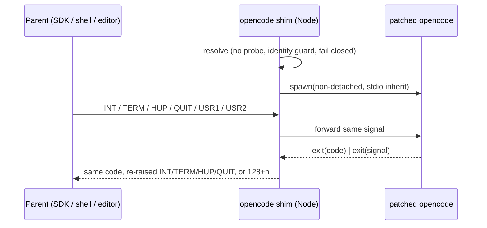

# feat: Expose an opencode command from @fro.bot/harness

## Overview

A global install of `@fro.bot/harness` gains a second command, `opencode`. It passes everything through to the patched OpenCode binary. Tools, scripts, and agents that look up `opencode` by name then find the harness build. The `opencode` shim and the `harness` passthrough share one async exec helper. The helper forwards catchable signals and propagates the child's exit status, which fixes an orphaned-server bug in today's `spawnSync` passthrough.

The Action stops trusting an arbitrary `opencode` on PATH. Once a harness shim can sit on PATH, a stale or different build would otherwise silently replace the pinned download.

## Problem Frame

`@fro.bot/harness` declares only `bin.harness` (`packages/harness/package.json`). Anything that resolves `opencode` from PATH cannot see a harness install and reports OpenCode as missing. The OpenCode SDK is the main example: it spawns `opencode serve` by bare name (`.slim/clonedeps/repos/anomalyco__opencode/packages/sdk/js/src/server.ts:35`). The native binary ships in the per-platform optional dependency, and global installs link only the top-level package's bins. The command therefore has to come from the main package.

The existing passthrough (`packages/harness/src/cli.ts` `cmdPassthrough`) uses `spawnSync`. While it blocks, a signal sent to the wrapper is not forwarded, so an SDK `proc.kill()` aimed at it can leave `opencode serve` running, and a signal death reports exit 1. Once `opencode` resolves to a Node shim, the SDK's `stop()` hits the shim, so forwarding becomes load-bearing.

Adding `bin.opencode` departs from the original package design, which declared only `bin: {harness}` (`docs/plans/2026-06-03-002-feat-fro-bot-harness-plan.md`). That plan recorded no collision rationale. The reason for the change is consumer compatibility.

Terminology: the **shim** is the `opencode` entry point, the **passthrough** is `harness <non-reserved args>`, and the **helper** is the shared exec function both use.

## Requirements Trace

- R1. A global install of `@fro.bot/harness` (npm, bun, mise `npm:`) puts an `opencode` command on PATH. It runs the patched binary with all arguments passed through and no reserved subcommands.
- R2. The shim and the passthrough forward SIGINT, SIGTERM, SIGHUP, SIGQUIT, SIGUSR1, and SIGUSR2 to the child. They wait for it to exit and propagate its exit code or terminating signal.
- R3. The shim and the passthrough resolve the binary without the per-invocation `--version` probe. `harness doctor` keeps the probe.
- R4. The shim never resolves to itself or to the `harness` entry point. That covers symlinks, hardlinks, and copies. Under `OPENCODE_PATH` or the `HARNESS_ALLOW_PATH_FALLBACK=1` PATH walk, a candidate that cannot be proven to be the native binary is rejected with a remediation message.
- R5. With no platform package and no explicit `OPENCODE_PATH`, the shim exits non-zero with a remediation message. It never runs stock OpenCode silently. The PATH walk runs only under `HARNESS_ALLOW_PATH_FALLBACK=1`, the existing dev-only opt-in.
- R6. The Action uses an existing `opencode` (`OPENCODE_PATH` or PATH) only when its reported version equals the pinned version. Otherwise it runs setup and downloads the pinned build.
- R7. Package docs state:
  - the npm global bin collision with `opencode-ai`;
  - that `opencode upgrade` is unsupported;
  - that duplicate delivery can happen for group-directed signals;
  - that SIGKILL or an uncaught shim error can leave the child running.

## Scope Boundaries

- No postinstall native-replace of the bin. mise's `npm:` backend and Bun skip dependency lifecycle scripts by default, so the JS shim is the path that actually runs.
- Windows is out of scope; harness supports linux and darwin only (`packages/harness/src/platform.ts`).
- No reserved subcommands on `opencode`, including `upgrade`. It passes through and is documented as unsupported.
- No process-group ownership. The helper signals its direct child only, the same blast radius stock `opencode` has, and descendant cleanup stays the binary's job.
- No dispatcher-resolution support, such as following mise shims to their target. Opaque dispatchers are rejected (R4).
- No change to the workspace or gateway images.

### Deferred to Separate Tasks

- A `workspace-smoke` assertion that `/app/node_modules/.bin/opencode` is absent from the images. The guard invariant in Unit 3 covers the cause.

## Context & Research

### Relevant Code and Patterns

- `packages/harness/src/cli.ts`: `cmdPassthrough`, the `spawnSync` call to replace, and `main()`'s reserved subcommand set.
- `packages/harness/src/resolve-binary.ts`: `resolveBinary` resolves in this order:
  - `OPENCODE_PATH`;
  - the platform package, with the `--version` probe;
  - the dev PATH fallback, which returns bare `opencode`.
- `packages/harness/tsdown.config.ts` has the entries `src/cli.ts` and `src/postinstall.ts`. `files` already ships `dist`.
- `packages/harness/src/postinstall.ts` claims "Using opencode on PATH as fallback" at three sites (lines 35, 52, 69). `resolveBinary` does not do that without an escape hatch.
- `packages/harness/src/integrate-command.ts` and `packages/harness/src/conflict-resolver.ts` default to bare `opencode` (`packages/harness/harness.config.json`). So does the runtime SDK path (`packages/runtime/src/agent/server.ts` `createOpencode`). None of them reach the shim today, because no workspace package depends on `@fro.bot/harness` and Bun therefore never links its bins.
- `packages/runtime/src/agent/server.ts` `ensureOpenCodeAvailable` and `src/features/agent/server.ts` `verifyOpenCodeAvailable` accept any `opencode` that answers `--version`. The version regex keeps only `x.y.z`.
- `packages/harness/src/integrate.test.ts`: executable `#!/bin/sh` fixtures. `apps/workspace-agent/src/update-fixtures/pack.test.ts`: real-process group signal tests.
- Upstream `packages/opencode/src/cli/cmd/tui.ts` uses SIGUSR2 for TUI reload. `src/installation/index.ts` and `src/cli/upgrade.ts` drive `npm i -g opencode-ai` upgrades.

### Institutional Learnings

- `docs/solutions/logic-errors/repair-before-capture-sqlite-session-cache-loop-2026-09-02.md`: signalling a child does not prove it exited. The helper awaits the child's exit before the shim exits.
- `docs/plans/2026-06-03-003-fix-workspace-opencode-supervisor-readiness-plan.md`: killing only the direct pid left descendants behind. The helper forwards to the direct child only, and descendant cleanup stays with the binary.
- `docs/solutions/integration-issues/tool-cache-directory-spawned-as-executable-2026-09-06.md`: `OPENCODE_PATH` is an executable path, never a directory.
- `evals/README.md` and `evals/runner.ts` forbid falling back to stock `opencode-ai`, which matches R5.

### External References

- esbuild `lib/npm/node-install.ts`: optional hardlink-and-rename native replace. Its JS fallback uses `execFileSync` with no signal forwarding.
- npm `bin-links` (`link-gently.js`): a global bin owned by another package fails with EEXIST unless `--force` is given. A forced overwrite is not restored on uninstall.
- mise npm backend: the default installer is `aube`, and when it uses npm it passes `--ignore-scripts=true`. Bun blocks untrusted dependency lifecycle scripts.
- Node `child_process`: `spawnSync` blocks the event loop. Node's own listener reserves SIGUSR1 for the inspector, and SIGPIPE is ignored by default.

## Prior-Art Survey

```json
{
  "schema_version": 2,
  "verdict": "build-new-within-scope",
  "scope": "monorepo first-party trees: packages/harness, packages/runtime, packages/gateway, apps/workspace-agent, src, scripts, deploy",
  "freshness": {"vcs_reference": "18890129d"},
  "budget": {"max_search_passes": 3, "max_candidate_inspections": 12, "exhausted": false},
  "candidates": [
    {
      "path_or_symbol": "src/services/setup/adapters.ts execWithTimeout",
      "description": "async installer spawn with timeout; detached process-group kill; re-raises parent signal on self",
      "disposition": "insufficient",
      "insufficiency_reason": "kills the child group instead of forwarding, detaches from the TTY foreground group, maps child signal death to exit 1, and lives in root src/ which packages/harness cannot import"
    },
    {
      "path_or_symbol": "apps/workspace-agent/src/opencode-server.ts killChildGroup",
      "description": "one-way SIGTERM to a child process group with pid guard",
      "disposition": "insufficient",
      "insufficiency_reason": "teardown only; no forwarding or exit-status propagation"
    },
    {
      "path_or_symbol": "packages/harness/src/cli.ts cmdPassthrough",
      "description": "spawnSync passthrough to the resolved binary",
      "disposition": "insufficient",
      "insufficiency_reason": "the call site being replaced: no signal forwarding, and signal death becomes exit 1"
    },
    {
      "path_or_symbol": "packages/runtime/src/agent/server.ts",
      "description": "OPENCODE_PATH selection and SDK server lifecycle for the Action",
      "disposition": "insufficient",
      "insufficiency_reason": "a consumer of opencode serve, not a reusable exec helper"
    }
  ],
  "excluded_scopes": [
    {"scope": ".slim/clonedeps", "reason": "read-only third-party clones; not importable"},
    {"scope": "deploy/*.sh entrypoints", "reason": "shell PID-1 supervision is a different boundary"}
  ]
}
```

## Key Technical Decisions

- **Separate Node entry point, JS shim only.** There is no native-replace, because mise and Bun skip lifecycle scripts by default. There is no shell-script bin, because it would duplicate module resolution. `process.execve` is not used either: it is experimental, and ENOENT aborts with SIGABRT on Node 24.21.
- **The bin is declared in source** (`packages/harness/package.json`). The publish step rewrites only `version` and `optionalDependencies`, so `bin` survives (`.github/workflows/harness-release.yaml`). The release workflow does not change.
- **Dev-shadowing guard.** Bun links a workspace package's bins only when another workspace package depends on it. No workspace package depends on `@fro.bot/harness`, so no checkout, CI job, or image gets a `.bin/opencode` link. That is why the runtime SDK path and `harness integrate`'s bare-`opencode` default are safe. A guard test pins this invariant (Unit 3).
- **Spawn mode.** The child is non-detached, uses `stdio: 'inherit'`, and is signalled directly. It stays in the terminal's foreground group, so TTY reads, Ctrl-C, and SIGWINCH behave as they do for stock opencode.
- **Forward every caught signal.** SIGINT, SIGTERM, SIGHUP, SIGQUIT, SIGUSR1, and SIGUSR2 are always forwarded. A signal delivered to the whole foreground group, such as Ctrl-C or a terminal hangup, may reach the child twice. That is accepted and documented, because JS handlers cannot tell PID-directed from group-directed delivery, and dropping PID-directed signals is worse. Listening on SIGUSR1 also stops Node opening its inspector.
- **Exit propagation lives in the entry point.** The helper only reports how the child ended: an exit code, a signal, or a spawn error. The entry point then acts on it:
  - **Exit code:** the shim exits with it. A child that handles SIGTERM and exits 0 yields 0.
  - **Child killed by SIGINT, SIGTERM, SIGHUP, or SIGQUIT:** the shim removes its listeners and re-raises the signal on itself.
  - **Any other terminating signal** (for example SIGPIPE or SIGUSR1): Node either ignores these or handles them itself, so the shim exits `128 + os.constants.signals[sig]` directly. No timer is involved.
  - **Neither code nor signal:** exits 1.
- **Spawn failure codes.** ENOENT exits 127 and EACCES exits 126, each with a message. The resolver's executable check must not turn a permission failure into a generic 127. A signal that arrives before the child exists is held and delivered on spawn. If spawn fails, the shim exits immediately.
- **No-probe resolution** for the shim and the passthrough. Resolution checks only that the platform binary path exists and is executable. The SDK's 5-second start deadline is the binding constraint. Unit 3 measures the built shim's overhead and runs a real SDK start/close.
- **Self-exec guard by identity.** A candidate is rejected when its realpath, or its `(dev, ino)`, matches either harness entry point. That catches symlinks, hardlinks, and npm/bun `.bin` layouts. When a candidate is not a recognizable native binary (mise shims resolve to the mise executable), the shim fails closed and tells the user to set `OPENCODE_PATH` to the native binary. A copied wrapper can still recurse, and that is documented. There is no env marker, because the binary may legitimately spawn `opencode`.
- **Action version pin (R6).** `ensureOpenCodeAvailable` reuses an existing binary only when its full `--version` output matches the pinned version, harness suffix included. Otherwise it runs setup. This is a behavior change: a workflow that pre-installed a different OpenCode now gets the pinned build.
- **Autoupdate is a verified ship gate.** Unit 3 confirms from the pinned upstream source, plus a fixture run, that a harness install leaves autoupdate and `upgrade` without a stock-install path. If it would replace the binary, implementation stops for a decision.
- **Environment passes through unchanged.** This is the CLI contract, distinct from the Action's `withScrubbedEnv` child policy.

## Open Questions

### Resolved During Planning

- Dev shadowing: the bin stays in source, with a clear non-zero exit when no platform package is present. The no-dependency invariant prevents linking today (user decision; guard test in Unit 3).
- `opencode upgrade`: documented as unsupported, with pure passthrough kept. Autoupdate behavior is verified as a ship gate (user decision).
- Probe: skipped in the shim and the passthrough, and kept in `harness doctor` (user decision).
- Signals: all catchable ones are forwarded, with duplicates accepted (user decision).
- Self-exec: identity checks, and fail closed on opaque dispatchers (user decision).
- Action exposure: fixed in this plan via R6 (user decision).
- Publish path: `bin` survives `harness-release.yaml`'s package rewrite, so no workflow change is needed.

### Deferred to Implementation

- Exact helper and option names, and whether no-probe resolution is an option on `resolveBinary` or a sibling export.
- How the resolver recognizes "native binary" versus "opaque dispatcher". It could check for a non-script executable header, or the absence of a shebang interpreter. Pick the narrowest check that rejects mise shims and accepts the platform binary and test fixtures.
- The exact version comparison for R6, given what the harness binary and stock OpenCode print for `--version`.

## High-Level Technical Design

> *This illustrates the intended approach and is directional guidance for review, not implementation specification. The implementing agent should treat it as context, not code to reproduce.*



## Implementation Units

- [ ] **Unit 1: Shared exec helper**

**Goal:** One async helper that runs the resolved binary, forwards signals, and reports how the child ended.

**Requirements:** R2

**Dependencies:** None

**Files:**
- Create: `packages/harness/src/exec-binary.ts`
- Test: `packages/harness/src/exec-binary.test.ts`

**Approach:**
- Non-detached `spawn`, `stdio: 'inherit'`, environment passed through.
- Install listeners for every forwarded signal before spawning. Hold a signal that arrives before the child exists.
- Return an outcome (exit code, signal, or spawn error) and leave the exit or re-raise to the entry point.

**Execution note:** Test-first. Each forwarding and propagation case should fail against a `spawnSync` implementation.

**Patterns to follow:**
- Executable `#!/bin/sh` and node fixtures as in `packages/harness/src/integrate.test.ts`.
- `apps/workspace-agent/src/update-fixtures/pack.test.ts` for real signal delivery.

**Test scenarios:**
- Happy path: the child exits 0 or 3, and the outcome reports that code.
- Happy path: stdout reaches the reader unbuffered, so a "listening on" line is readable before the child exits, and piped stdin reaches the child.
- Integration: a fixture runner hosts the helper over a fixture child. The child signals readiness only after its handlers are installed. Then a real signal goes to the runner, once for each of SIGTERM, SIGHUP, SIGINT, SIGQUIT, and SIGUSR2. The child records exactly one receipt of a PID-directed signal, and the outcome reports the child's handled exit.
- Integration: a child that handles SIGTERM and exits 0 yields outcome code 0.
- Integration: a signal sent before spawn completes is delivered to the child once it exists, and no child is orphaned.
- Error path: a nonexistent binary is reported as ENOENT, and a non-executable file as EACCES.
- Reliability: every test waits on readiness acknowledgements, with bounded waits and child `exit` events rather than `kill(pid, 0)`. Every spawned process is reaped unconditionally.

**Verification:**
- The scenarios pass on Linux CI. Reverting to `spawnSync` fails the forwarding tests.

- [ ] **Unit 2: No-probe resolution and identity guard**

**Goal:** Resolve the patched binary cheaply, never to a harness entry point, and fail closed on opaque dispatchers.

**Requirements:** R3, R4, R5

**Dependencies:** None (runs in parallel with Unit 1)

**Files:**
- Modify: `packages/harness/src/resolve-binary.ts`
- Test: `packages/harness/src/resolve-binary.test.ts` (create; existing resolver coverage in `packages/harness/src/cli.test.ts` stays)

**Approach:**
- Add a no-probe mode that checks the platform binary is executable without spawning it.
- Identity checks use realpath and `(dev, ino)` against both entry points.
- The PATH walk runs only under `HARNESS_ALLOW_PATH_FALLBACK=1`. It returns an absolute path and never bare `opencode`.
- Missing platform package, self-reference, and opaque dispatcher each produce a typed failure with remediation text.
- Keep the probing `resolveBinary` contract for `harness doctor`.

**Test scenarios:**
- Happy path: a fake platform package with an executable binary resolves without running it. The binary would hang if spawned.
- Edge case: `OPENCODE_PATH` set to a symlink, and separately a hardlink, to the shim fails with a self-reference error. The same holds for the `harness` entry.
- Edge case: under the PATH fallback, with the shim symlink first on PATH and a fake native `opencode` second, resolution returns the second as an absolute path.
- Edge case: under the PATH fallback, when the first non-self candidate is a shell-script dispatcher, resolution fails closed with the `OPENCODE_PATH` remediation.
- Edge case: when only the shim is on PATH, resolution fails with remediation and no recursion.
- Error path: with no platform package and no override, the failure names `@fro.bot/harness-<os>-<arch>`.
- Error path: a platform binary that is present but not executable is reported as a permission failure, not as not-found.

**Verification:**
- Resolution never returns bare `opencode`, never returns a harness entry point, and never returns an opaque dispatcher.

- [ ] **Unit 3: Entry points, packaging, and the autoupdate gate**

**Goal:** Ship the `opencode` bin, route both entry points through the helper, and prove the built package works.

**Requirements:** R1, R2, R3, R5

**Dependencies:** Units 1 and 2

**Files:**
- Create: `packages/harness/src/opencode.ts`
- Modify: `packages/harness/src/cli.ts`, so that `cmdPassthrough` uses the helper and no-probe resolution
- Modify: `packages/harness/tsdown.config.ts`, adding the entry
- Modify: `packages/harness/package.json`, adding `bin.opencode` → `./dist/opencode.mjs`
- Modify: `bun.lock`, regenerated for the workspace bin entry
- Modify: `packages/harness/src/postinstall.ts`, correcting all three fallback messages
- Test: `packages/harness/src/opencode.test.ts`, `packages/harness/src/package-invariants.test.ts`

**Approach:**
- `opencode.ts` has a `#!/usr/bin/env node` shebang and no reserved subcommands. It maps the helper outcome to an exit as described in Key Technical Decisions.
- `harness` keeps its reserved set (`info`, `patches`, `doctor`, `integrate`, `--help`, `--version`) and uses the same outcome mapping.
- Autoupdate gate: in the pinned upstream source (`src/installation/index.ts`, `src/cli/upgrade.ts`), confirm what install method is detected for a harness global install and what autoupdate does with it. Confirm it with a fixture run. If a stock install would run, stop and report.

**Test scenarios:**
- Happy path: the `opencode` entry with `OPENCODE_PATH` set to an argv-echo fixture passes `--version`, `info`, `doctor`, and `upgrade` through unchanged.
- Integration: the `harness` entry with a non-reserved argument propagates the fixture's exit code. `harness info` stays harness-owned.
- Integration: the `opencode` entry receiving a real SIGTERM forwards it to the fixture child (the SDK `proc.kill()` path). The child dies by SIGTERM, and the shim's own status is SIGTERM.
- Integration (Linux, PTY): a Python `pty` driver runs the `opencode` entry under a controlling terminal. A terminal-generated Ctrl-C reaches the child, at least once and at most twice. A PID-directed SIGINT with the PTY still attached also reaches the child.
- Edge case: a child that dies by SIGPIPE makes the shim exit `128 + SIGPIPE`, using the platform constant.
- Error path: with no platform package and no override, the `opencode` entry exits non-zero with remediation and no stock fallback.
- Package invariant: `bin` has exactly `harness` and `opencode`, and the tsdown entries include `src/opencode.ts`.
- Package invariant: no workspace package depends on `@fro.bot/harness`. This is the dev-shadowing guard.
- Packaging smoke (mandatory, not skippable): after build, `npm pack` the package. In isolated prefixes, install it with npm, with bun, and with mise `npm:`, with lifecycle scripts disabled. With a fixture platform binary or `OPENCODE_PATH`, `opencode --version` reaches the fixture.
- SDK smoke: `createOpencode` against a PATH whose `opencode` is the built shim, pointing at a fixture `serve`, starts within the SDK deadline. `close()` leaves no child. Record the shim's startup overhead.

**Verification:**
- The harness package's typecheck, lint, tests, and build pass.
- The packaging and SDK smoke tests pass on Linux CI.
- Darwin is verified manually with the same smoke script, with the result recorded in the PR.
- The autoupdate gate result is recorded.

- [ ] **Unit 4: Action pins the OpenCode version it reuses**

**Goal:** The Action reuses an existing `opencode` only at the pinned version.

**Requirements:** R6

**Dependencies:** None (independent of Units 1–3)

**Files:**
- Modify: `packages/runtime/src/agent/server.ts` (`ensureOpenCodeAvailable`)
- Modify: `src/features/agent/server.ts` (`verifyOpenCodeAvailable` returns the full version string)
- Modify: `dist/` (rebuilt; committed per the repo's dist invariant)
- Test: `packages/runtime/src/agent/server.test.ts`, `src/features/agent/opencode.test.ts`

**Approach:**
- `verifyOpenCodeAvailable` reports the full trimmed version line.
- `ensureOpenCodeAvailable` treats an existing binary as available only on an exact match with the pinned version. A mismatch logs both values and runs setup.

**Test scenarios:**
- Happy path: an existing `OPENCODE_PATH` binary reporting the pinned version is reused, and no setup runs.
- Edge case: a PATH `opencode` reporting a different version (a stock build or an older harness) triggers setup, logs both versions, and sets `OPENCODE_PATH` to the downloaded binary.
- Edge case: an existing binary whose version output cannot be parsed triggers setup.
- Error path: when setup fails after a mismatch, the existing failure path stays unchanged.

**Verification:**
- Root typecheck, lint, tests, and build pass, and `dist/` is rebuilt with no stray diff.

- [ ] **Unit 5: Docs**

**Goal:** Document the new command, its caveats, and the Action's version pin.

**Requirements:** R7

**Dependencies:** Units 3 and 4

**Files:**
- Create: `packages/harness/README.md` (already listed in `files` but missing)
- Modify: `packages/harness/AGENTS.md` (build output and bin list)
- Modify: `STRUCTURE.md` (one-line update to the harness row)
- Modify: `ARCHITECTURE.md` (the Action setup downloads the release tarball, not the npm package)

**Approach:**
- The README covers:
  - both commands and what each does;
  - install via npm, bun, and mise;
  - npm EEXIST with `opencode-ai`, and what `--force` does on install and uninstall;
  - bun's silent overwrite;
  - PATH order between mise tools;
  - that `opencode upgrade` is unsupported;
  - duplicate delivery for group-directed signals;
  - that SIGKILL or an uncaught shim error can orphan the server;
  - that opaque dispatchers on PATH are rejected;
  - the dev-checkout remediation (`OPENCODE_PATH`).
- Root living-doc edits follow the `generating-project-docs` skill: summary lines only, with the detail kept in the package README.

**Test expectation:** none. This is documentation, and the markdown link check runs in `bun run lint`.

**Verification:**
- The link check passes, and the README statements match the Unit 1–4 behavior.

## System-Wide Impact

- **Interaction graph:** The SDK spawns `opencode serve` by name and stops it with a direct `proc.kill()`. Under a global harness install, that signal reaches the shim and is forwarded.
- **Action:** Unit 4 changes reuse from "any `opencode` that answers" to "the pinned version only". A self-hosted runner with a global harness install or a stock opencode now downloads the pinned build.
- **Unchanged invariants:**
  - The workspace image spawns `/usr/local/bin/opencode` by absolute path with a fixed PATH.
  - The gateway image spawns no OpenCode.
  - No workspace package depends on `@fro.bot/harness`, so no image, checkout, or CI job links `.bin/opencode`.
  - Evals locate `harness` and the platform package directly.
  - The `bin` map survives `harness-release.yaml`'s package rewrite.
- **Error propagation:** Resolution failures exit non-zero with remediation. Spawn failures exit 127 or 126. Child signal deaths re-raise or map to `128+n`. A SIGKILL to the shim, or an uncaught shim exception, cannot be forwarded; this is documented.
- **API surface parity:** The `harness` passthrough gains the same forwarding and exit semantics as `opencode`.

## Risks & Dependencies

| Risk | Mitigation |
|------|------------|
| npm global install fails with EEXIST when `opencode-ai` is installed | Documented. mise installs are per tool. |
| Autoupdate or `upgrade` replaces the harness build with stock | Verified as a ship gate in Unit 3. Implementation stops if the replacement path exists. |
| Duplicate signal delivery on Ctrl-C or hangup | Accepted and documented. The PTY test bounds it to at most two deliveries. |
| A copied wrapper on PATH recurses | Identity guard plus fail-closed dispatcher rejection. Residual risk is documented. |
| Unit 4 changes Action behavior for pre-installed OpenCode | Version mismatch logs both values and downloads the pinned build. Release notes call it out. |
| Signal tests flake in CI | Readiness acknowledgements, bounded waits, exit events, and unconditional reaping. |
| Darwin is untested in CI | Manual smoke run recorded in the PR. |

## Documentation / Operational Notes

- The first release carrying this change publishes a new bin. Users with a global npm `opencode-ai` hit EEXIST until they choose one package.
- Release notes state the Action's pinned-version reuse change.

## Sources & References

- Related code: `packages/harness/src/cli.ts`, `packages/harness/src/resolve-binary.ts`, `packages/harness/src/postinstall.ts`, `packages/harness/tsdown.config.ts`, `packages/runtime/src/agent/server.ts`, `src/features/agent/server.ts`
- Prior plan: `docs/plans/2026-06-03-002-feat-fro-bot-harness-plan.md`
- External: esbuild `lib/npm/node-install.ts`; npm `bin-links` `lib/link-gently.js`; mise npm backend docs; Node `child_process` and process signal docs
