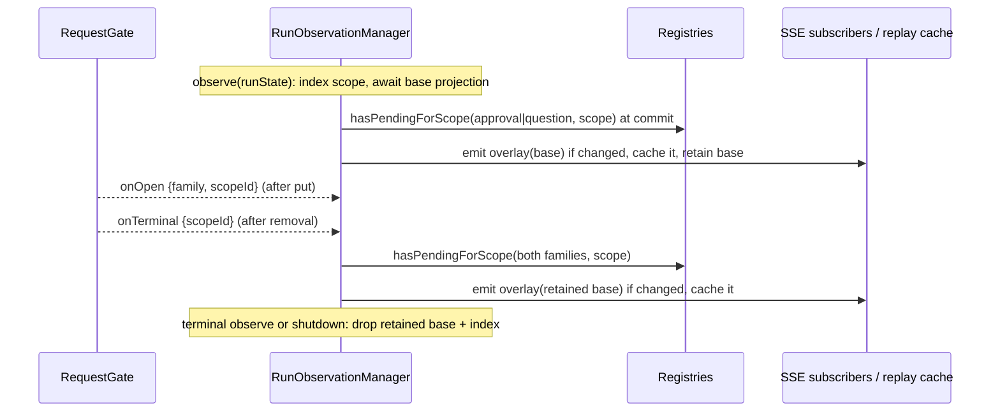

# fix: Show operator waiting state live, in run summaries, and in question pushes

## Overview

A run that is waiting on an operator question or approval should look that way everywhere the operator looks. Today it doesn't. The live SSE stream keeps saying `running` until some unrelated lifecycle event arrives. A reconnect can replay a `waiting_*` status that has already settled. The run list has no waiting state at all. A question notification opens the dashboard root and not the run that is asking.

This plan fixes all four. Waiting status is re-derived from registry truth whenever a request opens or is removed. Run summaries gain the two waiting statuses, which is operator contract 1.11.0. Question pushes carry the run ID and a deep link.

## Problem Frame

Issue #1780. The waiting overlay (`overlayWaitingStatus` in `packages/gateway/src/web/sse/projection.ts`) runs only inside a lifecycle projection. `RunObservationManager.observeQuestion` and `observeApproval` (`packages/gateway/src/web/sse/manager.ts`) emit request frames but never re-project, and never update `latestStatusCache`, so live status and replay both go stale. `toRunSummary` (`packages/gateway/src/operator-contract/run-summary.ts`) maps lifecycle phase only. The runs route (`packages/gateway/src/web/operator/runs-route.ts`) has no registry access. `buildQuestionPayload()` (`packages/gateway/src/web/operator-push/payload-builder.ts`) takes no arguments and always routes to `/`.

The gateway has exactly one operator. This work adds no per-recipient authorization or multi-operator gating. The repository redaction denylist still governs repository identity, and none of this changes it.

## Requirements Trace

- R1. Live SSE status shows `waiting_for_approval` or `waiting_for_question` as soon as a request for the run's scope is registered. It returns to the lifecycle status once the last pending request for that scope is removed from the registry.
- R2. Reconnect replay always matches the live stream. Once a request is removed from the registry, it never replays as waiting. In the short window between a settle frame and that removal, the status still reads waiting. That is expected.
- R3. Approval takes precedence over question. The overlay applies only when the base status is `running`. A terminal status never becomes waiting.
- R4. `GET /operator/runs` summaries apply the same overlay with the same precedence and scope rules (thread for Discord, run for web).
- R5. The operator contract bumps MINOR to 1.11.0. Every in-repo version pin, changelog entry and doc moves with it, and the dashboard pairing obligations are written down.
- R6. Question push data carries `runId` and `route: '/operator#' + encodeURIComponent(runId)`. The route falls back to `/` when the ID fails an allowlist. Notification copy is unchanged.

## Scope Boundaries

- Request semantics are unchanged: claim, echo, deadline, dispose and replacement behave as they do today. "Pending" keeps the registry's current definition, open or claimed.
- Approval and failed-run pushes keep `route: '/'`.
- Mid-run repository denial keeps its current silent-drop behavior. A null projection writes no frame and no cache entry.
- A claimed request whose echo never arrives stays pending until run teardown. That is pre-existing behavior, now more visible, and accepted.
- No `stale` field is added to run summaries.

### Deferred to Separate Tasks

- Dashboard pairing, owned by Marcus: release as a pair with this change, as was done for 1.9.0. See Documentation / Operational Notes.

## Context & Research

### Relevant Code and Patterns

- **Overlay:**
  - `packages/gateway/src/web/sse/projection.ts`: `projectRunObservation` awaits the redaction bridge, returns `null` for a denied or keyless repository, and then applies `overlayWaitingStatus`.
  - `overlayWaitingStatus` applies only when the status is `running`, with approval checked before question.
  - `scopeIdFor` returns `thread_id` for Discord and `run_id` otherwise.
- **Status writes:** `packages/gateway/src/web/sse/manager.ts`. `observe()` is the only writer of `latestStatusCache`. Its only guard against out-of-order async results is `terminalRuns`, which replay eviction can clear. `shutdown()` runs before the gate is disposed (`packages/gateway/src/program.ts`).
- **Request gate:** `packages/gateway/src/approvals/request-gate.ts`.
  - `put()` emits nothing.
  - `onTerminal` fires synchronously and exactly once, after the entry has been removed, on every exit path: echo, cascade, retire, deadline (after the settle frame renders), and fail-close.
  - `hasPendingForScope` counts `open | claimed`.
  - Approvals and questions use the same scope key: thread for Discord, run for web.
- **Run list:** `packages/gateway/src/web/operator/runs-route.ts` filters denied repositories before reading anything, then maps each `RunState` through `toRunSummary`. In `packages/gateway/src/web/server.ts`, the registries are optional `Pick`s without `hasPendingForScope`, and the route's mount condition does not include them.
- **Push:** `packages/gateway/src/web/operator-push/dispatcher.ts`. `dispatchQuestionPending` already receives `runId` and dedupes on `${runId}:question`.
- **Contract:** `packages/gateway/src/operator-contract/version.ts` holds the constant and the changelog. Precedents for touching every pin and doc are #1787 (1.10.0) and #1749 (1.9.0).

### Institutional Learnings

- `docs/solutions/best-practices/authenticated-sse-run-observation-2026-06-20.md` and `sse-output-streaming-terminal-drain-2026-06-21.md`:
  - Async projections resolve out of order.
  - Terminal state dominates.
  - Replay must stay consistent with live.
  - Operator DTOs are closed projections.
- `docs/solutions/best-practices/gateway-control-surface-spine-2026-06-15.md`: one settlement gate across transports. `onTerminal` fires once on every terminal path.
- `docs/solutions/best-practices/broadcast-notifications-when-operator-identity-is-absent-2026-07-10.md`: pushes are fixed-copy and repository-neutral. An opaque run ID inside the encrypted payload keeps that property, since there is one operator and no repository identity in the payload.
- Dashboard `docs/solutions/best-practices/consume-gateway-operator-contract-1-8-0-2026-10-07.md`: the dashboard's server and browser readers pin the contract version exactly and fail closed. Ship and deploy as a pair.

## Prior-Art Survey

```json
{
  "schema_version": 2,
  "verdict": "extend",
  "scope": "packages/gateway (operator web surface: sse, operator, operator-push, operator-contract, approvals)",
  "freshness": {
    "vcs_reference": "b2323b280"
  },
  "budget": {
    "max_search_passes": 12,
    "max_candidate_inspections": 10,
    "exhausted": false
  },
  "candidates": [
    {
      "path_or_symbol": "packages/gateway/src/web/sse/projection.ts overlayWaitingStatus",
      "description": "The only waiting overlay: approval then question precedence over registry hasPendingForScope, gated on status running",
      "disposition": "extend"
    },
    {
      "path_or_symbol": "packages/gateway/src/web/sse/projection.ts scopeIdFor",
      "description": "Maps a run to its request scope: thread id for discord, run id otherwise",
      "disposition": "reuse"
    },
    {
      "path_or_symbol": "packages/gateway/src/operator-contract/run-status.ts PHASE_TO_WEB_STATUS",
      "description": "Phase to base web status map, already used by toRunSummary",
      "disposition": "reuse"
    },
    {
      "path_or_symbol": "packages/gateway/src/approvals/request-gate.ts hasPendingForScope",
      "description": "Registry truth for open or claimed entries of a family and scope",
      "disposition": "reuse"
    },
    {
      "path_or_symbol": "packages/gateway/src/approvals/request-gate.ts onTerminal",
      "description": "Post-removal terminal notification fired once on every exit path",
      "disposition": "reuse"
    }
  ]
}
```

## Key Technical Decisions

- **Refresh re-overlays a retained base status, synchronously.** For each live run the manager keeps the last base status (redaction applied, overlay not applied) and the run's scope. A refresh reapplies the overlay against the live registries and commits immediately. It does not re-project from a retained `RunState`, for three reasons:
  - re-projecting recomputes `stale` from wall-clock time against an old heartbeat, so a run that waits a long time would wrongly flip to `stale`;
  - a synchronous refresh can never land after a lifecycle observation, so it needs no generation counters;
  - it adds no redaction-bridge calls.
- **`observe()` applies the overlay at commit time, not before its await.** It reads the registries after projection resolves. A request opened or removed during the redaction await is then reflected and can't stick. `projectRunObservation` splits into an async base projection plus the exported synchronous overlay. Behavior for existing callers is unchanged.
- **Retained state is the resurrection guard.** It is deleted on the terminal branch, on a null projection, and at shutdown. A refresh commits only when retained state exists. `terminalRuns` is not the guard here, because replay eviction clears it.
- **A refresh re-checks the denylist synchronously.** `isRepoDenied` is backed by a TTL cache, so a repository can become denied while its run is live, with no lifecycle observation in between. The retained record keeps the run's repository key. Each refresh calls `isRepoDenied` before reapplying the overlay. On denial it drops the retained state and the index entry and emits nothing. This adds no redaction-bridge call.
- **The scope index is `Map<scope, Set<runId>>` plus `runId → scope`.** `observe()` updates it synchronously before its first await. Empty scopes are skipped: pre-ACK Discord runs all have `thread_id: ''`. The index re-keys when a run adopts its thread.
- **`RequestGate` gains an open notification.** It fires on every `put`, replacements included, with `{family, scopeId}`. Each listener runs inside a try/catch so a throwing listener can't abort registration. It covers both families and both surfaces in one seam, which also covers Discord approvals, which never reach `observeApproval` today.
- **The refresh trigger is open plus `onTerminal`, never a settle frame.** The deadline path renders its settle frame while the entry is still registered.
- **Both families are recomputed on every trigger,** so an approval settling while a question is open lands on `waiting_for_question`.
- **Identical status is deduplicated.** A refresh that yields a status structurally equal to the cached one sends no frame.
- **The run list reuses the same overlay with required registries.** The route applies it after `toRunSummary`, which stays pure. The registry `Pick`s widen to include `hasPendingForScope` and join the route's mount condition. A production-shaped smoke test asserts that the route mounts.
- **The push deep link uses the dashboard's existing run URL,** `/operator#<runId>`. The run ID goes in `data.runId`, and the route is built from a constant prefix plus the encoded ID, gated on an allowlist (UUID or `[A-Za-z0-9_-]{1,128}`). Anything else falls back to `/` and never collapses the dedupe key. With one operator there is no recipient gate.

## Open Questions

### Resolved During Planning

- **Does the deep link need push authorization?** No. There is one operator, the run ID is opaque, the route is same-origin, and the dashboard's run view keeps its own redaction gate.
- **Run-summary shape?** The two waiting values go in `status`, the same vocabulary SSE uses.
- **Who owns the dashboard side?** Marcus, in a paired release.

### Deferred to Implementation

- The exact type for the retained per-run record and where the scope index lives inside the manager.
- Whether `projectRunObservation` stays exported as a composition or its callers move to the split functions. Keep whichever has the smaller diff.
- Whether a replacement `put` can change an entry's scope. If it can, the replaced scope also needs a refresh. Confirm from the registry call sites and pin the answer with a test.
- Whether `observe()` fires on the PENDING→ACK transition that persists `thread_id` (around `run.ts` `runObserver.observe`). The scope index only re-keys on `observe()`. If that transition isn't observed, add the call.
- Whether a pre-ACK Discord request can register under an empty scope. This is expected to be harmless, because pre-ACK runs project as `queued` and the overlay never applies. Confirm and pin with a test.
- Whether waiting runs keep heartbeating. The refresh keeps the last base `stale` value. If a waiting run stops heartbeating, the next lifecycle observation corrects it. The question deadline bounds the window.

## High-Level Technical Design

> _This illustrates the intended approach and is directional guidance for review, not implementation specification. The implementing agent should treat it as context, not code to reproduce._



## Implementation Units

- [ ] **Unit 1: RequestGate open notification**

**Goal:** Every registration, replacements included, notifies listeners with the family and scope, so status can refresh at the moment a request opens.

**Requirements:** R1

**Dependencies:** None

**Files:**

- Modify: `packages/gateway/src/approvals/request-gate.ts`
- Test: `packages/gateway/src/approvals/request-gate.test.ts`

**Approach:**

- Add an `onOpen` subscription next to `onTerminal`. It fires after `put` inserts the entry, and each listener sits in a try/catch, matching `terminate()`. It returns an unsubscribe function.
- A replacement `put` fires `onOpen` for the new entry's scope.
- The question registry's duplicate path never calls `put` and stays silent.

**Patterns to follow:** `onTerminal` registration and listener isolation in the same file.

**Test scenarios:**

- Happy path: `put` emits exactly one open notification with `{family, scopeId}`.
- Happy path: a replacement `put` emits an open notification and no terminal event.
- Edge case: a duplicate question register emits nothing.
- Error path: a throwing open listener doesn't break `put`. The entry is registered and the error is logged.
- Happy path: after unsubscribe, the listener receives nothing.
- Regression: terminal fires exactly once per entry on echo, cascade, retire, deadline and fail-close, and still fires after removal.

**Verification:** Every `put` path notifies, no listener can break registration, and terminal ordering is unchanged.

- [ ] **Unit 2: Split projection into base and overlay**

**Goal:** A synchronous, exported overlay that the manager and the run list can reapply without another redaction call.

**Requirements:** R1, R3, R4

**Dependencies:** None

**Files:**

- Modify: `packages/gateway/src/web/sse/projection.ts`
- Test: `packages/gateway/src/web/sse/projection.test.ts`

**Approach:**

- Extract the async base projection: redaction bridge, null for a denied or keyless repository, no overlay.
- Export `overlayWaitingStatus(base, scopeId, predicates)` and `scopeIdFor`.
- `projectRunObservation` keeps its behavior for existing callers.
- The overlay predicates must be supplied. Don't make the question predicate optional.

**Patterns to follow:** the existing `overlayWaitingStatus` precedence and `running`-only gate.

**Test scenarios:**

- Happy path: a `running` base with a pending approval gives `waiting_for_approval`. With a pending question only, it gives `waiting_for_question`. With both, it gives `waiting_for_approval`.
- Edge case: a base of `queued`, `succeeded`, `failed` or `cancelled` with a pending entry is unchanged.
- Edge case: Discord scope uses `thread_id`, and web uses `run_id`.
- Regression: existing `projectRunObservation` overlay tests pass unchanged.

**Verification:** One overlay implementation, reachable synchronously, and the existing projection behavior is unchanged.

- [ ] **Unit 3: Manager waiting refresh**

**Goal:** Live status and replay change when a request opens and after it is removed, with no stale or resurrected waiting state.

**Requirements:** R1, R2, R3

**Dependencies:** Unit 1, Unit 2

**Files:**

- Modify: `packages/gateway/src/web/sse/manager.ts`
- Modify: `packages/gateway/src/program.ts` (wire `onOpen` and `onTerminal` for both families into the manager; unsubscribe at shutdown)
- Test: `packages/gateway/src/web/sse/manager.test.ts`
- Test: `packages/gateway/src/program.test.ts` (wiring)

**Approach:**

- `RunObservationManagerDeps` changes:
  - `projectRunObservation` is replaced by a base-only projector.
  - It gains `hasPendingForScope(family, scopeId)`, `isRepoDenied`, and the gate `onOpen` and `onTerminal` subscriptions.
  - `program.ts` wires these from the existing registries and the redaction cache.
- `observe()` updates the scope index synchronously before it awaits. It awaits the base projection. On non-null, non-terminal results it reads both registries at commit, applies the overlay, retains the base together with the repository key, emits only if the status changed, and updates `latestStatusCache`. The terminal branch deletes the retained base and the index entries. It re-checks `isShutdown` after the await.
- `refreshScope(scopeId)` runs for each run ID in the index that has retained state. It calls `isRepoDenied` on the retained repository key first. On denial it drops the state and emits nothing. Otherwise it reapplies the overlay to the retained base, then emits and caches only on change. It is a no-op after shutdown.
- A null projection drops any retained state and index entry for the run, so later refreshes skip it. No frame is emitted and the cache is not written, which matches today's silent drop.
- Re-key the index when `thread_id` moves from `''` to a real thread.

**Execution note:** Write the race and ordering tests first. They are the reason this unit exists.

**Patterns to follow:** existing `observe()` frame emission and cache update, and the terminal handling.

**Test scenarios:**

- Happy path: `observe(running)`, then question opens, gives `waiting_for_question` live, and replay matches.
- Happy path: approval opens over a question, giving `waiting_for_approval`. The approval settles, giving `waiting_for_question`. The question settles, giving `running`.
- Edge case: two questions open and Q1 settles. No frame is sent. Q2 settling sends `running`.
- Edge case: a claimed request gives no status change. A claim whose reply fails and returns to open stays waiting with no extra frame.
- Edge case: a request opens before the first `observe`, so no frame is sent. The first `observe` commits waiting.
- Race: a request is put and removed during the first `observe`'s projection await. The final status is `running`.
- Race: a lifecycle `observe(newer)` commits while a request is open. The new phase wins, overlaid against the live registry.
- Edge case: the terminal `observe` commits first, then a question opens. No frame is sent and no cache write happens, even after replay-cap eviction clears `terminalRuns`.
- Edge case: a run idle past the stale threshold has a request settle. `stale` is unchanged from the previous frame.
- Edge case: a denied repository's projection is null. Nothing is retained and later gate events emit nothing.
- Edge case: mid-run denial. `observe(running)`, then the repository becomes denied, then a question opens. No frame is emitted, the cache is not written, and the retained state is dropped. Repeat with the denial observed through a null `observe()` instead of the refresh check.
- Edge case: thread adoption. A pre-ACK `thread_id ''` run gets thread T, a question opens under T and refreshes that run. Two pre-ACK runs don't collide.
- Ordering: on echo, deadline and retire, the settle frame precedes the status flip to `running`.
- Edge case: a subscriber connecting between the settle frame and `onTerminal` gets the snapshot `waiting_*`, then `running`. Replay equals live.
- Edge case: a teardown disposing three entries in one scope ends at `running` with no duplicate frames.
- Lifecycle: gate events after `shutdown()` cause no writes and no timers, and the listeners are unsubscribed. An `observe` in flight across shutdown doesn't repopulate caches.
- Integration (`program.test.ts`): wiring a real `RequestGate` and the manager, a registered question flips the live status.

**Verification:** Live and replay always agree with registry truth, terminal runs stay terminal, and no race test leaves a stuck waiting state.

- [ ] **Unit 4: Run-summary waiting status and contract 1.11.0**

**Goal:** The run list shows waiting runs, and the contract version and every pin move together.

**Requirements:** R4, R5

**Dependencies:** Unit 2

**Files:**

- Modify: `packages/gateway/src/operator-contract/run-summary.ts` (`RunSummaryStatus` gains both values; fix the comments that say summaries never carry overlays)
- Modify: `packages/gateway/src/web/operator/runs-route.ts` (required registry deps; overlay after `toRunSummary`)
- Modify: `packages/gateway/src/web/server.ts` (widen the registry `Pick`s; add them to the runs-route mount condition)
- Modify: `packages/gateway/src/operator-contract/version.ts` (1.11.0, plus a changelog entry)
- Test: `packages/gateway/src/operator-contract/run-summary.test.ts`, `packages/gateway/src/web/operator/runs-route.test.ts`, `packages/gateway/src/operator-contract/version.test.ts`, `packages/gateway/src/operator-contract/question-frame.test.ts`, `packages/gateway/src/config.test.ts`, the operator route smoke test (`operator-route-smoke`)

**Approach:**

- Overlay inside the route loop, after `listRunsForRepo` resolves, using `scopeIdFor` on the full `RunState`.
- Denied repositories are still filtered before any read.
- The changelog entry names the two new summary statuses and the question push deep link.

**Patterns to follow:** #1787's set of files for a MINOR bump.

**Test scenarios:**

- Happy path: a `running` run with a pending approval lists as `waiting_for_approval`. With a question only, it lists as `waiting_for_question`. With both, it lists as approval.
- Edge case: terminal and queued runs with an undisposed entry keep their lifecycle status.
- Edge case: Discord runs scope by thread and web runs by run ID.
- Regression: a denied repository is omitted before the read.
- Integration (smoke): `/operator/runs` mounts and returns 200 with production-shaped deps.
- Contract: the version is 1.11.0, and `RunSummaryStatus` has 7 members, checked by a type-level exhaustiveness test.

**Verification:** Waiting runs appear in summaries, the route can't silently unmount, and every pin reads 1.11.0.

- [ ] **Unit 5: Question push deep link**

**Goal:** A question notification opens the run that is asking.

**Requirements:** R6

**Dependencies:** None

**Files:**

- Modify: `packages/gateway/src/web/operator-push/payload-builder.ts` (`buildQuestionPayload(runId)`, `PushPayloadData` gains an optional `runId`, header invariant comment)
- Modify: `packages/gateway/src/web/operator-push/dispatcher.ts` (pass `runId`)
- Test: `packages/gateway/src/web/operator-push/payload-builder.test.ts`, `packages/gateway/src/web/operator-push/dispatcher.test.ts`

**Approach:**

- The route is `/operator#` plus `encodeURIComponent(runId)` when the ID passes the allowlist. Otherwise it is `/` with no `runId`.
- Title and body are unchanged.
- Replace the existing "ignores any argument" test.

**Patterns to follow:** the existing fixed-copy builders and the `FORBIDDEN_SUBSTRINGS` guard.

**Test scenarios:**

- Happy path: a UUID run ID produces `route: '/operator#<uuid>'` and `data.runId`, with copy unchanged.
- Error path: `''`, `a#b`, `//evil`, `javascript:x`, `a b`, `%2F` and an overlong string each fall back to `/` with no `runId`.
- Edge case: every produced route starts with `/` and not `//`.
- Integration: two questions in one run produce one send, and two runs produce two sends with different routes. An empty run ID doesn't suppress other runs' sends.
- Regression: approval and run-failed payloads keep `route: '/'`. The `FORBIDDEN_SUBSTRINGS` check still passes.

**Verification:** Question pushes deep-link to the run, and every non-conforming ID degrades to the old behavior.

- [ ] **Unit 6: Docs**

**Goal:** Docs describe the shipped behavior and the 1.11.0 pairing.

**Requirements:** R5

**Dependencies:** Units 3–5

**Files:**

- Modify: `docs/wiki/Operator Web Control Surface.md` (version, overlay description, run summary no longer "leaner" on status, question push route)
- Modify: `docs/wiki/Architecture Overview.md`, `ARCHITECTURE.md` (version mention only; keep summary-level, within the living-doc budget)
- Modify: `deploy/README.md` (dashboard pin moves to 1.11.0 in the same deploy window)
- Modify: `packages/gateway/AGENTS.md` (version mention)

**Approach:** Update the existing statements in place and append no history.

**Test expectation:** none, because this is documentation. `bun run lint` checks the links.

**Verification:** No doc claims 1.10.0, and none says summaries lack waiting status.

## System-Wide Impact

- **Interaction graph:** `RequestGate` gains `onOpen` listeners. The manager subscribes to both gate families, and `program.ts` owns subscription and unsubscription.
- **State lifecycle:** the manager's new per-run retained state is created on non-null non-terminal observations. It is removed at terminal, on a null projection, on a refresh-time denial, and at shutdown. The scope index is maintained alongside it.
- **API surface parity:** SSE status and run summaries share one overlay. Contract 1.11.0 is additive.
- **Unchanged invariants:**
  - request settlement semantics;
  - the redaction denylist boundary (filtered before reads, null projection drops);
  - fixed push copy;
  - approval and failed-run push routes;
  - the order in which terminal drain and replay deliver frames.

## Risks & Dependencies

| Risk | Mitigation |
| --- | --- |
| Dashboard silently drops run summaries with unknown statuses | Release the dashboard and gateway as a pair. See Operational Notes. |
| Dashboard SSE reader fails closed when the contract version doesn't match exactly (it is still pinned to 1.9.0) | Move the dashboard pin to 1.11.0 in the same deploy window. That also covers the outstanding 1.10.0 move. |
| Question deep link does nothing until the dashboard service worker honours the route | Paired dashboard change. Until then the gateway side degrades to today's behavior. |
| The runs route unmounts if a registry dep is absent | Required deps plus a mount smoke test. |
| A refresh resurrects waiting state for a finished run | The retained-state guard (Unit 3) and its terminal-first test. |

## Documentation / Operational Notes

The dashboard pairing is owned by Marcus and ships in the same deploy window as this gateway release. It needs:

- **Contract pin:** the vendored `src/gateway/operator-contract` moves to 1.11.0, covering both the server reader and the browser reader. The dashboard pin is currently 1.9.0.
- **Status values:** `RunSummaryStatus` and `VALID_RUN_SUMMARY_STATUSES` accept `waiting_for_approval` and `waiting_for_question`, and the run list renders labels for them. The fixture-harness assertion that index statuses exclude stream-only values is updated.
- **Service worker:** `web/src/push/sw-notification.ts` and `web/src/sw.ts` open exactly `/operator#<runId>` when `data.route` matches that shape, and fall back to `/` otherwise. The open-redirect guard test becomes an exact-shape allowlist test.

## Sources & References

- Issue: #1780, including the triage comment
- Contract precedents: #1787 (1.10.0), #1749 (1.9.0)
- Related code: `packages/gateway/src/web/sse/`, `packages/gateway/src/approvals/request-gate.ts`, `packages/gateway/src/web/operator/runs-route.ts`, `packages/gateway/src/web/operator-push/`
