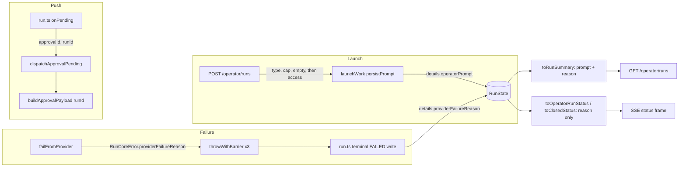

# feat: Operator contract 1.12.0 — approval run ID, launch prompt, provider failure reason

## Overview

Contract 1.12.0 is a MINOR bump. It adds three optional fields to the operator surface:

- Approval pushes carry the run ID and deep-link to the waiting run (#1840). Web-scope approvals can then be decided from the card. Discord-scope approvals open the card but are still decided in Discord.
- Run summaries carry the launch prompt for runs started from the operator surface (#1845).
- Failed runs carry a closed-set provider failure reason on both the run summary and the SSE status frame (follow-up to #1836).

The dashboard pins the contract version exactly, so it ships as a paired release.

## Problem Frame

- **Approval pushes can't open the run.** The payload is `{type:'approval', route:'/'}`. A question push already deep-links to its run, and approvals need it more, since they block a run until someone answers.
- **Run cards can't be told apart.** The prompt that started a run is not stored anywhere the operator surface can read. Keeping it in the tab's memory would not survive a reload or reach cards fetched from `GET /operator/runs` (fro-bot/dashboard#628).
- **Provider failures look alike.** Since #1854 a provider rejection fails the run promptly as `failureKind: 'session-error'`. The reason (`provider auth unavailable`, `model not available` and so on) survives only in the error message string, so every provider failure looks the same to the operator.

## Requirements Trace

**Approval push**

- R1. When the run ID matches `RUN_ID_PATTERN`, an approval push carries `runId` and `route: '/operator#<runId>'`. Otherwise it falls back to `route: '/'` with no `runId`. Title and body stay fixed copy. **Launch prompt**

- R2. A run launched through `POST /operator/runs` carries its prompt on `RunSummary.prompt`, and the prompt survives a gateway restart. Runs from any other surface have no `prompt`.
- R3. Launch rejects a prompt longer than 8,000 UTF-16 code units with a 400 and a typed reason. The stored value and the contract field share that bound, and nothing is truncated. **Provider failure reason**

- R4. A provider failure records a closed-enum reason on the run record. The reason projects onto both `RunSummary` and `OperatorRunStatus` (SSE status frame), and it survives a restart. **Shared**

- R5. The prompt never appears in logs, audit events, push payloads or the SSE status frame. The reason never appears in audit events or push payloads.
- R6. The contract version is 1.12.0 everywhere it is pinned, and the dashboard pairing is handed off.

## Scope Boundaries

- **No retention or scrub work.** The prompt already sits in the stored OpenCode session in S3. It gets the same retention as the run record.
- **No separate prompt fetch route.** The prompt is inline on `RunSummary`.
- **No prompt on `OperatorRunStatus`.** The status frame stays status-only, which keeps the run-stream revocation reasoning intact.
- **No change to `failureKind`.** The reason is a sibling field.
- **No Discord approval actionability.** Discord-scope approvals register under the thread ID, so the web cannot decide them, and that stays as it is. The deep link still points at the run, the same as question pushes do today.

### Deferred to Separate Tasks

- **Dashboard changes.** Accept `runId` and the route on approval pushes, `prompt` on run summaries, `providerFailureReason` on both DTOs, and the 1.12.0 pin. Also fix the stale `expiresAt` doc in the vendored `responses.ts`, which still says "sooner of absolute or idle" when it is now a fixed `issuedAt + 7d`. Marcus does this in fro-bot/dashboard, handed off through the fro-bot/.github#3512 tracker post.
- **Idempotency fingerprinting.** A repeated key with a different prompt keeps the first run, and that behavior is documented, not hardened.

## Context & Research

### Relevant Code and Patterns

- **Run record.** `RunState.details` (`packages/runtime/src/coordination/types.ts`) is an open record. `transitionRun` merges `detailsPatch` into it (`packages/runtime/src/coordination/run-state.ts`), so keys written at create time survive transitions, heartbeats and restart. Old binaries keep unknown keys.
- **Run creation.** `launchWork` (`packages/gateway/src/execute/run.ts`) builds `initialRunState` with details `{channelId, owner, repo}`. It has three callers: the web launch route, `runMention` (Discord), and test helpers.
- **Failure writes.**
  - `extractRunCoreKind` in `run.ts` persists `details.failureKind` at three terminal sites: quarantine (`quarantineDetailsPatch`, reused by the 412 retry), the cancel-to-FAILED fallback, and in-flight.
  - The following write FAILED with no provider reason: preparation failure, startup recovery (`recovery.ts`) and maintenance runs. `failAdmittedRun` takes an optional `failureKind` for workspace-startup gates and never takes the reason.
- **Provider failure.**
  - `failFromProvider` (`packages/gateway/src/execute/run-core.ts`) throws `RunCoreError('session-error', 'Provider failure: <reason>')` through `throwWithBarrier`, which has three throw sites, one of them quarantined.
  - `RunCoreError` carries only `kind` and `quarantined`.
  - `ProviderFailureReason` (`packages/gateway/src/execute/provider-failure.ts`) is a four-value union.
- **Projection.**
  - `toRunSummary` (`packages/gateway/src/operator-contract/run-summary.ts`) copies fields explicitly.
  - `toOperatorRunStatus` (`run-status.ts`) checks the denylist first.
  - `toClosedStatus` (`packages/gateway/src/redaction/surface-gate.ts`) destructures every field and ends with `satisfies Record<string, never>`, so a field left out is a compile error.
  - The live and durable SSE paths both project through `projectRunStatusWithKey`.
  - The list route gates with `filterDeniedRecords` before `listRunsForRepo` (`packages/gateway/src/web/operator/runs-route.ts`).
- **Closed enums on the wire.** Follow the precedent of the `checkoutProvenance` / `checkoutPreparation` parsers (`operator-contract/provenance.ts`) and the `failureKind` allowlist mapped with `satisfies Record<RunCoreErrorKind, …>` (`run-status.ts`).
- **Launch route** (`packages/gateway/src/web/operator/launch-route.ts`):
  - Order of checks: type checks, then `resolveRepoAccess` (404 when denied), then the empty-prompt check (400), then the idempotency lookup.
  - There is no length cap today.
  - The cap precedent is `QUESTION_ANSWER_MAX_LENGTH` with reason `text-too-long` (`packages/gateway/src/approvals/question-registry.ts`).
  - The body limit is 64 KiB (`web/server.ts`).
- **Approval push.**
  - `dispatchApprovalPending(approvalId)` (`packages/gateway/src/web/operator-push/dispatcher.ts`) dedupes on `approvalId`.
  - `buildApprovalPayload()` (`payload-builder.ts`) takes no arguments. The question push is the model: `buildQuestionPayload(runId)` with `RUN_ID_PATTERN`.
  - The caller in `run.ts` has `runId` in scope next to the question push.
- **Test seam.** `packages/gateway/src/execute/test-helpers.ts` replaces `RunCoreError` with a stand-in class. Any new field on the real class must be added to the stand-in, otherwise the `run.*` tests pass without testing anything.
- **Version pins (1.11.0).**
  - Code and tests: `operator-contract/version.ts` (changelog comment), `version.test.ts`, `question-frame.test.ts`, `config.test.ts`.
  - Docs: `packages/gateway/AGENTS.md`, `ARCHITECTURE.md`, `docs/wiki/Architecture Overview.md`, `docs/wiki/Operator Web Control Surface.md`, `deploy/README.md`.
  - Precedent: `docs/plans/2026-10-12-001-fix-operator-waiting-status-plan.md`.

### Institutional Learnings

- `docs/solutions/best-practices/authenticated-sse-run-observation-2026-06-20.md`: status is projected through an explicit safe-field DTO. New projected fields are allowed. Never spread run state.
- `docs/solutions/best-practices/web-operator-launch-surface-2026-06-20.md`: optional engine inputs leave the old path untouched when absent. Projections are closed. The denylist is checked before access.
- `docs/solutions/best-practices/broadcast-notifications-when-operator-identity-is-absent-2026-07-10.md`: fixed neutral push copy. An opaque, allowlisted run ID and a same-origin `/operator#<runId>` link are allowed. The doc currently covers question pushes only.
- `docs/solutions/best-practices/sse-output-streaming-terminal-drain-2026-06-21.md`: on a replay-cache miss, the persisted `RunState` is the authority. It goes through the same gated projection.

## Prior-Art Survey

```json
{
  "schema_version": 2,
  "verdict": "extend",
  "scope": "packages/gateway/src (operator-contract, web, execute, redaction, approvals) and packages/runtime/src/coordination",
  "freshness": {
    "vcs_reference": "2ad86a197"
  },
  "budget": {
    "max_search_passes": 8,
    "max_candidate_inspections": 32,
    "exhausted": false
  },
  "candidates": [
    {
      "path_or_symbol": "packages/runtime/src/coordination/types.ts:RunState.details",
      "description": "Open Record<string, unknown> on the durable run record; transitionRun merges detailsPatch, so create-time and transition-time keys survive restart.",
      "disposition": "reuse"
    },
    {
      "path_or_symbol": "packages/gateway/src/execute/run.ts:launchWork initialRunState",
      "description": "Admission-time run record; details holds channelId, owner and repo only; promptText is not stored.",
      "disposition": "extend"
    },
    {
      "path_or_symbol": "packages/gateway/src/execute/launch-types.ts:LaunchWorkRequest.promptText",
      "description": "Transport-neutral prompt input shared by the Discord runMention path and the web launch route.",
      "disposition": "insufficient",
      "insufficiency_reason": "Shared by Discord and web; storing it unconditionally would persist Discord text, so an explicit web-only opt-in is required."
    },
    {
      "path_or_symbol": "packages/gateway/src/web/operator/launch-route.ts:POST /operator/runs prompt gate",
      "description": "Validates a non-blank string prompt; no length cap; error envelope {error}.",
      "disposition": "extend"
    },
    {
      "path_or_symbol": "packages/gateway/src/approvals/question-registry.ts:QUESTION_ANSWER_MAX_LENGTH",
      "description": "Cap on operator-authored free text enforced as a bounded text-too-long reason.",
      "disposition": "reuse"
    },
    {
      "path_or_symbol": "packages/gateway/src/operator-contract/run-summary.ts:toRunSummary",
      "description": "Explicit field copy into RunSummary; failureKind gated on FAILED; entity_ref matched to the binding.",
      "disposition": "extend"
    },
    {
      "path_or_symbol": "packages/gateway/src/operator-contract/run-status.ts:OperatorFailureKind",
      "description": "Closed failureKind allowlist mapped from RunCoreErrorKind; session-error covers every provider failure.",
      "disposition": "insufficient",
      "insufficiency_reason": "session-error and prompt-error collapse to one value, so the four provider reasons cannot be expressed; a sibling field is needed."
    },
    {
      "path_or_symbol": "packages/gateway/src/redaction/surface-gate.ts:toClosedStatus",
      "description": "Closed-DTO copy for OperatorRunStatus with an exhaustive destructure and satisfies Record<string, never>.",
      "disposition": "extend"
    },
    {
      "path_or_symbol": "packages/gateway/src/execute/provider-failure.ts:ProviderFailureReason",
      "description": "Closed four-value union of fixed operator-safe provider failure texts.",
      "disposition": "reuse"
    },
    {
      "path_or_symbol": "packages/gateway/src/execute/run-core.ts:failFromProvider and RunCoreError",
      "description": "Throws RunCoreError(session-error, 'Provider failure: <reason>'); RunCoreError carries only kind and quarantined.",
      "disposition": "extend"
    },
    {
      "path_or_symbol": "packages/gateway/src/execute/run.ts:extractRunCoreKind and terminal detailsPatch writes",
      "description": "Persists only the RunCoreError kind as details.failureKind at the quarantine, cancel-fallback and in-flight FAILED writes.",
      "disposition": "extend"
    },
    {
      "path_or_symbol": "packages/gateway/src/operator-contract/provenance.ts:closed reason enums",
      "description": "Closed-set reason unions with fixed-value parsers that drop malformed values.",
      "disposition": "reuse"
    },
    {
      "path_or_symbol": "packages/gateway/src/web/operator-push/payload-builder.ts:buildQuestionPayload",
      "description": "Question push with runId and /operator#<runId> route when RUN_ID_PATTERN matches, else '/'.",
      "disposition": "reuse"
    },
    {
      "path_or_symbol": "packages/gateway/src/web/operator-push/payload-builder.ts:buildApprovalPayload",
      "description": "Fixed-copy approval payload with route '/' and no runId.",
      "disposition": "extend"
    },
    {
      "path_or_symbol": "packages/gateway/src/web/operator-push/dispatcher.ts:dispatchApprovalPending",
      "description": "Takes only approvalId; dedupes on it and forwards to buildApprovalPayload().",
      "disposition": "extend"
    },
    {
      "path_or_symbol": "packages/gateway/src/approvals/question-registry.ts:question text store",
      "description": "Holds agent question text in process memory only.",
      "disposition": "insufficient",
      "insufficiency_reason": "In-memory, so it cannot satisfy the restart requirement for launch text."
    }
  ],
  "excluded_scopes": [
    {
      "scope": "fro-bot/dashboard",
      "reason": "Separate repository; the paired client change is Marcus-owned and handed off through the tracker."
    },
    {
      "scope": "apps/workspace-agent",
      "reason": "No operator-contract surface; separate process boundary from the gateway run record."
    }
  ]
}
```

## Key Technical Decisions

- **The prompt lives on the run record under `details.operatorPrompt`.**
  - It needs no new storage, IAM or retention work, and it survives restart through the existing merge semantics.
  - A boolean opt-in on `LaunchWorkRequest` makes `launchWork` store `request.promptText`, the operator's text as submitted, before `buildWebPrompt` and checkout provenance are applied. Only the web launch route sets it. A second string field could drift from the real prompt, and keying on `surface` would catch future non-operator web callers.
- **The prompt bound is 8,000 UTF-16 code units, checked in two places.**
  - It is a named contract constant documented in code units, so the dashboard counts with `.length`.
  - The route returns 400 `{error: 'bad request', reason: 'prompt-too-long'}`, with the reason typed on the contract like `text-too-long`.
  - `launchWork` also rejects over-bound input with a new admission reason, but only when the prompt opt-in is set, because it is the persistence boundary. Discord launches are unaffected.
  - The route maps that admission reason to the same 400 `prompt-too-long`, not the generic `bad request`.
  - The bound can only be raised. Lowering it would silently drop older stored prompts on read.
- **Prompt checks run before repo access.**
  - The type, cap and empty checks run before `resolveRepoAccess`, so an oversize or empty prompt gets the same 400 for a bound, unbound or denylisted repo.
  - This moves the empty-prompt check ahead of access. Today an unbound repo with an empty prompt returns 404, and after this change it returns 400. This is a client-visible contract change: it goes in the `version.ts` changelog and the dashboard handoff. It also removes an existing oracle, since today an empty prompt returns 400 only for a bound repo.
- **The prompt is projected only when it is trustworthy.**
  - It goes onto `RunSummary.prompt` only when the stored value is a non-empty string within the bound and `surface === 'web'`.
  - Anything else is dropped. It is never sliced, and a bad value never fails the row or the list.
  - The prompt has no field on `OperatorRunStatus`.
- **The provider reason is a sibling field: `providerFailureReason`.**
  - Wire values are kebab-case and decoupled from `execute/`:
    - `provider-auth-unavailable`
    - `model-not-available`
    - `provider-rejected-request`
    - `unclassified` (mapped from the internal catch-all `session error`)
  - The mapping uses `satisfies Record<ProviderFailureReason, …>`, so a new internal value fails compilation until it is mapped.
- **The record stores the wire value.** `run.ts` maps the internal reason through the `satisfies` table and writes the wire value to `details.providerFailureReason`. The read gate accepts only wire values, so the internal spelling never reaches the record.
- **The reason is written only in the terminal FAILED transition.**
  - Written at the three sites that already write `failureKind`, and only when the typed reason is present and `kind === 'session-error'`.
  - Never written by `patchRunDetails`, since a merge cannot delete a key.
  - Never written on preparation failure, `failAdmittedRun`, recovery or maintenance runs.
- **The reason is read through three gates.** It projects only when the phase is `FAILED`, the internal `details.failureKind` is `session-error`, and the value is a known wire enum. An unknown value is dropped, with no `'unknown'` sentinel, because absence already means "no further detail".
- **Enum membership uses a `Set` or `Object.hasOwn`, never indexing a plain object.** Indexing lets `toString`, `constructor` and `__proto__` resolve to prototype members. The existing `toOperatorFailureKind` lookup in `run-status.ts` has this defect, and Unit 1 fixes it in the same way, since the new parser sits beside it.
- **Prompt-bearing paths never log raw error text.** The record now holds the prompt, and V8 `JSON.parse` errors quote a source excerpt. The `parseRunState` debug log, the launch-route error log and the `run.ts` execution-error log record the error name or a fixed string, not `error.message`.
- **The reason travels as a typed property.** `RunCoreError` gains an optional `providerFailureReason`, threaded through all three `throwWithBarrier` throw sites. `run.ts` reads the typed property and never parses the message.
- **`dispatchApprovalPending(approvalId, runId)` requires `runId`.**
  - Leaving it optional would turn a missed call site into a silent fallback to `/`.
  - Dedupe stays keyed on `approvalId`, so there is one push per approval.
  - Discord-run approvals keep the deep link, matching question pushes.
- **The reason may be logged; the prompt never is.** `providerFailureReason` is added to the `run: execution failed` log in `run.ts` for correlation. It stays out of audit events and push. The prompt is never logged.
- **Version 1.12.0, a MINOR bump.** Every additive field since 1.7.0 has bumped the version. The 2026-07-04 failure-reason plan's "additive fields do not bump" wording is superseded.

## Open Questions

### Resolved During Planning

- **Prompt storage and retention:** stored on the run record with no scrub (Marcus). The prompt already lives in the OpenCode session in S3.
- **Prompt cap and list payload:** 8,000 UTF-16 code units, inline (Marcus). The theoretical worst case is acceptable for a single operator.
- **Where the reason appears:** on both `RunSummary` and the status frame (Marcus). It is a closed enum with no user text.
- **Read gate for the prompt:** the same as the rest of the summary, `filterDeniedRecords` on the list route. No new per-repo reads.
- **Idempotency with a different prompt:** the first launch wins, and later prompts are discarded. This is documented.
- **Approval pushes per approval or per run:** per approval, with dedupe on `approvalId`.

### Deferred to Implementation

- **Exact names:** the opt-in flag, the admission reason and the prompt-bound constant are settled at implementation time, consistent with nearby code. The details keys `operatorPrompt` and `providerFailureReason` are fixed.
- **Constant sharing:** whether the prompt bound and `QUESTION_ANSWER_MAX_LENGTH` share a contract module, or the bound gets its own.

## High-Level Technical Design

> _This illustrates the intended approach and is directional guidance for review, not implementation specification. The implementing agent should treat it as context, not code to reproduce._



## Implementation Units

- [x] **Unit 1: Contract additions and the 1.12.0 version bump**

**Goal:** Define the wire surface. This means the reason enum and its mapping, the optional DTO fields, the prompt bound and the `prompt-too-long` reason. Bump every pin to 1.12.0. Nothing populates the new fields yet, so this unit stays type-clean.

**Requirements:** R3, R4, R6

**Dependencies:** None

**Files:**

- Modify: `packages/gateway/src/operator-contract/run-summary.ts`, `packages/gateway/src/operator-contract/run-status.ts`, `packages/gateway/src/operator-contract/version.ts`, `packages/gateway/src/operator-contract/index.ts`
- Create or modify: a provider-failure-reason contract module under `packages/gateway/src/operator-contract/`, with its parser and the internal-to-wire mapping
- Modify: `packages/gateway/src/redaction/surface-gate.ts` (`toClosedStatus` destructure)
- Test: `packages/gateway/src/operator-contract/version.test.ts`, `packages/gateway/src/operator-contract/question-frame.test.ts`, `packages/gateway/src/config.test.ts`, the new reason module's test, `packages/gateway/src/operator-contract/run-status.test.ts`, `packages/gateway/src/operator-contract/run-summary.test.ts`

**Approach:**

- The reason wire union and the internal mapping use `satisfies Record<ProviderFailureReason, …>`.
- The parser returns the wire value or `undefined`. It never returns a sentinel.
- Export the prompt bound and the `prompt-too-long` reason from the contract barrel.
- Add a version changelog entry that names the three additions.

**Patterns to follow:** `operator-contract/provenance.ts` closed-enum parsers; the `failureKind` allowlist in `run-status.ts`; the 1.11.0 bump in `docs/plans/2026-10-12-001-fix-operator-waiting-status-plan.md`.

**Test scenarios:**

- Happy path: every internal `ProviderFailureReason` maps to its wire value, and `session error` maps to `unclassified`.
- Edge case: the parser drops `undefined`, numbers, empty strings, values with different casing, the internal spaced spelling, and unknown strings.
- Edge case: the reason parser and `toOperatorFailureKind` both reject `toString`, `constructor`, `__proto__` and `hasOwnProperty`.
- Happy path: `OPERATOR_CONTRACT_VERSION` is `1.12.0` in the version, question-frame and config tests.

**Verification:** Gateway `tsc` passes. `toClosedStatus` compiles with the new field destructured.

- [x] **Unit 2: Provider failure reason end to end**

**Goal:** Carry the typed reason from `failFromProvider`, persist it in the terminal FAILED write, and project it onto both DTOs.

**Requirements:** R4, R5

**Dependencies:** Unit 1

**Files:**

- Modify: `packages/gateway/src/execute/run-core.ts`, `packages/gateway/src/execute/run.ts`, `packages/gateway/src/execute/test-helpers.ts` (the `RunCoreError` stand-in), `packages/gateway/src/operator-contract/run-summary.ts`, `packages/gateway/src/operator-contract/run-status.ts`
- Test: `packages/gateway/src/execute/run-core.provider-failure.test.ts`, `packages/gateway/src/execute/run.cancel.test.ts`, `packages/gateway/src/execute/run.quarantine.test.ts`, `packages/gateway/src/operator-contract/run-status.test.ts`, `packages/gateway/src/operator-contract/run-summary.test.ts`, `packages/gateway/src/redaction/surface-gate.test.ts`, `packages/gateway/src/web/sse/manager.test.ts`, `packages/gateway/src/redaction/redaction-gate.integration.test.ts`

**Approach:**

- **`RunCoreError`:** add an optional `providerFailureReason`. All three `throwWithBarrier` throw sites carry it, including the quarantined one. Add the same field to the test stand-in.
- **`run.ts`:** add a typed extractor next to `extractRunCoreKind`. Write the reason only at the three terminal sites:
  - Quarantine: add the reason inside `quarantineDetailsPatch` so the 412 retry reuses it.
  - Cancel fallback and in-flight: build the options from both fields.
  - Gate every write on `kind === 'session-error'`.
- **Projection:** both projectors apply the three read gates.
- **Logging:** add the reason to the `run: execution failed` log, and log the error name there instead of `execError.message`.

**Execution note:** Write the integration test through the real `RunCoreError` first. The stand-in hides missing threading.

**Test scenarios:**

- Integration: a provider failure through the real `RunCoreError` and the real `run.ts` persists `details.providerFailureReason`. Cover non-quarantined and quarantined runs.
- Integration: the first FAILED transition fails with 412, and the retry still persists the reason.
- Edge case: a provider failure racing a cancel ends CANCELLED with no reason. If the CANCELLED write fails, the FAILED fallback carries both `failureKind` and the reason.
- Edge case: a non-provider `session-error` and every other kind write no reason. Preparation failure and `failAdmittedRun` write none.
- Edge case: a tampered reason is omitted while the row stays in the summary and the status frame. The cases are a reason on an EXECUTING run, a reason with `failureKind: 'unreachable'`, a bogus reason string, and the internal spaced spelling.
- Integration: the exact key sets for FAILED and non-FAILED, checked through the real projector for both the status frame and the summary.
- Integration: a cold restart subscribing on a fresh manager gives a durable-path frame that deep-equals the live terminal frame, including the reason.
- Edge case: a 1.11-shaped record with no reason projects without the field.

**Verification:** A provider failure shows its reason on `GET /operator/runs` and on the SSE status frame. Every non-provider failure shows no reason.

- [x] **Unit 3: Launch prompt persisted and projected**

**Goal:** Cap and store the operator launch prompt, then return it on `RunSummary`.

**Requirements:** R2, R3, R5

**Dependencies:** Unit 1

**Files:**

- Modify: `packages/gateway/src/web/operator/launch-route.ts`, `packages/gateway/src/execute/launch-types.ts`, `packages/gateway/src/execute/run.ts`, `packages/gateway/src/operator-contract/run-summary.ts`, `packages/runtime/src/coordination/run-state.ts` (parse-error log)
- Test: `packages/gateway/src/web/operator/launch-route.test.ts`, `packages/gateway/src/execute/run.admission.test.ts`, `packages/gateway/src/operator-contract/run-summary.test.ts`, `packages/gateway/src/web/operator/runs-route.test.ts`, `packages/gateway/src/redaction/surface-gate.test.ts`, `packages/gateway/src/redaction/redaction-gate.integration.test.ts`, `packages/runtime/src/coordination/run-state.test.ts`

**Approach:**

- **Logs:** the `parseRunState` debug log (`packages/runtime/src/coordination/run-state.ts`) and the launch-route error log record the error name, not the message.
- **Route:** run the type, cap and empty checks before `resolveRepoAccess`, and update the gate-order header comment. Set the opt-in on the request literal.
- **`launchWork`:** when opted in, store `request.promptText` unchanged under the details key and enforce the bound with a new admission reason. Map that reason to `prompt-too-long` in the route's admission handling.
- **`toRunSummary`:** project the prompt under the read rules.

**Test scenarios:**

- Happy path: launch with a prompt, then `GET /operator/runs`, and the summary carries the exact prompt. A Discord-launched run has no `prompt`.
- Error path, over HTTP: the cap boundary.
  - 8,000 units passes and 8,001 fails with `prompt-too-long`.
  - 4,001 emoji (8,002 units) fails.
  - A whitespace-only prompt fails with the empty-prompt error.
  - A body over 64 KiB returns 413.
- Error path, over HTTP: an oversize prompt and an empty prompt get the same 400 for a bound, an unbound and a denylisted repo. Repo access is not consulted.
- Edge case: a zero-width-only prompt is accepted and stored as sent. The test pins the current behavior.
- Integration, real-store round trip: `launchWork(web)`, then the `createRun` JSON, then a heartbeat tick, then a FAILED transition. The prompt survives on the summary and is absent from the status.
- Integration: denylisting or unbinding the repo after launch makes `GET /operator/runs` omit the run, and `listRunsForRepo` is never called.
- Edge case: a repeated idempotency key with a different prompt returns the same `runId`, and the record holds the first prompt.
- Edge case: a tampered prompt is omitted while the row stays in the list. The cases are a numeric prompt, an over-bound prompt, and a prompt on a non-web run.
- Edge case: `launchWork` called directly with an over-bound opted-in prompt is refused by the admission reason, and no record is written. An over-bound Discord prompt without the opt-in is admitted unchanged.
- Integration, sentinel leak scan: launch with a `SENTINEL-…` prompt through the real route and run. Include an injected `createRun` or `transitionRun` failure, and a truncated prompt-bearing record read through `parseRunState` and `listRunsForRepo`. The sentinel must not appear in any captured logger call, audit event, push payload or SSE frame.
- Edge case, version skew: the main-branch projector reading a 1.12 record neither throws nor emits extra keys. A 1.12 projector reading a 1.11 record omits `prompt`.

**Verification:** The prompt shows on the run card data after a gateway restart, and it appears nowhere else.

- [x] **Unit 4: Run ID on approval pushes**

**Goal:** Give approval pushes the same run ID and deep-link shape as question pushes.

**Requirements:** R1, R5

**Dependencies:** Unit 1 (version only; the code is independent)

**Files:**

- Modify: `packages/gateway/src/web/operator-push/payload-builder.ts`, `packages/gateway/src/web/operator-push/dispatcher.ts` (both the `PushDispatcher` interface member and the implementation), `packages/gateway/src/execute/run.ts` (deps type and call site), and pass-through types in `packages/gateway/src/program.ts` if needed
- Test: `packages/gateway/src/web/operator-push/payload-builder.test.ts`, `packages/gateway/src/web/operator-push/dispatcher.test.ts`, `packages/gateway/src/web/operator-push/dispatcher-push-health.test.ts`, `packages/gateway/src/execute/run.observers.test.ts`, and the approval fakes in `run.cancel.test.ts` and `run.questions.test.ts`

**Approach:**

- `buildApprovalPayload(runId)` mirrors `buildQuestionPayload`.
- `dispatchApprovalPending(approvalId, runId)` requires `runId` and keeps dedupe on `approvalId`.
- Update the "never carries" invariants in the payload-builder header.

**Test scenarios:**

- Happy path: an admissible run ID gives `{type: 'approval', route: '/operator#<runId>', runId}` with fixed title and body.
- Edge case: a run ID that fails `RUN_ID_PATTERN` falls back to `route: '/'` with no `runId`.
- Integration: the real dispatcher plus the real `onPending`, for both a web run and a Discord run.
  - The route deep-links to the run.
  - The same `approvalId` sent twice produces one send.
  - Two approvals on one run produce two sends.
- Edge case: the payload never contains the tool name, command, repo or prompt.
- Integration: pin the existing behavior that a Discord-scope approval returns `[]` from the web pending-approvals route while the status overlay shows `waiting_for_approval`.

**Verification:** Tapping an approval push opens the waiting run's card. For a web-scope run, the approval can be decided there.

- [x] **Unit 5: Docs and the dashboard handoff**

**Goal:** Describe the 1.12.0 surface everywhere it is documented, and write the pairing handoff.

**Requirements:** R6

**Dependencies:** Units 1-4

**Files:**

- Modify: `ARCHITECTURE.md`, `docs/wiki/Operator Web Control Surface.md`, `docs/wiki/Architecture Overview.md`, `deploy/README.md`, `packages/gateway/AGENTS.md`, `docs/solutions/best-practices/broadcast-notifications-when-operator-identity-is-absent-2026-07-10.md`, and the gate-order comments in `packages/gateway/src/web/operator/launch-route.ts` and `packages/gateway/src/web/server.ts`

**Approach:**

- Load `.agents/skills/generating-project-docs/SKILL.md` before editing `ARCHITECTURE.md` or the wiki.
- Document the 1.12.0 pin and the three fields.
- Document the prompt cap and where its checks sit in the gate order.
- In the deploy README, update the approval-push line and add that the gateway and dashboard roll back as a pair.
- Extend the broadcast-notifications doc to cover approval pushes.
- Document first-launch-wins idempotency.

**Test expectation:** none. This unit is docs only, and `check:md-links` covers it.

**Verification:** A search for `1.11.0` across docs finds only changelog history. The links check passes.

## System-Wide Impact

- **Interaction graph:** the launch route, `launchWork`, the run record, the heartbeat, the terminal transitions, both projectors, the list route, the SSE manager (live and durable paths), and the push dispatcher.
- **Error propagation:** the reason travels as a typed property on `RunCoreError` and is never parsed from the message. Malformed stored values are dropped on read.
- **State lifecycle risks:** the heartbeat rewrites the whole record, so a prompt of up to 8,000 units is written again on every tick while the run lives. This is accepted.
- **API surface parity:** question and approval pushes now share one shape. `RunSummary` and the status frame carry the same reason.
- **Unchanged invariants:**
  - `failureKind` values and their mapping.
  - The status frame stays status-only, apart from the closed reason.
  - Approval and question settlement stay on their registries.
  - Push copy stays fixed.

## Risks & Dependencies

| Risk | Mitigation |
| --- | --- |
| The stand-in `RunCoreError` hides missing reason threading | Add the field to the stand-in, and run the integration test through the real class |
| The prompt leaks into a log, audit event, push or frame | Sentinel leak scan across every sink, including adapter error paths |
| The dashboard and gateway deploy out of step | Exact pin fails closed. Rollout and rollback happen as a pair, and the deploy README says so |
| A later lowering of the bound silently drops stored prompts | Documented as raise-only beside the constant |

## Documentation / Operational Notes

- **Dashboard handoff (Marcus, via the fro-bot/.github#3512 tracker post):**
  - Accept `data.runId` and the `/operator#<runId>` route on approval pushes.
  - Accept `prompt?` on `RunSummary`, rendered as inert text held in memory only.
  - Accept `providerFailureReason?` on both DTOs. An unknown or malformed value is dropped without rejecting the row.
  - Handle both 400 `prompt-too-long` and 413 on launch, counting length in UTF-16 units.
  - Bump the pin to 1.12.0.
  - Fix the stale `expiresAt` doc.
- **Deploy:** both sides pin the contract exactly, so any gap between the two deploys fails the operator surface closed. Ship them as a single infra change that moves the gateway pin and the dashboard image together, as with 1.11.0. The surface is down only for the container restart. Roll back the same way.
- **Launch status change:** an empty or oversize prompt now returns 400 for every repo. Previously an unbound repo with an empty prompt returned 404.

## Sources & References

- Related issues: #1840, #1845, #1836 (follow-up), fro-bot/dashboard#628
- Related PRs: #1854 (provider fail-fast), #1855 (durable sessions, `expiresAt`)
- Related plan: `docs/plans/2026-10-12-001-fix-operator-waiting-status-plan.md` (the 1.11.0 bump precedent)
