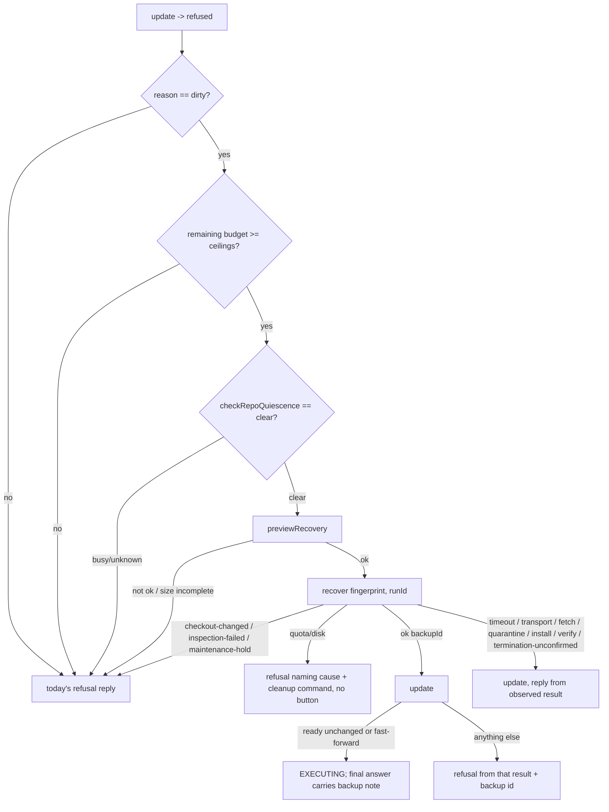

# fix: recover a dirty shared checkout automatically before a gateway run

## Overview

A gateway run can leave uncommitted files in the shared checkout. When that happens, every later launch on that repository is refused as `dirty` until an operator runs `/fro-bot recover-checkout`. This plan makes the gateway run the existing preserve-and-replace recovery on its own. It runs once, when `update` is refused as `dirty` and the workspace is quiet. The run then continues on a fresh checkout. On any failure, the run replies from the checkout state it actually observes afterwards.

## Problem Frame

#1889: a cancelled operator run kept writing into the checkout. #1906 fixed the stop for runs that already have a session: the root is aborted and confirmed gone. The leftovers it produced still wedge the repository. The refusal reply says nothing was discarded and offers a button. Only Discord users with `ManageChannels` can press it, and web-launched runs get no button. The repository stays unusable until a human notices.

The recovery itself already exists and is safe. `apps/workspace-agent/src/recover.ts` renames the whole checkout into a root-owned backup on the persistent volume, then installs a fresh default-branch checkout. Nothing is deleted. Retention is capped at 5 generations and 10 GiB, with no eviction, and recovery refuses before moving anything when the cap is reached. What is missing is a trigger that doesn't need a human.

## Requirements Trace

- R1. When `update` is refused for `dirty` and the repository is quiet, the run recovers the checkout once, calls `update` once more, and continues to `EXECUTING` if that returns ready (`unchanged` or `fast-forward`).
- R2. Only `dirty` triggers recovery. Every other refusal reason keeps today's behaviour.
- R3. Recovery runs under the run's held repo lock, after `checkRepoQuiescence` returns `clear`. A `busy` or `unknown` result keeps today's refusal.
- R4. Recovery starts only when the remaining run budget covers the preview, recover and follow-up `update` ceilings. Otherwise the run keeps today's refusal.
- R5. A recover refusal that moved nothing keeps today's refusal reply. Those are: preview not ok, incomplete size measurement, `quota-exceeded`, `insufficient-disk-space`, `checkout-changed`, `inspection-failed` and `maintenance-hold`. Quota and disk refusals name the cause and the cleanup command, with no Recover button.
- R6. After any other recover outcome, the run calls `update` once and replies from that result. Those outcomes are: a transport error, a timeout, `fetch-failed`, `quarantine-failed`, `install-failed`, `verification-failed` and `termination-unconfirmed`. A `needs-recovery` result gets that refusal text and its button.
- R7. A run that continues after recovery says so in one line of its final answer, with the backup id. A run refused after a successful recovery also names the backup id.
- R8. Backup metadata records the run id that triggered the recovery. `checkout-backup list` shows it. Metadata without the field still parses and still counts toward quota.
- R9. A gateway client timeout on `/recover` aborts the workspace recovery, as long as the quarantine rename has not started. The existing staging rollback handles cleanup.

## Scope Boundaries

- Only `dirty` triggers recovery. Excluded: `ahead`, `diverged`, `non-default-branch`, `detached`, `needs-recovery`, `operation-in-progress`, and every config, layout or submodule refusal.
- No stash, reset, clean or commit inside the checkout. Recovery stays rename-and-replace.
- The manual flows (`/fro-bot recover-checkout`, the Recover button) are unchanged. The one exception is that `checkout-backup list` gains the run id (R8).
- No operator contract change and no new run-details field.
- No new workspace-agent route. `/recover` gains one optional body field and honours its request signal.
- Nothing is evicted at the retention cap. This preserves R9 of `2026-09-24-001`.

### Deferred to Separate Tasks

- A web operator-surface recovery action for the fallback refusal. This is dashboard work, already deferred by the checkout recovery plan.
- Honouring operator cancel during preparation. Preparation runs before the cancel signal is registered. This predates this plan, but the plan widens the window (see Risks).
- Detached orphan processes that outlive their session. `checkRepoQuiescence` cannot see them. Known limit.

## Context & Research

Research notes are in `/tmp/dirty-checkout/repo.md`, which is local and untracked.

### Relevant Code and Patterns

- **Refusal branch:** the preparation section of `packages/gateway/src/execute/run.ts`, the refused-or-failed branch into `terminatePreparationEarly`. The lock is held and the heartbeat is renewing there, and no session exists yet for this run.
- **Success-path reply:** `appendProvenanceLineToBuffer` and the ready branch's `provenanceLine` in `run.ts`. The final answer goes out through `statusSink.resolveToAnswer(replySink.buffered())`.
- **Quiescence:** `packages/gateway/src/execute/repo-quiescence.ts` (`checkRepoQuiescence`, already a `RunMentionDeps` member).
- **Recovery client:** `packages/gateway/src/workspace-api/client.ts` has `previewRecovery` and `recover`, which use `AbortSignal.timeout`. It also has `update`, whose `remainingBudgetMs` is computed with an AbortController and `setTimeout`, which is controllable by fake timers.
- **Manual flow to mirror:** `packages/gateway/src/discord/commands/recover-checkout.ts` (token mint, preview, recover, quota and disk wording).
- **Dependency wiring:** `packages/gateway/src/program.ts` (`authForRepo`, then `workspaceClient.update`).
- **Workspace side:**
  - `apps/workspace-agent/src/recover.ts`: `previewRecovery` and `executeRecovery`, inside `withRepoLock`. Quota and free-space checks run before any rename. Quarantine, install and verify phases are journalled.
  - `apps/workspace-agent/src/backups.ts`: `parseQuarantineMetadata` builds its result from named fields, so unknown keys are dropped.
  - `apps/workspace-agent/src/types.ts`: `BackupEntry`.
  - `apps/workspace-agent/src/server.ts`: `/recover` passes no request signal today.
- **Test helpers:** `packages/gateway/src/execute/test-helpers.ts` (`makeDeps` defaults `checkRepoQuiescence` to a bare mock that returns undefined).

### Institutional Learnings

- `docs/plans/2026-09-24-001-feat-workspace-checkout-update-recovery-plan.md`, its R3, R7 and R9. The checkout is distrusted. Recovery is a whole-tree rename into a root-owned 0700 envelope. Stash, reset and clean were rejected. This plan amends R7 of `2026-09-24-001` for `dirty` only.
- `docs/solutions/logic-errors/gateway-root-not-aborted-on-early-stop-2026-10-22.md`. A released lock implies the root was confirmed gone. Quiescence is a point-in-time check, not a fence.

## Prior-Art Survey

```json
{
  "schema_version": 2,
  "verdict": "reuse",
  "scope": "apps/workspace-agent/src, packages/gateway/src/execute, packages/gateway/src/workspace-api, packages/gateway/src/discord/commands",
  "freshness": {
    "vcs_reference": "8eba5985f"
  },
  "budget": {
    "max_search_passes": 3,
    "max_candidate_inspections": 8,
    "exhausted": false
  },
  "candidates": [
    {
      "path_or_symbol": "apps/workspace-agent/src/recover.ts executeRecovery",
      "description": "Preserve-and-replace of a whole checkout into a root-owned backup with quota, disk and fingerprint checks",
      "disposition": "extend"
    },
    {
      "path_or_symbol": "packages/gateway/src/workspace-api/client.ts recover/previewRecovery",
      "description": "Gateway client for the recovery routes",
      "disposition": "extend"
    },
    {
      "path_or_symbol": "packages/gateway/src/discord/commands/recover-checkout.ts",
      "description": "Operator-confirmed recovery flow and its outcome strings",
      "disposition": "reuse"
    },
    {
      "path_or_symbol": "packages/gateway/src/execute/repo-quiescence.ts checkRepoQuiescence",
      "description": "Point-in-time workspace session-status check for a repository",
      "disposition": "reuse"
    }
  ]
}
```

## Key Technical Decisions

- **Reuse rename-and-replace.** It captures ignored files, submodules and `.git` state. It keeps leftovers out of the agent's reach. It already refuses safely at the quota and disk limits.
- **Trigger from the gateway's refusal branch.** The gateway holds the repo lock and can call `checkRepoQuiescence`. The workspace agent has no view of OpenCode sessions, so `/update` stays read-only.
- **One attempt per run, no loop.** A second `dirty` after recovery means a writer is still active.
- **Budget gate up front, fixed ceilings per call.** The ceilings are preview 45s, recover 300s and `update` 100s, about 445s worst case. Recovery runs only if the remaining run budget covers that sum. Otherwise the run refuses rather than starting a recovery it can't finish. The default run budget is 30 minutes, so the gate only bites on nearly-exhausted runs.
- **Reply from observed state after an ambiguous outcome.** A timeout, a transport error or a failure after quarantine may have moved the checkout or left a recovery journal. The follow-up `update` waits behind the workspace mutex until any in-flight recovery finishes, then reports what is on disk. That result decides the reply. A reply never says "Nothing was discarded" while the checkout's state is unknown.
- **Abort before quarantine.** `/recover` passes the request signal into `executeRecovery`, which honours it up to the quarantine rename. After the rename, the recovery runs to completion. Stopping halfway is worse than finishing.
- **Attribution.** `runId` is an optional field on the `/recover` body and in `metadata.json`. The workspace validates it against its own pattern, which mirrors the gateway's run id format. The parser and `BackupEntry` carry the field. No new `source` value: an unknown `source` parses as malformed and fails the quota check closed under image skew.
- **Fingerprint.** It is a state-shape check (head, dirty counts, byte total, entry count), not a content check. A same-size rewrite between preview and recover passes it. Nothing is lost, because the rename is whole-tree.

## Open Questions

### Resolved During Planning

- Eviction at the cap: no (Marcus).
- A contract field for the reply note: no. The note goes in the final answer (Marcus).
- A lease-ownership check before `EXECUTING`: no. The lease can lapse during a long recovery only after about 15 minutes of failed renewals. That exposure already exists for the whole run after `EXECUTING`, unchecked. Recorded as a risk.

### Deferred to Implementation

- Whether OpenCode caches per-directory state that goes stale after the rename. Unit 2 carries a test scenario. If the state can be observed, pin it. If it can't, record that in the PR.

## High-Level Technical Design

> _This illustrates the intended approach and is directional guidance for review, not implementation specification. The implementing agent should treat it as context, not code to reproduce._



## Implementation Units

- [ ] **Unit 1: Recovery API — run attribution, request abort, client budget form**

**Goal:** `/recover` accepts an optional `runId`, records it, lists it, and stops on a client abort before the quarantine rename. The gateway client's preview and recover use the fake-timer-controllable timeout form.

**Requirements:** R8, R9

**Dependencies:** None

**Files:**

- Modify: `apps/workspace-agent/src/server.ts`, `apps/workspace-agent/src/recover.ts`, `apps/workspace-agent/src/backups.ts`, `apps/workspace-agent/src/types.ts`
- Modify: `packages/gateway/src/workspace-api/client.ts`, `packages/gateway/src/workspace-api/types.ts`, `packages/gateway/src/discord/commands/checkout-backup.ts`
- Test: `apps/workspace-agent/src/recover.test.ts`, `apps/workspace-agent/src/backups.test.ts`, `apps/workspace-agent/src/server.test.ts`, `packages/gateway/src/workspace-api/client.test.ts`, `packages/gateway/src/discord/commands/checkout-backup.test.ts`

**Approach:**

- `/recover` reads an optional `runId` and validates it against a workspace-local pattern. A malformed value gets a fixed 400 and nothing moves.
- `executeRecovery` takes an optional signal and checks it at each phase boundary up to the quarantine rename. An abort rolls back staging the same way an existing pre-quarantine failure does.
- Metadata, the parser projection, `BackupEntry` and the gateway list mirror all carry the optional `runId`. The list line shows it when present.
- The client's preview and recover switch to the AbortController plus `setTimeout` form that `update` uses. Their ceilings are unchanged.

**Patterns to follow:** `update`'s timeout handling in `client.ts`; the existing pre-quarantine failure rollback in `recover.ts`.

**Test scenarios:**

- Happy path: `/recover` with a valid `runId` writes it to `metadata.json`, and `listBackups` and `checkout-backup list` show it.
- Edge case: metadata without `runId` parses, and the quota check counts it.
- Error path: a malformed `runId` returns 400 with no rename.
- Error path: the request signal aborts during the fetch or install-staging phase. The original checkout is untouched, staging is gone, and no backup exists.
- Edge case: an abort after the quarantine rename does not stop the recovery, which completes.
- Happy path: the client's recover and preview time out at their ceilings under fake timers.

**Verification:** Old and new metadata both count. A pre-quarantine abort leaves the checkout exactly as it was.

- [ ] **Unit 2: Auto-recovery on a dirty refusal**

**Goal:** The gateway preparation branch recovers a `dirty` checkout once, then continues or replies from the observed state.

**Requirements:** R1–R7

**Dependencies:** Unit 1

**Files:**

- Create: `packages/gateway/src/execute/checkout-recovery.ts`
- Modify: `packages/gateway/src/execute/run.ts`, `packages/gateway/src/program.ts`, `packages/gateway/src/execute/test-helpers.ts`, `packages/gateway/src/execute/preparation-reply.ts`
- Test: `packages/gateway/src/execute/checkout-recovery.test.ts`, `packages/gateway/src/execute/run.preparation.test.ts`, `packages/gateway/src/execute/preparation-reply.test.ts`

**Approach:**

- A small function takes the deps (quiescence, preview, recover), the repo, `runId`, the remaining budget and a logger. It returns a closed union:
  - `recovered {backupId}`
  - `declined {reason}`, where nothing moved
  - `ambiguous {reason}`, where something may have moved
- `RunMentionDeps` gains `previewRecovery` and `recover`, which mint the token internally the same way `update` does. They are wired in `program.ts`.
- `test-helpers.ts`: quiescence defaults to `unknown`. Preview and recover get default mocks. The existing dirty-refusal test keeps asserting today's refusal.
- `run.ts` handles each outcome:
  - `recovered`: call `update`. Ready continues and carries the backup id. Anything else goes to the refusal path with that result and the backup id.
  - `ambiguous`: call `update`. Ready continues. Anything else goes to the refusal path with that result.
  - `declined`: today's refusal. Quota and disk refusals get the manual flow's wording and no Recover button.
- The backup note goes into the final answer through the same buffer append path as the provenance line, exactly once.
- Logs carry the run id, the repo, and either the outcome reason or the backup id. They never include paths.

**Execution note:** Implement test-first, starting from the #1889 sequence (dirty, then recover, then ready).

**Patterns to follow:** The recover sequence in `recover-checkout.ts`, `terminatePreparationEarly`, and `appendProvenanceLineToBuffer`.

**Test scenarios:**

- Happy path: dirty, quiescence clear, preview ok, recover ok, `update` ready (`unchanged`). The run reaches `EXECUTING`, the final answer contains the backup note once with no extra send, and recover receives the run id.
- Happy path: the same, but the second `update` returns ready (`fast-forward`). The run continues.
- Edge case: the remaining budget is below the ceiling sum. Today's refusal, and quiescence, preview and recover are never called.
- Error path: quiescence `busy`, or `unknown` (including OpenCode unreachable). Today's refusal, and preview and recover are never called.
- Error path: preview not ok, or size measurement incomplete. Today's refusal, no recover.
- Error path: one row per declined reason: `quota-exceeded`, `insufficient-disk-space`, `checkout-changed`, `inspection-failed`, `maintenance-hold`. Quota and disk name the cause with no button. The others send today's refusal. Recover is never called a second time.
- Error path: one row per ambiguous reason: timeout, transport error, `fetch-failed`, `quarantine-failed`, `install-failed`, `verification-failed`, `termination-unconfirmed`. `update` is called once and the reply comes from its result. A `needs-recovery` result gets that text and the button. A ready result continues.
- Error path: the second `update` is still `dirty` after recovery. The reply comes from that result, names the backup id, and no second recovery is attempted.
- Edge case: no non-dirty refusal reason ever calls quiescence or recover.
- Edge case: a web-surface run recovers the same way, and its final answer carries the note.
- Edge case: an operator cancel arriving during preparation is not honoured. This pins the deferral.
- Integration: after a recovery, the OpenCode session is created in the renamed-and-replaced directory and sees the fresh tree. Pin this if a test can observe it. If not, record the limit in the PR.

**Verification:** The #1889 sequence completes in one launch. Every non-happy path replies from what was observed.

- [ ] **Unit 3: Docs**

**Goal:** Describe auto-recovery and record the amendment to R7 of `2026-09-24-001`.

**Requirements:** R1–R9

**Dependencies:** Unit 2

**Files:**

- Modify: `packages/gateway/AGENTS.md` (checkout preparation), `docs/wiki/Execution Lifecycle.md`, `docs/wiki/Troubleshooting.md`, `deploy/README.md` (refusal text), and `docs/plans/2026-09-24-001-feat-workspace-checkout-update-recovery-plan.md` (one superseding note at its R7)

**Approach:** Write in the present tense. Today's refusal text now applies only to the fallback. State the known limits: quota cost per incident, invisible detached processes, and the uncancellable preparation window.

**Test expectation:** none. This unit is docs only.

**Verification:** Prettier and the markdown link check pass.

## System-Wide Impact

- **Interaction graph:** Preparation in `run.ts`, workspace-agent `/recover`, and backup listing.
- **Error propagation:** Every recovery outcome becomes either a continued run or a refusal built from an observed `update` result. Nothing new reaches `RunCoreError`.
- **State lifecycle risks:**
  - Recovery renames the checkout while the run holds the lock.
  - The workspace mutex and fingerprint re-check guard against a concurrent manual recovery.
  - A pre-quarantine abort rolls back. A post-quarantine failure leaves a journal, which the follow-up `update` reports as `needs-recovery`.
- **API surface parity:** Manual recovery is unchanged and uses the same route. The list gains the run id.
- **Unchanged invariants:**
  - No content is discarded.
  - The quota and disk checks stay fail-closed.
  - Refusals other than `dirty` behave as before.

## Risks & Dependencies

| Risk | Mitigation |
| --- | --- |
| Each incident costs the whole checkout's size against the 10 GiB cap, and needs 2× that size free. A 3 GiB checkout fills the cap at the fourth incident, and manual backups share the cap | Refuse at the cap, name the cause and `/fro-bot checkout-backup delete` |
| Preparation becomes uncancellable for up to ~9 minutes (lock wait, then `update`, quiescence, preview, recover, `update`), up from ~100 s | Pinned by a test. The cancel work stays deferred |
| A lease lapse during a long recovery lets another run take over. This needs about 15 minutes of failed renewals, and the same exposure exists for the whole run after `EXECUTING` | Accepted. No fence |
| A detached writer re-dirties the fresh checkout | The next run recovers again or refuses, bounded by quota |
| An old workspace image ignores `runId` | Fail-soft. The backup lacks attribution. The images ship together per `deploy/README.md` |

## Sources & References

- Issue: #1889
- Related PRs: #1906 (root abort on early stop), #1915 (refusal and teardown diagnostics)
- Prior plan: `docs/plans/2026-09-24-001-feat-workspace-checkout-update-recovery-plan.md`
