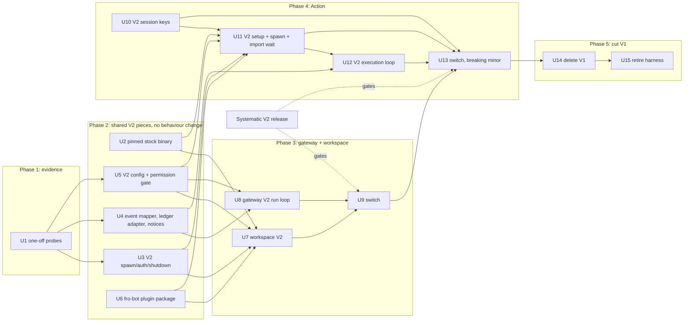

# feat: Move Fro Bot to OpenCode V2

## Overview

Fro Bot moves from the patched V1 harness to stock upstream OpenCode V2 (v2.2.0). The V2 code is written beside the V1 code. The gateway and workspace switch together first, then the Action. The V1 code and the harness are deleted after the last switch. Session history in the Action carries across through a separate V2 key name and a one-time import of the existing V1 data.

## Problem Frame

V2 is a rewrite. It has a new `/api/*` HTTP API, new event names, a new client and plugin API, a one-way migration of the V1 session database, and changed defaults. V1 is frozen, and all 15 harness carries are dead (see origin: `docs/brainstorms/2026-10-27-opencode-v2-migration-requirements.md`).

## Requirements Trace

| Requirement                                                                | Advanced by       |
| -------------------------------------------------------------------------- | ----------------- |
| R1 stock pinned binary, digest-verified, no fallback                       | U2                |
| R2 no carries by default                                                   | U1, U15           |
| R3 retire the harness                                                      | U15               |
| R4 plugins installed before start, under the bound                         | U3, U7, U11       |
| R5 V2 beside V1, main unchanged until a switch                             | U3-U12            |
| R6 each surface switches and reverts whole                                 | U9, U13           |
| R7 behaviour parity                                                        | U4, U8, U12       |
| R8 same-PR mirroring                                                       | Operational Notes |
| R9 delete V1 after the last switch                                         | U14               |
| R10 gateway and workspace first; Action as a breaking minor                | U9, U13           |
| R11 Systematic V2 gates each switch                                        | U9, U13           |
| R12 probes gate each switch                                                | U1, U9, U13       |
| R13-R16 Action continuity (precedence, key name, V1 deletion, import wait) | U10, U11, U14     |
| R17 outside-directory deny (Action) or ask (gateway), fail closed                                    | U5                |
| R18 no pending question in Action runs                                     | U5, U12           |
| R19 Code Mode on; deny holds; session move and worktree tools denied       | U1, U5, U8, U12   |
| R20 per-spawn password, never logged                                       | U3, U7            |
| R21 fro-bot V2 plugin package                                              | U6                |

## Scope Boundaries

- No harness patches carried forward, and no V2 PRs opened for them.
- Persisted session history is not added to the gateway or workspace.
- No generation handshake between the gateway and workspace. They deploy together.
- No re-runnable probe suite. Probes are one-off, run per switch.
- No pre-decided Code Mode fallback. If deny rules don't hold inside `execute`, we decide then.
- No rollback-copy lifecycle. V1 data is deleted when V1 is cut.
- Eval work is limited to the minimum needed to run the evals on V2.
- Systematic V2 is built separately.

### Deferred to Separate Tasks

- Isolating the OpenCode server from the agent's tools: #1970.
- Deprecating the `@fro.bot/harness*` npm packages: a separate step, approved by Marcus, after U15.

## Context & Research

### Relevant Code and Patterns

- **Spawn and auth:** `packages/runtime/src/agent/server.ts` (`bootstrapOpenCodeServer`, `waitForServerQuiescence`), `filter-env.ts`, `with-scrubbed-env.ts`. On the workspace: `apps/workspace-agent/src/opencode-server.ts` (allowlisted env, launch spec, supervised respawn).
- **Event loops:** Action `src/features/agent/{streaming,session-poll,retry,prompt-sender,execution}.ts`. Gateway `packages/gateway/src/execute/run-core.ts`. Both switch on raw V1 event names. The only shared helper is `packages/runtime/src/agent/event-shape.ts`.
- **Ownership:** `packages/runtime/src/agent/ownership-ledger.ts` is SDK-agnostic and reused as is. `ledger-reconcile.ts` exposes `LedgerReconcileAdapter`, and only `createSdkLedgerReconcileAdapter` is coupled to V1. `task-notice.ts` parses the V1 `<task>` notice.
- **Stop and quiescence:** `packages/gateway/src/execute/{root-stop,settle-owned-sessions,drain-completion,repo-quiescence,live-reconcile}.ts`. Action `src/harness/phases/execute.ts` (`runDrain`, `cancelOutstanding`).
- **Setup:** `src/services/setup/{setup,ci-config,systematic-plugin,session-tools-config,no-task-reuse-config,tools-cache,opencode}.ts`. `installOpenCode` already verifies against `SHA256SUMS`, but only for harness pins. The stock path fails open and falls back to `FALLBACK_VERSION`.
- **Sessions:** `src/services/cache/{cache-key,restore,save,paths}.ts`, `packages/runtime/src/object-store/{key-builder,content-sync}.ts`. Today's precedence is S3 first, and a hit skips the cache (`restore.ts`). The S3 session is one repo-scoped `sessions/opencode.db`.
- **Workspace:** `apps/workspace-agent/src/{opencode-proxy,opencode-instance,recover}.ts`, `deploy/workspace.Dockerfile` (digest-checked musl download), `deploy/managed-config/opencode.json`, `deploy/plugins/no-task-reuse.mjs`.
- **npm publishing:** `.github/workflows/harness-release.yaml` (OIDC `publish` job) and `packages/harness/BOOTSTRAP.md` (stub-then-trusted-publisher).
- **Probe templates:** the fake provider in `src/features/agent/quota-terminal-probe.test.ts`, the raw-fetch abort probe kept locally from the 1.19.4 work, and `packages/harness/src/shim-test-kit.ts` (a fixture binary that prints the listening line).

### Institutional Learnings

- `docs/solutions/logic-errors/gateway-root-not-aborted-on-early-stop-2026-10-22.md`: an abort acceptance, idle, or absence is not proof of stop. If a stop can't be confirmed, quarantine and keep the lock.
- `docs/solutions/logic-errors/bound-and-guard-every-reconcile-pass-2026-10-22.md` and `no-deadline-drain-counts-observation-not-ledger-state-2026-10-22.md`: every reconcile pass is bounded and guarded, and drain counts observations.
- `docs/solutions/integration-issues/read-only-actions-cache-token-broke-session-continuity-2026-08-11.md`: a `cacheId: -1` save is not a success.
- `#1519` (`fix(cache): break the session-cache bootstrap trap`): restore and save must use the same path list, or every entry silently fails to restore.
- `docs/solutions/best-practices/extract-timer-primitive-keep-policy-per-surface-2026-07-13.md`: share primitives in runtime and keep policy per surface. This is the rule for "beside, not behind a generic interface."
- `injected-deny-blocks-own-delivery-path`: a deny rewrite must keep the response-file and attachment exceptions.

### External References

- Upstream v2.2.0 migration guides: `services/www/src/docs/content/migrate-v1.mdx`, `.../build/plugins/migrate-v1.mdx`.
- Client: `packages/client/src/promise/generated/client.ts`. Server: `packages/cli/src/server-process.ts`. Plugin: `packages/plugin/README.md`. Import: `packages/core/src/database/v1-migration.bun.ts`. Restart resume: `packages/core/src/session/execution/restart.ts`.
- v2.2.0 publishes a `SHA256SUMS` asset, and the GitHub API returns per-asset sha256 digests.

## Prior-Art Survey

```json
{
  "schema_version": 2,
  "verdict": "extend",
  "scope": "fro-bot/agent monorepo: packages/runtime, src (Action), packages/gateway, apps/workspace-agent, packages/harness, deploy, .github/workflows",
  "freshness": {
    "vcs_reference": "1549f33df"
  },
  "budget": {
    "max_search_passes": 6,
    "max_candidate_inspections": 16,
    "exhausted": false
  },
  "candidates": [
    {
      "path_or_symbol": "packages/runtime/src/agent/server.ts#bootstrapOpenCodeServer",
      "description": "Spawns OpenCode through the V1 SDK on a loopback port, readiness-probes it, and returns a handle with shutdown.",
      "disposition": "insufficient",
      "insufficiency_reason": "Bound to the V1 SDK, unauthenticated, and uses V1-only env flags; its handle and readiness contract is the template for the V2 sibling."
    },
    {
      "path_or_symbol": "packages/runtime/src/agent/server.ts#waitForServerQuiescence",
      "description": "Port-liveness poll confirming the child released its socket after close.",
      "disposition": "reuse"
    },
    {
      "path_or_symbol": "packages/runtime/src/agent/filter-env.ts#filterAgentEnv",
      "description": "Deny-by-default child env scrub.",
      "disposition": "extend"
    },
    {
      "path_or_symbol": "apps/workspace-agent/src/opencode-server.ts#buildOpencodeLaunchSpec",
      "description": "Workspace launch spec: serve args, stdin, allowlisted env, uid and gid.",
      "disposition": "extend"
    },
    {
      "path_or_symbol": "packages/runtime/src/agent/event-shape.ts",
      "description": "Raw event kind, payload and session accessors.",
      "disposition": "insufficient",
      "insufficiency_reason": "Accessors only; V2 event names and payloads differ and need a mapper."
    },
    {
      "path_or_symbol": "src/features/agent/streaming.ts#processEventStream",
      "description": "Action event consumer keyed on V1 event names.",
      "disposition": "insufficient",
      "insufficiency_reason": "Keyed on V1 events and message part shapes."
    },
    {
      "path_or_symbol": "packages/gateway/src/execute/run-core.ts#runOpenCodeCore",
      "description": "Gateway execute and stream core keyed on V1 events, permissions and questions.",
      "disposition": "insufficient",
      "insufficiency_reason": "Same V1 event coupling; needs a V2 sibling."
    },
    {
      "path_or_symbol": "packages/runtime/src/agent/ownership-ledger.ts#createOwnershipLedger",
      "description": "SDK-agnostic ownership ledger with drain predicates.",
      "disposition": "reuse"
    },
    {
      "path_or_symbol": "packages/runtime/src/agent/ledger-reconcile.ts#LedgerReconcileAdapter",
      "description": "Reconcile adapter interface; the SDK adapter is the V1 implementation.",
      "disposition": "extend"
    },
    {
      "path_or_symbol": "packages/runtime/src/agent/task-notice.ts#parseTaskNotice",
      "description": "Parser for the V1 task completion notice.",
      "disposition": "insufficient",
      "insufficiency_reason": "V2 sends a subagent notice with structured metadata and a cancelled state."
    },
    {
      "path_or_symbol": "packages/gateway/src/execute/repo-quiescence.ts#createRepoQuiescenceChecker",
      "description": "Directory-scoped quiescence with an injectable client seam.",
      "disposition": "extend"
    },
    {
      "path_or_symbol": "src/services/setup/opencode.ts#installOpenCode",
      "description": "Pinned download with SHA256SUMS verification for harness pins only.",
      "disposition": "extend"
    },
    {
      "path_or_symbol": "deploy/workspace.Dockerfile (OpenCode install block)",
      "description": "Build-time archive and SHA256SUMS download, fail-closed compare, musl asset allowlist.",
      "disposition": "extend"
    },
    {
      "path_or_symbol": "src/services/setup/systematic-plugin.ts#installSystematicPlugin",
      "description": "Bounded plugin install subprocess with installed, failed and timed-out status.",
      "disposition": "extend"
    },
    {
      "path_or_symbol": ".github/workflows/harness-release.yaml (publish job)",
      "description": "OIDC trusted-publishing npm job and bootstrap runbook.",
      "disposition": "extend"
    },
    {
      "path_or_symbol": "src/services/cache/cache-key.ts + packages/runtime/src/object-store/key-builder.ts + content-sync.ts + src/services/cache/restore.ts",
      "description": "Actions cache and S3 key schemes, S3-first restore, version marker.",
      "disposition": "extend"
    }
  ]
}
```

## Key Technical Decisions

- **Each surface selects V2 at its existing seam, with no generic interface.** A major version of 2 or above selects V2.
  - **Action:** the selector is the resolved OpenCode version that bootstrap already saves to state. `cache-restore.ts` is the only place that selects the bootstrap. One selector in `runExecute` picks the executor for both `executeOpenCode` call sites, recovery and main. The post hook derives the generation from the same state key, and a missing key means V1.
  - **Workspace:** the V2 image sets an env value that `main.ts` reads through its existing env dependency. It uses that value to inject a V2 supervised runner, proxy and disposer through the `startWorkspaceAgent` deps.
  - **Gateway:** the workspace agent reports its OpenCode version on its control API. The gateway reads it when it attaches and picks the V1 or V2 run loop from it.
  - The only switch for the gateway and workspace is the workspace image pin. Neither surface keeps a second setting that could disagree with it.
- **Shared V2 primitives live in runtime, and policy stays per surface.** Spawn and auth, the event mapper, the V2 ledger adapter and the subagent-notice reader go in `packages/runtime`. The event loops, stop policy and approvals stay per surface.
- **`serve --stdio` with a held stdin pipe, on both surfaces.** The server prints `{url}`, drops the password from its own environment so tools never inherit it, and exits when stdin closes. That exit gives a real process event to use for shutdown confirmation.
- **No resumed work after a restart.** V2 keeps a session's execution claim across a shutdown and resumes it at the next boot. To prevent that:
  - Every shutdown first interrupts all owned sessions.
  - The workspace starts each spawn with a fresh database.
  - The Action clears leftover claims in the restored database before it spawns the server. Such a claim comes only from an earlier run that was killed. The mechanism comes from probe P11.
  - Because interrupting with reason `user` releases the claim, a normal shutdown saves a database with no held claims.
  - Stop confirmation never accepts an interrupt whose reason is `shutdown`.
- **Plugin gate after spawn.** V2 skips a plugin that fails to load, and the server stays up. After spawn, both surfaces require the Systematic and fro-bot plugin IDs to be listed with status `active`. If either one is listed as `failed`, or is not listed at all, startup fails.
- **The effective permissions are the source of truth for the deny check.** After spawn, each surface reads the effective per-agent rules from the server. It then evaluates sentinel paths outside the checkout and inside the response-file and attachment directories. The run fails if any agent that can run tools lacks the outside deny, or if any of those exceptions is missing. Project config is disabled in CI.
  - The gate checks that the rules exist, not that they are enforced. Probe P5 is the evidence that Code Mode enforces them for the pinned version.
- **Restore precedence is unchanged.**
  - **Order:** S3 V2, then S3 V1, then the cache tiers: V2 branch, V1 branch, V2 repo, V1 repo.
  - **Names:** the cache prefix is `opencode-v2-storage`, chosen so it isn't confused with the tools cache's `opencode-tools-v2`. The S3 V2 object is `<prefix>/github/<owner>/<repo>/sessions-v2/<db>`, a sibling of V1's `sessions/` that V1's recursive listing never matches.
  - **Database name:** `<db>` is the V2 database filename, pinned as a constant after probe P15. V2 names it `opencode.db` only on release channels. The V2 cache path list and the S3 upload both use that constant.
  - **Version marker:** the `.version` marker stays `1`, so a restored V1 entry is never wiped.
- **The digest lives in one source.** One JSON data file records the pinned version and each asset's sha256. `installOpenCode` imports it, and a Dockerfile build stage reads it.
  - Renovate keeps proposing V2 bumps.
  - Its PR fails until someone adds the digest by hand, and that edit is the manual verification step.
- **Gateway approvals keep `always`, for V1 parity.** The fresh database on each workspace spawn limits how long it lasts.
- **The plugin package is `@fro.bot/opencode-plugin`,** published from its own workflow with its own tag namespace. It pins `effect` as a peer dependency and is never bundled.

## Open Questions

### Resolved During Planning

- **Restore precedence:** unchanged, with V2 before V1 at each step. This was Marcus's call.
- **A failed or unfinished V1 import:** the run fails without prompting and saves nothing.
- **Probes:** one-off, run per switch. No suite.
- **Code Mode:** stays on, and there is no pre-decided fallback.
- **Rollback:** a revert during the cutover runs V1 on untouched V1 data. Nothing else is required.
- **Digest source:** upstream publishes `SHA256SUMS` and API digests. Record the digest and cross-check it against both.
- **Artifacts:** the Action uses `opencode-linux-{x64,arm64}.tar.gz` (the names already match `installOpenCode`). The workspace uses `opencode-linux-{x64,arm64}-musl.tar.gz`. The x64 baseline artifacts are byte-identical, so there's no baseline split.

### Deferred to Implementation

- Probe results P1-P15 (U1). Each one decides details inside a later unit, as named there.
- The exact mechanism for clearing a held execution claim in a restored database (P11).
- The replacement for `/instance/dispose` after a checkout swap: location reload or evict (P3).
- Whether `session.active` lists background children (P2). If not, the ledger adapter uses `session.list({parentID})` plus message evidence.
- Whether plugin installs use `opencode plugin add` or a direct bounded npm install into the plugin directory. This depends on P10 and on who owns the global config file.
- The bound for the import wait, sized from P7.
- The V2 database filename (P15). U10 depends on it.

## Output Structure

    packages/opencode-plugin/            # @fro.bot/opencode-plugin (U6)
      package.json
      tsconfig.json
      src/
        index.ts                         # server entry: Plugin.define
        session-tools.ts                 # session_list/read/search/info
        task-reuse-guard.ts              # execute.before on subagent + sessionID
        *.test.ts
    packages/runtime/src/agent/
      server-v2.ts                       # spawn, auth, readiness, plugin gate, shutdown (U3)
      event-v2.ts                        # V2 event to domain event mapper (U4)
      ledger-reconcile-v2.ts             # V2 LedgerReconcileAdapter (U4)
      subagent-notice.ts                 # metadata-based notice reader (U4)
      permission-gate-v2.ts              # effective-rule sentinel evaluation (U5)

## High-Level Technical Design

> _This shows the intended approach and is direction for review, not an implementation specification. The implementing agent should treat it as context, not code to reproduce._



Run order for a V2 Action run:

```text
install pinned binary (digest) -> install plugins (bounded) -> write V2 config
-> restore (S3 V2, S3 V1, cache tiers) -> SQLite repair -> clear held claims
-> spawn serve --stdio (password) -> /api/info -> plugin gate -> permission gate
-> wait for V1 import (bounded; fail = no prompt, no save)
-> subscribe (await server.connected) -> prompt -> event loop (Code Mode, form cancel, permission reply)
-> drain owned children -> interrupt owned -> close stdin -> confirm exit -> checkpoint -> save V2 keys only
```

## Implementation Units

### Phase 1: Evidence

- [ ] **Unit 1: One-off V2 probes**

**Goal:** Establish the V2 behaviours later units depend on, against the pinned v2.2.0 release. Results are posted to #1805 and not committed as repo code.

**Requirements:** R2, R12, R17, R18, R19

**Dependencies:** None

**Files:**

- None committed. Probe scripts and a scripted OpenAI-compatible fake provider (one that streams tool calls) live in a scratch directory outside the repo.

**Approach:**

- Run against a local `opencode serve` v2.2.0, verified against `SHA256SUMS`, with isolated HOME and XDG directories and a fake provider that streams scripted tool calls. Reuse the fake-provider pattern from `quota-terminal-probe.test.ts` and the raw-fetch abort probe.
- Probes, each recorded with version and digest:

| Probe | Question | Blocks |
| --- | --- | --- |
| P1 | Interrupt timing on a cold location | gateway switch |
| P2 | Does `session.active` list a background child? | both |
| P3 | Does location reload or evict refresh `fs/find` after a checkout swap? | gateway switch |
| P4 | Does a `question` deny hold against agent-level allow rules, or is the request dismissed? | Action switch |
| P5 | Code Mode tool-call lifecycle, and do deny rules hold inside `execute`? | both |
| P6 | Outside-directory rules for build and for subagents after conversion, plus managed and project config precedence | both |
| P7 | V1 import time on the largest real session database | Action switch |
| P9 | Directory quiescence from the global active list joined with `session.list({directory})` | gateway switch |
| P10 | Plugin install command, its bound, and global config ownership | both |
| P11 | Shutdown reasons for stdin close and SIGTERM, whether claims persist into the saved database, and how to clear them | both |
| P12 | Are the session-move and worktree-create tools removed by a deny, and what does the join return after a move? | both |
| P13 | Plugin load failure behaviour and the `GET /api/plugin` response shape | both |
| P14 | Proxy path: Basic auth, SSE, `x-opencode-directory`, 401 response shape | gateway switch |
| P15 | Database filename in the data directory, and `--stdio` behaviour on stdin close and exit | Action switch |

- A failed probe blocks the switch it gates until Marcus decides. No fallback is pre-decided.

**Test scenarios:**

- Test expectation: none. These are probes, not shipped code.

**Verification:**

- #1805 has one comment that lists each probe's result with the version and digest it ran against.

### Phase 2: Shared V2 pieces (no behaviour change on main)

- [ ] **Unit 2: Pinned stock V2 binary with recorded digest**

**Goal:** A V2 pin installs only a digest-verified stock asset. There is no fallback version and no fail-open path.

**Requirements:** R1

**Dependencies:** None

**Files:**

- Create: `packages/runtime/src/shared/opencode-v2-pin.json` (version and per-asset sha256)
- Modify: `src/services/setup/opencode.ts` (V2 path: verify against the recorded digest and `SHA256SUMS`; no `FALLBACK_VERSION` retry; no fail-open magic-byte result)
- Modify: `deploy/workspace.Dockerfile` (a V2 install path that verifies against the recorded digest; selected by build arg)
- Test: `src/services/setup/opencode.test.ts`

**Approach:**

- A V2 pin is any version with major 2 or higher. On that path, verification is mandatory and every failure throws.
- A Dockerfile build stage reads the same JSON file. Digests are not copied by hand into the Dockerfile.
- Ask first: lifting the `<=1.19.4` cap for `anomalyco/opencode` in `.github/renovate.json5`.

**Patterns to follow:**

- `verifyHarnessChecksum` and the harness fail-closed branch in `installOpenCode`.

**Test scenarios:**

- Happy path: the archive matches the recorded digest and the `SHA256SUMS` line, so it installs.
- Error path: a tampered archive fails the install, and no second download is attempted (assert the fetch count).
- Error path: a platform with no recorded digest fails before the download.
- Error path: `SHA256SUMS` disagrees with the recorded digest, so the install fails.
- Edge case: the `file` command is unavailable. On the V2 path this does not pass validation.
- Integration: a V1 pin still takes the existing V1 path, unchanged.

**Verification:**

- A V2 pin can't install without a digest match. V1 behaviour is unchanged.

- [ ] **Unit 3: V2 server spawn, auth, gates and shutdown (runtime)**

**Goal:** One runtime function spawns a V2 server, authenticates to it, gates on plugins, and shuts it down without leaving resumable work.

**Requirements:** R4, R5, R20

**Dependencies:** U1 (P11, P13, P15)

**Files:**

- Create: `packages/runtime/src/agent/server-v2.ts`
- Modify: `packages/runtime/src/agent/filter-env.ts` (add the V2 env names to the allowlist; inject the password only on the spawn)
- Test: `packages/runtime/src/agent/server-v2.test.ts`

**Approach:**

- Spawn `serve --stdio` with a held stdin pipe and a random per-spawn password. Parse `{url}` within a bound. Readiness is an authenticated `server.info()`.
- Register the password with logger redaction before spawning.
- Plugin gate: after readiness, wait a bounded time for `GET /api/plugin` to list every expected plugin ID with status `active`. Any expected plugin that is listed as `failed`, or is not listed, fails startup.
- Shutdown: interrupt every owned session, close stdin, and confirm the process exited within a bound. Expose the exit event as the confirmation.
- Use V2 env names only. Drop the dead V1 flags.

**Patterns to follow:**

- The `Result` contract and handle shape of `bootstrapOpenCodeServer`. The fixture-binary technique from `packages/harness/src/shim-test-kit.ts`.

**Test scenarios:**

- Happy path: a fixture binary prints `{url}`, `server.info` succeeds, and the handle is returned.
- Error path: no `{url}` within the bound fails with a typed error, and the child is killed.
- Error path: `server.info` returns 401, which is reported as an auth failure and not as the server being down.
- Error path: one expected plugin is `failed`, or is still not listed when the bound expires. Startup fails and names the plugin.
- Edge case: the password never appears in any captured log line, error message or thrown object, including on the 401 path.
- Integration: shutdown interrupts owned sessions before closing stdin, and the exit is confirmed. A child that won't exit is reported as unconfirmed.

**Verification:**

- Nothing calls this module yet. Its own tests pass, and the V1 server path is untouched.

- [ ] **Unit 4: V2 event mapper, ledger adapter and subagent notices (runtime)**

**Goal:** Shared V2 primitives that both run loops consume.

**Requirements:** R5, R7, R19

**Dependencies:** U1 (P2, P5, P9)

**Files:**

- Create: `packages/runtime/src/agent/event-v2.ts`
- Create: `packages/runtime/src/agent/ledger-reconcile-v2.ts`
- Create: `packages/runtime/src/agent/subagent-notice.ts`
- Test: `packages/runtime/src/agent/event-v2.test.ts`, `ledger-reconcile-v2.test.ts`, `subagent-notice.test.ts`

**Approach:**

- The mapper turns V2 events into a small domain union:
  - text delta (no reasoning);
  - tool started and finished, keyed by request id, so that nested Code Mode calls stay distinct;
  - permission asked;
  - form asked;
  - execution started, succeeded or failed;
  - execution interrupted, with its reason;
  - retry scheduled;
  - session moved;
  - `server.connected`.
- The ledger adapter implements `LedgerReconcileAdapter` using `session.active` and `session.list({parentID})`. If P2 shows that active doesn't list children, liveness comes from the children list plus message evidence.
- The notice reader uses structured metadata (`source`, `childID`, `state`) and never the notice text. Its states are completed, error and cancelled.

**Patterns to follow:**

- `ledger-reconcile.ts` (`createSdkLedgerReconcileAdapter`), `task-notice.ts`, `event-shape.ts`.

**Test scenarios:**

- Happy path: each V2 event fixture maps to the expected domain event.
- Edge case: two nested calls inside one `execute` share a tool-call id and still map to distinct requests.
- Edge case: a notice whose text contains a forged `<subagent sessionID=... state="completed">` is ignored. Only the metadata settles the ledger.
- Edge case: the `cancelled` state settles the ledger entry as cancelled.
- Error path: an active or list request that fails or hangs past the reconcile bound marks outstanding entries unknown, as in V1.
- Integration: `reconcileLedgerOnce` with the V2 adapter settles a child that left the active list and has a terminal reply.

**Verification:**

- The domain union covers every event the V1 loops act on today.

- [ ] **Unit 5: V2 config builder and permission gate**

**Goal:** CI and workspace config in V2 shape, with fail-closed outside-access checks against the effective rules.

**Requirements:** R17, R18, R19

**Dependencies:** U1 (P4, P5, P6, P12)

**Files:**

- Create: `src/services/setup/ci-config-v2.ts`
- Create: `packages/runtime/src/agent/permission-gate-v2.ts`
- Create: `deploy/managed-config/opencode-v2.json`
- Test: `src/services/setup/ci-config-v2.test.ts`, `packages/runtime/src/agent/permission-gate-v2.test.ts`

**Approach:**

- The builder emits:
  - `plugins` (V2 key);
  - `experimental.subagent_depth`;
  - an ordered permission list: outside the checkout denied in the Action and asked in the gateway workspace, with the run-scoped response-file and attachment exceptions in the Action and caller-supplied directories in the workspace; `.env` edits denied; `doom_loop` denied;
  - in the Action only, `question` denied;
  - the session-move and worktree-create tools denied.
- Project config is disabled in CI.
- The gate reads effective per-agent rules from `GET /api/agent`. For every agent that can run tools, including subagents, it evaluates the outside-checkout, response-file and attachment sentinels. The Action requires `deny` outside the checkout. The workspace accepts `ask` or `deny`, never `allow`. A violated outside policy, a missing exception or a missing forbidden-tool deny fails startup.
- The Action's no-pending-question guarantee has two parts: the config deny on `question`, and the runtime form-cancel in U12. The gate does not check for `question`.
- The V2 managed config for the workspace is a separate file. The V1 file stays unchanged.

**Patterns to follow:**

- `scopeExternalDirectoryPermission` and `scopeAttachmentDirectoryPermission` in `ci-config.ts`, and `ci-config.effective-permission.test.ts`.

**Test scenarios:**

- Happy path: for the build agent and each subagent type, the golden Action rules deny outside paths and `.env` and allow the response-file and attachment directories. The workspace rules ask for outside paths.
- Error path: the outside deny is missing, so the gate fails startup.
- Error path: a later allow overrides the deny under last-match-wins, so the gate fails startup. In the workspace, a later allow overriding the ask fails the same way.
- Error path: an Action config with `ask` outside fails the gate, because the Action requires `deny`.
- Edge case: on the gateway, `question` is kept.
- Integration: when the builder's output is loaded by a fixture server, the gate passes. That test is gated on the P6 result shape.

**Verification:**

- The V1 `buildCIConfig` and its tests are unchanged.

- [ ] **Unit 6: `@fro.bot/opencode-plugin` package**

**Goal:** A V2 plugin that provides the session tools and the task-reuse guard, published to npm at an exact version.

**Requirements:** R21

**Dependencies:** U1 (P10, P13)

**Files:**

- Create: `packages/opencode-plugin/` (see Output Structure)
- Create: `.github/workflows/opencode-plugin-release.yaml` (ask first: a new CI and release workflow)
- Modify: `package.json` (root script chains), `eslint.config.ts` (`packageDir`), `deploy/workspace.Dockerfile` and `deploy/gateway.Dockerfile` (`COPY package.json` lines), `scripts/module-taxonomy.test.ts` if a new subsystem entry is warranted, and `STRUCTURE.md` / `ARCHITECTURE.md` through the `generating-project-docs` skill
- Modify: `packages/runtime/src/shared/constants.ts` (the pinned plugin version, set the same way as Systematic's)
- Test: `packages/opencode-plugin/src/*.test.ts`

**Approach:**

- The server entry uses `Plugin.define`.
- The session tools are rebuilt on the V2 session API. They get V2 siblings of runtime's session storage mappers and backend (`packages/runtime/src/session/{storage-mappers,storage-message-mappers,backend}.ts`). Runtime's search and ranking logic is reused wherever it doesn't depend on the V1 message model.
- The guard rejects `subagent` calls that carry `sessionID` with the existing model-visible rejection text, which contains no ids or secrets.
- `effect` is a peer dependency.
- Publishing reuses the OIDC job pattern and the stub-then-trusted-publisher bootstrap, with its own tag namespace.
- Ask first: excluding `@opencode/*` from `minimumReleaseAge` in `bunfig.toml`, and the `bun.lock` changes.

**Patterns to follow:**

- `deploy/plugins/no-task-reuse.mjs` and its `node --test` tests, `packages/runtime/src/agent/session-tools.ts`, the `packages/harness` manifest and `BOOTSTRAP.md`.

**Test scenarios:**

- Happy path: `session_list`, `session_read`, `session_search` and `session_info` return results for a fixture session store through the V2 API.
- Happy path: the guard lets `subagent` through when no `sessionID` is passed.
- Error path: the guard rejects `subagent` with a `sessionID`, and the rejection text has no ids.
- Integration: when a fixture V2 server loads the package, `GET /api/plugin` shows it loaded and the tool list includes the four session tools.

**Verification:**

- The package builds and passes its tests.
- A first real publish to npm has happened. U7 and U11 install that published version.

### Phase 3: Gateway and workspace

- [ ] **Unit 7: Workspace on V2**

**Goal:** The workspace image can run stock V2 behind the bearer proxy.

**Requirements:** R4, R5, R6, R20

**Dependencies:** U2, U3, U5, U6 (published), and U1 (P3, P14)

**Files:**

- Modify: `apps/workspace-agent/src/main.ts` (choose the V2 runner, proxy and disposer from the image's env value; report the OpenCode version on the control API)
- Create: `apps/workspace-agent/src/opencode-server-v2.ts`, `opencode-proxy-v2.ts`, `opencode-instance-v2.ts`
- Modify: `deploy/workspace.Dockerfile` (V2 build arg: musl stock binary, baked Systematic and fro-bot plugins, V2 managed config, V2 env names, and an env value carrying the OpenCode version)
- Test: `apps/workspace-agent/src/opencode-server-v2.test.ts`, `opencode-proxy-v2.test.ts`, `opencode-instance-v2.test.ts`; `deploy/scripts/*.test.mjs` for the smoke test

**Approach:**

- The server is spawned through U3 with a fresh database path on every spawn and stdin held open.
- The credential holder is updated on every respawn before readiness flips to ready.
- The proxy reads the current password per request and injects Basic auth. The teardown classifier learns the V2 routes.
- Instance dispose uses the endpoint chosen by P3.
- Plugins are installed at image build time as the runtime user (uid 10001), with no install at boot.
- CI smoke test: run the image as uid 10001 with `--network none`. `serve --stdio` must reach `/api/info` and the plugin gate must pass. Editing `ci.yaml` needs approval first.

**Patterns to follow:**

- `opencode-server.ts` (allowlisted env), `opencode-proxy.ts`, `opencode-instance.ts`, and the existing workspace-smoke job.

**Test scenarios:**

- Happy path: a proxied request carries Basic auth with the current password.
- Edge case: after a respawn, the next request uses the new password and gets 200.
- Edge case: a respawn starts on an empty database, so nothing resumes.
- Error path: an upstream 401 is surfaced as an auth failure, not as a down server.
- Integration: under the smoke test conditions (uid 10001, no network), both plugins load and the permission gate passes.

**Verification:**

- With the version unset or set to V1, the image and the workspace-agent behave exactly as today.

- [ ] **Unit 8: Gateway V2 run loop**

**Goal:** The gateway runs mentions against a V2 workspace with the same stop, approval, cancel and drain behaviour as V1.

**Requirements:** R5, R7, R8, R19

**Dependencies:** U4, U5, and U1 (P1, P2, P9, P12)

**Files:**

- Create: `packages/gateway/src/execute/run-core-v2.ts`, `root-stop-v2.ts`, `repo-quiescence-v2.ts`, `drain-completion-v2.ts`, `settle-owned-sessions-v2.ts`, and `live-reconcile-v2.ts` if it turns out to be V1-shaped
- Create: V2 siblings of `packages/runtime/src/agent/remote-client.ts` and `remote-question-client.ts`
- Modify: `packages/gateway/src/execute/run.ts` and `packages/gateway/src/program.ts` (select V2 from the version the workspace reports when the gateway attaches)
- Test: `packages/gateway/src/execute/run-core-v2*.test.ts`, `root-stop-v2.test.ts`, `repo-quiescence-v2.test.ts`

**Approach:**

- Session creation passes `location`. The loop waits for `server.connected` before it prompts.
- The loop consumes U4 domain events:
  - Form kind `question` maps to the existing Discord question flow. Any other form kind is cancelled with a visible notice.
  - A permission request maps to the existing approval flow, with once, always and reject.
  - A session move on an owned session interrupts it and fails the run.
- **Stop confirmation:** the root is stopped only when there is an interrupt with reason `user`, or a terminal success or failure, and the root is absent from the active list. Anything else quarantines, which reuses `QUARANTINE_HOLD_WINDOW_MS`.
- **Drain:** it finishes only when every owned child is terminal and the root is idle after the last turn a notice triggered.
- **Terminal-state writes:** reused unchanged. This covers run-state writes, the terminal-write retry and the stranded-run sweep, none of which depend on the SDK.
- **Quiescence:** the active list joined with `session.list({directory})`. If P9 shows the join isn't reliable, any active session counts as busy.

**Patterns to follow:**

- `run-core.ts`, `root-stop.ts`, `settle-owned-sessions.ts`, `drain-completion.ts`, `repo-quiescence.ts`, and the V1 tests these mirror.

**Test scenarios:**

- Happy path: a mention streams a reply and posts exactly one response.
- Happy path: a question form reaches Discord, and the answer is relayed through the form reply.
- Edge case: a child finishes after the root succeeded. One reply is posted, after the turn the notice triggered.
- Edge case: an interrupt with reason `shutdown` is not accepted as a stop, and the run quarantines.
- Edge case: two approvals from one `execute` stay distinct.
- Error path: an unknown form kind is cancelled with a notice.
- Error path: a session move fails the run and interrupts the session.
- Error path: a stream lost mid-run fails through the barrier, as on V1.
- Integration: an operator cancel during a tool call confirms the stop. When the server is unreachable, it quarantines.
- Integration: a completed V2 run writes its terminal run state exactly as a V1 run does.

**Verification:**

- Every V1 gateway behaviour test that covers a parity item (R7) has a V2 counterpart that passes.

- [ ] **Unit 9: Gateway and workspace switch**

**Goal:** Production gateway and workspace run V2 together.

**Requirements:** R6, R10, R11, R12

**Dependencies:** U7, U8, the U1 probes that block this switch, and a released Systematic V2

**Files:**

- Modify: `deploy/README.md` (V2 pin, switch and revert steps)
- Modify: the gateway and workspace pin in `marcusrbrown/infra` (Marcus)

**Approach:**

- Set the V2 version for both images, deploy them together, and watch real mentions.
- To revert, redeploy both previous images.

**Test scenarios:**

- Test expectation: none. This is an operational switch, covered by U7 and U8 tests and live observation.

**Verification:**

- Mentions, approvals, cancels and background tasks work on V2 in production.

### Phase 4: Action

- [ ] **Unit 10: V2 session key name and restore precedence**

**Goal:** The Action saves V2 sessions under their own key name and restores V2 data before V1 data at each step.

**Requirements:** R13, R14

**Dependencies:** U1 (P15). It can land early with V1 unchanged, because the generation derives from the existing version key and a missing key means V1.

**Files:**

- Modify: `packages/runtime/src/shared/constants.ts` (`opencode-v2-storage` prefix), `packages/runtime/src/object-store/types.ts` and `content-sync.ts` (`sessions-v2` content type, with the prefix chosen by generation), `src/services/cache/{cache-key,restore,save}.ts`, `src/harness/post.ts` (read the generation from state)
- Test: `src/services/cache/{cache,restore-save-flow,save-ordering,cache-key}.test.ts`, `packages/runtime/src/object-store/content-sync.test.ts`, `src/harness/post.test.ts`

**Approach:**

- The order on the V2 path is S3 V2, then S3 V1, then the cache tiers in this order: V2 branch, V1 branch, V2 repo, V1 repo.
- One pure function maps whichever key or object hit to its store, generation and scope.
- Saves go to V2 keys only.
- The V2 path list uses the pinned database filename. The V1 path list is unchanged. The `.version` marker stays `1`.
- The post hook derives the generation from the `OPENCODE_VERSION` state key. A missing key means V1.

**Patterns to follow:**

- The existing restore and save adapters, and `docs/solutions/best-practices/centralize-s3-key-identity-construction-2026-06-09.md`.

**Test scenarios:**

- Happy path: S3 holds V2 data, so it is restored and the cache is not consulted.
- Happy path: S3 holds only V1 data, so V1 is restored.
- Happy path: there's no S3, the cache has V1 data for the branch and V2 data for the repo, so the V2 branch tier misses and V1 branch wins.
- Edge case: a V1-path restore never lists the `opencode-v2-storage` or `sessions-v2` keys.
- Edge case: a V2 save never writes V1 keys or the `sessions/` prefix.
- Error path: a cache save that reports `cacheId -1` is not treated as success.
- Integration: given V2 version state, the post hook saves only V2 keys. Given no version state, it takes the V1 path.

**Verification:**

- Behaviour on the V1 path is unchanged, and existing restore and save tests pass unedited.

- [ ] **Unit 11: Action V2 setup, spawn and import wait**

**Goal:** A V2 Action run installs and starts a gated V2 server on a clean restored database, and doesn't prompt until the V1 import finishes.

**Requirements:** R4, R13, R16, R20

**Dependencies:** U2, U3, U5, U6 (published), U10, and U1 (P7, P10, P11, P15)

**Files:**

- Modify: `src/harness/phases/{bootstrap,cache-restore}.ts` (`cache-restore.ts` is the only place that selects the bootstrap), `src/services/setup/setup.ts`, `src/services/setup/systematic-plugin.ts` (V2 install command; a failed install fails startup)
- Create: a V2 sibling of `src/features/attachments/{injector,types}.ts` for V2 file inputs
- Create: `src/harness/phases/v1-import-wait.ts`
- Test: `src/harness/phases/cache-restore.test.ts`, `v1-import-wait.test.ts`, `src/services/setup/setup.test.ts`, `systematic-plugin.test.ts`

**Approach:**

- On a V2 pin, setup installs plugins before writing the config, under the 420s bound. A failure or timeout fails startup with a named plugin-install error. The order of the global config writes follows P10.
- Held claims are cleared in the restored database before spawn, using the mechanism from P11.
- Spawn uses U3, then the plugin and permission gates run.
- The import wait polls `migration.v1.status` until it reports `completed`. It fails immediately on `error`, or when the bound set from P7 runs out. Any failure means no prompt and no save.

**Patterns to follow:**

- `runCacheRestore` (the SQLite repair sits before spawn) and `installSystematicPlugin`.

**Test scenarios:**

- Happy path: the restore hits V1, the import reports running then completed, and the prompt is sent after completion.
- Edge case: a V2-tier restore that reports `running` still waits.
- Error path: an import `error` fails without prompting, and the save step is skipped.
- Error path: the import runs past its bound, so the run fails without prompting and saves nothing.
- Error path: a Systematic install times out, so startup fails and names the plugin install.
- Integration: a restored database with a held claim starts a server that resumes nothing before the first prompt.

**Verification:**

- The V1 pin path is unchanged.

- [ ] **Unit 12: Action V2 execution loop**

**Goal:** The Action runs a prompt to completion on V2 with today's behaviour.

**Requirements:** R5, R7, R8, R18, R19

**Dependencies:** U4, U11, and U1 (P4, P5)

**Files:**

- Create: `src/features/agent/{execution-v2,streaming-v2,prompt-sender-v2,session-poll-v2,retry-v2}.ts` (`retry-v2` covers the `session.wait` client and the retry path)
- Create: a V2 sibling of `packages/runtime/src/session/archive.ts` for archive-on-overflow
- Modify: `src/harness/phases/execute.ts` (one selector in `runExecute` for both `executeOpenCode` call sites, plus the V2 drain adapter)
- Test: the matching `*-v2.test.ts` files, and `src/harness/phases/execute.test.ts`

**Approach:**

- Subscribe and wait for `server.connected` before prompting.
- The loop uses U4 domain events:
  - Any form is cancelled at once, and the run fails if the cancel fails.
  - Permission requests are auto-replied through `permission.reply`, as V1 does today.
  - Reasoning text is excluded from the response.
- Completion goes through `session.wait`, raced with the event loop as V1 does.
- Drain uses the V2 ledger adapter, and finishes only once the root is idle after the last turn a notice triggered.
- On a deadline, owned sessions are interrupted before shutdown.
- The ownership ledger, deadline policy and one-comment protocol are unchanged.

**Patterns to follow:**

- `streaming.ts`, `retry.ts`, `session-poll.ts`, `execution.ts`, and their tests.

**Test scenarios:**

- Happy path: a prompt streams text and completes, and the response excludes reasoning.
- Edge case: the model calls `question`. The form is cancelled and the run continues.
- Edge case: a background child finishes after the root succeeded. Completion waits for the turn the notice triggered.
- Error path: the form cancel fails, so the run fails.
- Error path: the event stream never connects, so the attempt is retried under `MAX_LLM_RETRIES`, as in V1.
- Error path: on a deadline, owned sessions are interrupted and the run is reported as timed out.
- Integration: with `timeout: 0`, the drain waits only while work is observed running, as V1 does.

**Verification:**

- Every V1 Action behaviour test that covers a parity item has a V2 counterpart that passes.

- [ ] **Unit 13: Action switch**

**Goal:** The Action defaults to V2 and ships as a breaking 0.x minor.

**Requirements:** R6, R10, R11, R12

**Dependencies:** U9 in production, U10 through U12, the U1 probes that gate the Action, and a released Systematic V2

**Files:**

- Modify: `packages/runtime/src/shared/constants.ts` (`DEFAULT_OPENCODE_VERSION` to stock 2.2.0), `tsdown.config.ts` and its test (the default-version invariant), `action.yaml` (`opencode-version` description), and `evals/runner.ts` (the minimal spawn swap)
- Modify: `.github/workflows/ci.yaml`, rewriting the `+harness` assertions for the stock pin (ask first)
- Test: `tsdown.config.test.ts`, `src/services/setup/opencode.test.ts`

**Approach:**

- One `feat!` PR flips the default and moves `FALLBACK_VERSION` to the V2 pin.
- The same PR removes the `sync-default-version` job from `harness-release.yaml`, so a harness dispatch can't revert the default before U15. Ask first.
- To revert, release the previous default.

**Test scenarios:**

- Happy path: the build carries the stock default, and the invariant passes.
- Happy path: when the `latest` lookup fails, the fallback version is the V2 pin, verified against its digest.
- Integration: the repo's own `fro-bot.yaml` runs complete on V2. This is checked after merge.

**Verification:**

- Fro Bot's own review and mention runs work on V2, and session history carries over.

### Phase 5: Cut V1

- [ ] **Unit 14: Delete V1 code and V1 session data**

**Goal:** Only V2 code paths remain.

**Requirements:** R9, R15

**Dependencies:** U13 has held in production

**Files:**

- Delete: each V1 module that has a `-v2` sibling, and its V1 tests. The `-v2` names stay.
- Delete V1-only files:
  - `deploy/plugins/no-task-reuse.mjs` and its tests;
  - `src/services/setup/{no-task-reuse-config,session-tools-config}.ts`;
  - `apps/action/src/session-tools.ts` and its `tsdown` entry;
  - `deploy/managed-config/opencode.json`;
  - the V1 install branch in `deploy/workspace.Dockerfile`;
  - the V1 `buildCIConfig`.
- Modify: remove `@opencode-ai/sdk` from `package.json` and `packages/runtime/package.json` (ask first: `bun.lock`), and remove the V1 restore tiers from `restore.ts`.
- Operational: deleting the V1 `sessions/` S3 objects is irreversible. Ask Marcus first; he decides when the switch has held. Cache entries expire on their own.

**Approach:**

- Remove the generation selection at each seam and delete the V1 branches.
- Restore keeps only the V2 tiers.

**Test scenarios:**

- Test expectation: the V2 suites pass, and no V1-only test remains.

**Verification:**

- No `@opencode-ai/sdk` import remains, and the full gates pass.

- [ ] **Unit 15: Retire the harness**

**Goal:** Remove the harness package and its pipeline.

**Requirements:** R3

**Dependencies:** U14

**Files:**

- Delete: `packages/harness/`, `.github/workflows/harness-release.yaml`, `.github/workflows/harness-integrate.yaml`, `docs/reference/carry-ledger.md`
- Modify: root `package.json` script chains, `eslint.config.ts`, `.gitignore`, both Dockerfiles' `COPY` lines, `.github/renovate.json5` (harness managers and caps), `ci.yaml` harness steps, `src/services/setup/opencode.ts` (harness branches), `packages/runtime/src/agent/server.ts` remnants, the living docs (through `generating-project-docs`), and the `.agents/skills/versioned-tool` skill
- Keep: `scripts/harness/mint-*.ts` (used by `fro-bot.yaml`), and the `+harness` tag filters in the release workflows

**Approach:**

- Every workflow and Renovate edit needs approval first.
- The published V1 harness releases and npm packages are left in place.

**Test scenarios:**

- Test expectation: none beyond the existing gates. `scripts/workspace-test-chain.test.ts` and `scripts/eslint-phantom-guard.test.ts` must pass after the package is removed.

**Verification:**

- No reference to `@fro.bot/harness` or `packages/harness` remains outside dated `docs/solutions`, `docs/plans` and `docs/brainstorms`, and both images build.

## System-Wide Impact

- **Interaction graph:**
  - The gateway reaches OpenCode through the workspace proxy, so U7 and U8 ship together.
  - The Action's post hook saves without server control. It derives the generation from the version state key (U10). The next run's pre-spawn clear handles any claim the post hook saved (U11).
- **State lifecycle risks:**
  - V2 resumes held executions at boot, which U3 and U11 handle.
  - A half-converted import must never be saved.
  - The same path list must be used for restore and save (#1519).
- **API surface parity:** the `opencode-version` input keeps its meaning. A major version of 2 or above selects V2.
- **Unchanged invariants:**
  - The coordination lease format and S3 `runs`, `locks`, `bindings` and `metadata` records stay as they are, so V1 and V2 runs of one repo still exclude each other.
  - The ownership ledger is unchanged.
  - The one-comment protocol is unchanged.

## Risks & Dependencies

| Risk | Mitigation |
| --- | --- |
| Systematic V2 slips | Phase 2 and the V2 modules land without it. Only the switches wait. |
| A blocking probe fails | The switch it gates waits for Marcus's decision. |
| The import runs too long for the largest real database | P7 sizes the bound. If the bound is exceeded, the run fails without saving and the V1 data stays intact. |
| The duplicated modules drift during the window | The same-PR mirroring rule applies. The window is kept short. |
| The `minimumReleaseAge` policy blocks the `@opencode/*` installs | Ask first about an exclusion, or wait for the age to pass (after about 2026-10-30). |

## Documentation / Operational Notes

- **Mirroring rule (R8):** while a module has both V1 and V2 copies, a fix to one changes both in the same PR, or the PR says why the other copy doesn't need it.
- **Ask-first items:**
  - the Renovate cap lift (U2) and the Renovate cleanup (U15);
  - the new publish workflow and its trusted publisher (U6);
  - the `bunfig.toml` age exclusion and the `bun.lock` changes (U6, U14);
  - the `ci.yaml` and `harness-release.yaml` edits (U7, U13, U15);
  - deleting the V1 S3 session data (U14).
- **Living docs:** update them in the unit that changes their subject, through `generating-project-docs`. `ARCHITECTURE.md` and `STRUCTURE.md` change in U6, U9, U13 and U15. `deploy/README.md` changes in U9.
- **Release:** U13 is the only `feat!`. All other units are `feat`, `refactor` or `build` and change nothing for users until a switch.

## Sources & References

- **Origin document:** [docs/brainstorms/2026-10-27-opencode-v2-migration-requirements.md](../brainstorms/2026-10-27-opencode-v2-migration-requirements.md)
- Related issues: #1805, #1970
- Upstream: `anomalyco/opencode@v2.2.0`
