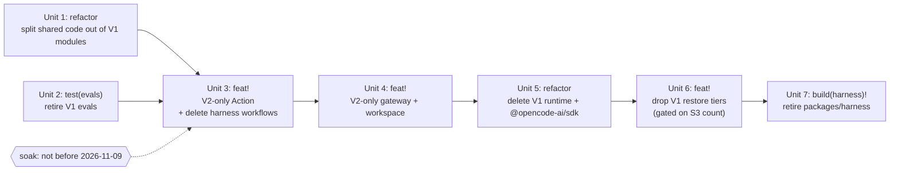

# refactor: Remove the OpenCode V1 path

## Overview

OpenCode V2 runs every surface now. The stock `opencode` binary is digest-pinned in `packages/runtime/src/shared/opencode-v2-pin.json`. It has been the Action default since v0.133.0 (#2024), and the gateway and workspace have run on it in production since 2026-10-30. The V1 path is still in the tree: the Action V1 run loop and installer, the gateway V1 run loop, the workspace V1 supervisors, the V1 restore tiers, `@opencode-ai/sdk`, the V1-only evals, and `packages/harness` with its release workflows. The final V1 harness build is `1.19.5+harness.bf7f7dfe`.

This plan deletes that path in seven pull requests, each shippable on its own. It replaces Units 14 and 15 of `docs/plans/2026-10-27-001-feat-opencode-v2-migration-plan.md`.

## Problem Frame

The origin requirements cut V1 once V2 is proven, with no side-by-side period after a surface switches (see origin: R9 delete V1 after the last switch, R2/R3 retire the harness). V2 is proven: the Action, gateway and workspace switches all landed, and so did the live checks. Keeping V1 has a cost:

- Every V2 fix has to reason about a second loop.
- 36 V2 modules still import from V1-named modules, so neither side can be read alone.
- Renovate, CI and the docs still carry V1 pins and V1 rollback text.

## Requirements Trace

- R1. Remove the V1 Action path. A V1 `opencode-version` is rejected at input parsing with a named error, never by a failed download (origin R9).
- R2. Remove the V1 gateway run loop and the workspace V1 supervisors. The gateway refuses a workspace that does not report V2 (origin R9).
- R3. Remove `@opencode-ai/sdk` from the tree and from `dist/` (origin R9).
- R4. Remove the remote V1 restore tiers (S3 `sessions/` and the V1 Actions-cache entries). Gate the S3 tier on a read-only count. Delete no data (origin R13-R16). The cache tier needs no gate: GitHub evicts caches not accessed in 7 days, and since the V2 default every V1 entry has either been superseded by a V2 save, which wins precedence, or sat idle.
- R5. Retire `packages/harness`, its release workflows and its Renovate managers. Published npm packages and tags stay (origin R2, R3).
- R6. Keep V2 behaviour unchanged at every step: restore precedence, save keys for runs that reach the server, the V1 database import wait, archive on overflow, and release-tag discovery. The deliberate changes are that every save uses V2 keys instead of falling back to V1, and that a run which ends before the V2 server starts saves nothing, in cleanup or in the post hook (Unit 3).
- R7. Every pull request passes the required checks by itself, and the committed `dist/` matches a fresh build.

## Scope Boundaries

- No change to V2 runtime behaviour, configuration or permissions.
- No S3 or Actions-cache deletion. Deleting V1 session data is a separate ask-first operation.
- No npm deprecation of `@fro.bot/harness*` and no change to npm trusted-publisher bindings. Both stay Marcus-only follow-ups.
- No old/new image-skew test matrix. Infra builds and replaces both images from one `fro-bot/agent` ref in one deploy.
- No V2 eval suite. The V1 evals are retired, not ported.
- Historical `docs/plans`, `docs/brainstorms`, `docs/solutions`, `docs/decisions` and `RFCs/` stay as written, as in #1968.

### Deferred to Separate Tasks

- The V1 database import wait (`v1-import-wait.ts`, `readV1MigrationStatus`, `readV1DatabaseFacts`). It stays because a persistent self-hosted data directory can still hold a V1 `opencode.db`. Remove it only after an explicit decision that such directories are unsupported.
- The infra credential broker. Its only consumer is `harness-integrate.yaml`, which Unit 3 deletes. Retiring it is an infra change.
- A V2 eval suite, if a prompt or harness change ever needs one.
- A V2 OpenCode source clone under `.slim/clonedeps/`, to replace the V1 clones that Unit 7 drops.

## Context & Research

### Relevant Code and Patterns

- Shared helpers between V1 and V2 siblings: `packages/runtime/src/session/generation.ts` (`selectOpenCodeGeneration`, moved out of the gateway in #2008) and `src/features/agent/attempt-outcome.ts`.
- Extraction direction: `docs/solutions/best-practices/extract-shared-helpers-toward-the-value-dependency-2026-08-08.md`. A helper moves toward the module that is already its runtime dependency.
- Input parse errors: `src/harness/config/inputs.ts` throws `Input '<name>' …` inside the parser `try`, and the parser returns `err(Error)`. `parseOutputMode` is the closest sibling.
- Fail-closed workspace readiness: `packages/gateway/src/execute/run.ts` already marks a workspace not ready when `opencodeVersion` is present but unreadable. Unit 4 extends that path to a missing or below-2 version.
- Infra reads `packages/runtime/src/shared/opencode-v2-pin.json` and passes `OPENCODE_VERSION` as a build-arg. The path must not move.

### Institutional Learnings

- Committed `dist/` is shipped code. Rebuild it and diff it on every PR that touches bundled code, with no carve-out (`docs/solutions/workflow-issues/committed-dist-attribution-and-sbom-hygiene-2026-06-21.md`).
- Harness release tags live outside the `v*` namespace. The `+harness` filters must outlive the package (`docs/solutions/workflow-issues/semantic-release-tag-namespace-collision-2026-06-14.md`).
- Restore and save must agree on the path list. Removing a tier must not change what V2 saves (`docs/solutions/logic-errors/repair-before-capture-sqlite-session-cache-loop-2026-09-02.md`).
- Cache keys are versioned and immutable. Removal must not alias V1 and V2 prefixes or touch the tools cache (`docs/solutions/performance-issues/tool-binary-caching-ephemeral-runners.md`).
- A frozen Bun lockfile validates the whole workspace, even for filtered builds (`docs/solutions/workflow-issues/migrate-pnpm-to-bun-monorepo-2026-06-24.md`).
- The post-consolidation ideation calls V1 finished and warns that a V1 eval suite would gate upgrades that will never come (`docs/ideation/2026-10-23-post-consolidation-ideation.md`).

## Prior-Art Survey

```json
{
  "schema_version": 2,
  "verdict": "extend",
  "scope": "fro-bot/agent origin/main: git history, docs/solutions, docs/plans, docs/brainstorms, RFCs",
  "freshness": {
    "vcs_reference": "8fbfda0bea3bc7def9601bd8fdc9ebe3959bff55"
  },
  "budget": {
    "max_search_passes": 6,
    "max_candidate_inspections": 12,
    "exhausted": false
  },
  "candidates": [
    {
      "path_or_symbol": "c71af87a9 (#1968) feat!: remove oMo and oMo Slim support",
      "description": "Single feat! PR deleting five action inputs, installers, constants, Renovate managers, CI assertions and docs; proved the default path unchanged by comparing buildCIConfig output across 9 input cases; left historical plans, RFCs and solutions alone.",
      "disposition": "reuse"
    },
    {
      "path_or_symbol": "f5b8d6910 (#1339) refactor(agent): remove the duplicate runtime execution stack",
      "description": "Single refactor (no release) deleting the duplicate packages/runtime execution/retry/prompt-sender stack and its barrel exports with the plan doc; pattern for private-package deletions.",
      "disposition": "reuse"
    },
    {
      "path_or_symbol": "2432df80b (#1439) and 82bbb6102 (#1445) forward-shadow removal",
      "description": "Removed the workflow call path first (fix(ci)), then the harness implementation and tests (refactor(harness)), then a naming-remnant cleanup PR; ordering precedent callers before implementation.",
      "disposition": "extend"
    },
    {
      "path_or_symbol": "ed4b882be (#1443) feat(action): remove legacy output-mode phrase inference",
      "description": "Removal gated on a compatibility window observed across a full minor release plus every in-repo caller setting the mode explicitly.",
      "disposition": "extend"
    },
    {
      "path_or_symbol": "docs/solutions/best-practices/extract-shared-helpers-toward-the-value-dependency-2026-08-08.md",
      "description": "Rule that a shared helper moves toward the module that is already the runtime (value) dependency; attempt-outcome.ts shouldRetryFromOutcome is the worked example.",
      "disposition": "reuse"
    },
    {
      "path_or_symbol": "docs/solutions/workflow-issues/semantic-release-tag-namespace-collision-2026-06-14.md",
      "description": "Why harness release tags live outside the v-prefixed product namespace and why the +harness tag filters in auto-release, prepare-release-pr, ci and preview.ts must outlive the package.",
      "disposition": "reuse"
    },
    {
      "path_or_symbol": "packages/runtime/src/session/generation.ts selectOpenCodeGeneration (9e469de92, #2008)",
      "description": "The one version-to-generation selector shared by gateway, Action cache keys and setup, extracted between V1 and V2 siblings with colocated tests.",
      "disposition": "reuse"
    },
    {
      "path_or_symbol": "scripts/runtime-no-actions-import-guard.test.ts and packages/gateway/src/discord/io.boundary.test.ts",
      "description": "Source-scanning boundary guards: offender list with a vacuity check and detector table, and an allowlist with per-entry reasons plus a staleness block.",
      "disposition": "extend"
    },
    {
      "path_or_symbol": "docs/plans/2026-10-27-001-feat-opencode-v2-migration-plan.md U14/U15",
      "description": "Existing deletion plan for V1 code, V1 session data and harness retirement; stale: omits session-tools.ts, the v1-import-wait decision, the harness-integrate Action pin and the test-reads-source couplings.",
      "disposition": "extend"
    },
    {
      "path_or_symbol": "1116f9e05 (#46) feat(agent): implement RFC-013 SDK execution mode",
      "description": "Replaced CLI execution with SDK execution in one feat PR at project start; no persisted-data tier, external consumers or release pipeline.",
      "disposition": "insufficient",
      "insufficiency_reason": "Predates every constraint of this removal (committed dist, npm-published package, S3 and cache data, infra consumer, required checks), so it offers no sequencing or verification pattern."
    }
  ],
  "excluded_scopes": [
    {
      "scope": "marcusrbrown/infra",
      "reason": "Consumer repo, not a removal precedent; read only for the deploy-gateway.yaml build-arg and pin-file path."
    },
    {
      "scope": "fro-bot/space-bus",
      "reason": "Consumer of the Action; it already runs V2 and pins no harness build."
    }
  ]
}
```

## Key Technical Decisions

- **Seven PRs, one in the merge path at a time.** Units 1 and 2 change no behaviour and can land now. Units 3-7 wait until 2026-11-09 (D2), seven days after the release that made V2 the Action default. Each unit can be reverted without the units after it.
- **Release type per unit** (checked against `@semantic-release/commit-analyzer` with `.releaserc.yaml`):
  - Unit 1 `refactor:` and Unit 5 `refactor:` (no `!`) do not release.
  - Unit 2 `test(evals):` does not release.
  - Units 3, 4 and 6 `feat!:` cut a minor.
  - Unit 7 `build(harness)!:` cuts a minor whose notes record the retirement.
  - Commits that don't release still ship in the next release.
- **Retire the V1 evals instead of porting them.** They are V1 end to end: harness binary spawn, `noReply` seeding, OAuth auth. The baseline is pinned to a 1.18 harness build and has not been regenerated since September. Their offline tests run inside the required `Test` check through `test:evals`, so deleting them drops those assertions, but every one covers V1 code that Unit 3 deletes. Porting would need a new seeding design and a paid baseline run.
- **Delete `harness-integrate.yaml` and `harness-release.yaml` with the Action cut.** After Unit 3 they can't build, because they run the local Action on the V1 harness build. 1.19.5 is the final V1 base, so no workflow is left broken. The package itself stays until Unit 7.
- **Reject V1 pins at input parsing (D4).** Map unset and `latest` to the pin first, because `selectOpenCodeGeneration` returns an error for `latest`. Then use the selector, so stock V1 and both harness spellings are rejected. `resolveStockV2Policy` still rejects V2 versions that aren't the pin. The input itself stays; only an old value is an error.
- **Move V2-only defaults with the Action cut, not the data-tier cut.** `resolveSessionGeneration` and seven helper defaults fall back to V1 when state is missing. Once the V1 path is gone nothing may fall back to V1 keys, so Unit 3 flips them to V2. A run that ends before the V2 server starts must not save at all: the data on the runner is not its own history. Unit 6 removes only the V1 read tiers.
- **The gateway gates on the workspace version instead of selecting by it.** A missing, unreadable or below-2 `opencodeVersion` marks the workspace not ready. Unit 4 extends the existing fail-closed path, which today covers only an unreadable value. `/readyz` keeps its shape, so the type mirror and the drift guard need no change.
- **The workspace image requires `OPENCODE_VERSION` as a build-arg.** A Docker `ARG` default can't be read from a file, and a literal default would be a second copy of the pin that drifts on every Renovate bump. A no-arg build fails fast with a message that names the pin file. Infra already passes the build-arg. CI smoke and the deploy docs pass it from the pin.
- **Rollback is documented, not engineered (D3).** After Unit 3, rollback means pinning the Action to the last pre-cut release tag. After Unit 4, it means redeploying the prior image pair from GHCR. V1 and V2 history fork on rollback: a V1 run cannot see V2 work, and a later V2 run keeps its own copy. The docs say this plainly. Nothing reconciles the two.
- **No import guard.** Unit 1 only moves code. Each later unit deletes V1 modules, and `tsc` then fails on any remaining import of them. A guard would only catch a new V2-to-V1 import added in the few days between units.
- **Soak evidence before Unit 3.** Check open V2 regressions and Action failures across the fro-bot repos for the soak window. An open V2 regression holds Unit 3.

## Open Questions

### Resolved During Planning

- V2 archive on overflow: V2 already archives through `updateSession({archived:true})` in `src/harness/phases/execute-v2.ts`. Only the V1 `packages/runtime/src/session/archive.ts` is dead.
- `@opencode-ai/plugin`: no package in this repo depends on it. The V2 plugin uses `@opencode/plugin`.
- Required checks: no required check is a harness job. `Build`, `Lint`, `Test`, `Workspace Image Smoke Test` and `Gateway Image Smoke Test` have steps that change, and their names stay.
- Infra build-arg: infra passes `OPENCODE_VERSION` from the pin file, so dropping the Dockerfile default changes nothing in production.

### Deferred to Implementation

- The exact module each extracted symbol lands in, for the edges the research map leaves open. Apply the value-dependency rule and check for cycles.
- Whether `scripts/provider-failure-parity.test.ts` ports to the V2 classifiers or is dropped. It cannot stay as written after Units 3 and 4. Decide by whether it guards behaviour or only restates config.
- Whether V2 needs `OPENCODE_EXPERIMENTAL_DISABLE_FILEWATCHER` and `OPENCODE_EXPERIMENTAL_BACKGROUND_SUBAGENTS`. The V1 smoke leg asserts them, and the V2 leg does not. Decide from the V2 source before dropping them.
- D1 result: Marcus runs the read-only S3 count before Unit 6. For each repo whose only history is V1 (a `sessions/` object, no `sessions-v2/`) that he wants to keep, one dispatched V2 run before Unit 6 imports that history and saves it as V2. The other V1-only repos start fresh.

## High-Level Technical Design

> _This illustrates the intended approach and is directional guidance for review, not implementation specification. The implementing agent should treat it as context, not code to reproduce._



## Implementation Units

- [x] **Unit 1: Split V2-used code out of V1 modules** (#2110)

**Goal:** No V2 module imports a V1 module that a later unit deletes. Every later deletion then becomes a file list plus `tsc`.

**Requirements:** R6, R7

**Dependencies:** None

**Files:**

- Create: `packages/gateway/src/execute/run-core-shared.ts` and its test (`RunCoreError`, `RunCoreErrorKind`, `CoreStreamSink`, `EVENT_STREAM_CONNECT_TIMEOUT_MS`, `wrapLedgerWithHooks`, `awaitFirstEvent`, `resumeWith` and `makeAbortableStream` from `run-core.ts`; `run-core-v2.ts` is already large)
- Create: `src/features/agent/execution-deadline.ts` and its test (the execution deadline, as a leaf so `retry-v2.ts` and `session-poll-v2.ts` don't import each other)
- Delete: `src/harness/phases/execution-backend.ts`, moving `ExecutionBackend` and `OverflowDrainOutcome` into `execute-v2.ts`
- Modify, Action: move symbols from `src/features/agent/{prompt-sender,retry,session-poll,streaming}.ts` into `attempt-outcome.ts`, `retry-v2.ts`, `session-poll-v2.ts` and `streaming-v2.ts`. Repoint the importers.
- Modify, gateway: move symbols from `packages/gateway/src/execute/{drain-completion,provider-failure,root-stop}.ts` into their `-v2` siblings. Repoint `run.ts`, `settle-owned-sessions.ts`, `operator-contract/{wait-reason,provider-failure-reason,run-status}.ts` and `test-helpers.ts`. Point `live-reconcile.ts` at `settle-owned-sessions-v2.ts`'s `DEFAULT_SETTLE_TIMEOUT_MS`.
- Modify, workspace: move types from `apps/workspace-agent/src/{opencode-server,opencode-proxy,opencode-instance}.ts` into `types.ts` and the `-v2` siblings. Repoint `main.ts`, `recover.ts` and `server.ts`.
- Modify, SDK types: give `packages/runtime/src/agent/{types,reference-files}.ts` local structural `FilePartInput`/`TextPartInput` types, and have `src/features/attachments/types.ts` re-export them.
- Modify: move `defaultOpenCodeConfigDir` out of `src/services/setup/no-task-reuse-config.ts` into a shared setup helper.
- Test: move the helper tests whose only home is a V1 test file. That means `createExecutionDeadline` (from `retry.test.ts`), `waitForEventProcessorShutdown` (from `opencode.test.ts`), and `detectArtifacts`/`observeClassification` (from `streaming.test.ts`), each into its `-v2` sibling test.

**Approach:**

- Move a symbol when the V1 file's whole identity is the V1 loop. Trim in place when the file survives: the gateway `repo-quiescence.ts`, the Action `src/harness/phases/execute.ts`, the runtime `ledger-reconcile.ts` and `session/types.ts`. Each later unit cuts its V1 part.
- Moves only. No renames beyond what a move needs, and no logic changes.
- Repoint every V2 importer, including `prompt-sender-v2.ts`, `execution-v2.ts` and `observed-turn-v2.ts`.

**Execution note:** Characterization first. The suites that already cover the moved symbols stay green with no assertion changes.

**Patterns to follow:**

- `src/features/agent/attempt-outcome.ts`
- `packages/runtime/src/session/generation.ts`
- `docs/solutions/best-practices/extract-shared-helpers-toward-the-value-dependency-2026-08-08.md`

**Test scenarios:**

- Happy path: each moved helper's moved test passes in its new file with unchanged assertions.
- Integration: the full action, gateway, runtime and workspace-agent suites pass with no assertion edits outside the moved tests.

**Verification:**

- `bun run check-types`, `lint`, `test` and `test:scripts` pass, and `aft_inspect` reports no new import cycles.
- No `-v2` module imports a file that Units 3-5 delete.
- `dist/` is rebuilt and reproducible across two builds.

- [x] **Unit 2: Retire the V1 evals** (#2112)

**Goal:** Remove the V1-only eval suite, so the Action and the harness lose their last non-production consumer.

**Requirements:** R7. It removes the last non-production consumer of the V1 Action and harness code, so Units 3 and 7 can delete them.

**Dependencies:** None (independent of Unit 1)

**Files:**

- Delete: `evals/`
- Modify: `package.json`. Drop `test:evals`, `evals:baseline:update` and `evals:presearch`, and remove `test:evals` from the `test` chain.
- Modify: the root `vitest.config.ts` and `scripts/vitest-home-isolation.setup.ts`, removing any `evals/` include or the `FRO_BOT_EVAL` opt-out.
- Modify: `.github/workflows/ci.yaml`, removing the `evals/**` path-filter entry. This is a CI edit and needs approval first.
- Modify: `AGENTS.md` (COMMANDS, the test-isolation note), `STRUCTURE.md`, `ARCHITECTURE.md`, and the wiki pages that describe evals. Follow the `generating-project-docs` skill for the living docs.

**Approach:**

- Delete the suite outright. The history stays in git. Its offline tests run in the `Test` check today, and each covers V1 code that Unit 3 deletes. The PR body says so.
- `scripts/module-taxonomy.test.ts` keeps any `evals` module value that existing solution docs use.

**Test expectation:** none, because this removes a non-shipped test suite. The `Test` required check runs without `test:evals` and stays green. No remaining test covers V2 behaviour through `evals/`.

**Verification:**

- `bun run test` and `test:scripts` pass.
- No remaining non-historical reference to `evals/`.
- `dist/` is unchanged.

- [x] **Unit 3: V2-only Action**

**Goal:** The Action runs only OpenCode V2, rejects a V1 `opencode-version` at input parsing, saves V2 keys, and persists session state only for a run that restored the cache and started the V2 server.

**As built:** these differ from the file list below.

- `src/features/attachments/injector.ts` stays, because `session-prep.ts` still uses `buildAttachmentResult`.
- `src/services/setup/systematic-plugin.ts` and its test are deleted, since no code used them any more.
- `resolveSessionGeneration` and `STATE_KEYS.OPENCODE_VERSION` are removed instead of flipped. Post and cleanup saves no longer carry a version.
- `packages/runtime/src/object-store/content-sync.ts` defaults to V2 as well.
- `packages/harness/scripts/build-platform.test.ts` loses its `harness-release.yaml` drift guard.
- `parseOpenCodeVersion` also rejects malformed values before any URL is built.
- The workflow deletions ship in the same commit, because `scripts/fro-bot-workflow.test.ts` reads them.
- `ci.yaml` needed no edit.

**Requirements:** R1, R5 (the harness workflow deletion), R6, R7

**Dependencies:** Units 1 and 2, the soak (not before 2026-11-09), and the soak evidence check

**Files:**

- Modify: `src/harness/config/inputs.ts`, adding `parseOpenCodeVersion` beside `parseOutputMode`.
- Modify, collapsing each to the V2 path:
  - `src/harness/phases/{execute,cache-restore,session-prep,bootstrap,cleanup}.ts`
  - `src/harness/run.ts`
  - `src/services/setup/{opencode,setup}.ts`
  - `src/services/cache/{cache-key,paths,restore,save,content-sync}.ts` (V1-run branches only; the V2 run's V1 fallback tiers stay until Unit 6)
- Modify: flip the `resolveSessionGeneration` fallback and the helper `generation` defaults to V2.
- Delete:
  - `src/harness/phases/cache-restore-kind.ts`
  - `src/features/agent/{execution,prompt-sender,retry,session-poll,streaming,server-adapter}.ts`
  - `src/features/attachments/injector.ts`
  - `src/services/setup/{ci-config,no-task-reuse-config,session-tools-config}.ts`
  - `apps/action/src/session-tools.ts` and its `tsdown.config.ts` entry
  - `packages/runtime/src/agent/session-tools.ts` and its export
  - the matching tests
- Modify: the barrels `src/features/agent/index.ts`, `src/services/setup/index.ts` and `src/features/attachments/index.ts`. Drop their re-exports of deleted modules, and delete a barrel that is left with no consumers.
- Delete: `.github/workflows/harness-integrate.yaml`, `.github/workflows/harness-release.yaml` and `scripts/harness/mint-broker-credential.ts` with its test. This is a release-workflow edit and needs approval first.
- Modify: `.github/workflows/fro-bot.yaml` (comment naming harness-release as a caller), and `scripts/fro-bot-workflow.test.ts` (drop the harness-workflow describes).
- Delete: `scripts/harness-tag-derivation.test.ts`. Trim: the `packages/harness/src/version.test.ts` describe that reads `src/services/setup/opencode.ts`.
- Modify: `scripts/provider-failure-parity.test.ts`. Port it to the V2 classifiers or drop it (see Open Questions).
- Modify: `action.yaml`, `README.md` (the input table and "Moving to OpenCode V2"), and `docs/wiki/{Setup and Configuration,Architecture Overview,Execution Lifecycle,index}.md`.
- Test: `src/harness/config/inputs.test.ts`, `src/services/cache/cache-key.test.ts` and `src/harness/post.test.ts`.

**Approach:**

- `runExecute` calls the V2 backend directly. Unit 1 already moved `ExecutionBackend` into `execute-v2.ts`; collapse it there. `src/features/agent/execution-deadline.ts` (from Unit 1) stays.
- The V1-pin error names the input and the value, says V1 is no longer run, and points to the README section and to pinning a pre-cut Action release.
- The README's rollback text names the immutable last pre-cut release tag. It also states the history fork: a V1 run can't see V2 sessions, and V2 keeps its own copy.
- Keep `buildCachePathsV1Sqlite` and the V2 run's V1 fallback tiers. Keep the V1 import wait.

**Patterns to follow:**

- `parseOutputMode` in `src/harness/config/inputs.ts`
- The #1968 removal (inputs, installer, CI assertions and docs in one PR, characterization of the default path)

**Test scenarios:**

- Happy path: `opencode-version` unset or `latest` resolves to the recorded V2 pin. The exact pin is accepted.
- Error path: `1.19.5+harness.bf7f7dfe`, `1.19.5-harness.bf7f7dfe`, `1.19.4`, `v1.19.4` and `0.9.0` each fail parsing with the named error, and no tool-cache lookup or download happens.
- Error path: a V2 version that isn't the pin is still rejected by the stock-V2 policy.
- Edge case: a malformed version string fails at parsing and never reaches the network.
- Integration: a run that ends before the V2 server starts (a rejected V1 input, a setup failure, a failed restore) makes no Actions-cache and no object-store call, in cleanup or in the post hook. A crash after the server started still saves under V2 keys, through cleanup or the post hook's retry.
- Integration: a V2 run with only a V1 cache or S3 entry still restores it and imports it (the fallback tiers are unchanged).
- Characterization: `buildCIConfigV2` (`src/services/setup/ci-config-v2.ts`) output is byte-identical to main for the existing input cases.

**Verification:**

- The Action self-test (`Test GitHub Action`) passes on the PR.
- The real-binary V2 suites pass locally against the pinned binary.
- `dist/` is rebuilt, reproducible, and contains no V1 execution code reachable from the Action entry.

- [x] **Unit 4: V2-only gateway and workspace**

**Goal:** The gateway runs only the V2 loop and refuses a non-V2 workspace. The workspace image builds and runs only V2.

**As built:** these differ from the file list below.

- The readiness gate lives in `run.ts` and reuses `selectOpenCodeGeneration` from `@fro-bot/runtime`; the gateway's own `execute/opencode-generation.ts` is deleted. Its tests are `run.workspace-version.test.ts` (renamed from `run.v2-selection.test.ts`), not `run.test.ts`.
- The V1 `run-core*.test.ts` suites are deleted with `run-core.ts`; the V2 loop keeps its own `run-core-v2*.test.ts` suites.
- `deploy/managed-config/opencode.json` is deleted. Its only content was the `file://` entry for the no-task-reuse plugin, and the V1 image already replaced it with `opencode-v2.json` for V2. The Dockerfile now copies `opencode-v2.json` straight to `/etc/opencode/opencode.json`.
- The Dockerfile gate is a `version-gate` stage that every other stage builds from. It also rejects a version that is not equal to the pin, so `1.19.4`, `2.2.5` and `latest` fail as well as an unset or `+harness` value.
- The `OPENCODE_EXPERIMENTAL_DISABLE_FILEWATCHER` and `OPENCODE_EXPERIMENTAL_BACKGROUND_SUBAGENTS` image envs are dropped, along with their smoke assertions. The V2 child environment is an allowlist that never forwards them.
- The entrypoint and `provision-agent-config` no longer write `auth.json`; the supervisor provisions each spawn. The smoke asserts `auth: present` and no file under the agent home.
- `ci.yaml` `workspace-smoke` builds one image (`:smoke`) from the pin file. The separate V1 build, the `+harness` checks, the Dockerfile-default tag check and the checksum negative test are replaced by a version-gate negative test.
- `deploy/plugins/` is gone entirely. The root `src/services/setup/no-task-reuse-plugin.test.ts` is deleted too.

**Requirements:** R2, R6, R7

**Dependencies:** Unit 3

**Files:**

- Modify: `packages/gateway/src/execute/run.ts`. The V1 branch goes, and readiness gates on `opencodeVersion` being major 2 or higher.
- Delete: `packages/gateway/src/execute/{run-core,root-stop,settle-owned-sessions,question-client,opencode-attach,permission-reply-v1,opencode-generation,drain-completion,provider-failure}.ts` and their tests. Unit 1 has already moved what V2 needs out of `drain-completion.ts` and `provider-failure.ts`. Trim `repo-quiescence.ts`, removing `createRepoQuiescenceChecker` and `SessionStatusClient`.
- Modify: `packages/gateway/src/program.ts`. Wire `createRepoQuiescenceCheckerV2` in place of the generation-aware checker.
- Delete: `packages/gateway/src/runtime-effect.ts` `syncSessionsToStoreEffect`/`FromStoreEffect`, which have no callers.
- Modify: `apps/workspace-agent/src/{main,opencode-generation,recover,server}.ts`. An unset `WORKSPACE_IMAGE_OPENCODE_VERSION` becomes fatal, not V1.
- Delete: `apps/workspace-agent/src/{opencode-server,opencode-proxy,opencode-instance}.ts` and their tests.
- Modify: `deploy/workspace.Dockerfile`. Drop the V1 install block, the harness cases, the `ARG OPENCODE_VERSION` literal default and the no-task-reuse copy. A missing `OPENCODE_VERSION` fails the build at once, with a message naming `packages/runtime/src/shared/opencode-v2-pin.json`.
- Modify: `deploy/workspace-entrypoint.sh` and `deploy/scripts/{provision-agent-config,merge-config}.mjs` (V2 only), plus their `.test.mjs`. Delete: `deploy/plugins/no-task-reuse.{mjs,d.mts}`, `deploy/managed-config/opencode.json` if V2 doesn't read it, and their tests.
- Modify: `.github/workflows/ci.yaml` `workspace-smoke`. This is a CI edit and needs approval first.
- Modify: `deploy/README.md`, `deploy/compose.yaml` (comment), `packages/gateway/AGENTS.md` and `apps/workspace-agent/AGENTS.md`.
- Test: `packages/gateway/src/execute/run.test.ts` (readiness gate) and `apps/workspace-agent/src/main-v2.test.ts`.

**Approach:**

- `/readyz` keeps `opencodeVersion` and its shape. Only the gateway's use of it changes, from selecting a generation to gating on V2.
- Build `:smoke` as the V2 image, passing `OPENCODE_VERSION` from the pin file. Carry over the boot, whitespace-auth, egress, isolation and provider-credential assertions. Drop the `+harness` checks, the Dockerfile-default tag check and the harness checksum steps. Keep the job name `Workspace Image Smoke Test`.
- `deploy/README.md` documents the required build-arg. Its rollback text becomes: redeploy the previous image pair from GHCR.

**Test scenarios:**

- Happy path: the gateway admits a run when the workspace reports `2.2.6`.
- Error path: a workspace that reports no version, `1.19.5+harness.bf7f7dfe` or garbage is not ready. No run is admitted, and the operator sees the existing not-ready diagnostic.
- Error path: a workspace started with no `WORKSPACE_IMAGE_OPENCODE_VERSION` exits with a named error.
- Integration: a workspace image built with `OPENCODE_VERSION` from the pin file passes the V2 smoke.
- Error path: a no-arg build, and a build with a `+harness` value, both fail before any download.
- Integration: the gateway e2e against the real V2 binary passes (`run-core-v2.e2e.test.ts`).

**Verification:**

- The `Workspace Image Smoke Test` and `Gateway Image Smoke Test` required checks run and pass on the PR.
- After release, the infra pin bump deploys, and a plain mention plus a Deny on an approval both behave as before.

- [ ] **Unit 5: Delete the V1 runtime and `@opencode-ai/sdk`**

**Goal:** No source file, lockfile entry or bundle references `@opencode-ai/sdk`.

**Requirements:** R3, R7

**Dependencies:** Unit 4

**Files:**

- Delete: `packages/runtime/src/agent/{remote-client,remote-question-client,server}.ts`.
- Delete: `packages/runtime/src/session/{archive,backend,storage-mappers,storage-message-mappers}.ts`.
- Delete: the matching tests, and their exports from `packages/runtime/src/agent/index.ts` and `session/index.ts`.
- Trim: `packages/runtime/src/agent/ledger-reconcile.ts` (`createSdkLedgerReconcileAdapter`) and `packages/runtime/src/session/types.ts` (the SDK-derived V1 types). Surviving search and prune types stay.
- Modify: `packages/runtime/src/shared/constants.ts`, `tsdown.config.ts` (the inline SDK rule), the root and runtime `package.json`, and `bun.lock`. The lockfile change needs approval first.
- Modify: `.github/renovate.json5`. Remove `@opencode-ai/sdk` from the group and from the V1 cap names. Keep the `anomalyco/opencode` cap and the harness base manager until Unit 7.
- Modify: `scripts/bfra-me-exemption-guard.test.ts`, `AGENTS.md`, `.github/copilot-instructions.md`, `.agents/skills/versioned-tool/SKILL.md` and `src/services/session/AGENTS.md`.
- Modify: the `@opencode-ai/sdk` entry in `dist/THIRD_PARTY_NOTICES.txt` (it drops when the dependency goes), the comments in `-v2` modules that still name their deleted V1 sibling (for example "sibling of `execution.ts`"), and any V1 wording left in the wiki pages Session Persistence, Operator Web Control Surface and Conventions.

**Approach:**

- Delete only. Check whether `session/discovery-integration.test.ts` covers the surviving `discovery.ts`, and if it does, repoint it rather than delete it.
- Deleting `server.ts` removes `pinQuestionToolOff`. V2 is unaffected, because the Action denies `question` through the V2 permission rules (`buildPermissionRulesV2`).

**Test expectation:** none for new behavior; this is pure deletion. The surviving suites stay green.

**Verification:**

- `bun install --frozen-lockfile` and the full gates pass.
- `git grep @opencode-ai/sdk` finds only historical docs.
- `dist/` is rebuilt and reproducible.

- [ ] **Unit 6: Drop the V1 restore tiers**

**Goal:** A V2 run restores only V2 S3 and V2 cache entries. The V1 database import wait stays.

**Requirements:** R4, R6, R7

**Dependencies:** Unit 5, Marcus's read-only S3 count (D1), and one dispatched V2 run for each V1-only repo he wants to keep

**Files:**

- Modify: `src/services/cache/{restore,cache-key,paths,save,content-sync}.ts`. Restore tiers become V2 only. Remove `buildCachePathsV1Sqlite`, the V1 `classifyRestoreHit` branch, and the `generation` parameter where it now has a single value.
- Modify: `packages/runtime/src/session/version.ts` (`SessionGeneration`, `getSessionDbBasenames`), `packages/runtime/src/shared/constants.ts` (the V1 `CACHE_PREFIX`) and its re-exports in `src/shared/constants.ts` and `src/index.ts`.
- Modify: `README.md` and the `docs/wiki/Session Persistence.md` page. Session history comes only from V2 saves. A local V1 database is still imported.
- Test: `src/services/cache/{restore-save-flow,cache,cache-key,paths}.test.ts`.

**Approach:**

- Keep the WAL-distrust block for every object-store download. It covers the non-atomic two-key upload, not V1 specifically.
- Keep `v1-import-wait.ts`, `readV1MigrationStatus` and `readV1DatabaseFacts`.
- The PR body states the D1 count and which V1-only repos were pre-run. It also says that V1 cache entries have aged out and that V1 S3 objects are kept.

**Test scenarios:**

- Happy path: a V2 run with a V2 S3 object restores it. The cache is not consulted.
- Edge case: a V2 run with only a V1 S3 object or a V1 cache entry starts fresh and does not restore it.
- Integration: a V1-format `opencode.db` already on disk is still imported through the import wait.
- Integration: what is saved after a run is byte-identical to main (same keys, same path list).

**Verification:**

- The restore and save suites pass.
- The Action self-test passes on the PR.
- No V1 key prefix is built anywhere in `src/`.

- [ ] **Unit 7: Retire `packages/harness`**

**Goal:** The harness package, its Renovate managers and every build reference to it are gone, while release-tag discovery still ignores the historical harness tags.

**Requirements:** R5, R6, R7

**Dependencies:** Unit 6

**Files:**

- Delete: `packages/harness/`, `scripts/harness/duplicate-harness-release-tags.ts` and its test.
- Keep: `scripts/harness/mint-app-token.ts`, which `fro-bot.yaml` uses.
- Modify: `package.json`, removing the `--filter @fro.bot/harness` steps from `build`, `check-types`, `fix`, `lint` and `test`. Update `bun.lock` as well (needs approval first).
- Modify: `deploy/workspace.Dockerfile` and `deploy/gateway.Dockerfile`, removing the `COPY packages/harness/package.json` lines.
- Modify: `.github/renovate.json5`. Remove the `base_version` manager, the `bun-version.ts` manager and the `anomalyco/opencode` V1 cap in the same change. Keep the path-scoped V2 pin rule and its post-upgrade tasks. Decide whether the global Bun rule still has a purpose. This needs approval first.
- Modify: `eslint.config.ts`, `.gitignore`, `vitest.config.ts` (comment) and `.slim/clonedeps.json`. Drop the V1 clonedeps entries and the AGENTS.md "Cloned Dependency Source" section that describes them.
- Modify: `ARCHITECTURE.md`, `STRUCTURE.md`, `AGENTS.md`, `SECURITY.md`, `.agents/skills/{versioned-tool,generating-project-docs}/SKILL.md`, `docs/wiki/*` (about ten pages), `docs/product/{PRD,FEATURES}.md` and `docs/reference/carry-ledger.md`.
- Keep unchanged: the `+harness` tag filters in `auto-release.yaml`, `prepare-release-pr.yaml`, `ci.yaml` and `scripts/release/preview.ts`, and `module-taxonomy`'s `harness-release` module value.

**Approach:**

- Remove the V1 base manager and the cap together. With the cap gone and the manager kept, Renovate would propose V2 versions as a V1 base. Between Units 3 and 7 the manager opens no PRs, because 1.19.5 is the last V1 release and the cap is `<=1.19.5`.
- Make no change to npm or to published tags. The `.dotfiles` mise pin on `@fro.bot/harness` keeps working off the published package.

**Test scenarios:**

- Integration: `scripts/release/preview.test.ts` still excludes harness tags when picking the latest product tag, with the package gone.
- Integration: both Dockerfiles build from the PR ref with infra's build-args.

**Verification:**

- `Build`, `Lint`, `Test`, `Gateway Image Smoke Test` and `Workspace Image Smoke Test` pass.
- `bun install --frozen-lockfile` passes, and Renovate's dry-run extraction shows no V1 managers.
- `git grep packages/harness` finds only historical docs.

## System-Wide Impact

- **Interaction graph:** the Action phases (bootstrap, cache-restore, session-prep, execute, cleanup, post), the gateway run admission and quiescence, the workspace supervisor selection, Renovate, CI's required checks and the release tooling.
- **Error propagation:** a V1 pin now fails at input parsing as an Action failure with a named message. A non-V2 workspace reads as not ready on the gateway's existing path.
- **State lifecycle risks:** every save uses V2 keys, and a run that ends before the V2 server starts saves nothing (Unit 3). Removing the restore tiers must not change saves (Unit 6). On rollback, V1 and V2 history fork.
- **API surface parity:** the `opencode-version` input keeps its name and its default. Only V1 values become errors. `/readyz` keeps its shape. The V2 pin file path is fixed because infra reads it.
- **Integration coverage:** the Action self-test, the real-binary V2 suites (run locally; no workflow runs them), the image smokes, and the post-release infra deploy check.
- **Unchanged invariants:**
  - V2 restore precedence and save keys
  - the V1 database import wait
  - V2 archive on overflow
  - the V2 permission posture
  - `+harness` tag filtering
  - published npm packages and release tags

## Risks & Dependencies

| Risk | Mitigation |
| --- | --- |
| A shared helper moved in Unit 1 changes behaviour | Moves only, with tests carried over unchanged. `aft_inspect` checks for cycles. |
| A new V2-to-V1 import lands between units | Units 3-5 delete the V1 modules, and `tsc` fails on any remaining import. |
| A source-reading test fails before its target is deleted | `harness-tag-derivation.test.ts` and the `version.test.ts` describe go in Unit 3. The `fro-bot-workflow.test.ts` Dockerfile assumption changes in Unit 4. |
| Renovate proposes V2 as a V1 base | The base manager and the cap are removed together in Unit 7. |
| Infra's next ref bump fails at image build | The `COPY packages/harness/package.json` lines go in the same PR that deletes the package. The pin file path never moves. |
| A repository whose only history is V1 loses continuity at Unit 6 | Gated on Marcus's S3 count (D1). A V1-only repo worth keeping gets one dispatched V2 run first, which imports its history and saves V2. V1 objects are kept, and the import wait still imports a local V1 database. |
| A required check stops reporting | Job names stay. Each CI-touching unit shows the check running on its PR. |

## Documentation / Operational Notes

- Living docs (README, ARCHITECTURE, STRUCTURE, AGENTS) change through the `generating-project-docs` skill.
- Unit 3's release notes carry the breaking change and the rollback target: the immutable last pre-cut release tag.
- After Units 3, 4 and 6, the infra pin bump follows the existing boot-config check and live smoke.
- Marcus-only follow-ups: deprecating `@fro.bot/harness*` on npm, the trusted-publisher bindings, the `.dotfiles` mise pin, and the infra broker.

## Sources & References

- **Origin document:** [docs/brainstorms/2026-10-27-opencode-v2-migration-requirements.md](../brainstorms/2026-10-27-opencode-v2-migration-requirements.md)
- Superseded units: `docs/plans/2026-10-27-001-feat-opencode-v2-migration-plan.md` Units 14-15, recorded `active`. That plan's U1-U13 have landed. This plan replaces U14-U15 with the seven units above and adds the eval retirement and the early harness-workflow deletion.
- Related PRs: #1968 (oMo removal), #1339 (duplicate stack removal), #2008 (shared generation selector), #2024 (V2 Action default), #2100 (V1 pins to the final 1.19.5 build).
