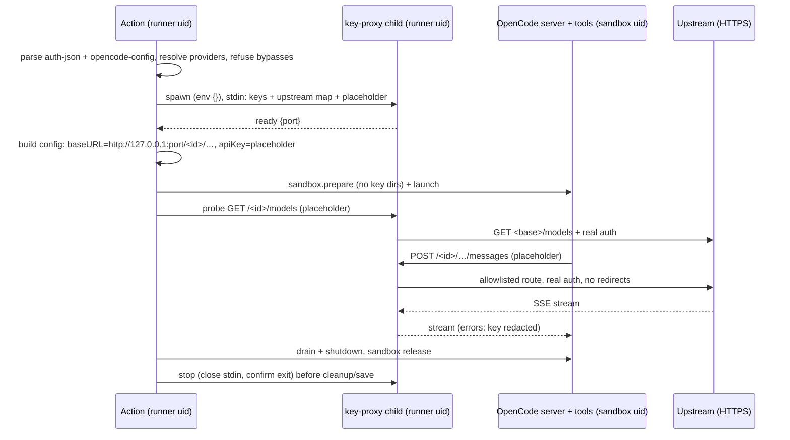

# feat(action): keep provider keys out of the isolate-agent sandbox

## Overview

When `isolate-agent` is on, the Action starts a key proxy before the sandboxed OpenCode V2 server. The proxy is a small child process that runs as the runner user and listens on loopback. It holds the `auth-json` API keys, accepts only the model routes each protocol needs, and attaches the real credential on the way to the provider's upstream. The server gets a loopback base URL for each provider and one per-run placeholder key, and the sandbox never has a grant on a key file. A probe through the proxy at start-up checks the run's selected provider. Every isolation preflight refusal names its fix. Runs without isolation are unchanged.

## Problem Frame

`isolate-agent` runs the server and every tool it starts as a throwaway user. Each `auth-json` key is still a `0600` file that user can read, because the server needs it. So any model shell, or the in-process `read` tool, can read the key. The key is often a gateway key with no per-route scoping, so once it leaks it can be spent anywhere until rotated (see origin: `docs/brainstorms/2026-11-13-isolate-agent-key-proxy-requirements.md`).

## Requirements Trace

- R1. No `auth-json` secret is readable by the sandbox user, and the sandbox has no grant on a real key.
- R2. With isolation off, credential handling is unchanged.
- R3. Model requests reach the upstream with the real credential attached. Streaming, long responses and provider errors behave as they do without isolation, with the key redacted from error bodies.
- R4. The proxy works with any gateway. It supports API-type providers whose requests use the Anthropic Messages, OpenAI Responses or OpenAI Chat protocol. The upstream is the operator's base URL, or the provider's default endpoint when none is set. Under isolation, a provider that can't be mapped is refused, and the refusal names the fix.
- R5. The proxy forwards only allowlisted method-and-path routes (inference and model listing) to each provider's fixed upstream, and answers anything else locally.
- R6. Client credential headers and hop-by-hop headers are dropped, and only origin-form requests are accepted. The proxy follows no redirects and logs no headers.
- R7. Every upstream must be HTTPS. The upstream map is fixed when the proxy starts.
- R8. The proxy runs as its own process, holding only the keys and the upstream map. Keys reach it over stdin, never through argv or env.
- R9. The proxy listens on an ephemeral loopback port and requires the per-run placeholder. It lives for the run only and stops before session state is saved.
- R10. Malformed input gets an error and the proxy keeps serving. If the proxy can't start or dies, the run fails closed.
- R11. A bounded probe of the selected provider runs at start-up. A 401 or 403 fails the run as `auth-rejected`. A 429, a timeout, or any other non-2xx response logs a warning naming that class, and the run continues. A 2xx only means the upstream did not reject the key.
- R12. Every isolation preflight refusal names its fix.
- R13. One canonical docs section covers what is hidden and what isn't. That includes the trusted-upstream residual and the fact that the proxy is not egress control.

## Scope Boundaries

- The default flip of `isolate-agent` is decided separately, once this ships.
- Per-run revocable keys from the broker.
- A second tool uid, and hiding `OPENCODE_PASSWORD`.
- Limiting spend during a run.
- Hiding credentials a trigger provisions on purpose, such as the provision-mode `gh` config.
- Gateways behind an internal CA. Under isolation these are documented as unsupported for now, because the proxy child gets `env: {}` and no CA input exists.

### Deferred to Separate Tasks

- Cross-step post-hook trust of the shared OpenCode log path (`src/harness/post.ts`): a separate issue. The gap is pre-existing and this proxy doesn't affect it.
- Google generateContent, and providers that sign requests (Bedrock, Vertex). Under isolation these are refused or fail with a named error.
- Mediating the server's config API. The model can add a provider through it and send traffic straight out, but it never gets an `auth-json` key that way.
- Blocking private-range upstreams, and guarding against DNS rebinding. The operator's chosen gateway is trusted.

## Context & Research

### Relevant Code and Patterns

- `src/services/setup/credential-files-v2.ts` (`parseProviderKeysV2`, `writeCredentialFilesV2`) handles API-type keys and writes the 0600 files. Isolated runs stop writing those files.
- `withProviderKeyFiles` in `src/services/setup/ci-config-v2.ts` sets `provider.<id>.options.apiKey` to `{file:}`. Its sibling sets a placeholder and a loopback `baseURL` instead.
- `startActionOpenCodeV2` and `runGates` in `src/harness/phases/v2-server.ts` hold the start order and the gates. The start stages are typed as `V2StartStage`.
- `src/harness/phases/sandbox-lifecycle.ts` derives `handedOver` from the dirnames of `keyFilePaths`. It also provides a memoized `release()`, signal ownership (`holdSignalOwnership`), and `lifecycle.launch`.
- `packages/runtime/src/agent/credential-gate-v2.ts` is a presence-only gate, and the workspace also uses it. This plan leaves it unchanged.
- `isForwardableTarget` in `apps/workspace-agent/src/opencode-proxy-v2.ts` checks for canonical origin-form requests. This plan extracts it into runtime and makes the route table a parameter. `createOpencodeProxyV2` serves as a pattern reference for SSE and timing-safe compare only.
- `validateEndpoint` in `packages/runtime/src/object-store/validation.ts` is a pattern for literal-URL checks. This plan requires HTTPS, no userinfo, no fragment and no metadata host, and allows private ranges.
- `startOpenCodeV2Server`, `trackChild` and `terminateChild` in `packages/runtime/src/agent/server-v2.ts` show how to spawn a child, close stdin as the shutdown signal, and confirm the kill.
- `deploy/scripts/fake-anthropic-provider.mjs` is a fake that records a verdict for each header and never echoes the key. `generateSelfSignedCert` in `apps/workspace-agent/src/update-fixtures/helpers.ts` provides a TLS fake.
- The real-runner suite is `src/harness/phases/v2-server.sandbox.integration.test.ts` with `v2-server.sandbox.harness.ts` (`startScriptedProvider`, `Probe.control`).
- `tsdown.config.ts` builds the entries `main` and `post`, and `RUNNER_ENTRY_SCRIPTS` in `src/services/setup/sandbox-preflight.ts` lists them.

### Institutional Learnings

- `docs/solutions/best-practices/workspace-executor-opencode-provisioning-best-practices-2026-06-01.md`: a `0600` key file gives no protection against code running as its owner, and `options.baseURL` is the routing seam.
- `docs/solutions/logic-errors/injected-deny-blocks-own-delivery-path-2026-07-13.md`: test the whole set of controls together against the Action's own response delivery.
- `docs/solutions/best-practices/sse-output-streaming-terminal-drain-2026-06-21.md`: make sure the last SSE bytes are delivered before close.
- `docs/solutions/integration-issues/signal-forwarding-shim-orphans-native-child-2026-10-12.md`: sending a signal does not prove the child exited, so confirm it.
- `docs/solutions/logic-errors/repair-before-capture-sqlite-session-cache-loop-2026-09-02.md`: confirmed teardown must happen before persistence.
- `docs/solutions/integration-issues/provider-auth-failure-hangs-to-timeout-2026-07-25.md`: an auth failure should be one sticky terminal error, and provider detail stays out of public output.

### External References

- OpenCode v2.2.7 `packages/ai` has native protocols. Anthropic Messages uses `x-api-key` with `anthropic-version`. OpenAI and openai-compatible use Bearer. Requests are built as `baseURL` plus the protocol path, and a provider-level `baseURL` replaces the per-model catalog URLs. `http://` base URLs and placeholder keys are accepted. At boot the server never calls a provider's model list.
- RFC 9110 §7.6.1 lists the hop-by-hop headers, including any header named in `Connection`.
- undici #4917: custom auth headers survive a cross-origin redirect. So use `https.request` and never follow redirects.
- OpenAI codex `responses-api-proxy` is the closest prior art: stdin key delivery, a loopback port 0, and exact routes. Don't copy its header pass-through or its shutdown endpoint.
- CLIProxyAPI exposes non-inference routes that the ordinary client key authenticates, which is why a path allowlist is needed and not just a host pin.

## Prior-Art Survey

```json
{
  "schema_version": 2,
  "verdict": "extend",
  "scope": "whole repo: src/, packages/runtime, packages/gateway, apps/workspace-agent, apps/action, deploy/, scripts/, .github/workflows",
  "freshness": {
    "vcs_reference": "4fef260c40745139d334d22524ae0a40c051d269"
  },
  "budget": {
    "max_search_passes": 6,
    "max_candidate_inspections": 12,
    "exhausted": false
  },
  "candidates": [
    {
      "path_or_symbol": "apps/workspace-agent/src/opencode-proxy-v2.ts#isForwardableTarget",
      "description": "Canonical origin-form target check plus exact-segment route matching",
      "disposition": "extend"
    },
    {
      "path_or_symbol": "apps/workspace-agent/src/opencode-proxy-v2.ts#createOpencodeProxyV2",
      "description": "node:http bearer-to-Basic reverse proxy over plain-http loopback upstream",
      "disposition": "insufficient",
      "insufficiency_reason": "Single plain-http upstream, keeps client headers, injects the OpenCode Basic credential; pattern source only"
    },
    {
      "path_or_symbol": "packages/runtime/src/agent/gateway-routes-v2.ts#V2_GATEWAY_ROUTES",
      "description": "Method+path allowlist pinned by test to the SDK client",
      "disposition": "insufficient",
      "insufficiency_reason": "OpenCode server routes, not provider protocol routes; reused as the pin-to-client test pattern"
    },
    {
      "path_or_symbol": "packages/runtime/src/object-store/validation.ts#validateEndpoint",
      "description": "Literal URL validator: https, metadata block, embedded credentials rejected",
      "disposition": "extend"
    },
    {
      "path_or_symbol": "deploy/mitmproxy/allowlist.py",
      "description": "Host-level egress allowlist for gateway containers",
      "disposition": "insufficient",
      "insufficiency_reason": "Host-only, no header injection, not present on hosted runners"
    },
    {
      "path_or_symbol": "apps/workspace-agent/src/opencode-credentials-v2.ts#provisionCredentials",
      "description": "Supervisor posts keys into the server's credential store",
      "disposition": "insufficient",
      "insufficiency_reason": "The key lands in the server store, readable by the server uid"
    },
    {
      "path_or_symbol": "src/features/delegated/brokered-push.ts",
      "description": "Runner-side holder of the GitHub write credential",
      "disposition": "insufficient",
      "insufficiency_reason": "Same trust shape, git push only"
    }
  ]
}
```

## Key Technical Decisions

- **Routes are keyed on protocol, so the proxy works with any gateway.** Each provider has its own path prefix (`/<providerId>/…`). The routes allowed under that prefix are the protocol paths OpenCode sends. Each route also fixes the auth header to inject: Messages gets `x-api-key`, Responses and Chat get `Authorization: Bearer`. Direct providers, cliproxy, opencode-go through cliproxy and any other gateway therefore all work the same way.
- **The upstream is the operator's base URL, or else a built-in default.** The proxy reads the literal base URL from `provider.<id>.options.baseURL` in `opencode-config`, or from the V2 `providers.<id>.settings.baseURL`. When an operator base URL is set, every protocol path is joined to it. When it isn't, a small default table covers `anthropic` (`https://api.anthropic.com/v1`), `openai` (`https://api.openai.com/v1`) and `opencode-go`. The opencode-go defaults are fixed per protocol: `/inference/go/anthropic/v1` for Messages, `/inference/go/openai/v1` for Responses and Chat, plus a separate models route. A provider not in the table and without a base URL is refused, and the refusal tells the operator to set one.
- **Anything that could bypass the proxy is refused under isolation.** That covers:
  - `options.endpoint`;
  - model-level base URLs, in V2 model settings or legacy `model.provider.api`;
  - credential-bearing `headers` at the provider or model level;
  - a literal `apiKey`;
  - `{env:}` or `{file:}` in a base URL;
  - signing providers;
  - an operator provider that has no `auth-json` key.

  Each refusal says how to fix it.
- **One placeholder per run.** It is a 32-byte CSPRNG value shared by every provider prefix. It must arrive in the credential header the protocol uses (`x-api-key` for Messages, `Authorization: Bearer` for Responses and Chat). Any other client credential header is stripped and never forwarded.
- **The upstream is trusted, and keys are redacted from error bodies.** 2xx responses stream through unchanged.
  - The proxy always sends `accept-encoding: identity` upstream and never forwards the client's value.
  - A non-2xx body that is uncompressed and within the bound is buffered whole. Every exact occurrence of the key is replaced, and the result is forwarded with its status, so OpenCode's retry, quota and overflow classification keeps working.
  - A non-2xx body that is compressed or over the bound becomes a fixed generic error with the same status. It is never partially forwarded.
  - Response headers come from a short fixed list that excludes `www-authenticate` and free-form `x-*` headers.
  - If an upstream echoes the key in a successful response, that is a documented residual.
- **Address policy.** Upstreams must be HTTPS, literal, and free of userinfo and fragments, and cloud metadata hosts are refused. Private and internal addresses are allowed. A 3xx becomes a local 502, with no `Location` header and no second request.
- **`https.request` instead of `fetch`.** It never follows redirects, it doesn't transparently decompress, and backpressure is easier to reason about with it.
- **The proxy is a separate child built as a third tsdown entry.** `dist/key-proxy.js` is spawned with `process.execPath`, `env: {}` and `stdio: ['pipe', 'pipe', 'ignore']`. A framed JSON config arrives on stdin, and the pipe stays open, since EOF means shutdown. The child prints one ready line with its port. A config that fails to parse or exceeds the size bound exits with a fixed code and a fixed message that never quotes input. A top-level handler prints no stack. Provider prefixes are looked up in a `Map`. Local error responses use fixed text and never name an upstream host.
- **Test seams can't be reached from production input.** The launcher (`bun` on the TypeScript entry) and the test CA can be set only through the supervisor's test-only options. No Action input, env var or `opencode-config` value can populate them.
- **The run owns the proxy before it spawns.** The lifecycle takes signal ownership and opens an admission point for the proxy launch before the spawn, not inside `prepare()`. `release()` closes admission synchronously, then aborts or awaits an in-flight launch. It stops the proxy on every branch, including one where no sandbox account was ever created. The proxy stop runs after sandbox take-back and before cleanup and save, within the existing signal budget. If the proxy exits unexpectedly, that is latched, and an owned abort controller fails the run. A stop that can't be confirmed records `unsafe`, so nothing is persisted.
- **The probe runs in the Action and leaves the shared gate alone.** It is a new `key-proxy` stage in `runGates` for isolated runs. It probes only the provider of the run's selected `model`, with `GET` on that provider's models route through the proxy and a 10 s limit. Only a 401 or 403 fails the run. Every other outcome logs a warning with its class (`rate-limited`, `unreachable`, `unverifiable`), and the first model request surfaces any real problem through the existing provider-auth handling. The shared credential gate stays in `runGates` because the workspace uses it. The placeholder satisfies it trivially, so for isolated runs the probe is the real check.
- **This is not egress control.** The model can still use the server password to configure a direct provider and send traffic out that way. The guarantee is only that `auth-json` keys stay out of the sandbox.

## Open Questions

### Resolved During Planning

- Is this cliproxy-specific? No. Routing is keyed on protocol and the upstream comes from the operator.
- How do error bodies stay usable without leaking the key? They are passed through with exact-key redaction, and the upstream is trusted.
- Are private gateways allowed? Yes. Metadata hosts are refused.
- Is runtime config mutation in scope? No. It is documented as a non-goal.
- Is opencode-go supported? Yes, through the protocol routes. The default `opencode.ai` endpoint's model list needs no auth, so the probe proves only that it is reachable.

### Deferred to Implementation

- The exact query strings each protocol sends (Anthropic `?beta=true`, for example), and the response-header allowlist. Pin both to what the real 2.2.7 binary sends.
- The stdin framing and the ready-line format.
- Timeout values: connect, response headers, idle SSE, and total upload. Long, quiet reasoning streams must not be cut off. Start with an idle limit of at least 10 minutes and no total lifetime.
- How the default-upstream table is sourced: hard-coded or read from the bundled catalog.
- Whether each provider's models route costs anything, and what rate limits apply. Marcus's one-off `curl` against his gateway answers this for cliproxy. Because the probe only fails on 401 or 403, a cost or limit surprise can't block runs.
- Whether `Sandbox integration` needs a `ci.yaml` change. If the harness picks the source launcher itself, it doesn't. Any CI edit needs Marcus's approval.

## High-Level Technical Design

> *This illustrates the intended approach and is directional guidance for review, not implementation specification.*



## Implementation Units

- [ ] **Unit 1: Provider resolution and bypass refusal**

**Goal:** A pure function maps the `auth-json` keys and operator config to a proxy route map. It refuses any config that would bypass the proxy.

**Requirements:** R4, R5, R7, R12

**Dependencies:** None

**Files:**
- Create: `src/services/setup/key-proxy-providers.ts`
- Create: `packages/runtime/src/agent/key-proxy-routes.ts` (protocol route table and default upstreams)
- Test: `src/services/setup/key-proxy-providers.test.ts`, `packages/runtime/src/agent/key-proxy-routes.test.ts`

**Approach:**
- For each API-type key, read the literal `baseURL` from both legacy `provider.<id>.options` and V2 `providers.<id>.settings`. Refuse if both are set and disagree. Fall back to the default table when neither is set.
- Validate each upstream: `https:`, no userinfo, no fragment, and not a metadata host. Private hosts are allowed.
- Refuse each of the following. Each refusal names the provider and the fix, and never prints a value.
  - `endpoint`
  - model-level base URLs, in V2 model settings or legacy `model.provider.api`
  - credential-bearing `headers` at the provider or model level
  - a literal `apiKey`/`authToken`
  - `{env:` or `{file:` in a base URL
  - known signing packages
  - operator providers with no `auth-json` key
- Each provider's protocol set comes from the default table, or for an operator base URL, from its package: Anthropic → Messages; OpenAI and OpenAI-compatible → Responses and Chat; opencode-go → all three. Each route entry also records the models route used by the probe.

**Patterns to follow:** `parseProviderKeysV2` (error kinds that never carry a key), and `validateEndpoint` (extend it with a parameter that allows private ranges).

**Test scenarios:**
- Happy path: `anthropic` with no base URL resolves to the default upstream with the Messages routes.
- Happy path: `openai` with a cliproxy base URL uses that upstream.
- Happy path: `opencode-go` with an operator base URL resolves to that URL with all three protocols.
- Edge case: a legacy `baseURL` and a V2 `settings.baseURL` that disagree are refused. If they agree, the config is accepted.
- Edge case: an existing `/v1` suffix on the base URL is joined without doubling it.
- Error path: `http://` upstream → refused with a fix.
- Error path: userinfo in the URL → refused with a fix.
- Error path: `169.254.169.254` as the upstream → refused with a fix.
- Error path: `options.endpoint` set → refused with a fix.
- Error path: `headers.Authorization` set at the provider or model level → refused with a fix.
- Error path: `{env:X}` in the base URL → refused with a fix.
- Error path: a Bedrock provider → refused with a fix.
- Error path: an unknown provider with no base URL → refused with a fix.
- Error path: a model-level `baseURL` (V2 settings or legacy `model.provider.api`) → refused with a fix.
- Happy path: opencode-go with no operator base URL → Messages maps to `/inference/go/anthropic/v1`, Responses and Chat map to `/inference/go/openai/v1`, and the models route is its own entry.
- Edge case: the route table contains each protocol's `GET …/models` entry.
- Error path: an operator provider with no `auth-json` key → refused with a fix.
- Every refusal message names the provider, names the fix, and contains no URL credentials or key material.

**Verification:** Every provider shape that callers use today resolves, and every bypass field is refused with a message that names the fix.

- [ ] **Unit 2: Proxy core**

**Goal:** A node-only request handler and server that enforces R5, R6, R9 and R10 and injects credentials.

**Requirements:** R3, R5, R6, R9, R10

**Dependencies:** Unit 1 (the route table types)

**Files:**
- Create: `packages/runtime/src/agent/key-proxy.ts`
- Modify: move `isForwardableTarget` from `apps/workspace-agent/src/opencode-proxy-v2.ts` into `packages/runtime/src/agent/forwardable-target.ts`, take the route matcher as a parameter, and have the workspace re-import it.
- Test: `packages/runtime/src/agent/key-proxy.test.ts`, `packages/runtime/src/agent/forwardable-target.test.ts`

**Approach:**
- Bind on `127.0.0.1:0`.
- Accept a request only when the protocol's own credential header (`x-api-key` or `Authorization: Bearer`) carries the placeholder. Compare it with `timingSafeEqual`. Strip any other client credential header.
- Accept only an exact `/<id>` prefix plus an allowlisted method, path and query. Reject CONNECT, Upgrade, absolute-form targets and `Expect`.
- Build each outbound request from a short allowlist of client headers. Strip every hop-by-hop header, including any named in `Connection`, then inject the real credential last.
- Send requests with `https.request` to the fixed upstream. Stream in both directions with backpressure. Abort the upstream request when the client disconnects.
- Return a local 502 for any 3xx.
- Always send `accept-encoding: identity` upstream.
- Buffer each non-2xx body whole, up to a bound, and replace every exact occurrence of the key before forwarding.
- If the body is compressed or exceeds the bound, return a fixed generic error with the upstream's status instead.
- Forward response headers from a fixed allowlist only.
- Cap header size, body size and concurrent connections.
- Never log headers, bodies or full URLs. Never exit on malformed input.

**Execution note:** Write the tests first. Each control gets a test that fails when the control is removed.

**Patterns to follow:** `createOpencodeProxyV2` (SSE handling, timing-safe compare, SSE-aware idle timer).

**Test scenarios:**
- Happy path: a POST to the Messages route with the placeholder arrives upstream carrying the real `x-api-key`. The SSE chunks reach the client in order, and the final bytes arrive before close.
- Happy path: a POST to the Responses or Chat route arrives upstream with a Bearer token.
- Error path: a missing or wrong placeholder in the protocol's header → 401 locally, and the upstream sees no request.
- Error path: a path that isn't allowlisted on the correct prefix (a gateway management route) → 404 locally, and the upstream sees nothing.
- Error path: an absolute-form target, CONNECT, an Upgrade request, `//` or `%2f` in the path, or a dot segment → rejected locally.
- Error path: the client sends its own `x-api-key` or `Authorization` → the upstream sees only the real credential.
- Error path: a hop-by-hop header, or a header named in `Connection` → stripped before forwarding.
- Error path: the upstream returns a 302 to another host → the client gets a 502 with no `Location`, and no second request is made.
- Error path: an upstream 400 whose body contains the key → the client gets a 400 with the key redacted and the rest of the error JSON intact.
- Error path: an upstream gzipped 400 containing the key → the client gets a fixed generic 400, and the key is absent.
- Error path: a non-2xx body over the bound, with the key straddling or past the bound → a fixed generic error, never partly forwarded.
- Error path: the client sends `accept-encoding: gzip` → the upstream receives `identity`.
- Error path: an upstream `www-authenticate` or a free-form `x-*` header → not forwarded.
- Edge case: the prefix `/constructor/…` or `/__proto__/…` → 404 locally, with no exception.
- Edge case: local error bodies never contain the upstream host.
- Edge case: an oversized body, oversized headers or a malformed request → an error, and the next valid request still streams.
- Edge case: the client disconnects mid-stream → the upstream socket is destroyed.
- Edge case: the upstream truncates mid-stream → the client stream ends with an error and no second response.
- Edge case: a long idle gap inside a healthy SSE stream is not cut off before the idle limit.
- Integration: the workspace proxy still passes its own route tests after the `isForwardableTarget` extraction.

**Verification:** Every control has a test that fails when the control is removed.

- [ ] **Unit 3: Child entry and supervisor**

**Goal:** Ship `dist/key-proxy.js`, plus a supervisor that spawns the proxy, waits for its ready line, watches for exit and stops it with confirmation.

**Requirements:** R8, R9, R10

**Dependencies:** Unit 2

**Files:**
- Create: `apps/action/src/key-proxy.ts` (entry: read the framed stdin config, start the core, print ready, exit on stdin EOF)
- Create: `src/harness/phases/key-proxy-process.ts`
- Modify: `tsdown.config.ts` (third entry), `src/services/setup/sandbox-preflight.ts` (`RUNNER_ENTRY_SCRIPTS` gains `dist/key-proxy.js`)
- Modify: `dist/` (rebuild)
- Test: `src/harness/phases/key-proxy-process.test.ts`

**Approach:**
- The launcher is injectable: production uses `process.execPath` plus `dist/key-proxy.js`, and tests use `bun` plus the source entry. The child always gets `env: {}`.
- Send a bounded, framed config on stdin and keep the pipe open. Handle `EPIPE`.
- Wait for the ready line within a start-up bound, rejecting partial or invalid output. Register the exit watcher before ready is declared.
- If the child exits unexpectedly, latch it and fire an owned `AbortController`.
- To stop: mark the stop as intentional, close stdin, allow a short grace period, kill, then confirm the exit. Report `unconfirmed` if the exit can't be confirmed.

**Patterns to follow:** `startOpenCodeV2Server`, `trackChild` and `terminateChild` in `packages/runtime/src/agent/server-v2.ts`.

**Test scenarios:**
- Happy path: a spawn returns a port, stop closes stdin, and the child exits with confirmation.
- Error path: the child exits before ready, prints garbage, or never answers within the bound → a start error, and the child is reaped.
- Error path: a truncated or oversized stdin config → the child exits with a fixed message, and its output contains no fragment of the config.
- Error path: the child dies after ready → the watcher fires the abort controller, and a later request fails.
- Edge case: a stop racing the exit watcher → no false crash report.
- Edge case: a child that ignores stdin EOF is killed, and a child that survives the kill is reported `unconfirmed`.
- Integration: the child's `/proc/<pid>/cmdline` and `/proc/<pid>/environ`, read from the runner side, contain no key. This is checked in the Unit 6 real-runner suite. A read from the sandbox side is EACCES whether or not env is scrubbed, so it proves nothing on its own.

**Verification:** Two builds produce identical `dist/`. The preflight requires `dist/key-proxy.js` as a regular file.

- [ ] **Unit 4: Wire into the isolated start**

**Goal:** Isolated runs use the proxy and write no key files. Runs without isolation are unchanged.

**Requirements:** R1, R2, R9, R10

**Dependencies:** Units 1 and 3

**Files:**
- Modify: `src/harness/phases/v2-server.ts`, `src/services/setup/ci-config-v2.ts` (add `withProxiedProviders` beside `withProviderKeyFiles`), `src/harness/phases/sandbox-lifecycle.ts` (proxy-owned resource and release hook), `src/harness/run.ts` (combined abort signal)
- Test: `src/harness/phases/v2-server.test.ts`, `src/harness/phases/sandbox-lifecycle.test.ts`, `src/services/setup/ci-config-v2.test.ts`

**Approach:**
- When the sandbox is in use:
  1. Resolve providers (Unit 1).
  2. Register the proxy with the lifecycle, then spawn it.
  3. Build the config with a placeholder and a loopback `baseURL` for each provider.
  4. Skip `writeCredentialFilesV2` and pass `keyFilePaths: []`.
- Signal ownership and the proxy admission point are taken before the spawn. Every early return and throw after that goes through the lifecycle release, including when `prepare()` never ran.
- The release order is: server drained and stopped, then sandbox take-back, then proxy stop confirmed, then cleanup and save. If the proxy stop is unconfirmed, the run is recorded `unsafe`.
- The run-wide signal combines the external signal, the sandbox signal and the proxy watcher.

**Patterns to follow:** `lifecycle.launch`, plus the `unsafe` handling in `sandbox-lifecycle.ts` for unconfirmed stops and timeouts.

**Test scenarios:**
- Happy path: an isolated run's config has a placeholder `apiKey`, a loopback `baseURL` for each provider, no `{file:}` key references, and an empty `keyFilePaths`.
- Happy path: a run without isolation produces config and credential files byte-identical to main.
- Error path: the proxy fails to start → the run fails at the `key-proxy` stage, no server is spawned and the account is released.
- Error path: the server launch fails after the proxy is up → the proxy is stopped with confirmation.
- Error path: SIGTERM before the spawn, during readiness, and between readiness and `prepare()` → in every case the proxy is never left running, release completes, and no account is left behind.
- Error path: a failure before any sandbox account exists → the proxy is still stopped with confirmation.
- Error path: the proxy dies mid-run → the run fails, the stop is still attempted, and nothing is saved if the exit is unconfirmed.
- Integration: the release order puts the proxy stop before `saveCache`, and three sequential isolated invocations in one job each own their own proxy.

**Verification:** Revert-checks fail when the release hook or the key-file skip is removed.

- [ ] **Unit 5: Start-up probe**

**Goal:** A bounded probe of each provider's upstream through the proxy, with a distinct error for each failure class.

**Requirements:** R11

**Dependencies:** Unit 4

**Files:**
- Create: `src/harness/phases/key-proxy-probe.ts`
- Modify: `src/harness/phases/v2-server.ts` (new `key-proxy` stage in `runGates`, isolated runs only)
- Test: `src/harness/phases/key-proxy-probe.test.ts`

**Approach:** Probe only the provider of the run's selected `model`. Send `GET` to its models route through the proxy using the placeholder, with a 10 s limit.
- A 2xx passes.
- A 401 or 403 fails the run as `auth-rejected`.
- A 429 is `rate-limited`, a timeout is `unreachable`, and any other non-2xx or malformed response is `unverifiable`. Each of these logs a warning, and the run continues.

Messages name the provider and the class, never a body.

**Patterns to follow:** `boundedCredentialRequest`, and `readAgentList`'s retry discipline.

**Test scenarios:**
- Happy path: 200 → pass.
- Error path: 401 and 403 → `auth-rejected`, so the run fails before the model starts.
- Edge case: 429 → a `rate-limited` warning, and the run continues.
- Edge case: 404 or 405 from an inference-only gateway, 500, or a malformed body → an `unverifiable` warning, and the run continues.
- Edge case: a timeout → an `unreachable` warning within 10 s, and the run continues.
- Edge case: a second configured provider that the selected model doesn't use is not probed.

**Verification:** A fake upstream that rejects the key fails the run at the `key-proxy` stage.

- [ ] **Unit 6: Preflight remedies, real-runner suite, docs**

**Goal:** Every refusal names its fix, the sandbox suite proves the key is out of reach, and the docs state the new guarantee.

**Requirements:** R12, R13, and the origin's Success Criteria

**Dependencies:** Units 4 and 5

**Files:**
- Modify: `src/services/setup/sandbox-preflight.ts` and `src/services/setup/sandbox-handoff.ts` (refusal text)
- Modify: `src/harness/phases/v2-server.sandbox.integration.test.ts`, `src/harness/phases/v2-server.sandbox.harness.ts` (TLS fake upstream that records per-header verdicts and requires the real key)
- Modify: `docs/wiki/Setup and Configuration.md` (canonical isolate-agent section), `README.md` (point to that section), `action.yaml` (`isolate-agent` description), `ARCHITECTURE.md`, `src/services/setup/AGENTS.md`
- Modify (only if needed, and only with approval): `.github/workflows/ci.yaml`
- Test: `src/services/setup/sandbox-preflight.test.ts`

**Approach:**
- Inventory every isolation refusal and append its fix: `isolate-agent: false`, a GitHub-hosted Linux runner, `persist-credentials: false`, a published `fro-bot/agent@<ref>`, and so on.
- In the suite, flip `key_file_readable` to expect BLOCKED and add negative controls. The fake upstream is HTTPS, and only tests pass its CA to the proxy, through a field in the stdin config.
- Load the `generating-project-docs` skill before editing README, ARCHITECTURE or STRUCTURE.

**Test scenarios:**
- Integration: a canary key never appears in any probe output from the sandbox shell. This covers `cat` across the filesystem, `/proc/*/environ`, `/proc/*/cmdline`, and the server config and provider routes read with the password. A runner-side positive control can read it.
- Integration: a sandbox `curl` with the placeholder to a route that isn't allowlisted → refused, and the fake upstream records no request.
- Integration: a sandbox request carrying its own `x-api-key` → the upstream records the real key only.
- Integration: a model turn streams through the proxy and the response file is delivered (the injected-deny lesson).
- Integration: kill the proxy mid-run → the run fails and nothing is saved.
- Unit: every preflight refusal message contains a remedy string.

**Verification:** `Sandbox integration` passes on a hosted runner with the new controls. Docs links pass `check:md-links`.

## System-Wide Impact

- **Interaction graph:** bootstrap creates the lifecycle, then the key proxy starts, then config is built, then `sandbox.prepare` and launch run, then `runGates` (permission gate, key-proxy probe, credential gate), then execute, then release (server, take-back, proxy), then cleanup and save, then post.
- **Error propagation:** proxy start and probe failures are `V2StartStage` failures with fix text. A mid-run proxy death fires the run abort and becomes a run failure.
- **State lifecycle risks:** an unconfirmed proxy stop is recorded `unsafe`, so nothing is persisted. The post hook keeps its existing decline-for-safety behavior.
- **API surface parity:** the shared `credential-gate-v2` and the workspace proxy keep their behavior. The workspace only re-imports the extracted target check.
- **Integration coverage:** the real-runner suite is the only evidence for loopback reachability across uids, for `/proc` exposure, and for streaming through the proxy into the sandboxed server.
- **Unchanged invariants:** runs without isolation, the `isolate-agent` default (off), the public `action.yaml` inputs, and the cache path lists are all unchanged.

## Risks & Dependencies

| Risk | Mitigation |
|------|------------|
| A protocol sends a path or query the allowlist misses, so model calls 404 | Pin the routes to the requests the real 2.2.7 binary sends in the integration suite. The 404 message names the route. |
| A long reasoning stream is cut off by a timeout | Use an idle-based SSE limit of at least 10 minutes and no total lifetime, and test a long idle gap. |
| The upstream echoes the key in a success body | Documented as a trusted-upstream residual. Error bodies are redacted. |
| A caller's config uses a field we refuse | The refusal names the fix, and runs without isolation are unaffected. |
| The CI source run differs from the packaged `dist/` run | Make the launcher injectable. The published-install live check covers the packaged path after release. |

## Documentation / Operational Notes

- The canonical section in `docs/wiki/Setup and Configuration.md` covers four things. First, the change: provider keys are now hidden. Second, the residuals: the server password and config API, spend during the run, credentials provisioned on purpose, trust in the upstream, and the fact that the proxy is not egress control. Third, the supported protocols and refused configs. Fourth, that the model-list probe proves only reachability on some gateways.
- After release, repeat the published-install live check with `isolate-agent: true` in fro-bot/.github, and confirm one turn through cliproxy.
- Run one `curl` to confirm that cliproxy returns 401 on `/v1/models` for a bad key. Marcus does this, because it touches credentials.

## Sources & References

- **Origin document:** [docs/brainstorms/2026-11-13-isolate-agent-key-proxy-requirements.md](../brainstorms/2026-11-13-isolate-agent-key-proxy-requirements.md)
- Related past work: `docs/plans/2026-11-10-001-feat-isolate-agent-uid-plan.md`, recorded as active. That plan built the sandbox uid. This plan removes the provider-key residual it documented.
- Related issues: #2135, #1970 (approvals are a guardrail).
- External: OpenCode v2.2.7 `packages/ai` (protocols, endpoint building), RFC 9110 §7.6.1, undici #4917, openai/codex `responses-api-proxy`, router-for-me/CLIProxyAPI.
