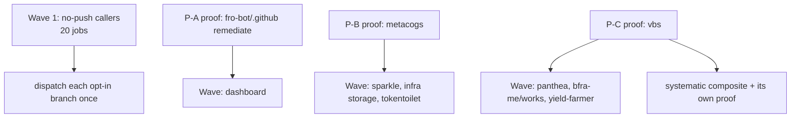

# feat: Turn on isolate-agent in every compatible owned caller

## Overview

`isolate-agent` stays opt-in (see origin). This plan turns it on, on every trigger, in the owned workflows that can run isolated today. It also proves each push pattern before the workflows that push from the model's run opt in.

No fro-bot/agent code changes. Every change is a workflow edit in a caller repo.

## Problem Frame

Without isolation the model runs as the Action's user and can read the Action's `github-token` from `/proc` on every trigger. On owned callers that token is usually a write-capable PAT.

v0.144.1 removes the blockers recorded in the origin's dependencies:
- the read-only view closes the shared writable directories;
- node, uv, bun and pnpm from their setup actions work under isolation;
- the agent has its own XDG directories;
- the model's `git push` gets a credential through `gh` in provision mode;
- account setup costs under a second (370 ms in #2208's CI; under 90 ms in the v0.143.0 live check), not 30–100 s, which removes the cost the origin accepted as the price of opting in.

## Requirements Trace

- R4. Every compatible owned workflow sets `isolate-agent: true` on every trigger. Its agent checkout has `persist-credentials: false` on every trigger.
- R5. Each workflow that pushes from the model's run proves the push under isolation before its opt-in merges. The proof is a `workflow_dispatch` of the opt-in branch.
  - This plan narrows R5 in one way. A push pattern is proved once, and the rest of its group then needs only its own branch dispatch. Where a job can't run from a branch (its `if:` requires `main` or a content event), its first run after merge is the gate, with a revert PR ready.
- R6. survey-repo opts in. Its gate, #2186, is fixed (#2201).
- R7. Opting in is a normal PR in that repo. A caller below v0.144.1 bumps its pin in the same PR.
- R1–R3 are done: the default stays false, the docs are in #2198 and #2206, and #2135 is closed.

## Scope Boundaries

- No default flip and no `auto` mode (see origin).
- External callers are not changed.
- fro-bot/agent's own `uses: ./` self-review jobs stay out, because the preflight refuses a local install.
- The origin's runner-home toolchain exclusion named panthea and ddr for `~/.cargo`. Both prompts forbid cargo, so neither is excluded.
- Pushes on comment, review and issue triggers. Those runs withhold the token from the model, so the model can't push there with or without isolation. infra's `fro-bot-content` pushes only through the Action's brokered push, which runs runner-side after the sandbox is restored, so isolation doesn't change it.

### Deferred to Separate Tasks

- **Blocked callers (5), since done (see As Built).** Each uses a tool installed under the runner home that the agent can't reach:
  - Playwright browsers in `~/.cache/ms-playwright`: marcusrbrown/gpt, and marcusrbrown/marcusrbrown.github.io `fro-bot-scheduled` and `live-audit-discovery`;
  - uv-managed Python: marcusrbrown/poly;
  - mise: marcusrbrown/containers.

  With its own XDG directories the agent may now download its own browser or Python at a network cost per run. A separate probe decides each one.
- **Re-measuring cost** across the rollout. That belongs to a later default-flip discussion.
- **marcusrbrown/systematic `connect.yaml`.** It also calls the composite, from a non-repository workspace, with jobs that require the default branch. It stays unisolated (the composite input defaults to `'false'`) until a probe gives it a verdict.

## Context & Research

- The inventory is at `/tmp/isolate-rollout/inventory-refresh.md`, local and untracked. It lists 36 agent jobs in 31 files across fro-bot, marcusrbrown and bfra-me, with each repo's HEAD SHA recorded on 2026-11-15. No job sets `isolate-agent`. No job uses a container, self-hosted or macOS runner, or `lfs: true`.
- With isolation on, the preflight (`src/harness/phases/bootstrap.ts`, `assertNoPersistedGitCredentials`) refuses a run on every trigger in two cases:
  - a checkout that persists its token;
  - any `http.*.extraheader` in `.git/config`.

  So `persist-credentials: false` and removing extraheader steps are required, not optional.
- In provision mode the sandbox `~/.gitconfig` names `gh auth git-credential` as the credential helper for the origin (#2202). That is the push path under isolation for every `branch-pr` workflow.
- Tool roots: the Action grants `~/.bun` and `~/setup-pnpm` read and execute (#2217). Tool-cache tools reach the agent through the mirrored PATH (#2213).
- Live checks of the published install on v0.143.0, v0.144.0 and v0.144.1 all passed (fro-bot/.github runs 43661864176, 43674875425, 43681781888 and 43681892094).

## Prior-Art Survey

```json
{
  "schema_version": 2,
  "verdict": "extend",
  "scope": "owned caller workflows under fro-bot, marcusrbrown and bfra-me (.github/workflows and composite actions wrapping fro-bot/agent)",
  "freshness": {
    "vcs_reference": "per-repo default-branch HEAD SHAs recorded 2026-11-15 in the caller inventory",
    "scope_baseline": "31 workflow files, 36 agent jobs"
  },
  "budget": {
    "max_search_passes": 2,
    "max_candidate_inspections": 36,
    "exhausted": false
  },
  "candidates": [
    {
      "path_or_symbol": "fro-bot/.github .github/workflows/fro-bot.yaml (fro-bot job)",
      "description": "Reference caller already on v0.144.1 with persist-credentials false on every trigger",
      "disposition": "extend"
    },
    {
      "path_or_symbol": "marcusrbrown/systematic .github/actions/fro-bot-agent",
      "description": "Composite action wrapping fro-bot/agent; forwards a fixed input list without isolate-agent",
      "disposition": "extend"
    }
  ]
}
```

## Key Technical Decisions

- **One PR per opt-in step, holding complete workflows.** Each PR bumps the pin to v0.144.1 or later, sets `persist-credentials: false` on the agent checkout for every trigger, removes any extraheader step, and adds `isolate-agent: true`, for every job it touches. This follows R7, so no job runs a partly edited state. A repo with jobs in different waves gets one PR per wave: fro-bot/.github (wave 1, then remediate), infra (`fro-bot-content`, then `fro-bot-storage`) and systematic.
- **Proof per push pattern, not per workflow.** The `branch-pr` workflows group by how they get a push credential today:
  - P-A, a persisted checkout token;
  - P-B, an explicit extraheader step;
  - P-C, no credential step at all.

  Each pattern becomes the same thing under isolation: no on-disk credential, with the `gh` helper as the only path. One proof per pattern stands for its group. The workflows that don't own their proof then opt in with a normal PR.
- **Waves, with Marcus asked before each.** Different repos' PRs don't conflict, so a wave opens in parallel. Each repo still gets its own review. Wave 1 is the no-push callers. Each push group's wave opens only after its proof passes.
- **The opt-in input goes on the agent step itself,** next to the other `with:` inputs. There is no per-trigger expression, because the origin requires every trigger.
- **Systematic's composite gains an `isolate-agent` input** (default `'false'`) that it forwards. Its caller passes `'true'`. The composite pin moves to v0.144.1 in the same PR.

## Open Questions

### Resolved During Planning

- *Is v0.144.0 enough?* No. The XDG fix (#2219) is in v0.144.1.
- *Does survey-repo's multi-step layout still block?* No. #2201 snapshots each step's log at confirmed restore.
- *Should Renovate do the pin bumps?* No. The bump rides in the opt-in PR (R7).

### Deferred to Implementation

- How vbs's past autoheal PRs got pushed with no visible credential step. The P-C proof shows whether the `gh` helper alone is enough. If it isn't, P-C stops and gets reassessed.
- `workflow_call` callers of bfra-me/renovate-action and bfra-me/.github were not audited. Unit 1 lists them; they inherit the called workflow's inputs, so they need no edit unless they override the checkout.
- Whether a private repo's own steps need the checkout token after checkout (the inventory sampled public repos only). Each PR's dispatch run shows it.
- `org:marcusrbrown` and `org:bfra-me` code searches were rate-limited. Re-run them before wave 1 to catch any missed caller.

## High-Level Technical Design

> *This illustrates the intended approach and is directional guidance for review, not implementation specification. The implementing agent should treat it as context, not code to reproduce.*



## Implementation Units

- [x] **Unit 1: Re-confirm the caller list**

**Goal:** Wave 1 starts from a complete, current list.

**Requirements:** R4, R7

**Dependencies:** None

**Files:** none in fro-bot/agent. The inventory is updated in place.

**Approach:**
- Re-run the owner code searches that were rate-limited.
- Re-read each caller's HEAD, since Renovate may have moved pins.
- Record any new caller with a verdict.

**Test expectation:** none, because this unit is research only.

**Verification:**
- Every owned job has one verdict: ready, ready after edits, push group (P-A, P-B or P-C), gated, or blocked.

- [x] **Unit 2: Wave 1, callers that don't push from the model**

**Goal:** Turn isolation on for the 20 jobs that don't push from the model: 2 ready, 17 needing edits, and the formerly gated survey-repo. With the 11 push-group jobs in Units 3–7 and the 5 deferred, that accounts for all 36.

**Requirements:** R4, R6, R7, AE1

**Dependencies:** Unit 1

**Files:** `.github/workflows/*.yaml` in each repo.

Ready, input only:
- fro-bot/.github `fro-bot` job
- fro-bot/.github `draft-solutions.yaml`

Edits needed:
- fro-bot/.github `observe`, `survey-repo.yaml`, `capture-patterns.yaml` and `capture-learnings.yaml`: persist
- fro-bot/space-bus: pin, persist
- marcusrbrown/.dotfiles: pin, persist
- marcusrbrown/infra `fro-bot-content`: pin
- marcusrbrown/renovate-config: pin
- marcusrbrown/marcusrbrown: pin
- marcusrbrown/ddr: pin
- marcusrbrown/marcusrbrown.github.io `fro-bot`: pin
- marcusrbrown/dev-like: pin
- marcusrbrown/mothership: pin
- marcusrbrown/opencode-copilot-delegate: pin, persist
- marcusrbrown/marcusrbrown.com: pin. Its prompt mentions Playwright; if a run needs a browser it moves to the deferred probe
- bfra-me/ha-addon-repository: pin
- bfra-me/renovate-action: persist, including its `workflow_call` path
- bfra-me/.github: pin, persist

The fro-bot/.github jobs (`fro-bot` and `observe` in `fro-bot.yaml`, plus `draft-solutions.yaml`, `survey-repo.yaml`, `capture-patterns.yaml` and `capture-learnings.yaml`) go in one PR. The `fro-bot-remediate` job in `fro-bot.yaml` is left for Unit 3.

**Approach:**
- Each PR edits only the agent job:
  - the pin, kept with its `# vX.Y.Z` comment;
  - the checkout's `persist-credentials: false`, set or replacing a per-trigger expression;
  - `isolate-agent: true`.
- Before opening a PR, `workflow_dispatch` the opt-in branch for each job whose `if:` lets a branch dispatch run it. On fro-bot/.github, branch dispatch works only for files that exist on the default branch, which all of these do.
- A job that a branch dispatch skips (fro-bot/.github's `fro-bot` job runs only on content events) is verified by its first content-triggered run after merge, with a revert PR ready.

**Test scenarios:**
- Integration: each dispatched opt-in branch logs `Read-only view probe passed`, `Sandbox account created` and `Sandbox stopped and restored`, and ends `success`.
- Integration (AE1): on one opted-in repo whose job serves every trigger, a comment, a PR review comment, a scheduled run and a dispatch each complete isolated after merge.
- Error path: a run that names a preflight refusal, such as persisted credentials, stops that repo's PR until it's fixed. Other repos continue.

**Verification:**
- Each merged repo's next run of each trigger type completes isolated.

- [x] **Unit 3: Push proof P-A (persisted checkout token): fro-bot/.github remediate**

**Goal:** Show that a job which relied on the persisted checkout token pushes through the `gh` helper alone (AE2).

**Requirements:** R5

**Dependencies:** Unit 2's fro-bot/.github PR merged, since it shares the file.

**Files:** `.github/workflows/fro-bot.yaml` (the `fro-bot-remediate` job) in fro-bot/.github.

**Approach:**
- Set persist false on the remediate checkout and add `isolate-agent: true`.
- Dispatch the opt-in branch into a run that pushes a branch and opens its PR.

**Test scenarios:**
- Integration: the dispatch opens a branch and PR authored by the bot. The log shows isolation and no preflight refusal.

**Verification:**
- The remediate PR exists and the run is green. Only then does the opt-in PR merge.

- [x] **Unit 4: Push proof P-B (extraheader step): metacogs**

**Goal:** Show that removing the extraheader step leaves a working push.

**Requirements:** R5

**Dependencies:** None, so it can run beside Unit 3.

**Files:** `.github/workflows/fro-bot.yaml` in marcusrbrown/metacogs.

**Approach:**
- Bump the pin, delete the step that writes the extraheader, and add the input.
- Dispatch the no-prompt `branch-pr` path.

**Test scenarios:**
- Integration: the dispatch pushes its branch and opens a PR.
- Error path: if the step is left in, the run is refused at preflight. This is a known result and not part of the proof.

**Verification:**
- The PR exists and the run is green before metacogs' opt-in merges.

- [x] **Unit 5: Push proof P-C (no credential step): vbs**

**Goal:** Show that a job with persist false and no credential step pushes through the `gh` helper. This also resolves the open question about vbs's history. marcusrbrown/yield-farmer is in this group: its scheduled prompt pushes fixes to existing PR branches.

**Requirements:** R5

**Dependencies:** None, so it can run beside Units 3 and 4.

**Files:** `.github/workflows/fro-bot.yaml` in marcusrbrown/vbs.

**Approach:**
- Bump the pin and add the input.
- Dispatch the autoheal path.

**Test scenarios:**
- Integration: the dispatch pushes and opens a PR.

**Verification:**
- The PR exists. If the push fails, stop P-C and report back before any of its group opts in.

- [x] **Unit 6: Push-group waves**

**Goal:** Opt in the remaining `branch-pr` workflows after their pattern's proof.

**Requirements:** R4, R5, R7

**Dependencies:** Units 3–5, each gating only its own group.

**Files:** `.github/workflows/*.yaml`:
- P-A: fro-bot/dashboard;
- P-B: marcusrbrown/sparkle, marcusrbrown/infra `fro-bot-storage` and marcusrbrown/tokentoilet, each deleting its extraheader step;
- P-C: marcusrbrown/panthea, bfra-me/works and marcusrbrown/yield-farmer.

**Approach:**
- The same edits as Unit 2, plus removing extraheader steps in P-B.
- tokentoilet's pin jump from v0.117.3 crosses the V2-only cut. It passes `omo-providers`, which the current `action.yaml` no longer declares; drop it and check that its provider config still comes through `opencode-config` or `auth-json`. A green run alone doesn't prove the old setting still applies, since undeclared inputs are ignored.
- yield-farmer's jump from v0.43.0 also crosses the V2-only cut. Its current inputs are all still declared. A dispatch requires a custom prompt, so it can't exercise the scheduled push path: its first scheduled run after merge is the gate, with a revert PR ready.
- infra's `fro-bot-storage` runs on dispatch only from `main`, so a branch dispatch skips it. It opts in in its own PR after Unit 2's infra PR, and its first `main` dispatch after merge is the gate, with a revert PR ready.

**Test scenarios:**
- Integration: one dispatch per opted-in workflow on its `branch-pr` path pushes and opens a PR. A run with nothing to push only shows the preflight passed, so repeat it until one pushes or accept the group's proof for that workflow.
- Integration: the post-merge gates (yield-farmer schedule, infra storage on `main`) push and open their PR.

**Verification:**
- Each workflow's next scheduled `branch-pr` run completes isolated.

- [x] **Unit 7: Systematic composite**

**Goal:** Let marcusrbrown/systematic opt in through its wrapper action.

**Requirements:** R4, R5, R7

**Dependencies:** Unit 5, since Systematic is in the P-C group.

**Files:** `.github/actions/fro-bot-agent/action.yml` and `.github/workflows/fro-bot.yaml` in marcusrbrown/systematic.

**Approach:**
- Add an `isolate-agent` input (default `'false'`) to the composite and forward it.
- Bump the composite's pin.
- The workflow passes `'true'`.
- Dispatch its autoheal path as its own proof, because the composite adds a layer the vbs proof doesn't cover.

**Test scenarios:**
- Integration: a dispatch runs isolated through the composite and pushes.
- Edge case: a caller of the composite that omits the input runs unisolated as before.

**Verification:**
- The dispatch PR exists and the run is green.

## As Built

All 24 planned opt-in PRs merged on 2026-11-15, and the 5 deferred jobs followed on 2026-11-16. The plan's "no fro-bot/agent code changes" didn't hold. The rollout needed four Action fixes:

- **v0.144.2 (#2222).** The agent's PATH drops entries the account can't enter. Before this, a missing command under `~/.cargo/bin` reported EACCES, not ENOENT. The launch env also trusts the checkout through `GIT_CONFIG_*` `safe.directory`, because tests that set `GIT_CONFIG_NOSYSTEM=1` lose `/etc/gitconfig`'s `safe.directory=*`.
- **v0.144.3 (#2225).** The preflight finds the published install from the running bundle (`process.argv[1]`), not `GITHUB_ACTION_PATH`, which names the composite's own directory when a composite wraps the Action. This unblocked Systematic.
- **v0.144.4 (#2232).** The agent gets its own `XDG_RUNTIME_DIR` (`~/.run`), which fixed agent-browser's socket. `PLAYWRIGHT_BROWSERS_PATH`, `UV_PYTHON_INSTALL_DIR` and `MISE_DATA_DIR` pass through as resolved paths when the agent can enter them and the view still shows them. This unblocked the 5 deferred jobs.
- **Five `OPENCODE_AUTH_JSON` secrets.** Five secrets (renovate-config, marcusrbrown, opencode-copilot-delegate, sparkle, bfra-me/.github), and later poly's, carried an unused `opencode` provider that the key proxy can't route. Removing it from each secret fixed the config-stage refusal.

Push proofs:
- The first dispatches pushed nothing, so seeded proofs re-ran on v0.144.2. They made an empty commit and ran a plain `git push` with no credential setup.
- **P-C passed:** vbs, run 43698088014, draft PR vbs#827.
- **P-A passed:** fro-bot/.github remediate, run 43698123070, draft PR fro-bot/.github#4252.
- **P-B (metacogs) didn't push.** A non-empty prompt clears `output-mode`, so the model treated the run as comment-only. Its gitconfig did carry the `gh` helper, and with the extraheader step gone metacogs is in the same state as vbs. P-C stands for it.

Deferred jobs:
- **Playwright** (gpt, both github.io jobs): browsers install into `$RUNNER_TOOL_CACHE/ms-playwright`.
- **poly:** installs uv's Pythons into `$RUNNER_TOOL_CACHE/uv-python`.
- **containers:** installs mise into `$RUNNER_TOOL_CACHE/mise`.
- **agent-browser** works under isolation. The live-audit prompt itself still points HOME at a path too long for a socket, with or without isolation (marcusrbrown.github.io#514).

Other repo fixes:
- dashboard#841, fro-bot/.github#4253, containers#865 and Systematic#1420 each needed a workflow test updated.
- fro-bot/.github's knowledge-MCP call log moved out of `RUNNER_TEMP`.
- yield-farmer needed `output-mode: branch-pr` restored for the v0.43 to v0.144 jump.
- github.io, marcusrbrown.com and tokentoilet first needed their pre-existing red checks fixed (github.io#507, .com#611, tokentoilet#1687).

Still open:
- The first real post-merge push runs: infra `fro-bot-storage`, bfra-me/works autoheal, yield-farmer's schedule, github.io `fro-bot-scheduled`, and fro-bot/.github's comment path.
- marcusrbrown/systematic `connect.yaml` stays unisolated. It would pass the preflight, but the Action overrides the workflow's `XDG_STATE_HOME`, so the run record lands in the agent's home, and its nested clones aren't trusted for git. It needs its own design.

## System-Wide Impact

- **Interaction graph:** each caller's other steps after the agent step may depend on the checkout token. Turning persist off removes it for those steps too. Any later step that pushes or fetches private refs must use its own credential.
- **Error propagation:** a preflight refusal fails the run closed before the model starts. No partial writes happen and no session state is saved.
- **State lifecycle risks:** none new. Session caches keep their keys, so an isolated run restores a non-isolated run's state and the reverse.
- **Unchanged invariants:** fro-bot/agent's code and defaults are unchanged. External callers see nothing.

## Risks & Dependencies

| Risk | Mitigation |
|------|------------|
| A caller step after the agent needed the persisted token | The dispatch run before each PR surfaces it. Fix it in that PR with the step's own token. |
| A big pin jump (yield-farmer, tokentoilet) hits a removed input | Read the inputs against the current `action.yaml` before the bump. tokentoilet's `omo-providers` is already known. |
| A post-merge gate fails on its first real run | Its revert PR is prepared with the opt-in PR and opened at once. |
| The P-C mechanism turns out to rely on something isolation removes | The vbs proof runs first and stops its group on failure. |
| Wave PRs each trigger a review cycle in their repo | Waves are asked one at a time. Each PR is a single push with no follow-ups unless a review requires one. |
| A missed caller stays unisolated | Unit 1 re-runs the rate-limited searches. |

## Documentation / Operational Notes

- No fro-bot/agent docs change. The README and wiki already recommend the input (#2198, #2206).
- Record each wave's PRs and dispatch runs in the inventory, so the rollout state stays checkable.

## Sources & References

- **Origin document:** [docs/brainstorms/2026-11-14-isolate-agent-opt-in-rollout-requirements.md](../brainstorms/2026-11-14-isolate-agent-opt-in-rollout-requirements.md)
- Caller inventory: `/tmp/isolate-rollout/inventory-refresh.md`. It is local and untracked, so a clone won't have it.
- Related past work: `docs/plans/2026-11-14-001-fix-isolate-agent-readonly-view-plan.md` (active), which this rollout depends on and doesn't change.
- Related PRs/issues: #2135, #2186, #2198, #2201, #2202, #2206, #2209, #2213, #2217, #2218, #2219.
