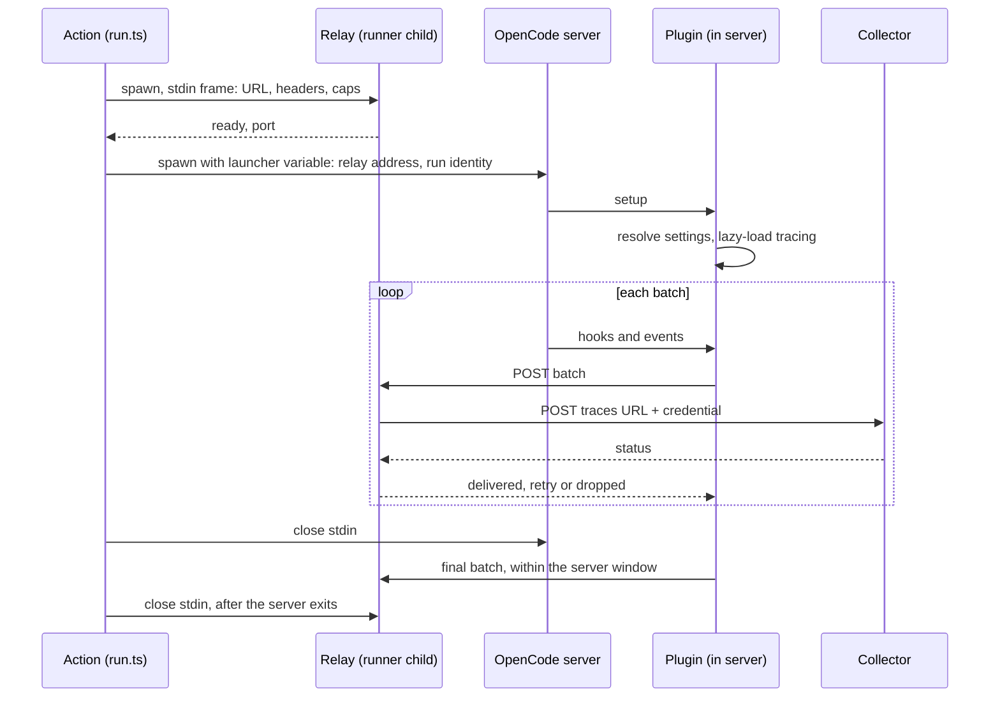

# feat: OpenTelemetry tracing of OpenCode runs

## Overview

`@fro.bot/opencode-plugin` gains opt-in tracing. It turns each turn of an OpenCode session into one trace of GenAI-convention spans, with prompt, tool and model content, and exports them over OTLP/HTTP. The work has three stages. Stage 1 builds capture and local export in the plugin. Stage 2 builds the Action side against a locally built plugin: a loopback relay that holds the collector credential, two inputs, and the handoff to the plugin. Stage 3 proves the result in Langfuse, publishes the plugin once, moves the pin, and ships the docs.

## Problem Frame

An operator cannot see what a run sent to the model. OpenCode V2 dropped the content telemetry V1 had, and the Action strips `OTEL_*` from the server. The origin document sets what a trace contains, who may turn it on, and where the credential lives (see origin: `docs/brainstorms/2026-11-19-opencode-run-tracing-requirements.md`).

## Requirements Trace

From the origin document.

- R1. One trace per turn, including subagents and follow-on work. Unit 3.
- R2. Model requests as inference spans, with usage and finish reason where reported. Units 3, 4.
- R3. Tool calls as tool-execution spans, including rejected and interrupted calls. Units 3, 4.
- R4. Subagent spans in the parent's trace under the tool call that started them. Unit 3.
- R5. Model spans carry the hook-time view; the Action lists the plugin last. Units 4, 8.
- R6. Session, agent and run identity on every span. Units 4, 8.
- R7. Redaction and truncation are marked; absent means not captured. Unit 4.
- R8. Off by default, one switch, no default destination. Units 2, 8.
- R9. Only the operator enables and directs tracing. Units 2, 8.
- R10. Content scrubbed over the whole value, then bounded, in the plugin. Unit 4.
- R11. No spans for past turns; history rides in the model span. Units 3, 4.
- R12. The collector credential goes only to the relay. Units 6, 7, 9.
- R13. The relay forwards to one fixed endpoint with fixed safety rules. Unit 6.
- R14. Works with and without `isolate-agent`, with a warning when not isolated. Units 7, 9.
- R15. Tracing never fails a run; drops are reported honestly. Units 5, 7.
- R16. `OTEL_*` stays out of the Action's server environment. Units 5, 8.
- R17. Inert when off, and outside local sessions and the Action. Units 1, 2, 8.
- R18. Policy and docs revised. Units 5, 10.
- Success criteria: readable in Langfuse on a published install. Units 9, 11.

## Scope Boundaries

- No gateway or workspace tracing. The plugin stays off there.
- No structure-only level, metrics, logs, sampling, or OTLP over gRPC.
- The relay does not decode, validate, rewrite, scrub or queue spans.
- No capture of provider wire traffic, provider-side reasoning, or the response body the plugin could clone.
- No merging of these spans into OpenCode's own traces.
- No spans for the Action's own phases, and no job-summary link.
- No export of past sessions, and no fro-bot hosted collector.
- No per-run token on the relay, and no proxy or private-CA support in the relay.
- Operator plugin entries in object form stay dropped by the Action, as today.

### Deferred to Separate Tasks

- Collector, Langfuse and Tempo: a task in the operator's infrastructure repo. Units 9 and 11 depend on it.
- Upstream request to restore opt-in content capture in OpenCode's exporter: an issue on `anomalyco/opencode`.
- Gateway tracing per binding: its own requirements and plan.
- Running every real-binary suite in CI: only the plugin's suite is added here.

## Context & Research

### Relevant Code and Patterns

- `packages/opencode-plugin/src/setup.ts` (`setupFroBotPlugin`, `HostSurface`): the plugin's one setup function and its narrow host type. It returns no cleanup today.
- `packages/opencode-plugin/tsdown.config.ts`: `neverBundle` for `effect` and `@opencode/plugin`; `onlyBundle` is the allowlist of inlined third-party code.
- `.github/workflows/opencode-plugin-release.yaml`: the import check reads only `dist/index.mjs`, allows `effect`, `@opencode/plugin` and `node:` imports, and rejects relative imports. It stages `dist`, `README.md`, `LICENSE` and `package.json`.
- `src/services/setup/ci-config-v2.ts` (`buildCIConfigV2`): builds the plugin list as Systematic, this plugin, then operator plugins.
- `packages/runtime/src/agent/filter-env.ts`: admits `OPENCODE_`-prefixed names unless they end in a denied suffix. `GITHUB_RUN_ATTEMPT` is not admitted.
- `packages/runtime/src/agent/server-v2.ts` (`startOpenCodeV2Server`): the one spawn function for the Action and the workspace. It sets `OPENCODE_PASSWORD` and `OPENCODE_CONFIG_CONTENT` on every spawn.
- The key proxy, as the pattern for the relay: `packages/runtime/src/agent/key-proxy.ts`, `key-proxy-wire.ts`, `key-proxy-child.ts`, `apps/action/src/key-proxy.ts`, `src/harness/phases/key-proxy-process.ts`.
- `packages/runtime/src/agent/forwardable-target.ts` (`isForwardableTarget`).
- `src/harness/phases/sandbox-lifecycle.ts`: its signal handler releases the sandbox and re-raises without running `run.ts`'s `finally`.
- `src/services/setup/sandbox-preflight.ts` (`RUNNER_ENTRY_SCRIPTS`) and the matching list in `src/harness/phases/v2-server.sandbox.integration.test.ts`.
- `src/harness/config/inputs.ts` (`parseActionInputs`): input parsing, masking and removal from the environment.
- `src/harness/run.ts` and `src/harness/phases/cache-restore.ts`: `run.ts` holds the routed repository and trigger; `runCacheRestore` passes only run id and attempt to the server start.
- `packages/opencode-plugin/src/integration.test.ts` and `integration.fixture.ts`: the real-binary harness with a scripted provider.

### Institutional Learnings

- `docs/solutions/best-practices/key-proxy-keeps-provider-keys-out-of-the-agent-sandbox-2026-11-17.md`: use `https.request`, never follow 3xx or 101, attach the socket error handler before rejecting CONNECT, validate by structure.
- `docs/solutions/best-practices/separate-uid-is-not-a-boundary-on-hosted-runners-2026-11-17.md`: withholding from the environment is not secrecy without isolation.
- `docs/solutions/integration-issues/plugin-install-at-server-start-stalls-first-request-2026-11-17.md`: nothing new may install at boot.
- `docs/solutions/workflow-issues/published-install-live-check-before-rollout-2026-11-17.md`: prove an opt-in feature on a published install, with `workflow_dispatch`, never `push`.

### External References

- OpenTelemetry GenAI semantic conventions, Development status: `https://github.com/open-telemetry/semantic-conventions-genai/tree/main/docs/gen-ai`. Read at commit `76e0c19`.
- Langfuse OTLP ingestion: HTTP only, Basic auth, header `x-langfuse-ingestion-version: 4`. It reads `gen_ai.input.messages`, `gen_ai.output.messages`, `gen_ai.system_instructions` and tool call attributes. It does not show span links. It groups by `session.id` or `gen_ai.conversation.id`.
- Tempo cuts attributes at 2,048 bytes by default.
- A probe on the pinned 2.3.2 binary, on macOS without isolation and with a scripted provider, established the hook and event facts this plan starts from. Parallel and nested subagents, overlapping turns, Linux, isolation, real providers and multi-megabyte results were not probed.

## Prior-Art Survey

```json
{
  "schema_version": 2,
  "verdict": "extend",
  "scope": "whole repository (packages/*, apps/*, src/, deploy/, scripts/, .github/) plus bun.lock",
  "freshness": {
    "vcs_reference": "0233957ae0389d1c80a92b4f1a56b963df887af9"
  },
  "budget": {
    "max_search_passes": 12,
    "max_candidate_inspections": 25,
    "exhausted": false
  },
  "candidates": [
    {
      "path_or_symbol": "packages/opencode-plugin (setupFroBotPlugin, HostSurface)",
      "description": "the only repo code running inside the OpenCode server process; registers a tool hook and four tools",
      "disposition": "extend"
    },
    {
      "path_or_symbol": "packages/runtime/src/agent/key-proxy.ts; key-proxy-wire.ts; key-proxy-child.ts; apps/action/src/key-proxy.ts; src/harness/phases/key-proxy-process.ts",
      "description": "loopback credential-injecting forwarder to a fixed https upstream with stdin-frame secret, empty env and supervision",
      "disposition": "extend"
    },
    {
      "path_or_symbol": "packages/runtime/src/agent/forwardable-target.ts isForwardableTarget",
      "description": "canonical origin-form target check",
      "disposition": "reuse"
    },
    {
      "path_or_symbol": "packages/runtime/src/agent/event-v2.ts; src/features/agent/streaming-v2.ts",
      "description": "SSE frame mapper and activity tracker for the run loop",
      "disposition": "insufficient"
    },
    {
      "path_or_symbol": "src/features/observability/ (createMetricsCollector, run-summary, job-summary)",
      "description": "per-run counters, token usage and local summaries",
      "disposition": "insufficient"
    },
    {
      "path_or_symbol": "src/services/artifact/upload.ts; syncArtifactsToStore",
      "description": "batch publication of log files to artifacts and the object store",
      "disposition": "insufficient"
    },
    {
      "path_or_symbol": "packages/gateway/src/web/sse/*; packages/gateway/src/web/audit.ts",
      "description": "operator run-status stream and audit events",
      "disposition": "insufficient"
    },
    {
      "path_or_symbol": "packages/runtime/src/shared/logger.ts redactSensitiveFields; src/services/setup/key-proxy-providers.ts checkConfigForKeys",
      "description": "key-name field redaction and exact-credential config scan",
      "disposition": "insufficient"
    }
  ]
}
```

## Key Technical Decisions

- **Bundle the OpenTelemetry SDK into the plugin.** The host provides only `effect` and `@opencode/plugin`, and a declared dependency would add an install step to every run. The SDK packages are plugin devDependencies at exact versions, listed in `onlyBundle`, and inlined. A Renovate group updates them together.
- **Load tracing code lazily.** All tracing code and the SDK sit behind one dynamic `import()` that runs only when tracing resolves to on. The import, SDK construction, hook registration and cleanup are each wrapped, so a failure there leaves tracing off and the plugin active.
- **Configure the SDK explicitly.** The exporter gets its URL and headers from the plugin's settings and reads no `OTEL_*` variable. The resource is built by hand with no detectors, so no process arguments or host data are attached. SDK diagnostics are not logged.
- **The plugin builds spans by hand.** No auto-instrumentation and no ambient context. Spans carry explicit start and end times and explicit parents, so a subagent's spans can sit under a tool span that has already ended.
- **Content attributes are JSON strings.** The JavaScript SDK does not carry structured values on span attributes. The conventions allow a JSON string, and Langfuse parses it.
- **A turn is an execution chain.** The root span opens on the root session's execution start. It stays open while subagents it dispatched are running or their reports are unprocessed. It closes on idle with nothing outstanding, on failure or interruption, or when an inactivity bound passes, in which case it is marked incomplete. A late report for a closed root starts a new trace marked as a continuation.
- **Subagents are joined by dispatch, not by time.** A dispatch map links a subagent tool call to the child session id the tool returns. A child's events that arrive before that link exists are buffered in bounded memory. A child whose dispatcher cannot be proven gets its own trace, marked unattributed.
- **Model output is joined to its request by order within a session and request kind.** The request hook carries no message id. Where order is not proven the span is exported with its output marked absent.
- **Host mode is declared by the launcher and checked by the plugin.** The Action sets a plugin variable that carries either off or the relay address and run identity. The workspace launcher sets it to off. With the variable absent the plugin treats the session as local only if the headless markers `OPENCODE_PASSWORD` and `OPENCODE_CONFIG_CONTENT` are also absent. So an old Action or any other headless host running a new plugin stays off.
- **Local settings live in one user-scope file.** It holds the endpoint, optional headers, and the list of hostnames it applies to. Tracing is on only when this machine's hostname is in that list, so a container or another host that shares the home directory stays off. A remote endpoint must be `https` with certificate verification, and the exporter follows no redirects. The plugin refuses a file that is not a regular file owned by the user, has any group or other permission bit set (it must be mode 0600, since it can hold a collector credential), or resolves inside the project. It logs the destination host once when local tracing starts. Plugin options in OpenCode config are never read for tracing.
- **One Action input turns tracing on.** `trace-endpoint` holds the full OTLP traces URL. `trace-headers`, a secret, holds the credential headers. An empty endpoint is off. A malformed endpoint or header logs one warning that names the input and omits the value, and leaves tracing off.
- **The relay is stateless.** It accepts a batch, forwards it to the configured URL with the credential headers, waits for the upstream within a timeout, and answers the plugin with a fixed status that says delivered, retry, or dropped. The SDK exporter owns retries. The relay has no queue and nothing to flush at stop. It counts batches by outcome, and the Action logs those counts as acknowledged by the collector, to retry, and dropped. An acknowledgement is the collector's HTTP answer, not proof that every span in the batch was stored. The Action starts the server with its error output discarded, so the plugin's own log lines do not reach the run log there. In Action mode the plugin sends its running exported and dropped span counts in one numeric request header on each batch; the relay keeps the last valid value and prints it in its report, labelled as reported by the plugin as of its last batch. It cannot include that batch's own outcome or spans dropped afterwards.
- **The relay is a sibling of the key proxy, with its own owner.** It reuses the stdin frame, empty environment, ready line and supervision patterns. It does not use the sandbox lifecycle's proxy slot. Its death never aborts the server and never affects persistence.
- **The plugin moves last only when tracing is on.** A plugin sees only the edits of plugins listed before it. With tracing off the Action's plugin order is unchanged.
- **Drift shows as gaps.** A field that stops arriving is omitted and marked. The plugin's peer range is not narrowed; the README names the OpenCode versions tracing was recorded on.
- **The scrubber is written here and runs at one point.** Every string in a span passes through it just before export: attribute values, span names, status messages and events. A value that cannot be scrubbed within its size ceiling is omitted with a marker.
- **Recorded as Completed in `RFCs/RFC-007-Observability-Run-Summary.md`, with the F83 acceptance boxes unchecked and its `telemetry` input never built.** This plan replaces that sketch with operator-directed tracing.

## Open Questions

### Resolved During Planning

- Where does the OpenTelemetry code come from? Bundled SDK, lazily loaded.
- Where does a local session's credential live? In the user-scope settings file, with ownership and mode checks and a visible start line.
- Does the relay queue or retry? No. The exporter retries.
- Does plugin order change for runs with tracing off? No.
- When is the plugin published? Once, after the Action path passes against a local build and the Langfuse proof passes.
- How does an old Action treat a new plugin? The plugin sees the headless markers and no launcher variable, and stays off.
- Are title, compaction and generate outputs read from the HTTP response? No. Their missing fields are marked absent.

### Deferred to Implementation

- The ownership rule when a new prompt arrives while an earlier turn waits on a background subagent and that subagent's report lands in the new execution. Unit 3 records this ordering first. If the delivered items cannot be told apart, the follow-on work joins the execution it ran in and names the other turn in an attribute.
- Event order under parallel and nested dispatch. Unit 3 records it before the join logic is written.
- Whether the bundled SDK and a sibling chunk load inside OpenCode's compiled plugin host from its npm cache directory. Unit 1 proves it or the bundling shape changes.
- Size bounds per value and per span, the inactivity bound for a root, and the limits on buffered child events. Start from the probe's sizes and measured Langfuse limits.
- Which attribute Langfuse uses to group a trace with its session on the pinned version.
- How OpenCode's token counts map to the convention's totals.
- The exporter's batch interval and timeout, and the relay's upstream timeout, so a final batch fits the 5 s server window. Measure, then set.
- Linux and `isolate-agent` behaviour of the plugin. First exercised in Unit 9.

## Output Structure

    packages/opencode-plugin/src/
      tracing/
        settings.ts            host mode and settings resolution
        turn-model.ts          events and hooks to span records
        genai-attributes.ts    span records to GenAI attributes
        content.ts             extract, scrub, bound, mark
        exporter.ts            SDK tracer, batch processor, flush
        index.ts               lazy entry: wires the above into the host
    packages/runtime/src/agent/
      trace-relay.ts           loopback forwarder and child main loop
      trace-relay-wire.ts      stdin frame, ready line, URL and header validation
    apps/action/src/trace-relay.ts              bundle entry, built to dist/trace-relay.js
    src/harness/phases/trace-relay-process.ts   fail-soft supervisor
    src/services/setup/tracing.ts               inputs to relay frame and launcher variable

## High-Level Technical Design

> *This illustrates the intended approach and is directional guidance for review, not implementation specification. The implementing agent should treat it as context, not code to reproduce.*



Span shape for one turn:

    invoke_agent <root agent>                 root span, one per turn
      chat <model>                            one per model request; a retry is its own span
      execute_tool <tool>                     one per tool call
      execute_tool subagent
        invoke_agent <child agent>            child session, same trace
          chat <model>
          execute_tool <tool>
      chat <model>                            follow-on after the child reports back

## Implementation Units

### Stage 1: capture and local export

- [x] **Unit 1: Bundle the SDK behind a lazy entry**

**Goal:** The plugin can carry OpenTelemetry code that loads inside the real plugin host, without changing what an install or a tracing-off start does.

**Requirements:** R17

**Dependencies:** None

**Files:**
- Modify: `packages/opencode-plugin/package.json`, `packages/opencode-plugin/tsdown.config.ts`, `packages/opencode-plugin/src/setup.ts`, `.github/workflows/opencode-plugin-release.yaml`, `.github/renovate.json5`
- Create: `packages/opencode-plugin/src/tracing/index.ts`, `packages/opencode-plugin/THIRD_PARTY_NOTICES.md`
- Test: `packages/opencode-plugin/src/bundle.test.ts`, `packages/opencode-plugin/src/integration.test.ts`

**Approach:**
- Add the SDK packages as devDependencies at exact versions and list them in `onlyBundle`. Add a Renovate group for them.
- Build the exporter from the SDK's OTLP HTTP delegate, not from the packaged trace exporter, which merges `OTEL_EXPORTER_OTLP_HEADERS` into the headers it is given.
- Put a stub tracing entry behind one dynamic import from `setup.ts`, so the bundler emits a separate chunk. Later units fill it.
- First prove the shape on the real binary: the built plugin, loaded the way OpenCode loads it from its cache, imports the chunk and constructs a tracer. If that fails, change the bundling shape before anything else is built on it.
- Release workflow: allow a relative import only when it resolves to a regular file inside `dist`, and check every such file against the external-import allowlist. Forbid `node:child_process`, `node:vm` and `node:worker_threads` in the tracing chunk.
- Add the notices file to the package's `files` list and to the workflow's staging copy.
- The workflow and Renovate edits are shown for approval before they are pushed.

**Patterns to follow:** the existing `@bfra.me/es` inlining in `tsdown.config.ts`.

**Test scenarios:**
- Happy path: the built entry file imports only `effect`, `@opencode/plugin` and `node:` modules, and reaches the tracing chunk only through a dynamic import.
- Edge case: every emitted chunk passes the same external-import allowlist and names no forbidden `node:` module.
- Integration: the packed tarball, installed with production dependencies only, imports under Node without resolving any `@opentelemetry` package from disk, and contains the notices file.
- Integration, real binary: with the stub forced on, the plugin loads the chunk inside the server and stays active.
- Edge case: with tracing off the chunk is never evaluated.
- Error path: a missing chunk file leaves the plugin active and tracing off, with one log line.

**Verification:** The real binary loads the lazy chunk from an installed copy of the plugin. Tarball size and cold-import time are recorded before and after.

- [x] **Unit 2: Host mode and settings**

**Goal:** One function decides whether tracing is on and where spans go, and fails closed.

**Requirements:** R8, R9, R17

**Dependencies:** None

**Files:**
- Create: `packages/opencode-plugin/src/tracing/settings.ts`
- Modify: `packages/opencode-plugin/src/setup.ts`
- Test: `packages/opencode-plugin/src/tracing/settings.test.ts`

**Approach:**
- Read the launcher variable once at setup. Its value is a versioned JSON document: host, off or on, relay address, run identity.
- Host "Action": use only what the variable carries. The relay address must be a loopback address. Never read the user file.
- Host "workspace", an unknown host, or an unknown version: off.
- Variable absent and either headless marker present: off, with one log line.
- Variable absent and no headless marker: local. Read the user-scope file under the user's config directory.
- The file must list this machine's hostname. The file is checked on the opened handle: regular file, owned by the current user, no group or other write bit, small, and its real path outside the session's project directory. A symlink is resolved and its target checked the same way.
- Anything unreadable or malformed resolves to off with one log line that names the reason and no values.
- When local tracing resolves to on, log the destination host once.
- Settings are resolved once and never written to session or cache state. Plugin options are ignored.
- This check lives outside the lazy chunk, since it decides whether to load it.

**Test scenarios:**
- Happy path: Action variable with a relay address resolves to on with that address and identity.
- Happy path: no variable, no headless marker and a valid user file resolves to on, and the destination host is logged once.
- Edge case: no variable and no user file resolves to off, silently.
- Edge case: a valid user file whose host list does not name this machine resolves to off; a file with no host list is refused.
- Edge case: a headless host with neither marker set, sharing a home directory with a valid user file that names another machine, resolves to off.
- Happy path: a server the operator starts by hand on a named machine, with neither marker set, resolves to on. The origin document defines this as a local session.
- Edge case: no variable, a valid user file and `OPENCODE_PASSWORD` set: off.
- Edge case: Action variable says off while a valid user file exists: off.
- Edge case: workspace variable present with a valid user file: off.
- Error path: malformed JSON, unknown version, non-loopback relay address in Action mode, endpoint with userinfo: each resolves to off with a log line that contains no setting value.
- Error path: a user file that is group-writable, owned by another user, a directory, or resolving inside the project resolves to off.
- Edge case: a symlinked user file whose target passes the checks is accepted.
- Edge case: plugin options carrying an endpoint are ignored in every mode.
- Edge case: a project config that names this plugin with tracing options does not turn tracing on.

**Verification:** No input a checkout or project config can supply turns tracing on. A host with a headless marker and no launcher variable stays off. An unmarked process under the operator's account on a machine the file names is a local session and traces.

- [x] **Unit 3: Turn model**

**Goal:** A pure module turns hook calls and bus events into span records with correct parents and end states.

**Requirements:** R1, R2, R3, R4, R11

**Dependencies:** None

**Files:**
- Create: `packages/opencode-plugin/src/tracing/turn-model.ts`, `packages/opencode-plugin/src/tracing/turn-model.fixtures.ts`, `packages/opencode-plugin/src/tracing/record-observations.ts`
- Modify: `packages/opencode-plugin/src/integration.fixture.ts`
- Test: `packages/opencode-plugin/src/tracing/turn-model.test.ts`

**Approach:**
- First task: a small recorder that logs every hook call and bus event from the real binary, built on the existing integration fixture. Record one fixture per scenario below, including the orderings the probe did not cover: a new prompt while a subagent runs, parallel dispatch, nested dispatch, a queued prompt, a failed model call before its step starts.
- Input is a stream of normalized observations. Output is span records: name, kind, trace, parent, start, end, status, raw content, gaps.
- Roots per session are a set, not one. A dispatch records its root when it is made and never changes it.
- A child session's observations are buffered until its dispatch resolves, within a count and byte bound. On overflow or expiry the child gets its own trace marked unattributed.
- Session tool events are the lifecycle of a tool span: the call event opens it and the success or failure event closes it, keyed by call id. The before and after hooks add input and result where they fire. A call the provider executes itself has no hooks and is built from events alone. A call this plugin's own reuse guard rejects is a span with the rejected outcome.
- Calls made inside a code-execution tool are not separate spans in this release. The outer call's span carries its input and result.
- Retries are separate model spans with an attempt number where OpenCode exposes the attempt, which it does for a session's model steps. Generate, title and compaction requests are prepared once and retried below the plugin's view, so each is one span whose attempt count is marked unknown. Model output joins its request by order within session and kind, and is left absent when order is not proven.
- A root closes on idle with nothing outstanding, on failure or interruption after its open children, or on the inactivity bound, marked incomplete. A late report for a closed root starts a continuation trace that names the first. A report delivered inside a later turn's execution has its follow-on work in that turn's trace, naming the dispatching turn. The origin document states both exceptions.
- Manual compaction and generate requests outside any execution get a small standalone trace.
- Tool results cut by the tool itself keep that fact as a marker, separate from the plugin's own truncation.
- Cleanup closes every open span as interrupted and incomplete, and releases all state.

**Execution note:** Record the fixtures first, then build the model test-first from them.

**Test scenarios:**
- Happy path: a text turn yields a root span and one model span with output, usage and finish reason.
- Happy path: a turn with one tool yields a tool span under the root with input and result, closed on tool success.
- Edge case: a rejected tool call and an interrupted one each yield a closed tool span with that outcome and no result.
- Edge case: a call rejected by the plugin's own reuse guard yields a tool span with the rejected outcome.
- Edge case: a tool call with session events and no hooks yields a span from the events alone.
- Edge case: a generate request yields one span with its attempt count marked unknown.
- Edge case: a failed model call followed by a retry yields two model spans, the first marked failed.
- Happy path: a background subagent yields child spans in the root's trace under the dispatching tool span, though that tool span has ended, and the child's prompt is present although it arrived before the dispatch result.
- Happy path: the parent's follow-on model call after the child reports back is in the same trace.
- Edge case: two subagents dispatched in parallel each sit under their own tool span.
- Edge case: a subagent that starts a subagent keeps all three sessions in one trace.
- Edge case: a new prompt while an earlier turn's subagent runs yields two roots; the recorded fixture decides where the report's follow-on work goes, and that span names the other turn.
- Edge case: two sessions running at once never share a trace.
- Edge case: a child session with no known dispatcher gets its own trace, marked unattributed.
- Edge case: buffered child events over the bound are released as an unattributed trace.
- Edge case: a prompt arriving mid-execution is recorded in the running trace and opens no new root.
- Edge case: title and compaction requests yield model spans with finish reason absent.
- Edge case: a manual compaction with no execution yields a standalone trace.
- Edge case: a restored session's first new turn yields spans for that turn only.
- Error path: an execution failure closes the root with an error status after its open children.
- Edge case: a subagent that never reports leaves its root closed by the inactivity bound and marked incomplete; a later report starts a continuation trace.
- Edge case: cleanup with spans open closes them as interrupted and leaves no state.
- Integration: the long-session fixture, with a compaction, a retry, a background subagent and several large tool results, yields every model and tool span with its identity.

**Verification:** Every recorded fixture replays to the expected span tree with exact parents. A closed root leaves only a bounded record of its trace id, kept so a continuation can name it. When that record has expired, a late report starts an unattributed trace.

- [x] **Unit 4: Content and GenAI attributes**

**Goal:** Span records become GenAI-convention attributes with scrubbed, bounded, marked content.

**Requirements:** R2, R3, R5, R6, R7, R10, R11

**Dependencies:** Unit 3

**Files:**
- Create: `packages/opencode-plugin/src/tracing/content.ts`, `packages/opencode-plugin/src/tracing/genai-attributes.ts`
- Test: `packages/opencode-plugin/src/tracing/content.test.ts`, `packages/opencode-plugin/src/tracing/genai-attributes.test.ts`

**Approach:**
- Extract by named field. Take system instructions, message text parts, tool definitions, tool arguments and tool results. Never serialize the request's model or options objects, headers, attachments or binary parts.
- One scrub function runs over every string of a finished span: attribute values, name, status message and event text.
- Scrub the whole value, then bound it. A value over the input ceiling, or one the scrubber fails on, is omitted with a marker.
- Patterns: provider and vendor key prefixes, GitHub tokens, AWS key ids, bearer and basic header values, JWT-shaped strings, PEM blocks including unterminated and escaped-newline forms, `name=value` and `name: value` pairs with a secret-like name, connection strings, and URL userinfo and key-like query values. Each pattern runs in linear time.
- A literal pass removes the values of the plugin's own secret-named environment variables and `OPENCODE_PASSWORD`, raw and JSON-escaped.
- Bounds apply per value and per span, and truncation keeps the JSON valid. Over budget, the oldest history messages go first and the span says how many.
- Markers: redaction count, truncation, omission, and the tool's own truncation. An uncaptured field sets no attribute.
- Map to the pinned convention revision: provider, model, agent, call id, system instructions, input and output messages, tool definitions, tool arguments and results, usage, finish reasons.
- Identity on every span: the session id, the root session id as the grouping key, agent name. In Action mode also repository, run id, attempt, job and trigger.
- A model span carries a fixed attribute saying its content is the hook-time view.

**Test scenarios:**
- Happy path: a model record maps to the convention's names with provider, model and agent, and content as JSON strings that parse back to the input.
- Happy path: a tool record carries tool name, call id, arguments and result.
- Happy path: every span of a subagent carries its own session id and the root session id.
- Happy path: a model span on a restored session carries the restored history.
- Happy path: each secret shape in the list above, placed in tool output, a tool argument, an error message and a span name, is removed, and the redaction marker counts it.
- Edge case: a secret that straddles the truncation boundary is still removed.
- Edge case: a PEM block already cut by the tool, with no end line, is removed.
- Edge case: the value of a secret-named environment variable with no recognizable shape is removed.
- Edge case: a 5 MB tool result is cut to the bound, stays valid JSON, and carries the truncation marker.
- Edge case: a value over the input ceiling is omitted with a marker, not partly scanned.
- Error path: a scrubber that throws causes the value to be omitted, never exported raw.
- Edge case: a model span over budget drops oldest history first and states the count.
- Edge case: a request's options object holding a provider key never reaches an attribute.
- Edge case: a missing finish reason produces no attribute.
- Edge case: each pattern stays under a time ceiling on its own adversarial input.
- Happy path: in Action mode every span carries repository and run identity; in local mode none do.

**Verification:** A recursive walk of every string in the exported payload finds no fixture secret, and every bounded value parses.

- [x] **Unit 5: Wire tracing into the plugin**

**Goal:** A local session with tracing on exports a turn's trace, and nothing tracing does can break a session.

**Requirements:** R15, R16, R17, R18

**Dependencies:** Units 1, 2, 3, 4

**Files:**
- Create: `packages/opencode-plugin/src/tracing/exporter.ts`
- Modify: `packages/opencode-plugin/src/tracing/index.ts`, `packages/opencode-plugin/src/setup.ts`, `packages/opencode-plugin/src/index.test.ts`, `packages/opencode-plugin/package.json`, `packages/opencode-plugin/README.md`
- Test: `packages/opencode-plugin/src/tracing/exporter.test.ts`, `packages/opencode-plugin/src/tracing/tracing.integration.test.ts`

**Approach:**
- Widen `HostSurface` to the session hooks, the event subscription and a returned cleanup.
- Register hooks only when settings resolve to on. Before a hook returns, the handler takes a bounded, immutable copy of the fields the content module extracts, so a later change by OpenCode or another plugin cannot alter what is recorded as the hook-time view. Scrubbing, bounding and serialization run after the hook returns. Pending copies are bounded by count and bytes, separately from the export queue; over the bound the span keeps its structure and its content is marked omitted. A handler never changes hook arguments, and every handler body is wrapped.
- The exporter is built with an explicit URL and headers, a hand-built resource, a short batch interval and a bounded queue. A full queue drops and counts.
- The exporter retries a batch the relay or collector marks retryable, within a bound. After repeated connection failures it stops trying and counts the rest as dropped.
- Cleanup closes open spans, flushes within a bound shorter than the server's window, and logs exported and dropped span counts without content.
- The plugin's peer range is unchanged, so an install that works today still works with tracing off.
- The plugin README gains a tracing section: the local settings file and its checks, what a trace contains, session history, best-effort scrubbing, that the credential in the file is readable by a local agent, and that OpenCode's own exporter is separate.

**Test scenarios:**
- Happy path, real binary: a turn with a tool and a background subagent, against a loopback OTLP sink, produces one trace with the expected span tree and content.
- Integration, real binary: the long-session scenario produces every expected span at the sink, and each span that lost content says so.
- Happy path, real binary: tracing off sends nothing to the sink and loads no tracing chunk.
- Error path: the sink refuses connections for the whole session; the session completes and the local log reports dropped spans.
- Error path: the sink answers retryable then delivered; the batch arrives once.
- Error path: SDK construction, hook registration and cleanup each throwing leaves the plugin active and the session unaffected.
- Error path: a handler that throws inside tracing does not fail the tool call or the model request.
- Edge case: a large request is copied within a stated time bound before the hook returns.
- Edge case: hook input changed after the hook returns does not change the exported content.
- Edge case: pending copies over their bound export the span with content marked omitted.
- Edge case: `OTEL_EXPORTER_OTLP_ENDPOINT`, `OTEL_EXPORTER_OTLP_HEADERS` and `OTEL_RESOURCE_ATTRIBUTES` in the environment change nothing the plugin sends.
- Edge case: a sink that echoes the request body in an error response does not get that body into the log.
- Integration: the server is stopped with stdin close; the final batch reaches the sink before the kill, and spans still open are exported as interrupted.
- Edge case: the exported resource carries no process arguments.

**Verification:** The real-binary suite passes three times in a row against the loopback sink.

### Stage 2: the Action, against a locally built plugin

- [x] **Unit 6: Relay**

**Goal:** A loopback process that forwards a trace batch to one fixed URL with a credential it alone holds, and reports what happened.

**Requirements:** R12, R13

**Dependencies:** None

**Files:**
- Create: `packages/runtime/src/agent/trace-relay.ts`, `packages/runtime/src/agent/trace-relay-wire.ts`, `apps/action/src/trace-relay.ts`
- Modify: `packages/runtime/src/agent/index.ts`, `tsdown.config.ts`
- Test: `packages/runtime/src/agent/trace-relay.test.ts`, `packages/runtime/src/agent/trace-relay-wire.test.ts`

**Approach:**
- Config arrives as one stdin frame: the traces URL, the credential headers and the caps. The environment is empty and stderr is ignored. Closing stdin is the stop signal.
- The child prints one ready line with its port, and when stdin closes one report line with batch counts: delivered, retry and dropped. It prints nothing else.
- It binds `127.0.0.1` on an ephemeral port and serves `POST` on one path, checked with `isForwardableTarget`. Everything else is answered locally.
- It accepts `content-type` of protobuf or JSON and `content-encoding` of identity or gzip, and refuses others. It sets its own length and forwards no other sender header.
- It forwards the body unchanged with the configured headers, waits for the upstream within a timeout, and answers with a fixed status: delivered for 2xx, retry for 429, 5xx and timeouts, dropped for anything else. No upstream body is returned.
- URL rules live in the wire module: `https`, or `http` to `127.0.0.0/8` or `::1`, no userinfo, no port 0. An `http` URL is accepted only with no credential headers, because a plain-HTTP collector does not prove who it is. The shared object-store validator is not changed.
- Redirects and upgrades are never followed. Request size, total bytes per run, connections, and header and request time are capped, as in the key proxy.
- Node standard library only.

**Patterns to follow:** `key-proxy.ts` for `https.request`, socket error handling and limits; `key-proxy-wire.ts` for the frame; `key-proxy-child.ts` for injected streams in tests.

**Test scenarios:**
- Happy path: a batch posted to the relay arrives at a recording upstream with the same bytes and the configured headers, and the sender gets the delivered status.
- Edge case: a request naming another host in its path, `Host` header or body is forwarded only to the configured URL.
- Edge case: sender-supplied `authorization` and other headers are not forwarded.
- Error path: `GET`, another path, an absolute-form target, `CONNECT` and an upgrade request are answered locally and nothing is forwarded.
- Error path: an unsupported `content-type` or `content-encoding` is refused locally.
- Error path: upstream `301` is not followed and the sender gets dropped.
- Edge case: an upstream `200` whose body reports partial rejection is counted as acknowledged, and the docs say so.
- Error path: upstream `401` gives dropped; `429` and `503` give retry; an upstream that never answers gives retry within the timeout. No upstream body reaches the sender.
- Edge case: a body over the request cap is refused before it is buffered, and the run-total cap refuses further batches once reached.
- Edge case: a sender that stalls mid-request is cut off by the request timeout.
- Edge case: the listening socket is bound to `127.0.0.1` only.
- Error path: an `http` URL to a non-loopback host, `http://localhost`, a URL with userinfo, and a malformed frame are each refused at start with a fixed error code.
- Error path: an `http` loopback URL with any credential header is refused at start with its own fixed error code, by the frame parse and by the supervisor before anything is spawned. An `http` loopback URL with no headers works end to end, and `https` with headers is unchanged.
- Error path: an explicit port `0` is refused; an absent port means 443 for `https` and 80 for `http`.
- Happy path: closing stdin prints the report line with the batch counts and ends the process.
- Edge case: nothing the child prints contains the URL, a header value or body bytes.

**Verification:** The child's whole output is one ready line and one report line, and the credential appears in no argument or environment.

- [x] **Unit 7: Relay supervisor and run lifecycle**

**Goal:** The Action starts the relay before the server and stops it on every path, without letting it affect the run.

**Requirements:** R12, R14, R15

**Dependencies:** Unit 6

**Files:**
- Create: `src/harness/phases/trace-relay-process.ts`
- Modify: `src/harness/run.ts`, `src/harness/phases/v2-server.ts`, `src/harness/phases/sandbox-lifecycle.ts`, `src/services/setup/sandbox-preflight.ts`, `src/harness/phases/v2-server.sandbox.integration.test.ts`
- Test: `src/harness/phases/trace-relay-process.test.ts`, `src/harness/run-tracing.test.ts`, `src/harness/phases/sandbox-lifecycle.test.ts`

**Approach:**
- The supervisor spawns the bundle entry with an empty environment, writes the frame, and waits a bounded time for the ready line. The credential lives only in the frame it writes, not in its handle or any logged object.
- Start failure, a ready timeout or a later crash logs one warning with a fixed reason. The run continues with tracing off or, after a crash, with the plugin's exporter giving up. The relay is never joined to the server's abort signal and never declines persistence.
- `run.ts` holds the handle and stops it after the server has exited, in the normal path and in `finally`. Stop is: close stdin, short grace, kill the process group, confirm. The supervisor logs the report's batch counts, or says the count is incomplete when the child was killed or the server was killed before the plugin's last flush.
- The sandbox lifecycle's signal teardown gains one registered "also stop" callback, so an isolated run's cancellation stops the relay inside the existing budget. A non-isolated run relies on stdin closing when the Action exits.
- The relay's bundle file is checked only when tracing is requested, with the same rules the preflight applies to the Action's other entry files. A missing or unsafe file turns tracing off with one warning. It is not part of the mandatory preflight, so it cannot block an isolated run. The bundle ships in the same change as its supervisor.
- The signal-teardown stop runs beside the sandbox release, is cut at the existing budget, and never changes the sandbox outcome.
- Log lines: "Trace relay started" with its process id; "Trace relay stopped"; one warning on failure. None names the collector host.
- A non-isolated traced run logs one fixed warning before the server starts: the agent can read the collector credential and the content of every span.

**Patterns to follow:** `key-proxy-process.ts` for spawn, ready and stop; contrast its crash policy.

**Test scenarios:**
- Happy path: the relay is ready before the server spawn and stopped after the server exits.
- Error path: the relay fails to start; the run proceeds, the plugin is told tracing is off, one warning is logged.
- Error path: the relay exits mid-run; the server keeps running and the run's result and persistence decision are unchanged.
- Edge case: the run throws after the relay starts; the relay is still stopped.
- Edge case: an isolated run's signal teardown calls the relay stop within the budget.
- Edge case: a relay that ignores stdin close is killed and confirmed, and the log says the count is incomplete.
- Happy path: the stop report's batch counts appear in the run log, with no content.
- Happy path: a non-isolated traced run logs the exposure warning once; an isolated one does not.
- Edge case: tracing off starts no relay process.
- Edge case: with tracing off, a missing or non-regular relay bundle does not affect an isolated run's preflight.
- Error path: with tracing requested, a missing or non-regular relay bundle turns tracing off with one warning and the run proceeds.
- Edge case: no log line contains the endpoint or a header value.

**Verification:** No test finds a path that leaves a relay process alive, or that changes a run's outcome because of tracing.

- [ ] **Unit 8: Inputs and the plugin handoff**

**Goal:** Two inputs turn tracing on, the plugin receives the relay address and run identity, and every launcher declares its host.

**Requirements:** R5, R6, R8, R9, R16, R17

**Dependencies:** Units 2, 5, 7

**Files:**
- Create: `src/services/setup/tracing.ts`
- Modify: `action.yaml`, `src/harness/config/inputs.ts`, `packages/runtime/src/shared/types.ts`, `packages/runtime/src/shared/constants.ts`, `packages/runtime/src/agent/server-v2.ts`, `src/harness/phases/v2-server.ts`, `src/harness/phases/cache-restore.ts`, `src/harness/run.ts`, `src/services/setup/ci-config-v2.ts`, `apps/workspace-agent/src/opencode-server-v2.ts`
- Test: `src/services/setup/tracing.test.ts`, `src/harness/config/inputs.test.ts`, `packages/runtime/src/agent/server-v2.test.ts`, `src/services/setup/ci-config-v2.test.ts`, `apps/workspace-agent/src/opencode-server-v2.test.ts`, `src/harness/phases/tracing.integration.test.ts`

**Approach:**
- `trace-endpoint` and `trace-headers` are parsed in `parseActionInputs`. Registered as secrets: the whole headers input, each line, each header value of eight characters or more, and for a Basic value the encoded part and the decoded pair. The endpoint is registered too. The input variables are removed from the process environment.
- Header names are validated, and hop-by-hop and framing headers are refused. A parse failure names the input and line number only.
- An endpoint with empty headers is on, and logs one notice that no credential is configured. An `http` endpoint with `trace-headers` set resolves to off with a warning, since the relay sends a credential only over HTTPS.
- `startOpenCodeV2Server` takes a required host setting with no default: Action off, Action on with relay address and identity, or workspace. It writes the launcher variable from it and removes any inherited value. Every call site passes one.
- `run.ts` threads a typed run identity through `runCacheRestore` to the server start: repository, run id, attempt, job and trigger, from the routed context.
- `buildCIConfigV2` places this plugin after operator plugins only when tracing is on.
- The variable's name lives in one runtime constant, mirrored in the plugin with an equality test, as the plugin id is today.
- The real-binary test loads the locally built plugin, a real relay child and a recording upstream.

**Test scenarios:**
- Happy path: both inputs set yields a relay frame with the URL and headers, and a launcher variable with the relay address and identity.
- Edge case: endpoint set, headers empty: on, with the no-credential notice.
- Error path: an `http` endpoint with headers set: off, with a warning that names no value.
- Edge case: headers set, endpoint empty: off, no relay.
- Error path: an `http` endpoint to a public host, an endpoint with userinfo, a header line without a colon, and a `host` header each resolve to off with a warning that names the input and contains no part of the value.
- Edge case: every derived form of a Basic header value is registered as a secret, and a one-character header value is not.
- Edge case: `INPUT_TRACE-HEADERS` is gone from the process environment after parsing.
- Edge case: the launcher variable's value contains no header value and no collector host.
- Edge case: a launcher variable inherited from the job environment is replaced.
- Happy path: the workspace server environment carries the workspace value.
- Edge case: a call to the spawn function without a host setting does not compile.
- Happy path: with tracing on and two operator plugins, this plugin is last; with tracing off the order is as today.
- Edge case: an operator who lists this plugin themselves does not get it twice.
- Edge case: the server environment has no `OTEL_` variable when the job sets one.
- Integration, real binary: a turn's spans arrive at the recording upstream with the credential header and Action identity attributes, and the credential is absent from the server's environment and config.
- Integration, real binary: the upstream refuses connections for a run that sends one batch; the run succeeds and the log reports that batch as not acknowledged.
- Integration, real binary: a file in the checkout and a restored session directory that name a tracing endpoint, with tracing off, send nothing.
- Integration, real binary: the plugin and permission gates pass with the plugin listed last.

**Verification:** On the real binary, with the locally built plugin, the Action path delivers a trace through the relay and tracing off is indistinguishable from today.

### Stage 3: prove, publish, document

- [ ] **Unit 9: Langfuse proof, publish, pin, real-runner proof**

**Goal:** The plugin is published once, after it is shown readable in Langfuse, and the Action runs it on hosted runners, isolated and not.

**Requirements:** R12, R14, R15, R17, success criteria

**Dependencies:** Units 1 to 8; the operator's collector and Langfuse running

**Files:**
- Modify: `packages/runtime/src/shared/constants.ts`, `deploy/workspace.Dockerfile`, `src/harness/phases/v2-server.sandbox.integration.test.ts`, `src/harness/phases/v2-server.sandbox.harness.ts`, `.github/workflows/ci.yaml`, `dist/`
- Test: `src/harness/phases/v2-server.sandbox.integration.test.ts`

**Approach:**
- Before publishing: run a local session with the built plugin against the operator's collector, using the long multi-subagent scenario. Confirm in Langfuse that system instructions, subagent prompts, tool input and results are readable and grouped by session. Confirm the trace is in Tempo. Fix attribute names if Langfuse renders them badly, then re-run.
- Publish the plugin as a stable version through its release workflow.
- Move `FRO_BOT_PLUGIN_VERSION` and the Dockerfile argument together, and rebuild committed `dist/`.
- Real-runner rows in the sandbox suite use a loopback collector stand-in and a unique canary credential. As the sandbox user, search process environments, arguments and open files, the runner's temp and step files, the checkout and the agent's home for the canary. The same search must find it in the non-isolated row.
- Add the plugin's real-binary suite to CI. The `ci.yaml` edits are shown for approval before they are pushed.

**Test scenarios:**
- Integration, isolated: a traced turn's spans reach the collector stand-in with the canary credential, and the sandbox user's search for the canary finds nothing.
- Integration, non-isolated: the same turn is traced, the exposure warning is logged, and the same search finds the canary.
- Integration: the canary appears in no exported span.
- Integration: after each run no relay process remains and the sandbox restores cleanly.
- Integration: tracing off on the same runner starts no relay and sends nothing.
- Integration: the workspace image smoke test shows both plugins active and nothing sent.

**Verification:** `Sandbox integration` passes on both runner images with the new rows, and the Langfuse check is recorded with screenshots or exported span structure, without trace content.

- [ ] **Unit 10: Docs and policy**

**Goal:** The docs say what tracing sends and how to turn it on, and the recorded policy matches.

**Requirements:** R18

**Dependencies:** Unit 8

**Files:**
- Modify: `README.md`, `docs/wiki/Setup and Configuration.md`, `ARCHITECTURE.md`, `SECURITY.md`, `AGENTS.md`, `RFCs/RFC-007-Observability-Run-Summary.md`, `RFCS.md`, `docs/product/FEATURES.md`, `docs/product/PRD.md`, `src/harness/phases/AGENTS.md`, `src/services/setup/AGENTS.md`

**Approach:**
- Follow the repo's project-docs skill: living docs summarize, the wiki holds the detail.
- A new wiki section covers the two inputs, what a trace contains, session history, that traces may hold secrets and other people's text, best-effort scrubbing, that an agent or another local process can write misleading spans and use up the run's byte cap, the non-isolated exposure, the recommended ingest-only credential scoped to one project, collector access and retention, that the project never receives trace data, and that OpenCode's own exporter is separate.
- Revise F83 in all four places it is recorded.
- Correct `ARCHITECTURE.md`'s statement that no surface loads the plugin.
- Release notes name the two inputs and say plugin order changes only for traced runs.

**Test scenarios:** Test expectation: none -- documentation only; the link check and lint cover it.

**Verification:** The link check passes, and every file path and input name in the new text exists.

- [ ] **Unit 11: Published-install live check**

**Goal:** Show the feature end to end on a release, in the operator's backend.

**Requirements:** Success criteria

**Dependencies:** Units 9 and 10 released

**Files:**
- Create: one learning under `docs/solutions/`, with a `module` from the existing taxonomy

**Approach:**
- From a throwaway branch in a repository with no private content, dispatch a workflow pinned to the release with tracing on, once isolated and once not. Use an ingest-only credential for a test project, and delete it afterwards.
- Read the trace in Langfuse and confirm it in Tempo.
- Run the same subagent scenario in a local session on a registry install of the plugin, and confirm both surfaces show the prompt and tool results in Langfuse without reading session records. Include a continuation trace and confirm it is found through the session.
- Read the run log for the relay's start and stop lines and the warning on the non-isolated run.
- Repeat with a wrong credential and confirm the run succeeds and reports the batch as dropped.
- The learning records span structure, counts and log lines. It holds no trace content, endpoint or credential.

**Test scenarios:** Test expectation: none -- operational verification on a published install.

**Verification:** The origin document's success criteria are observed and the evidence is recorded.

## System-Wide Impact

- **Interaction graph:** the plugin's new hooks run inside every model request and tool call when tracing is on. The Action gains a second child process and a second `dist/` entry. The spawn function gains a required host setting that both launchers pass.
- **Error propagation:** tracing errors stop at the plugin's wrappers and at the relay supervisor. They reach the log and nowhere else. The plugin gate and the reuse guard keep failing loudly.
- **State lifecycle risks:** span state and buffered child events live in memory, bounded, and are released on close, on the inactivity bound and at cleanup. Nothing is written to disk, cache or session state.
- **API surface parity:** the workspace loads the same plugin build and stays off. Gateway tracing is a later plan.
- **Integration coverage:** real-binary suites for the plugin and the Action path, and real-runner rows for isolation.
- **Unchanged invariants:** the credential gate, the key proxy and its lifecycle slot, sandbox take-back order, cache save and restore paths, the single response per invocation, and plugin order for runs with tracing off.

## Risks & Dependencies

| Risk | Mitigation |
|------|------------|
| The bundled SDK or its lazy chunk does not load in OpenCode's compiled host | Unit 1 proves it on the real binary before anything is built on it |
| A hook changes shape on an OpenCode pin bump | The plugin's real-binary suite in CI replays the scenarios on the pinned binary; missing fields show as gaps |
| Turn attribution is wrong under orderings the probe did not cover | Unit 3 records those orderings first; unprovable joins get their own marked trace |
| Scrubbing misses a secret | One choke point over every string; omit on failure; docs say it is best-effort and recommend an ingest-only credential |
| Capture slows model requests or grows memory | Handlers return before extraction; bounds on values, spans and buffered events; a latency test |
| The relay outlives or disturbs the run | Stateless relay; fail-soft supervisor; stop on every path including isolated signal teardown |
| Langfuse renders the spans badly | Proof on a long session before the single publish |
| Stage 3 depends on infrastructure outside this repo | Stages 1 and 2 are built and tested against a loopback sink and a recording upstream |
| A published plugin with tracing reaches other hosts | Headless markers force off; local mode needs the user's own file; the plugin README documents it at publish |

## Phased Delivery

### Stage 1

Units 1 to 5. Nothing is published and nothing changes for callers.

### Stage 2

Units 6 to 8. Units 6 and 7 do not depend on Stage 1 and can be built alongside it. Unit 8 needs Unit 5. These changes can merge with tracing unreachable, since the pinned plugin has no tracing yet.

### Stage 3

Units 9 to 11. Unit 9 waits on the operator's collector and Langfuse.

## Documentation / Operational Notes

- The plugin is published by hand through its release workflow, once, in Unit 9.
- The Action release that carries the pin is a minor: two new inputs, no default change.
- Three edits need approval before they are pushed: the plugin release workflow, the Renovate group, and `ci.yaml`.

## Sources & References

- **Origin document:** [docs/brainstorms/2026-11-19-opencode-run-tracing-requirements.md](../brainstorms/2026-11-19-opencode-run-tracing-requirements.md)
- Related code: `packages/opencode-plugin/src/setup.ts`, `packages/runtime/src/agent/key-proxy.ts`, `packages/runtime/src/agent/server-v2.ts`, `src/services/setup/ci-config-v2.ts`
- Related past work: `RFCs/RFC-007-Observability-Run-Summary.md`, recorded Completed. Its telemetry item described project-run telemetry with no raw content; this plan builds operator-directed tracing with content and revises that item.
- Related past work: `docs/solutions/best-practices/authenticated-sse-run-observation-2026-06-20.md`, recorded active. The operator stream stays payload-free; traces are a separate surface.
- External docs: `https://github.com/open-telemetry/semantic-conventions-genai/tree/main/docs/gen-ai`
