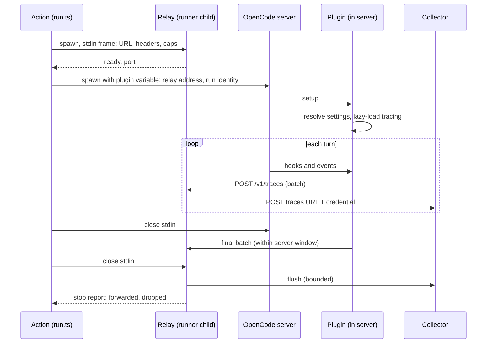

# feat: OpenTelemetry tracing of OpenCode runs

## Overview

`@fro.bot/opencode-plugin` gains opt-in tracing. It turns each turn of an OpenCode session into one trace of GenAI-convention spans, with prompt, tool and model content, and exports them over OTLP/HTTP. The work lands in two stages. Stage 1 is capture and local export, published as a plugin release and proven readable in Langfuse. Stage 2 is the Action: inputs, a loopback relay that holds the collector credential, the pin bump, docs and the policy revision.

## Problem Frame

An operator cannot see what a run sent to the model. OpenCode V2 dropped the content telemetry V1 had, and the Action strips `OTEL_*` from the server. The origin document sets what a trace contains, who may turn it on, and where the credential lives (see origin: `docs/brainstorms/2026-11-19-opencode-run-tracing-requirements.md`).

## Requirements Trace

From the origin document. Each requirement names the unit that satisfies it.

- R1. One trace per turn, including subagents and follow-on work. Unit 3.
- R2. Model requests as inference spans, with usage and finish reason where reported. Units 3, 4.
- R3. Tool calls as tool-execution spans, including rejected and interrupted calls. Units 3, 4.
- R4. Subagent spans in the parent's trace under the tool call that started them. Unit 3.
- R5. Model spans carry the hook-time system instructions, messages, tool definitions and output; the plugin is listed last. Units 3, 4, 6.
- R6. Session, agent and run identity on every span. Units 4, 9.
- R7. Redaction and truncation are marked; absent means not captured. Unit 4.
- R8. Off by default, one switch, no default destination. Units 2, 9.
- R9. Only the operator enables and directs tracing. Units 2, 6, 9.
- R10. Content scrubbed over the whole value, then bounded, in the plugin. Unit 4.
- R11. No spans for past turns; history rides in the model span. Units 3, 4.
- R12. The collector credential goes only to the relay. Units 7, 8.
- R13. The relay forwards to one fixed endpoint with fixed safety rules. Unit 7.
- R14. Works with and without `isolate-agent`, with a warning when not isolated. Units 8, 9.
- R15. Tracing never fails a run; drops are reported honestly. Units 5, 8.
- R16. `OTEL_*` stays out of the Action's server environment. Unit 9.
- R17. Inert when off, and outside local sessions and the Action. Units 1, 2, 6.
- R18. Policy and docs revised. Unit 11.
- Success criteria: readable in Langfuse on a published install with a dummy credential. Units 5, 12.

## Scope Boundaries

- No gateway or workspace tracing. The plugin is forced off there.
- No structure-only level, metrics, logs, sampling, or OTLP over gRPC.
- The relay does not decode, validate, rewrite or scrub spans.
- No capture of provider wire traffic or of the response body the plugin could clone.
- No spans for the Action's own phases, and no job-summary link.
- No export of past sessions.

### Deferred to Separate Tasks

- Collector, Langfuse and Tempo: a task in the operator's infrastructure repo. Unit 12 depends on it.
- Upstream request to restore opt-in content capture in OpenCode's exporter: an issue on `anomalyco/opencode`.
- Gateway tracing per binding: its own requirements and plan.
- Running every real-binary suite in CI: only the plugin's suite is added here.

## Context & Research

### Relevant Code and Patterns

- `packages/opencode-plugin/src/setup.ts` (`setupFroBotPlugin`, `HostSurface`): the plugin's one setup function and its narrow host type. It returns no cleanup today.
- `packages/opencode-plugin/tsdown.config.ts`: `neverBundle` for `effect` and `@opencode/plugin`, `onlyBundle` as the allowlist of inlined third-party code.
- `.github/workflows/opencode-plugin-release.yaml`: the bundle-import check reads only `dist/index.mjs` and allows `effect`, `@opencode/plugin` and `node:` imports.
- `src/services/setup/ci-config-v2.ts` (`buildCIConfigV2`): builds the plugin list as `[systematic, fro-bot, ...operator plugins]` and drops object-form operator entries.
- `packages/runtime/src/agent/filter-env.ts`: admits `OPENCODE_`-prefixed names unless they end in a denied suffix. `GITHUB_RUN_ATTEMPT` is not admitted.
- `apps/workspace-agent/src/opencode-server-v2.ts` (`buildOpencodeV2Env`): an allowlist builder for the workspace server's environment.
- The key proxy, as the pattern for the relay: `packages/runtime/src/agent/key-proxy.ts`, `key-proxy-wire.ts`, `key-proxy-child.ts`, `apps/action/src/key-proxy.ts`, `src/harness/phases/key-proxy-process.ts`.
- `packages/runtime/src/agent/forwardable-target.ts` (`isForwardableTarget`) and `packages/runtime/src/object-store/validation.ts` (`validateUpstreamUrl`).
- `src/services/setup/sandbox-preflight.ts` (`RUNNER_ENTRY_SCRIPTS`) and the matching list in `src/harness/phases/v2-server.sandbox.integration.test.ts`.
- `src/harness/config/inputs.ts` (`parseActionInputs`, `isIsolationRequested`) for a new input end to end.
- `src/harness/run.ts`, `src/harness/phases/release-v2.ts`, `packages/runtime/src/agent/server-v2.ts` (`runShutdown`): the stop sequence. The server gets 5 s after stdin closes.
- `packages/opencode-plugin/src/integration.test.ts` and `integration.fixture.ts`: the real-binary harness with a scripted provider.

### Institutional Learnings

- `docs/solutions/best-practices/key-proxy-keeps-provider-keys-out-of-the-agent-sandbox-2026-11-17.md`: use `https.request`, never follow 3xx or 101, attach the socket error handler before rejecting CONNECT, validate by structure.
- `docs/solutions/best-practices/separate-uid-is-not-a-boundary-on-hosted-runners-2026-11-17.md`: withholding from the environment is not secrecy without isolation.
- `docs/solutions/integration-issues/plugin-install-at-server-start-stalls-first-request-2026-11-17.md`: nothing new may install at boot.
- `docs/solutions/workflow-issues/published-install-live-check-before-rollout-2026-11-17.md`: prove an opt-in feature on a published install, with `workflow_dispatch`, never `push`.
- `docs/solutions/best-practices/workspace-opencode-provisioning-on-v2-2026-11-17.md`: workspace tools share the server's uid, so nothing secret goes in its environment or config.

### External References

- OpenTelemetry GenAI semantic conventions, Development status: `https://github.com/open-telemetry/semantic-conventions-genai/tree/main/docs/gen-ai`. Read at commit `76e0c19`.
- Langfuse OTLP ingestion: HTTP only, Basic auth, header `x-langfuse-ingestion-version: 4`. It reads `gen_ai.input.messages`, `gen_ai.output.messages`, `gen_ai.system_instructions` and tool call attributes. It does not show span links. It groups by `session.id` or `gen_ai.conversation.id`.
- Tempo cuts attributes at 2,048 bytes by default.
- A probe on the pinned 2.3.2 binary established the hook and event facts this plan relies on. They are restated in the origin document's Dependencies section.

## Prior-Art Survey

```json
{
  "schema_version": 2,
  "verdict": "extend",
  "scope": "whole repository (packages/*, apps/*, src/, deploy/, scripts/, .github/) plus bun.lock",
  "freshness": {
    "vcs_reference": "0233957ae0389d1c80a92b4f1a56b963df887af9"
  },
  "budget": {
    "max_search_passes": 12,
    "max_candidate_inspections": 25,
    "exhausted": false
  },
  "candidates": [
    {
      "path_or_symbol": "packages/opencode-plugin (setupFroBotPlugin, HostSurface)",
      "description": "the only repo code running inside the OpenCode server process; registers a tool hook and four tools",
      "disposition": "extend"
    },
    {
      "path_or_symbol": "packages/runtime/src/agent/key-proxy.ts; key-proxy-wire.ts; key-proxy-child.ts; apps/action/src/key-proxy.ts; src/harness/phases/key-proxy-process.ts",
      "description": "loopback credential-injecting forwarder to a fixed https upstream with stdin-frame secret, empty env and supervision",
      "disposition": "extend"
    },
    {
      "path_or_symbol": "packages/runtime/src/agent/forwardable-target.ts isForwardableTarget; packages/runtime/src/object-store/validation.ts validateUpstreamUrl",
      "description": "canonical origin-form target check and https upstream validation",
      "disposition": "reuse"
    },
    {
      "path_or_symbol": "packages/runtime/src/agent/event-v2.ts; src/features/agent/streaming-v2.ts",
      "description": "SSE frame mapper and activity tracker for the run loop",
      "disposition": "insufficient"
    },
    {
      "path_or_symbol": "src/features/observability/ (createMetricsCollector, run-summary, job-summary)",
      "description": "per-run counters, token usage and local summaries",
      "disposition": "insufficient"
    },
    {
      "path_or_symbol": "src/services/artifact/upload.ts; syncArtifactsToStore",
      "description": "batch publication of log files to artifacts and the object store",
      "disposition": "insufficient"
    },
    {
      "path_or_symbol": "packages/gateway/src/web/sse/*; packages/gateway/src/web/audit.ts",
      "description": "operator run-status stream and audit events",
      "disposition": "insufficient"
    },
    {
      "path_or_symbol": "packages/runtime/src/shared/logger.ts redactSensitiveFields; src/services/setup/key-proxy-providers.ts checkConfigForKeys",
      "description": "key-name field redaction and exact-credential config scan",
      "disposition": "insufficient"
    }
  ]
}
```

## Key Technical Decisions

- **Bundle the OpenTelemetry SDK into the plugin.** The host provides only `effect` and `@opencode/plugin`, and a declared dependency would add an install step to every run. The SDK packages become plugin devDependencies, are added to `onlyBundle`, and are inlined. Use the versions already in `bun.lock` through OpenCode, so the three-day release-age gate does not bite.
- **Load tracing code lazily.** All tracing code and the SDK sit behind one dynamic `import()` that runs only when tracing resolves to on. With tracing off the plugin executes no new code beyond the settings check, which keeps R17 and the plugin gate safe.
- **The plugin builds spans by hand.** It does not use auto-instrumentation or ambient context. It records spans with explicit start and end times and explicit parent contexts, so a subagent's spans can be placed under a tool span that has already ended.
- **Content attributes are JSON strings.** The JavaScript SDK does not carry structured values on span attributes. The conventions allow a JSON string, and Langfuse parses it.
- **A turn is an execution chain.** The root span opens on the root session's execution start. It stays open while subagents it dispatched are running or their reports are unprocessed, and closes on idle with nothing outstanding, or on failure or interruption. A prompt sent while an execution runs is recorded in that trace.
- **Subagents are joined by dispatch, not by time.** The plugin keeps a map from a dispatching tool call to the child session id the tool returns, and a child inherits its dispatcher's root. A child whose dispatcher cannot be proven gets its own trace, marked as unattributed. Nothing is guessed.
- **Model output is joined to its request by order within a session and request kind.** The request hook carries no message id. Where order is ambiguous the span is exported with its output marked absent.
- **Three host modes, set by the launcher.** The Action sets a plugin variable that says "Action" and carries either off or the relay address and run identity. The workspace launcher sets the same variable to off. With the variable absent the plugin is in a local session and reads one user-scope settings file. Plugin options in OpenCode config are never read for tracing, so a project config cannot enable it.
- **One Action input turns tracing on.** `trace-endpoint` holds the full OTLP traces URL. A second secret input, `trace-headers`, holds the credential headers. An empty endpoint means off. A malformed endpoint or header logs one warning and leaves tracing off; it does not fail the run.
- **The relay is a sibling of the key proxy, with its own owner.** It reuses the stdin-frame, empty-environment, ready-line and supervision patterns. It does not go in the sandbox lifecycle's proxy slot, and its death never aborts the server. `run.ts` owns it for isolated and non-isolated runs alike.
- **The relay forwards bytes.** It accepts `POST` on one path, forwards the body unchanged to the configured URL with the credential headers, retries transient upstream failures within a bound, and answers the plugin with a fixed status. It never parses spans.
- **The plugin moves to the end of the Action's plugin list.** A plugin sees only edits made by plugins listed before it.
- **Hook drift disables tracing, loudly.** At start the tracing code checks that the hooks and events it needs exist. If one is missing it logs once and stays off. A field that stops arriving becomes a marked gap on the span.
- **The scrubber is written here.** It matches provider key prefixes, GitHub tokens, AWS key ids, bearer and basic header values, PEM blocks and JWT-shaped strings. Copying the community plugin's MPL-licensed scrubber into an MIT package is avoided.
- **Recorded as Completed in `RFCs/RFC-007-Observability-Run-Summary.md`, with the F83 acceptance boxes unchecked and its `telemetry` input never built.** This plan replaces that sketch with operator-directed tracing.

## Open Questions

### Resolved During Planning

- Where does the OpenTelemetry code come from? Bundled SDK, lazily loaded.
- How does the plugin learn its settings in the Action? An `OPENCODE_FROBOT_`-prefixed variable set by the Action before the server spawn. It passes `filterAgentEnv` without a change.
- Who owns the relay? `run.ts`, through a fail-soft supervisor, for both isolation modes.
- Does a second prompt mid-run get its own trace? No. It joins the running execution's trace.
- Are title, compaction and generate outputs read from the HTTP response? No. Their missing fields are marked absent.
- Can the Action install a prerelease plugin for testing? No. The pin accepts only `x.y.z`, so the plugin is published as a stable version before the pin moves.

### Deferred to Implementation

- The exact rule when a new prompt arrives while an earlier turn waits on a background subagent, and that subagent's report then lands in the new execution. Needs a real-binary run of that ordering. If the delivered items cannot be told apart, the follow-on work joins the execution it ran in and carries an attribute naming the other turn.
- Whether child events can arrive before the dispatching tool's result under parallel dispatch. If they can, child events are buffered in bounded memory until the dispatch resolves.
- Size bounds per value, span and run, and the truncation order for repeated history. Start from measured Langfuse limits and the probe's sizes.
- Which attribute Langfuse uses to group a turn's trace with its session on the pinned version, and whether the root session id fits its 200-character limit.
- How OpenCode's token counts map to the convention's totals.
- Whether the hooks exist on OpenCode 2.2.x. If not, the plugin's peer range rises.
- The drain and flush budget inside the 5 s server window and the 10 s signal budget. Measure, then set.
- Whether the relay needs proxy and CA settings for self-hosted runners. Hosted runners do not.
- Linux and `isolate-agent` behaviour of everything in Stage 1. The probe ran on macOS without isolation.

## Output Structure

    packages/opencode-plugin/src/
      tracing/
        settings.ts            host mode and settings resolution
        turn-model.ts          events and hooks to span records
        genai-attributes.ts    span records to GenAI attributes
        content.ts             scrub, bound, mark
        exporter.ts            SDK tracer, batch processor, flush
        index.ts               lazy entry: wires the above into the host
    packages/runtime/src/agent/
      trace-relay.ts           loopback forwarder
      trace-relay-wire.ts      stdin frame, ready line, stop report
      trace-relay-child.ts     child main loop
    apps/action/src/trace-relay.ts          bundle entry, built to dist/trace-relay.js
    src/harness/phases/trace-relay-process.ts   fail-soft supervisor
    src/services/setup/tracing.ts           inputs to relay config and plugin variable

## High-Level Technical Design

> *This illustrates the intended approach and is directional guidance for review, not implementation specification. The implementing agent should treat it as context, not code to reproduce.*



Span shape for one turn:

    invoke_agent <root agent>                 root span, one per turn
      chat <model>                            one per model request, retries are separate spans
      execute_tool <tool>                     one per tool call
      execute_tool subagent
        invoke_agent <child agent>            child session, same trace
          chat <model>
          execute_tool <tool>
      chat <model>                            follow-on after the child reports back

## Implementation Units

### Stage 1: capture and local export

- [ ] **Unit 1: Bundle the SDK behind a lazy entry**

**Goal:** The plugin can carry OpenTelemetry code without changing what an install or a tracing-off start does.

**Requirements:** R17

**Dependencies:** None

**Files:**
- Modify: `packages/opencode-plugin/package.json`, `packages/opencode-plugin/tsdown.config.ts`, `.github/workflows/opencode-plugin-release.yaml`, `packages/opencode-plugin/README.md`
- Create: `packages/opencode-plugin/src/tracing/index.ts`, `packages/opencode-plugin/THIRD_PARTY_NOTICES.md`
- Test: `packages/opencode-plugin/src/bundle.test.ts`

**Approach:**
- Add the SDK packages as devDependencies at the versions already locked through OpenCode, and list them in `onlyBundle`.
- Put everything under `src/tracing/` behind one dynamic import from `setup.ts`, so the bundler emits it as a separate chunk.
- Extend the release workflow's import check to read every emitted file, not only `dist/index.mjs`, with the same allowlist.
- Ship a notices file in the tarball for the inlined Apache-2.0 code.
- The release workflow edit is CI configuration: show it for approval before it is pushed.

**Patterns to follow:** the existing `@bfra.me/es` inlining in `tsdown.config.ts`.

**Test scenarios:**
- Happy path: the built `dist/index.mjs` imports only `effect`, `@opencode/plugin` and `node:` modules, and reaches the tracing chunk only through a dynamic import.
- Edge case: every emitted chunk passes the same import allowlist.
- Integration: packing the tarball and installing it with production dependencies only, then importing it under Node, loads without resolving any `@opentelemetry` package from disk.
- Edge case: importing the built entry does not evaluate the tracing chunk.

**Verification:** A tracing-off start loads no tracing chunk, and the published-shape tarball installs with no new dependency fetch. Record tarball size and cold-import time before and after.

- [ ] **Unit 2: Host mode and settings**

**Goal:** One function decides whether tracing is on and where spans go, and fails closed.

**Requirements:** R8, R9, R17

**Dependencies:** None

**Files:**
- Create: `packages/opencode-plugin/src/tracing/settings.ts`
- Modify: `packages/opencode-plugin/src/setup.ts`
- Test: `packages/opencode-plugin/src/tracing/settings.test.ts`

**Approach:**
- Read the launcher variable once at setup. Its value is a versioned JSON document: host, off or on, relay address, run identity.
- Host "Action": use only what the variable carries. Never read the user file.
- Host "workspace", or any unknown host or version: off.
- Variable absent: local session. Read the user-scope file under the user's config directory. It holds the endpoint and optional headers.
- Anything unreadable or malformed resolves to off with one log line that names the reason and no values.
- Settings are resolved once and never written to session or cache state.
- This check lives outside the lazy chunk, since it decides whether to load it.

**Test scenarios:**
- Happy path: Action variable with a relay address resolves to on with that address and identity.
- Happy path: no variable and a valid user file resolves to on with the file's endpoint.
- Edge case: no variable and no user file resolves to off, silently.
- Edge case: Action variable says off while a valid user file exists: off.
- Edge case: workspace variable present with a valid user file: off.
- Error path: malformed JSON, unknown version, non-loopback relay address in Action mode, endpoint with userinfo: each resolves to off with a log line that contains no setting value.
- Edge case: plugin options carrying an endpoint are ignored in every mode.
- Edge case: tests pass an explicit environment and config directory and never read the real home.

**Verification:** No input the agent or a checkout can write turns tracing on in Action or workspace mode.

- [ ] **Unit 3: Turn model**

**Goal:** A pure module turns hook calls and bus events into span records with correct parents and end states.

**Requirements:** R1, R2, R3, R4, R5, R11

**Dependencies:** None

**Files:**
- Create: `packages/opencode-plugin/src/tracing/turn-model.ts`, `packages/opencode-plugin/src/tracing/turn-model.fixtures.ts`
- Test: `packages/opencode-plugin/src/tracing/turn-model.test.ts`

**Approach:**
- Input is a stream of normalized observations: prompt, execution started and ended, request-hook snapshot by kind, step started and ended, text ended, tool before, tool success and failure, subagent dispatch result, inbox delivery, idle, compaction, cleanup.
- Output is span records: name, kind, trace, parent, start, end, status, raw content, gaps.
- State per root: active, waiting on subagents or their reports, closed. A root is never closed while a dispatch it owns is unresolved.
- Tool spans open on the before-hook and close on the session tool event, keyed by call id. A call with no after-hook still closes.
- Retries are separate model spans with an attempt number.
- A dispatch map from tool call to child session gives each child session its parent span. Nested subagents inherit the root through their dispatcher.
- Cleanup closes every open span as interrupted and marks it incomplete.
- Fixtures are recorded from the real binary, one per scenario, so the tests replay real event order.

**Execution note:** Build this test-first from the recorded fixtures.

**Test scenarios:**
- Happy path: a text turn yields a root span and one model span with output, usage and finish reason.
- Happy path: a turn with one tool yields a tool span under the root with input and result, closed on tool success.
- Edge case: a rejected tool call and an interrupted one each yield a closed tool span with that outcome and no result.
- Edge case: a failed model call followed by a retry yields two model spans, the first marked failed.
- Happy path: a background subagent yields child spans in the root's trace under the dispatching tool span, though that tool span has ended.
- Happy path: the parent's follow-on model call after the child reports back is in the same trace.
- Edge case: a subagent that starts a subagent keeps all three sessions in one trace.
- Edge case: two sessions running at once never share a trace.
- Edge case: a child session with no known dispatcher gets its own trace, marked unattributed.
- Edge case: a prompt arriving mid-execution is recorded in the running trace and opens no new root.
- Edge case: title and compaction requests yield model spans with finish reason marked absent.
- Edge case: a restored session's first new turn yields spans for that turn only.
- Error path: an execution failure closes the root with an error status after its open children.
- Edge case: cleanup with spans open closes them as interrupted and incomplete.
- Edge case: a root that never receives its idle event is closed by a bounded age limit and marked incomplete.

**Verification:** Every fixture replays to the expected span tree, and no state remains for a closed root.

- [ ] **Unit 4: Content and GenAI attributes**

**Goal:** Span records become GenAI-convention attributes with scrubbed, bounded, marked content.

**Requirements:** R2, R3, R5, R6, R7, R10, R11

**Dependencies:** Unit 3

**Files:**
- Create: `packages/opencode-plugin/src/tracing/content.ts`, `packages/opencode-plugin/src/tracing/genai-attributes.ts`
- Test: `packages/opencode-plugin/src/tracing/content.test.ts`, `packages/opencode-plugin/src/tracing/genai-attributes.test.ts`

**Approach:**
- Keep only text parts. Attachments, binary parts and all headers are dropped before serialization.
- Scrub each retained string in full, then bound it. Bounds apply per value and per span, and truncation keeps the JSON valid.
- When a span is over budget, cut the oldest history messages first and state how many were cut.
- Each redaction and truncation sets a marker attribute with a count. An uncaptured field sets no attribute.
- Map to the pinned convention revision's names for system instructions, input and output messages, tool definitions, tool arguments and results, usage and finish reasons.
- Identity: the actual session id, the root session id as the grouping key, agent name, and in Action mode repository, run id, attempt, job and trigger.
- A model span states that its content is the hook-time view.
- Record the pinned convention revision in one constant.

**Test scenarios:**
- Happy path: a model record maps to the convention's attribute names with content as JSON strings that parse back to the input.
- Happy path: a provider key, a GitHub token, an AWS key id, a bearer header value, a PEM block and a JWT inside tool output are each replaced, and the redaction marker counts them.
- Edge case: a secret that straddles the truncation boundary is still removed, because scrubbing runs first.
- Edge case: a 5 MB tool result is cut to the bound, stays valid JSON, and carries the truncation marker.
- Edge case: a model span over budget drops oldest history first and states the count.
- Edge case: binary and attachment parts are absent, with an omission marker.
- Edge case: a missing finish reason produces no attribute, not an empty one.
- Edge case: a scrubber pattern cannot take super-linear time on a long line of repeated characters.
- Happy path: in Action mode every span carries repository and run identity; in local mode none do.

**Verification:** No test fixture secret survives into any attribute, and every bounded value parses.

- [ ] **Unit 5: Wire tracing into the plugin**

**Goal:** A local session with tracing on exports a turn's trace, and nothing tracing does can break a session.

**Requirements:** R15, R16, R17, success criteria

**Dependencies:** Units 1, 2, 3, 4

**Files:**
- Create: `packages/opencode-plugin/src/tracing/exporter.ts`
- Modify: `packages/opencode-plugin/src/tracing/index.ts`, `packages/opencode-plugin/src/setup.ts`, `packages/opencode-plugin/src/index.test.ts`, `packages/opencode-plugin/src/integration.fixture.ts`
- Test: `packages/opencode-plugin/src/tracing/exporter.test.ts`, `packages/opencode-plugin/src/tracing/tracing.integration.test.ts`

**Approach:**
- Widen `HostSurface` to the session hooks, the event subscription and a returned cleanup.
- Register hooks only when settings resolve to on. Each handler copies what it needs, returns at once, and never changes hook arguments. Every handler body is wrapped so a tracing error is counted and swallowed.
- Check at start that each required hook and event exists. If not, log once and stay off.
- Export with a batch processor on a short interval and a bounded queue. When the queue is full, drop and count.
- Cleanup closes open spans, flushes within a bound shorter than the server's window, and logs counts of exported and dropped spans without content.
- The existing reuse guard and session tools are untouched, and their failures still surface.

**Test scenarios:**
- Happy path, real binary: a turn with a tool and a background subagent, against a loopback OTLP sink, produces one trace with the expected span tree and content.
- Happy path, real binary: tracing off produces no request to the sink and loads no tracing chunk.
- Error path: the sink refuses connections for the whole session; the session completes and the log reports dropped spans.
- Error path: a handler that throws inside tracing does not fail the tool call or the model request.
- Edge case: a second plugin listed before this one that edits the system prompt has its edit visible in the model span.
- Edge case: a missing required hook leaves tracing off with one log line and the plugin otherwise active.
- Integration: the server is stopped with stdin close; the final batch reaches the sink before the kill, and spans still open are exported as interrupted.
- Edge case: the operator's own `OTEL_EXPORTER_OTLP_ENDPOINT` set alongside does not change what the plugin sends.

**Verification:** The real-binary suite passes three times in a row, and a turn is readable in a local Langfuse with system instructions, tool input and result, and the subagent nested.

- [ ] **Unit 6: Launchers set the host mode; the plugin goes last**

**Goal:** The Action and the workspace state their host mode, and the Action lists this plugin after every other.

**Requirements:** R5, R9, R17

**Dependencies:** Unit 2

**Files:**
- Modify: `src/services/setup/ci-config-v2.ts`, `packages/runtime/src/agent/server-v2.ts`, `apps/workspace-agent/src/opencode-server-v2.ts`, `packages/runtime/src/shared/constants.ts`
- Test: `src/services/setup/ci-config-v2.test.ts`, `packages/runtime/src/agent/server-v2.test.ts`, `apps/workspace-agent/src/opencode-server-v2.test.ts`

**Approach:**
- Plugin order becomes Systematic, operator plugins, then this plugin. Object-form operator entries are kept and placed before it.
- The Action sets the launcher variable to "Action, off" on every spawn until Unit 9 supplies real values. It removes any inherited value first.
- The workspace launcher sets it to "workspace, off".
- The variable's name lives in one runtime constant shared by both launchers and mirrored in the plugin with an equality test, as the plugin id is today.

**Test scenarios:**
- Happy path: with two operator plugins, this plugin is last in the built config.
- Edge case: an operator entry in object form is kept and precedes this plugin.
- Edge case: an operator who lists this plugin themselves does not get it twice.
- Happy path: the Action's server environment carries the variable as "Action, off" with tracing unset.
- Edge case: a value for the variable inherited from the job environment is replaced, not passed through.
- Happy path: the workspace server environment carries "workspace, off".
- Integration: the plugin and permission gates still pass on the real binary with the new order.

**Verification:** No launch path in the repo starts a server with the variable absent.

### Stage 2: the Action

- [ ] **Unit 7: Relay core**

**Goal:** A loopback process that forwards trace batches to one fixed URL with a credential it alone holds.

**Requirements:** R12, R13

**Dependencies:** None

**Files:**
- Create: `packages/runtime/src/agent/trace-relay.ts`, `packages/runtime/src/agent/trace-relay-wire.ts`, `packages/runtime/src/agent/trace-relay-child.ts`, `apps/action/src/trace-relay.ts`
- Modify: `packages/runtime/src/agent/index.ts`, `packages/runtime/src/object-store/validation.ts`, `tsdown.config.ts`
- Test: `packages/runtime/src/agent/trace-relay.test.ts`, `packages/runtime/src/agent/trace-relay-wire.test.ts`, `packages/runtime/src/agent/trace-relay-child.test.ts`

**Approach:**
- Config arrives as one stdin frame: the traces URL, the credential headers and the caps. The environment is empty. Closing stdin is the stop signal.
- The child prints one ready line with its port, and at stop one report line with counts.
- It serves `POST` on one path and answers everything else locally. It answers the sender with a fixed status and no upstream body.
- It forwards the body unchanged with `content-type`, `content-encoding` and the configured headers only. No header from the sender is forwarded.
- The upstream URL may have a path. It must be `https`, or `http` to a literal loopback address, with no userinfo. Extend the URL validation for this without loosening it for its current callers.
- Redirects and upgrades are never followed. Per-request size, total bytes per run and concurrent connections are capped.
- Transient upstream failures and `429` are retried with backoff within a bound, from a bounded in-memory queue. Other `4xx` drop the batch and count it.
- Node standard library only, as the key proxy is.

**Patterns to follow:** `key-proxy.ts` for `https.request`, socket error handling and limits; `key-proxy-wire.ts` and `key-proxy-child.ts` for the frame and injected streams.

**Test scenarios:**
- Happy path: a batch posted to the relay arrives at a recording upstream with the same bytes and the configured headers.
- Edge case: a request naming another host in its path, `Host` header or body is still forwarded only to the configured URL.
- Edge case: sender-supplied `authorization` and other headers are not forwarded.
- Error path: `GET`, another path, `CONNECT` and an upgrade request are answered locally and nothing is forwarded.
- Error path: upstream `301` is not followed and counts as a drop.
- Error path: upstream `401` drops the batch, counts it, and returns no body to the sender.
- Error path: upstream `503` then `200` delivers the batch once after a retry.
- Edge case: a body over the request cap is refused before it is buffered, and the run-total cap stops forwarding once reached.
- Error path: an upstream that never answers times out within the bound.
- Edge case: an `http` URL to a non-loopback host, a URL with userinfo, and a malformed frame are each refused at start with a fixed error code.
- Happy path: closing stdin flushes the queue within the bound and prints a report with forwarded and dropped counts.
- Edge case: nothing the child prints contains the URL, a header value or body bytes.

**Verification:** The child's whole output is one ready line and one report line, and the credential appears in no argument or environment.

- [ ] **Unit 8: Relay supervisor and run lifecycle**

**Goal:** The Action starts the relay before the server, keeps it past the server's exit, and stops it on every path, without letting it affect the run.

**Requirements:** R12, R14, R15

**Dependencies:** Unit 7

**Files:**
- Create: `src/harness/phases/trace-relay-process.ts`
- Modify: `src/harness/run.ts`, `src/harness/phases/cache-restore.ts`, `src/harness/phases/v2-server.ts`, `src/services/setup/sandbox-preflight.ts`, `src/harness/phases/AGENTS.md`
- Test: `src/harness/phases/trace-relay-process.test.ts`, `src/harness/run-tracing.test.ts`

**Approach:**
- The supervisor spawns the bundle entry with an empty environment and writes the frame. It waits a bounded time for the ready line.
- Start failure, a ready timeout or a later crash logs one warning with a fixed reason. The run continues with tracing off. The relay's death is never joined to the server's abort signal, and never declines persistence.
- `run.ts` holds the handle beside the sandbox lifecycle and stops it after the server has exited, in the normal path and in `finally`.
- Stop is: close stdin, wait the flush bound, kill the process group, confirm. Then log the report, or "count incomplete" if the child was killed.
- On a signal the relay gets a short separate bound inside the lifecycle's existing budget.
- Add `dist/trace-relay.js` to the preflight's entry list so an isolated run verifies it.
- A non-isolated run logs one warning that the agent can read the collector credential.

**Patterns to follow:** `key-proxy-process.ts` for spawn, ready and stop; contrast its crash policy.

**Test scenarios:**
- Happy path: the relay is ready before the server spawn and stopped after the server exits.
- Error path: the relay fails to start; the run proceeds, tracing is off for the plugin, one warning is logged.
- Error path: the relay exits mid-run; the server keeps running and the run's result and persistence decision are unchanged.
- Edge case: the run throws after the relay starts; the relay is still stopped.
- Edge case: a cancellation signal stops the relay within the budget.
- Happy path: the stop report's counts appear in the log, with no content.
- Edge case: a relay killed at the flush bound logs that the count is incomplete.
- Happy path: a non-isolated traced run logs the exposure warning once; an isolated one does not.
- Edge case: tracing off starts no relay process.

**Verification:** No test finds a path that leaves a relay process alive, or that changes a run's outcome because of tracing.

- [ ] **Unit 9: Inputs and the plugin handoff**

**Goal:** Two inputs turn tracing on, and the plugin receives the relay address and run identity.

**Requirements:** R6, R8, R9, R14, R16

**Dependencies:** Units 6, 8

**Files:**
- Create: `src/services/setup/tracing.ts`
- Modify: `action.yaml`, `src/harness/config/inputs.ts`, `packages/runtime/src/shared/types.ts`, `src/harness/phases/v2-server.ts`, `src/harness/phases/cache-restore.ts`, `src/harness/config/AGENTS.md`, `src/services/setup/AGENTS.md`
- Test: `src/services/setup/tracing.test.ts`, `src/harness/config/inputs.test.ts`, `src/harness/phases/v2-server.test.ts`

**Approach:**
- `trace-endpoint` and `trace-headers` are parsed in `parseActionInputs`. The headers value and each header value in it are masked, and the input variables are removed from the process environment as the token inputs are.
- An empty endpoint is off. An invalid endpoint or header line logs one warning without the value and is off.
- `tracing.ts` builds the relay frame and the launcher variable's value. The variable carries the relay's loopback address, repository, run id, run attempt, job and trigger. It carries no credential and no collector URL.
- The variable is set in the server's environment in place of Unit 6's "off" value. `OTEL_*` stays filtered.

**Test scenarios:**
- Happy path: both inputs set yields a relay frame with the URL and headers, and a variable with the relay address and identity.
- Edge case: endpoint set, headers empty: on, with no credential headers.
- Edge case: headers set, endpoint empty: off, no relay.
- Error path: an `http` endpoint to a public host, an endpoint with userinfo, and a header line without a colon each resolve to off with a warning that omits the value.
- Edge case: the variable's value contains no header value and no collector host.
- Edge case: the header values are registered as secrets before anything is logged.
- Edge case: `INPUT_TRACE-HEADERS` is gone from the process environment after parsing.
- Integration, real binary: with a relay and a recording upstream, a turn's spans arrive upstream with the credential header and Action identity attributes.
- Edge case: the server environment has no `OTEL_` variable when the job sets one.

**Verification:** On the real binary the collector credential is absent from the server's environment and config.

- [ ] **Unit 10: Pin, real-runner proof and CI**

**Goal:** The Action runs the published plugin version, and CI proves tracing on a hosted runner, isolated and not.

**Requirements:** R12, R14, R15, R17

**Dependencies:** Units 1 to 9; the plugin published as a stable version

**Files:**
- Modify: `packages/runtime/src/shared/constants.ts`, `deploy/workspace.Dockerfile`, `src/harness/phases/v2-server.sandbox.integration.test.ts`, `src/harness/phases/v2-server.sandbox.harness.ts`, `.github/workflows/ci.yaml`, `dist/`
- Test: `src/harness/phases/v2-server.sandbox.integration.test.ts`

**Approach:**
- Move `FRO_BOT_PLUGIN_VERSION` and the Dockerfile argument together, after the plugin is on npm.
- Add real-runner rows to the sandbox suite, with a loopback collector stand-in and a dummy credential.
- Add the plugin's real-binary suite to CI, and a check that runs the tracing fixtures against the pinned binary so a pin bump that changes a hook fails in CI.
- The `ci.yaml` edits are shown for approval before they are pushed.
- Rebuild committed `dist/`, which gains `dist/trace-relay.js`.

**Test scenarios:**
- Integration, isolated: a traced turn's spans reach the collector stand-in with the credential; the sandboxed agent's shell cannot find the credential in its environment, its config, or the arguments of any process it can list.
- Integration, isolated: the sandboxed plugin reaches the relay over loopback.
- Integration, non-isolated: the same turn is traced and the exposure warning is logged.
- Integration: after the run no relay process remains and the sandbox restores cleanly.
- Integration: tracing off on the same runner starts no relay and sends nothing.
- Integration: the workspace image smoke test still shows both plugins active.

**Verification:** `Sandbox integration` passes on both runner images with the new rows, and the tools cache key moves with the pin.

- [ ] **Unit 11: Docs and policy**

**Goal:** The docs say what tracing sends and how to turn it on, and the recorded policy matches.

**Requirements:** R18

**Dependencies:** Units 9, 10

**Files:**
- Modify: `README.md`, `action.yaml`, `docs/wiki/Setup and Configuration.md`, `docs/wiki/Execution Lifecycle.md`, `docs/wiki/Troubleshooting.md`, `ARCHITECTURE.md`, `STRUCTURE.md`, `SECURITY.md`, `AGENTS.md`, `RFCs/RFC-007-Observability-Run-Summary.md`, `RFCS.md`, `docs/product/FEATURES.md`, `docs/product/PRD.md`, `packages/opencode-plugin/README.md`, `apps/workspace-agent/AGENTS.md`

**Approach:**
- Follow the repo's project-docs skill: living docs summarize, the wiki holds the detail.
- A new wiki section covers the two inputs, the local settings file, what a trace contains, session history, best-effort scrubbing, misleading spans from an agent, the non-isolated exposure, the recommended ingest-only credential, and collector access and retention.
- Revise F83 in all four places it is recorded.
- Correct `ARCHITECTURE.md`'s statement that no surface loads the plugin.

**Test scenarios:** Test expectation: none -- documentation only; the link check and lint cover it.

**Verification:** The link check passes, and every file path and input name in the new text exists.

- [ ] **Unit 12: Published-install live check**

**Goal:** Show the feature end to end on a release, in the operator's backend.

**Requirements:** Success criteria

**Dependencies:** Unit 10 released; the operator's collector and Langfuse running

**Files:**
- Create: `docs/solutions/` learning for this work, with a `module` from the existing taxonomy

**Approach:**
- From a throwaway branch in a caller repository, dispatch a workflow pinned to the release with tracing on, once isolated and once not.
- Read the trace in Langfuse: system instructions, a subagent's prompt, tool input and result. Confirm the same trace is in Tempo.
- Read the run log for the relay's start, its stop report, and the warning on the non-isolated run.
- Repeat with a wrong credential and confirm the run succeeds and reports drops.

**Test scenarios:** Test expectation: none -- operational verification on a published install.

**Verification:** The origin document's first two success criteria are observed, and the evidence is recorded in the learning.

## System-Wide Impact

- **Interaction graph:** the plugin's new hooks run inside every model request and tool call when tracing is on. The Action gains a second child process and a second `dist/` entry.
- **Error propagation:** tracing errors stop at the plugin's handler wrapper and at the relay supervisor. They reach the log and nowhere else. The plugin gate and the existing reuse guard keep failing loudly.
- **State lifecycle risks:** span state lives in memory per root and must be released on close, on age-out and at cleanup. Nothing is written to disk, cache or session state.
- **API surface parity:** the workspace loads the same plugin build and must stay off. The gateway's own tracing is a later plan.
- **Integration coverage:** real-binary suites for the plugin and the Action, and real-runner rows for isolation.
- **Unchanged invariants:** the credential gate, the key proxy and its lifecycle slot, the sandbox take-back order, cache save and restore paths, and the single response per invocation. Plugin order changes for operator plugins, which now load before this plugin.

## Risks & Dependencies

| Risk | Mitigation |
|------|------------|
| A hook changes shape on an OpenCode pin bump | Start-time hook check turns tracing off with a log line; CI replays tracing fixtures against the pinned binary |
| Bundled SDK grows the tarball or slows a tracing-off start | Lazy chunk; measure size and import time in Unit 1 |
| Scrubbing misses a secret | Docs say scrubbing is best-effort; recommend an ingest-only credential and CI-log-grade access on the collector |
| A long session's repeated history exceeds backend limits | Per-span bound that drops oldest history first, with a marker; limits set from measured Langfuse behaviour |
| Turn attribution is wrong under overlapping prompts and subagent reports | Dispatch-based joins only; unattributed work gets its own marked trace |
| The relay outlives or kills the run | Fail-soft supervisor with bounded stop; tests for every exit path |
| Moving this plugin last changes behaviour for operators with their own plugins | Covered by a config test and the real-binary gate test; noted in the release |
| Stage 2 proof depends on infrastructure outside this repo | Stage 1 is proven against a local Langfuse; Unit 12 waits on the collector |

## Phased Delivery

### Stage 1

Units 1 to 6. Ends with a published plugin version. The Action and workspace still pin the old version, so nothing changes for callers.

### Stage 2

Units 7 to 12. Units 7 and 8 can be built while Stage 1 is in review. Unit 10 needs the Stage 1 publish.

## Documentation / Operational Notes

- The plugin is published by hand through its release workflow before the pin moves.
- The Action release that carries Stage 2 is a minor: two new inputs, no default change.
- Release notes state the plugin-order change.

## Sources & References

- **Origin document:** [docs/brainstorms/2026-11-19-opencode-run-tracing-requirements.md](../brainstorms/2026-11-19-opencode-run-tracing-requirements.md)
- Related code: `packages/opencode-plugin/src/setup.ts`, `packages/runtime/src/agent/key-proxy.ts`, `src/services/setup/ci-config-v2.ts`
- Related past work: `RFCs/RFC-007-Observability-Run-Summary.md`, recorded Completed. Its telemetry item described project-run telemetry with no raw content; this plan builds operator-directed tracing with content and revises that item.
- Related past work: `docs/solutions/best-practices/authenticated-sse-run-observation-2026-06-20.md`, recorded active. The operator stream stays payload-free; traces are a separate surface.
- External docs: `https://github.com/open-telemetry/semantic-conventions-genai/tree/main/docs/gen-ai`
