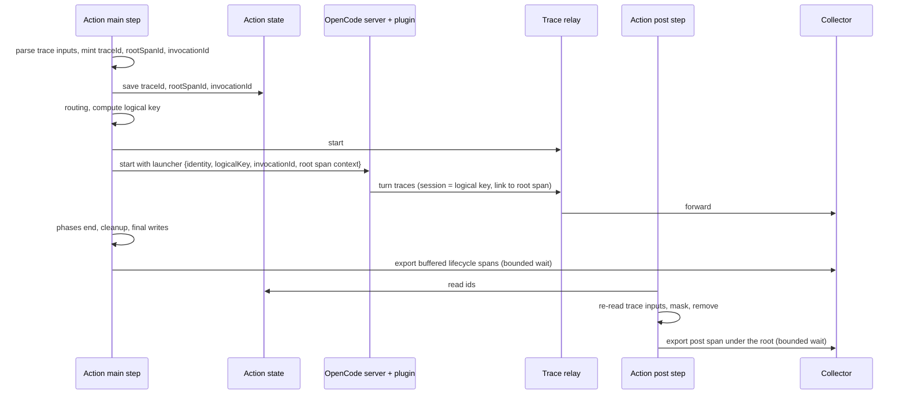

# feat: Trace the Action's own run lifecycle

## Overview

When tracing is on, the Action sends its own OTLP trace of each invocation to the operator's collector. The trace has one root span for the main step, a span per phase of the run, child spans for the slow work inside phases, and a span for the post step. Lifecycle and turn traces share the conversation's logical key as their Langfuse session, and each turn trace links to the run's root span in Tempo.

The plugin's exporter and scrubber move into the shared runtime package so both sides use one implementation. The plugin gains three launcher fields and ships a new release, which the Action pins in the same release that turns lifecycle tracing on.

## Problem Frame

Turn traces show what the model did. They show nothing of the Action around the model: bootstrap, installs, cache restore and save, isolation handoff, gates, delivery and cleanup. Those are where most CI questions start. Today the answers live only in one job's log and summary, which can't be compared across runs (see origin: `docs/brainstorms/2026-11-23-action-lifecycle-tracing-requirements.md`).

## Requirements Trace

All 26 origin requirements carry forward. Grouped by where they land:

- Enablement (R1-R3): Units 3, 4.
- Trace shape (R4-R12): Units 3, 4, 7.
- Content and scrubbing (R13-R16): Units 2, 3, 7.
- Joining turns and runs (R17-R21): Units 4, 6.
- Delivery (R22-R24): Units 3, 5, 7.
- Backend fit (R25-R26): Unit 9.
- Success criteria: Units 8, 10.

## Scope Boundaries

- Gateway tracing, the job-summary trace link and native OpenCode telemetry stay out, as the origin says.
- No change to how turn traces are shaped beyond the three launcher fields and the run link.
- A forced kill, including a job-level timeout, loses spans not yet sent.

### Deferred to Separate Tasks

- The wiki sentence that the plugin's reported span count excludes the last batch: folded into Unit 9's docs touch.

## Context & Research

### Relevant Code and Patterns

- `src/harness/run.ts` (`run`): phases called in order with `createLogger({phase})`; `metrics` is the model for a run-wide collector created at the top; the `finally` at the end holds cleanup, the outcome and final writes, then `return exitCode`.
- `src/harness/phases/cache-restore.ts` (`runCacheRestore`): cache restore and the V2 server start are one function; they become two spans inside it.
- `src/harness/phases/routing.ts` (`RoutingPhaseSkip`): drops the trigger context that `TriggerResultSkip` carries, so a skipped run can't compute its logical key today.
- `packages/runtime/src/session/logical-key.ts` (`buildLogicalKey`): pure; computed at `session-prep.ts` today, computable right after routing.
- `src/services/cache/restore.ts`: tiers log hit or miss and return only the winner; per-tier spans need a hook here.
- `src/harness/phases/cleanup.ts` (`runCleanup`): returns no save outcome; the result is mapped only to state.
- `packages/runtime/src/agent/sandbox-lifecycle.ts` (`registerSignalStop`): the only SIGINT/SIGTERM handling, isolated runs only, 10 s budget, re-raises.
- `src/main.ts`: `process.exit` straight after `run()`.
- `src/harness/post.ts`: reads only `core.getState`; already reads one input by env (`INPUT_MATRIX-CONTEXT`).
- `src/harness/config/inputs.ts` and `src/harness/config/trace-inputs.ts`: trace inputs are masked and removed from the environment before validation.
- `packages/runtime/src/agent/trace-relay-wire.ts` (`validateTraceRelayUrl`, `parseTraceRelayConfig`): reusable URL and credential-over-http rules.
- `packages/runtime/src/agent/trace-relay.ts`: transport rules to mirror (`https.request`, `rejectUnauthorized`, no redirects, body never read, 5 s connect, 8 s upstream).
- `packages/opencode-plugin/src/tracing/exporter.ts` (`createSpanExporter`): SDK serializer plus own HTTPS delegate, 4 MB batches, bounded close, exact counts.
- `packages/opencode-plugin/src/tracing/content.ts` (`createScrubber`, `scrubSpan`, `collectLiterals`): pure scrubber over names, attributes, status messages and events.
- `packages/runtime/src/agent/tracing-launcher.ts`, `packages/opencode-plugin/src/tracing/settings.ts`, `packages/opencode-plugin/src/tracing/genai-attributes.ts` (`identityAttributes`): the launcher document, its strict parser, and where `langfuse.session.id` is set.
- `packages/runtime/src/shared/invocation-identity.ts` (`getInvocationIdentity`): job plus matrix hash, so two steps in one job collide.
- Tests: `run()` is tested by mocking every phase (`src/harness/run-v2.test.ts`, `src/harness/run-tracing.test.ts`); the real-binary tracing test reuses the plugin's OTLP sinks (`src/harness/phases/tracing.integration.test.ts`).

### Institutional Learnings

- `docs/solutions/workflow-issues/committed-dist-attribution-and-sbom-hygiene-2026-06-21.md`: bundled dependencies in `dist/` need their notices and a verified rebuild.
- `docs/solutions/integration-issues/signal-forwarding-shim-orphans-native-child-2026-10-12.md`: install listeners before spawning, test real signal delivery, a forced kill can't be flushed.
- `docs/solutions/workflow-issues/run-tracing-live-check-2026-11-23.md`: test the published install against the real collector in isolated, non-isolated and bad-credential runs, and confirm in the backends, not just counts.

### External References

- OTLP JSON encoding (hex IDs, decimal-string nanoseconds, numeric wire enums, partial success, retryable statuses): https://github.com/open-telemetry/opentelemetry-proto/blob/main/docs/specification.md
- GitHub cancellation (SIGINT, SIGTERM at 7.5 s, kill at 10 s): https://docs.github.com/en/actions/reference/workflows-and-actions/workflow-cancellation
- Post-step inputs are injected per stage by the runner: https://github.com/actions/runner/blob/main/src/Runner.Worker/Handlers/NodeScriptActionHandler.cs
- Langfuse session per conversation, links ignored: https://langfuse.com/docs/observability/best-practices, https://langfuse.com/faq/all/opentelemetry-logs-metrics-span-links

## Prior-Art Survey

```json
{
  "schema_version": 2,
  "verdict": "extend",
  "scope": "src/ and packages/ (runtime, opencode-plugin; gateway by search only)",
  "freshness": {
    "vcs_reference": "76ee420c9f440932e858fee11294671eca9d30c6"
  },
  "budget": {
    "max_search_passes": 3,
    "max_candidate_inspections": 12,
    "exhausted": false
  },
  "candidates": [
    {
      "path_or_symbol": "packages/opencode-plugin/src/tracing/exporter.ts:createSpanExporter",
      "description": "OTLP/HTTP JSON exporter built on the SDK serializer with its own HTTPS transport, batch cap, bounded close and exact counts",
      "disposition": "extend"
    },
    {
      "path_or_symbol": "packages/opencode-plugin/src/tracing/content.ts:createScrubber",
      "description": "Pure value scrubber over span names, attributes, status messages and event text",
      "disposition": "extend"
    },
    {
      "path_or_symbol": "packages/runtime/src/agent/trace-relay-wire.ts:validateTraceRelayUrl",
      "description": "Collector URL and credential-over-http rules used by trace input parsing",
      "disposition": "reuse"
    },
    {
      "path_or_symbol": "src/services/setup/tracing.ts:buildTracingRunIdentity",
      "description": "Run identity shared with the launcher document",
      "disposition": "extend"
    },
    {
      "path_or_symbol": "packages/runtime/src/agent/tracing-launcher.ts:buildTracingLauncherValue",
      "description": "Launcher document for the plugin with a strict key set",
      "disposition": "extend"
    },
    {
      "path_or_symbol": "packages/runtime/src/agent/trace-relay.ts:startTraceRelay",
      "description": "Loopback batch forwarder for plugin spans",
      "disposition": "insufficient",
      "insufficiency_reason": "stops before finalize and cleanup and does not exist in the post step"
    },
    {
      "path_or_symbol": "packages/opencode-plugin/src/tracing/pipeline.ts:createTracePipeline",
      "description": "Maps OpenCode turn events to spans",
      "disposition": "insufficient",
      "insufficiency_reason": "models OpenCode events inside the server, not Action phases"
    },
    {
      "path_or_symbol": "src/features/observability/metrics.ts:createMetricsCollector",
      "description": "Run metrics with one start and end time",
      "disposition": "insufficient",
      "insufficiency_reason": "no per-phase timing and no export"
    },
    {
      "path_or_symbol": "src/harness/phases/trace-relay-process.ts:startTraceRelayProcess",
      "description": "Relay child supervisor with a bounded settle",
      "disposition": "insufficient",
      "insufficiency_reason": "supervises a process; emits nothing about phases"
    },
    {
      "path_or_symbol": "src/features/observability/job-summary.ts:writeInvocationOutcomeSummary",
      "description": "Job summary rows and the duration and outcome outputs",
      "disposition": "insufficient",
      "insufficiency_reason": "human summary with one total duration, not exportable"
    }
  ]
}
```

## Key Technical Decisions

- **One tracing core in `packages/runtime`.** The exporter and scrubber move out of the plugin, and both the plugin and the Action bundle them. The plugin can't import `@fro-bot/runtime` at runtime today, so the move must leave the plugin's built output self-contained and its release import check green. Cost: about 280 KB added to the Action's `dist/`, measured with an ad-hoc build; Unit 2 re-measures with the real build.
- **The SDK serializer, not a hand-written encoder.** The plugin's serializer-plus-own-transport path is already proven against Langfuse and Tempo. A hand-written encoder would need its own real-receiver proof of IDs, nanosecond strings and enums.
- **The Action's tracer is a collector held like `metrics`.** It is created at the top of `run()` and passed to the seams that open child spans. A no-op tracer is the default when tracing is off, so phases call it unconditionally and do no export work.
- **Spans are buffered and exported once at the end.** The run is short and the collector acks from a queue, so per-phase sends buy nothing for a clean exit. Cancellation flushes the same buffer (Unit 5).
- **IDs are minted at the start and saved to Action state at once.** The trace id, root span id and a random invocation id are saved before routing, so the post step can join the trace even if the main step dies. No credential or input ever goes into state.
- **The logical key is computed right after routing.** `RoutingPhaseSkip` keeps the trigger context so skipped runs get a key too. Spans that ended before routing gain the session attribute at export time.
- **One signal owner for every run.** A run-wide handler from start to flush replaces the isolated-only path, and the sandbox teardown registers with it. On a signal, export starts at once beside teardown and must finish before SIGTERM at 7.5 s.
- **No launcher version negotiation.** The new plugin accepts the launcher document with or without the new fields. The Action always sends them, with its matching pinned plugin. Nothing has rolled out yet.
- **Turns link to the root span.** The plugin starts before the execution span exists, and the root span id is known from the start.
- **The post step is gated on a hosted check.** If its process can't read the trace inputs, the post span drops out and the docs say so.

## Open Questions

### Resolved During Planning

- How the post step gets the trace: through the trace id, root span id and invocation id in Action state, with its own inputs re-read from its environment.
- Where an outcome lives: as attributes using the existing outcome values. Span status marks errors only.
- How to tell two steps in one job apart: a random invocation id minted in the main step, because `GITHUB_ACTION` isn't guaranteed unique across matrices, composites and reruns.

### Deferred to Implementation

- Exact attribute keys and event names. They are derived from the success-criteria queries, then handed to infra in Unit 9 before the first send.
- The final-wait bound on a normal exit (start near the relay's existing 6 s settle) and the export reserve on a signal.
- How the plugin bundles the shared core: a workspace subpath bundled inline, or a source copy generated at build time.
- Whether a tier hook in `services/cache` is an injected tracer option or a returned list of attempts.

## High-Level Technical Design

> _This illustrates the intended approach and is directional guidance for review, not implementation specification. The implementing agent should treat it as context, not code to reproduce._



Early-exit span matrix (what a trace contains, never inventing unreached phases):

| Exit                   | Spans                                                                 | Exit code |
| ---------------------- | --------------------------------------------------------------------- | --------- |
| Bootstrap returns null | bootstrap, cleanup                                                    | 1         |
| Routing skip           | bootstrap, routing, cleanup                                           | 0         |
| Dedup skip             | through dedup, cleanup                                                | 0         |
| Lock held / lock error | through lock, cleanup                                                 | 0 / 1     |
| Cache restore null     | through cache restore, failed server start, cleanup                   | 1         |
| Sandbox not restored   | through failed take-back, cleanup                                     | 1         |
| Uncaught throw         | reached spans, exception on the span it came from, cleanup if reached | 1         |

## Implementation Units

- [ ] **Unit 1: Hosted check that the post step can read the trace inputs**

**Goal:** Prove on a hosted runner whether `INPUT_TRACE-ENDPOINT` and `INPUT_TRACE-HEADERS` reach the post process, with the same values as main.

**Requirements:** R12, R24.

**Dependencies:** None.

**Files:** None in this repo. A throwaway branch and workflow in `fro-bot/.github` with a dummy endpoint and a dummy header value.

**Approach:**

- A minimal JavaScript action with `post:` prints, in main and post, only whether each input is set and a hash of its value. It never prints the value.
- Run it on `ubuntu-24.04` and `ubuntu-26.04`, once normally and once cancelled mid-main.
- Delete the branch after.

**Test expectation:** none -- a probe; its result decides whether Unit 7 ships.

**Verification:**

- A recorded yes or no per image and per path (normal and cancelled), with matching hashes when yes.

- [ ] **Unit 2: Move the exporter and scrubber into the shared runtime**

**Goal:** One implementation of OTLP export and scrubbing that the plugin and the Action both bundle, with no change to plugin behaviour.

**Requirements:** R3, R14, R15.

**Dependencies:** None.

**Files:**

- Create: `packages/runtime/src/tracing/exporter.ts`, `packages/runtime/src/tracing/scrub.ts`, plus their tests moved from the plugin.
- Modify: `packages/opencode-plugin/src/tracing/exporter.ts`, `packages/opencode-plugin/src/tracing/content.ts` (re-export or import), `packages/opencode-plugin/tsdown.config.ts`, `packages/opencode-plugin/package.json`, `packages/runtime/package.json` (OTel dependencies), `packages/runtime/src/index.ts`.
- Modify: `THIRD_PARTY_NOTICES.md` and the plugin's notices file if the dependency set changes.
- Test: `packages/runtime/src/tracing/exporter.test.ts`, `packages/runtime/src/tracing/scrub.test.ts`; existing plugin tests stay green.

**Approach:**

- Move code, not behaviour. The plugin's built bundle must stay self-contained (no runtime import of `@fro-bot/runtime`), so the release workflow's import check keeps passing.
- Add span links to the scrubbed span type and the exporter, unused by the plugin until Unit 6.
- The exporter's transport keeps its rules: TLS verified, no redirects, credential only over TLS, failures reported by category.

**Execution note:** Characterization first: the plugin's existing exporter and scrubber suites are the contract and must pass unchanged against the moved code.

**Patterns to follow:** The plugin's existing exporter and scrubber.

**Test scenarios:**

- Happy path: every existing plugin exporter, scrubber and real-binary test passes against the moved code.
- Happy path: a span with a link serializes the link's trace id and span id as hex in OTLP JSON.
- Integration: the plugin's packed tarball installs with production dependencies only and its bundle imports only `effect`, `@opencode/plugin` and `node:` modules.

**Verification:**

- Plugin tests, the release import check and a packed install pass. The Action's `dist/` size delta is measured and recorded.

- [ ] **Unit 3: The Action's lifecycle tracer**

**Goal:** A run-wide collector that records spans, events and outcomes, scrubs at serialization, and exports with a bounded wait.

**Requirements:** R1-R4, R7, R9, R13-R16, R22.

**Dependencies:** Unit 2.

**Files:**

- Create: `src/shared/lifecycle-tracer.ts` (the interface and no-op tracer), `packages/runtime/src/tracing/lifecycle-tracer.ts` (the recording tracer and export).
- Create: `packages/runtime/src/tracing/lifecycle-redaction.ts` (the closed redaction set).
- Test: `src/shared/lifecycle-tracer.test.ts`, `packages/runtime/src/tracing/lifecycle-tracer.test.ts`, `packages/runtime/src/tracing/lifecycle-redaction.test.ts`.

**Approach:**

- Mints a trace id, root span id and invocation id at creation. The resource has a fixed `service.name` for the Action, distinct from the plugin's.
- Spans have a name, start and end, outcome and reason attributes, events, and exception events with type plus a capped, scrubbed message and no cause chain or stack.
- The redaction set is built from what the process knows: values registered with `setSecret`, every leaf of `auth-json` and `opencode-config` raw and escaped, values of secret-named environment variables, and token patterns. A value that can't be scrubbed is omitted and marked.
- Export goes through the shared exporter to the validated endpoint. The final wait is bounded. Spans not delivered are counted in one log line.
- With tracing off or invalid inputs, the tracer is the no-op and does no export work.

**Execution note:** Implement test-first.

**Patterns to follow:** `src/features/observability/metrics.ts` for a run-wide collector; the plugin's exporter tests for counts.

**Test scenarios:**

- Happy path: three nested spans with events export as one OTLP request with correct parenting, hex ids and decimal nanosecond times.
- Happy path: outcome and reason attributes use the existing outcome values; an error span has error status and an exception event.
- Edge case: tracing off produces no request and creates no exporter.
- Edge case: an exception message longer than the cap is cut after scrubbing.
- Error path: a message containing the GitHub token, an `auth-json` provider key and an `opencode-config` header token exports with all three redacted.
- Error path: a value the scrubber can't process is omitted with a marker.
- Error path: a collector that returns 401, 413, or never answers leaves the run's result unchanged, ends within the bound, and logs the undelivered count.
- Error path: a 503 with `Retry-After` within the bound is retried once and delivered.

**Verification:**

- Unit tests pass. A real OTLP receiver accepts the output (covered in Unit 8).

- [ ] **Unit 4: Instrument the run**

**Goal:** Every phase and the listed inner work opens and closes spans, early exits produce the span matrix above, and the logical key and IDs flow where they're needed.

**Requirements:** R4-R11, R13, R17-R19.

**Dependencies:** Unit 3.

**Files:**

- Modify: `src/harness/run.ts`, `src/harness/phases/routing.ts`, `src/harness/phases/cache-restore.ts`, `src/harness/phases/cleanup.ts`, `src/harness/phases/bootstrap.ts`, `src/harness/phases/execute.ts`, `src/harness/phases/finalize.ts`, `src/services/cache/restore.ts`, `src/services/cache/save.ts`, `src/services/setup/tracing.ts`, `src/harness/config/state-keys.ts`.
- Test: `src/harness/run-lifecycle-tracing.test.ts`, plus updates to `src/harness/phases/routing.test.ts`, `src/harness/phases/cleanup.test.ts`, `src/services/cache/restore.test.ts`.

**Approach:**

- The tracer is created at the top of `run()` from the parsed trace inputs. Its IDs are saved to Action state at once.
- `RoutingPhaseSkip` carries the trigger context. The logical key is computed right after routing and set on every span at export.
- Child spans: OpenCode and tool installs and the plugin install in bootstrap; each cache tier in restore; server start and the isolation handoff in cache restore; response posting in execute and finalize; the cache save in cleanup.
- `runCleanup` returns the save outcome so the root can carry it.
- The export runs in an outer `finally` after the final writes, so it also covers throws from cleanup and the final writes, without changing the exit code or the thrown error.

**Execution note:** Start with a failing test that pins the early-exit span matrix.

**Patterns to follow:** How `metrics` is threaded through `run.ts`; the existing `run-tracing.test.ts` phase mocks.

**Test scenarios:**

- Happy path: a full run produces every phase span in order under one root, with the invocation outcome, save result and exit code on the root.
- Edge case: each row of the early-exit matrix produces exactly the listed spans and exit code.
- Edge case: a routing skip's spans carry the logical key; a bootstrap failure's spans carry none.
- Edge case: a cache restore that misses the Actions cache and hits S3 has a child span per tier with miss and hit outcomes.
- Error path: a throw from cleanup still exports the reached spans and keeps the original error and exit code.
- Integration: Action state holds the trace id, root span id and invocation id, and nothing from the trace inputs.

**Verification:**

- Focused tests pass, and the whole `run()` suite is unchanged with tracing off.

- [ ] **Unit 5: One signal owner for every run**

**Goal:** A cancelled run exports what it reached, isolated or not, without delaying the sandbox teardown.

**Requirements:** R11, R22.

**Dependencies:** Units 3, 4.

**Files:**

- Create: `src/harness/signal-owner.ts`.
- Modify: `src/harness/run.ts`, `src/main.ts`, `packages/runtime/src/agent/sandbox-lifecycle.ts` (register with the owner instead of installing its own handlers).
- Test: `src/harness/signal-owner.test.ts`, updates to `packages/runtime/src/agent/sandbox-lifecycle.test.ts`.

**Approach:**

- One SIGINT/SIGTERM handler is installed at the start of `run()` and stays until the final flush. Sandbox teardown and the trace export register with it.
- On a signal, the current phase span and the root end with outcome cancelled. The export starts at once, alongside the teardown, with a deadline before SIGTERM at 7.5 s. The handler then re-raises as today.
- The isolated teardown's existing 10 s budget and ordering are unchanged.

**Execution note:** Test real signal delivery to a child process, per the signal-forwarding learning.

**Test scenarios:**

- Happy path: SIGINT during execution on a non-isolated run exports the reached spans with an execution span marked cancelled, then the process exits by the signal.
- Happy path: the same on an isolated run also completes the sandbox teardown, and the teardown's timing doesn't change.
- Edge case: a second signal during the flush doesn't start a second export.
- Error path: a collector that never answers doesn't push the exit past the deadline.

**Verification:**

- Signal tests pass locally. The sandbox integration suite in Unit 8 confirms it on hosted runners.

- [ ] **Unit 6: Plugin launcher fields and the run link**

**Goal:** Turn traces use the logical key as their Langfuse session, carry the invocation id, and link to the run's root span.

**Requirements:** R17, R18, R20, R21.

**Dependencies:** Unit 2.

**Files:**

- Modify: `packages/runtime/src/agent/tracing-launcher.ts`, `src/services/setup/tracing.ts`, `packages/opencode-plugin/src/tracing/settings.ts`, `packages/opencode-plugin/src/tracing/genai-attributes.ts`, `packages/opencode-plugin/src/tracing/content.ts` (`actionIdentityAttributes`), the plugin's turn-root span builder.
- Modify: `packages/opencode-plugin/README.md`, `packages/opencode-plugin/package.json` (version).
- Test: `packages/runtime/src/agent/tracing-launcher.test.ts`, `packages/opencode-plugin/src/tracing/settings.test.ts`, `packages/opencode-plugin/src/tracing/genai-attributes.test.ts`, the plugin's real-binary suite.

**Approach:**

- The launcher document gains optional fields: the root span context, the logical key and the invocation id. The parser accepts the document with or without them and still rejects any other key.
- With a logical key present, `langfuse.session.id` is the logical key. Without it, including local sessions, it stays the OpenCode root session.
- Each turn's root span gets a link to the run's root span.
- Release: publish the plugin as a minor, then move `FRO_BOT_PLUGIN_VERSION` and the workspace Dockerfile pin together in the Action change that turns lifecycle tracing on.

**Test scenarios:**

- Happy path: a launcher document with all three fields gives turn spans the logical key as session, the invocation id, and a link to the given root span.
- Edge case: a document without the new fields behaves as today.
- Edge case: a local session (no launcher) keeps the OpenCode root session.
- Error path: an unknown key or a malformed root span context turns tracing off, as an invalid document does today.
- Integration: on the real binary, two turns in one run both link to the same root span id.

**Verification:**

- Plugin and runtime tests pass. The release dry run passes, then the release publishes.

- [ ] **Unit 7: The post step's span**

**Goal:** The post step adds its span to the run's trace when its process can read the trace inputs.

**Requirements:** R12, R24.

**Dependencies:** Units 1 (must say yes), 3, 4.

**Files:**

- Modify: `src/harness/post.ts`, `src/harness/config/inputs.ts` (a post-safe trace input reader that masks and removes before anything can fail).
- Test: `src/harness/post.test.ts`, `src/harness/config/trace-inputs.test.ts`.

**Approach:**

- Post reads the trace id, root span id and invocation id from state. It re-reads the trace inputs from its own environment, masking and removing them first.
- It records one span, a child of the root even though the root has ended, carrying its outcome (retried save, skip or safety skip) and the retried save's result.
- Its redaction set is smaller: the main step's server password and key-proxy placeholder don't exist here.
- With missing ids or unusable inputs, post sends nothing and logs nothing new.

**Test scenarios:**

- Happy path: post after a main step that didn't save retries the save and exports a post span under the root with the save result.
- Edge case: post with no tracing state sends nothing.
- Edge case: post with tracing state but no trace inputs sends nothing.
- Error path: a refusing collector leaves post's outcome unchanged within its bound.
- Integration: the trace inputs are never written to state by either step.

**Verification:**

- Post tests pass. If Unit 1 says no, this unit is dropped and Unit 9 documents that the post step isn't traced.

- [ ] **Unit 8: Real-receiver and hosted-runner tests**

**Goal:** Prove the wire format, parenting, links, retries, cancellation and credential isolation against real components.

**Requirements:** R2, R3, R11, R20, R22, R23; success criteria.

**Dependencies:** Units 3-7.

**Files:**

- Create: `src/harness/lifecycle-tracing.integration.test.ts`.
- Modify: the sandbox integration suite (`src/harness/phases/v2-server.sandbox.integration.test.ts` and `src/harness/phases/v2-server.sandbox.harness.ts`), and `.github/workflows/ci.yaml` only if a new test needs a step.

**Approach:**

- A real OTLP receiver (the plugin's sink helpers) checks ids, parenting, nanosecond times, links from turn roots to the run root, and the shared session attribute.
- A scripted receiver covers 429 and 503 with `Retry-After`, 401, 413, partial success and a stalled connection.
- The sandbox suite adds rows: a cancelled isolated run and a cancelled non-isolated run both export, and a canary trace credential can't be found by the agent user when isolated.

**Test scenarios:**

- Integration: a full run against the real receiver yields one lifecycle trace and turn traces that link to its root span.
- Integration: each scripted failure leaves the run's outcome unchanged and the undelivered count correct.
- Integration: on hosted runners, both cancelled rows export reached spans before SIGTERM.

**Verification:**

- The suites pass on both hosted images.

- [ ] **Unit 9: Docs and the infra handoff**

**Goal:** Operators know what the lifecycle trace holds, and infra has the exact field list before the first send.

**Requirements:** R25, R26.

**Dependencies:** Units 3, 4, 6 (keys settled); Unit 7's outcome.

**Files:**

- Modify: `docs/wiki/Setup and Configuration.md` ("Tracing a run"), `README.md` (input descriptions if needed), `action.yaml` descriptions, `ARCHITECTURE.md` cross-cutting tracing section within its size budget, `packages/opencode-plugin/README.md`.

**Approach:**

- The wiki describes the lifecycle trace, what it carries (including error text), the logical-key session, and the run link. It adds the sentence that the plugin's reported span count excludes the last batch.
- A short field list (attribute keys, event names, `service.name`) goes to the collector operator for Tempo's keep-list and the trace privacy page.

**Test expectation:** none -- documentation.

**Verification:**

- Docs guards pass. Infra confirms the keep-list and privacy page updates before Unit 10.

- [ ] **Unit 10: Published-install live check**

**Goal:** Confirm the released Action and plugin produce the expected traces in Langfuse and Tempo.

**Requirements:** Success criteria.

**Dependencies:** Units 1-9 released.

**Files:** None in this repo. A throwaway dispatch workflow in `fro-bot/.github`, as in the run-tracing live check.

**Approach:**

- With a fresh write-only token, run a normal traced run, a routing-skipped run, a cancelled run and a two-step job, isolated and not.
- In Langfuse, the session shows lifecycle and turn traces in order. In Tempo, phase spans, outcomes and the turn-to-run link are queryable.

**Test expectation:** none -- a live check.

**Verification:**

- The operator confirms both backends. The token is revoked afterwards.

## System-Wide Impact

- **Interaction graph:** `run()` and every phase gain tracer calls; `services/cache` gains a tier hook; the sandbox lifecycle registers with the new signal owner; the plugin's launcher parser gains fields.
- **Error propagation:** tracing never throws into the run; every export failure ends in one log line and the undelivered count.
- **State lifecycle risks:** only ids enter Action state; credentials never do.
- **API surface parity:** no new inputs; the launcher document gains optional fields; the plugin's session attribute changes for Action runs only.
- **Integration coverage:** wire format, links and cancellation need the real receiver and hosted runners.
- **Unchanged invariants:** with tracing off, runs behave exactly as today; the relay, its rules and the turn trace shape are unchanged apart from the three fields and the link; the isolated teardown's budget and order are unchanged.

## Risks & Dependencies

| Risk | Mitigation |
| --- | --- |
| Moving the exporter breaks the plugin's self-contained bundle or release check | Characterization tests first; the packed-install and import checks gate Unit 2 |
| The signal owner changes how non-isolated runs stop | Real signal tests in Unit 5 and hosted rows in Unit 8; the re-raise keeps the exit status |
| Post can't read the inputs | Unit 1 decides first; Unit 7 drops out cleanly |
| Infra's keep-list lags the first send | Unit 9 gates Unit 10; Tempo still keeps names, status and events |
| `dist/` grows by about 280 KB | Measured in Unit 2; notices updated |

## Documentation / Operational Notes

- Release order: Unit 2's move ships first as a plugin-neutral change. The plugin release from Unit 6 publishes before the Action change that pins it and turns lifecycle tracing on.
- Ships before tracing rolls out to the operator's callers.

## Sources & References

- **Origin document:** [docs/brainstorms/2026-11-23-action-lifecycle-tracing-requirements.md](../brainstorms/2026-11-23-action-lifecycle-tracing-requirements.md)
- Related past work: `docs/plans/2026-11-19-001-feat-opencode-run-tracing-plan.md`, recorded active. It built turn tracing and excluded Action phases; this plan adds them.
- Related code: `src/harness/run.ts`, `packages/opencode-plugin/src/tracing/`, `packages/runtime/src/agent/tracing-launcher.ts`
- External docs: listed under External References.
