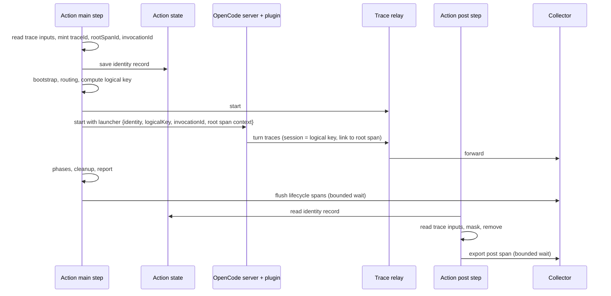

# feat: Trace the Action's own run lifecycle

## Overview

When tracing is on, the Action sends its own OTLP trace of each invocation to the operator's collector. The trace has one root span for the main step, a span per phase of the run, child spans for the slow work inside phases, and, if the hosted check in Unit 1 passes, a span for the post step. Lifecycle and turn traces share the conversation's logical key as their Langfuse session, and each turn trace links to the run's root span in Tempo.

The plugin's exporter and scrubber move into the shared runtime package so both sides use one implementation. The plugin gains three launcher fields and ships a new release. The Action pins that release in the same change that turns lifecycle tracing on.

## Problem Frame

Turn traces show what the model did. They show nothing of the Action around the model: bootstrap, installs, cache restore and save, isolation handoff, gates, delivery and cleanup. Those are where most CI questions start. Today the answers live only in one job's log and summary, which can't be compared across runs (see origin: `docs/brainstorms/2026-11-23-action-lifecycle-tracing-requirements.md`).

## Requirements Trace

All 26 origin requirements carry forward. R12 and R24 depend on Unit 1; if it fails, the post step isn't traced and the docs say so.

| Requirements                                | Units      |
| ------------------------------------------- | ---------- |
| R1 enablement                               | 4, 5       |
| R2, R3 failure handling and transport rules | 2, 4       |
| R4-R10 trace shape                          | 4, 5       |
| R11 early exits and cancellation            | 5, 6       |
| R12 post span                               | 7          |
| R13-R16 content and scrubbing               | 2, 4, 5, 7 |
| R17-R21 joining turns and runs              | 3, 5, 8    |
| R22 delivery                                | 4, 6       |
| R23 direct send                             | 4          |
| R24 post inputs                             | 5, 7       |
| R25, R26 backend fit                        | 10         |
| Success criteria                            | 9, 11      |

## Scope Boundaries

- Gateway tracing, the job-summary trace link and native OpenCode telemetry stay out, as the origin says.
- No change to how turn traces are shaped beyond the three launcher fields and the run link.
- A forced kill, including a job-level timeout, loses spans not yet sent.
- With tracing off, nothing about a run changes, including how a cancelled run stops, beyond the signal owner in Unit 6.

## Context & Research

### Relevant Code and Patterns

- `src/harness/run.ts` (`run`): phases called in order with `createLogger({phase})`; `metrics` is the model for a run-wide recorder created at the top; the `finally` holds cleanup, the outcome assessment and the final writes (dedup marker, terminal reaction, outputs, job summary), then `return exitCode`.
- `src/harness/config/inputs.ts` (`parseActionInputs`) and `src/harness/config/trace-inputs.ts`: trace inputs are read, masked with `core.setSecret` and removed from the environment inside bootstrap, before other inputs are validated. `inputs.ts` also masks and removes the GitHub token and `auth-json`, and masks the AWS keys.
- `src/harness/phases/bootstrap.ts` (`runBootstrap`): returns null on invalid inputs, sandbox preflight failure or credential check failure.
- `src/harness/phases/cache-restore.ts` (`runCacheRestore`): cache restore and the V2 server start are one function; `maskSecret` there and in `src/harness/phases/v2-server.ts` masks the server password and key-proxy values later in the run.
- `src/harness/phases/routing.ts` (`RoutingPhaseSkip`): drops the trigger context that `TriggerResultSkip` carries, so a skipped run can't compute its logical key today.
- `packages/runtime/src/session/logical-key.ts` (`buildLogicalKey`): pure; computed at `session-prep.ts` today, computable right after routing.
- `src/services/cache/restore.ts`: tries S3 V2, then S3 V1, then the Actions cache, returning on the first hit; tiers log hit or miss and return only the winner.
- `src/harness/phases/cleanup.ts` (`runCleanup`): returns no save outcome; the result is mapped only to state.
- `src/harness/phases/sandbox-lifecycle.ts` (`registerSignalStop`): the only SIGINT/SIGTERM handling, isolated runs only, 10 s budget, takes `holdSignalOwnership()` so the exec adapter's own handlers (`src/services/setup/adapters.ts`) don't kill children and re-raise; re-raises after teardown. Real-signal tests: `src/harness/phases/sandbox-signal.test.ts`, `src/harness/phases/sandbox-signal.fixture.ts`.
- `src/main.ts`: `process.exit` straight after `run()`.
- `src/harness/post.ts`: reads `core.getState`; already reads `INPUT_MATRIX-CONTEXT` through `packages/runtime/src/shared/invocation-identity.ts`, so the runner does inject `INPUT_*` into post.
- `packages/runtime/src/shared/invocation-identity.ts` (`getInvocationIdentity`): job plus matrix hash, so two steps in one job collide.
- `packages/runtime/src/agent/trace-relay-wire.ts` (`validateTraceRelayUrl`, `parseTraceRelayConfig`): reusable URL and credential-over-http rules.
- `packages/runtime/src/agent/trace-relay.ts`: transport rules to keep (`https.request`, `rejectUnauthorized`, no redirects, response body never read, 5 s connect, 8 s upstream).
- `packages/opencode-plugin/src/tracing/exporter.ts` (`createSpanExporter`): SDK serializer plus own HTTPS delegate, 4 MB batches, bounded close, exact counts.
- `packages/opencode-plugin/src/tracing/content.ts` (`createScrubber`, `scrubSpan`, `collectLiterals`): pure scrubber; literals are collected once at construction and capped at the longest 128; about 1,700 lines mixing scrubbing with content extraction.
- `packages/runtime/src/agent/tracing-launcher.ts`, `packages/opencode-plugin/src/tracing/settings.ts`, `packages/opencode-plugin/src/tracing/genai-attributes.ts` (`identityAttributes`): the launcher document, its strict parser, and where `langfuse.session.id` is set.
- Notices: `scripts/third-party-notices.ts` generates `dist/THIRD_PARTY_NOTICES.txt`; the plugin ships `packages/opencode-plugin/THIRD_PARTY_NOTICES.md`.
- Tests: `run()` is tested by mocking every phase (`src/harness/run-v2.test.ts`, `src/harness/run-tracing.test.ts`); the real-binary tracing test reuses the plugin's OTLP sinks (`src/harness/phases/tracing.integration.test.ts`); hosted rows live in `src/harness/phases/v2-server.sandbox.integration.test.ts` with `src/harness/phases/v2-server.sandbox.harness.ts`.

### Institutional Learnings

- `docs/solutions/workflow-issues/committed-dist-attribution-and-sbom-hygiene-2026-06-21.md`: bundled dependencies in `dist/` need their notices and a verified rebuild.
- `docs/solutions/integration-issues/signal-forwarding-shim-orphans-native-child-2026-10-12.md`: install listeners before spawning, test real signal delivery, a forced kill can't be flushed.
- `docs/solutions/workflow-issues/run-tracing-live-check-2026-11-23.md`: test the published install against the real collector, confirm in the backends, use a disposable write-only token.

### External References

- OTLP JSON encoding (hex IDs, decimal-string nanoseconds, numeric wire enums, partial success, retryable statuses): https://github.com/open-telemetry/opentelemetry-proto/blob/main/docs/specification.md
- GitHub cancellation (SIGINT, SIGTERM at 7.5 s, kill at 10 s): https://docs.github.com/en/actions/reference/workflows-and-actions/workflow-cancellation
- Post-step inputs are injected per stage by the runner: https://github.com/actions/runner/blob/main/src/Runner.Worker/Handlers/NodeScriptActionHandler.cs
- Langfuse session per conversation, links ignored: https://langfuse.com/docs/observability/best-practices, https://langfuse.com/faq/all/opentelemetry-logs-metrics-span-links

## Prior-Art Survey

```json
{
  "schema_version": 2,
  "verdict": "extend",
  "scope": "src/ and packages/ (runtime, opencode-plugin; gateway by search only)",
  "freshness": {
    "vcs_reference": "76ee420c9f440932e858fee11294671eca9d30c6"
  },
  "budget": {
    "max_search_passes": 3,
    "max_candidate_inspections": 12,
    "exhausted": false
  },
  "candidates": [
    {
      "path_or_symbol": "packages/opencode-plugin/src/tracing/exporter.ts:createSpanExporter",
      "description": "OTLP/HTTP JSON exporter built on the SDK serializer with its own HTTPS transport, batch cap, bounded close and exact counts",
      "disposition": "extend"
    },
    {
      "path_or_symbol": "packages/opencode-plugin/src/tracing/content.ts:createScrubber",
      "description": "Pure value scrubber over span names, attributes, status messages and event text",
      "disposition": "extend"
    },
    {
      "path_or_symbol": "packages/runtime/src/agent/trace-relay-wire.ts:validateTraceRelayUrl",
      "description": "Collector URL and credential-over-http rules used by trace input parsing",
      "disposition": "reuse"
    },
    {
      "path_or_symbol": "src/services/setup/tracing.ts:buildTracingRunIdentity",
      "description": "Run identity shared with the launcher document",
      "disposition": "extend"
    },
    {
      "path_or_symbol": "packages/runtime/src/agent/tracing-launcher.ts:buildTracingLauncherValue",
      "description": "Launcher document for the plugin with a strict key set",
      "disposition": "extend"
    },
    {
      "path_or_symbol": "packages/runtime/src/agent/trace-relay.ts:startTraceRelay",
      "description": "Loopback batch forwarder for plugin spans",
      "disposition": "insufficient",
      "insufficiency_reason": "stops before finalize and cleanup and does not exist in the post step"
    },
    {
      "path_or_symbol": "packages/opencode-plugin/src/tracing/pipeline.ts:createTracePipeline",
      "description": "Maps OpenCode turn events to spans",
      "disposition": "insufficient",
      "insufficiency_reason": "models OpenCode events inside the server, not Action phases"
    },
    {
      "path_or_symbol": "src/features/observability/metrics.ts:createMetricsCollector",
      "description": "Run metrics with one start and end time",
      "disposition": "insufficient",
      "insufficiency_reason": "no per-phase timing and no export"
    },
    {
      "path_or_symbol": "src/harness/phases/trace-relay-process.ts:startTraceRelayProcess",
      "description": "Relay child supervisor with a bounded settle",
      "disposition": "insufficient",
      "insufficiency_reason": "supervises a process; emits nothing about phases"
    },
    {
      "path_or_symbol": "src/features/observability/job-summary.ts:writeInvocationOutcomeSummary",
      "description": "Job summary rows and the duration and outcome outputs",
      "disposition": "insufficient",
      "insufficiency_reason": "human summary with one total duration, not exportable"
    }
  ]
}
```

## Key Technical Decisions

- **One shared exporter and scrubber in `packages/runtime`.** Both the plugin and the Action bundle them. The plugin can't import `@fro-bot/runtime` at runtime, so its built output must stay self-contained and its release import check green. Cost: about 280 KB added to the Action's `dist/` (ad-hoc measurement; Unit 2 re-measures).
- **The SDK serializer, not a hand-written encoder.** The plugin's serializer-plus-own-transport path is already proven against Langfuse and Tempo.
- **The Action-only lifecycle tracer lives in `src/`.** Only the shared exporter and scrubber go to the runtime package. The tracer is a run-wide recorder held like `metrics`; a no-op tracer is the default.
- **Trace inputs are read first.** One trace-input reader runs before bootstrap. It reads, masks, removes and validates the two inputs, and both the main and post steps use it. Bootstrap receives its result instead of re-reading the removed variables. A run whose trace inputs are missing or invalid is untraced from the start.
- **The redaction set grows during the run.** `core.setSecret` can't be read back, and the server password and key-proxy values appear after the start. Every mask site calls one recording mask function that both masks and adds to the tracer's set. The trace credential and its derived forms (the Bearer token, the Basic pair) are added. The shared scrubber accepts literals after creation.
- **Spans are buffered and exported once.** Normal completion and a signal share one idempotent flush, and `main.ts` waits for it before exiting.
- **IDs are minted at the start and saved as one state record.** The trace id, root span id and a random invocation id are saved before routing. Partial or invalid state in post means no telemetry. No credential or input ever goes into state.
- **Outcomes reuse the existing values, plus `cancelled`.** `cancelled` is a tracing-only outcome for a signalled run. The Action's outputs and job summary are unchanged.
- **The final writes get their own span.** The origin's R5 puts them under finalize, but they run after cleanup, so they become a `report` span after cleanup. The finalize phase span keeps its place before cleanup.
- **The logical key is computed right after routing.** `RoutingPhaseSkip` keeps the trigger context so skipped runs get a key too. Spans that ended before routing gain the session attribute at export. Run identity comes from the GitHub environment, so it exists from the first span.
- **One signal owner for every run.** It takes over the exec adapter's signal ownership from the sandbox handler. On a signal, the export starts at once beside teardown and must finish before SIGTERM at 7.5 s.
- **No launcher version negotiation.** The new plugin accepts the launcher document with or without the new fields. The Action sends them only in the change that pins the new plugin.
- **Turns link to the root span.** The plugin starts before the execution span exists, and the root span id is known from the start.
- **The post step rebuilds its own redaction set.** Its environment still holds the GitHub token, `auth-json` and the AWS keys, so it reads them into its set and exports scrubbed error text like main.
- **Lifecycle tracing doesn't depend on the turn-trace identity.** An incomplete run identity turns the relay off today; the lifecycle trace still sends whatever identity exists.

## Open Questions

### Resolved During Planning

- How the post step gets the trace: through the one identity record in Action state, with its own inputs read by the shared trace-input reader.
- How to tell two steps in one job apart: a random invocation id minted in the main step, because `GITHUB_ACTION` isn't guaranteed unique across matrices, composites and reruns.
- Where the failure matrix is tested: once, in Unit 4.

### Deferred to Implementation

- Exact attribute keys and event names. They are derived from the success-criteria queries and handed to infra in Unit 10.
- The final-wait bound on a normal exit (start near the relay's 6 s settle) and the export reserve on a signal. The SDK's retry timer can't be cancelled, so the deadline bounds the wait, not the retry.
- How the plugin bundles the shared code: a workspace subpath bundled inline, or a source copy generated at build. Decided at the start of Unit 2, because it decides whether the import check passes.
- Whether the cache tier hook is an injected tracer option or a returned list of attempts.
- Whether the post span is the root's child or its sibling in the same trace.

## High-Level Technical Design

> _This illustrates the intended approach and is directional guidance for review, not implementation specification. The implementing agent should treat it as context, not code to reproduce._



Early-exit span matrix (a trace never invents unreached phases):

| Exit | Spans | Exit code |
| --- | --- | --- |
| Trace inputs missing or invalid | none (untraced) | unchanged |
| Bootstrap returns null | bootstrap, cleanup, report | 1 |
| Routing skip | bootstrap, routing, cleanup, report | 0 |
| Dedup skip | through dedup, cleanup, report | 0 |
| Lock held / lock error | through lock, cleanup, report | 0 / 1 |
| Cache restore null | through cache restore, failed server start, cleanup, report | 1 |
| Execution timeout | through execution (outcome `failed`, reason timeout), later phases reached, cleanup, report | 1 |
| Sandbox not restored | through failed take-back, cleanup, report | 1 |
| Signal | reached spans; current phase and root `cancelled` | by signal |
| Uncaught throw | reached spans, exception on its span, cleanup and report if reached | 1 |

## Implementation Units

- [ ] **Unit 1: Hosted check of the post step's inputs and state**

**Goal:** Confirm on a hosted runner that the trace inputs reach the post process with the same values, and that state saved early in main is visible to post after main is cancelled.

**Requirements:** R12, R24.

**Dependencies:** None.

**Files:** None in this repo. A throwaway branch and workflow in `fro-bot/.github` with a dummy endpoint and header.

**Approach:**

- The post step already receives `INPUT_MATRIX-CONTEXT`, so input injection is expected. The probe checks the two trace inputs and early-saved state specifically.
- A minimal JavaScript action with `post:` prints only whether each value is set and a hash of it, on `ubuntu-24.04`, once normally and once cancelled mid-main. The branch is deleted after.

**Test expectation:** none -- a probe; its result decides whether Unit 7 ships.

**Verification:**

- A recorded yes or no for inputs and for state, on both paths.

- [ ] **Unit 2: Move the exporter and scrubber into the shared runtime**

**Goal:** One implementation of OTLP export and scrubbing that the plugin and the Action both bundle, with no change to plugin behaviour.

**Requirements:** R3, R14, R15.

**Dependencies:** None.

**Files:**

- Create: `packages/runtime/src/tracing/exporter.ts`, `packages/runtime/src/tracing/scrub.ts`, with tests moved from the plugin.
- Modify: `packages/opencode-plugin/src/tracing/exporter.ts`, `packages/opencode-plugin/src/tracing/content.ts`, `packages/opencode-plugin/tsdown.config.ts`, `packages/opencode-plugin/package.json`, `packages/runtime/package.json`, `packages/runtime/src/index.ts`.
- Modify: `packages/opencode-plugin/THIRD_PARTY_NOTICES.md` if the plugin's dependency set changes.
- Test: `packages/runtime/src/tracing/exporter.test.ts`, `packages/runtime/src/tracing/scrub.test.ts`; existing plugin suites stay green.

**Approach:**

- Move the scrubbing half of `content.ts`; content extraction stays in the plugin.
- Two plugin-neutral extensions: span links in the scrubbed span type and the exporter, and a scrubber that accepts literals added after creation.
- The transport keeps its rules: TLS verified, no redirects, credential only over TLS, failures reported by category.

**Execution note:** Characterization first: the plugin's existing exporter and scrubber suites are the contract and must pass unchanged against the moved code.

**Patterns to follow:** The plugin's existing exporter and scrubber.

**Test scenarios:**

- Happy path: every existing plugin exporter, scrubber and real-binary test passes against the moved code.
- Happy path: a span with a link serializes the link's ids as hex in OTLP JSON.
- Happy path: a literal added after creation is redacted from a later span.
- Integration: the packed plugin installs with production dependencies only, and its bundle imports only `effect`, `@opencode/plugin` and `node:` modules.

**Verification:**

- Plugin tests, the release import check and a packed install pass. The Action's `dist/` size delta is measured and recorded.

- [ ] **Unit 3: Plugin launcher fields and the run link**

**Goal:** Turn traces use the logical key as their Langfuse session, carry the invocation id, and link to the run's root span. Plugin-only, released on its own.

**Requirements:** R17, R18, R20, R21.

**Dependencies:** Unit 2.

**Files:**

- Modify: `packages/runtime/src/agent/tracing-launcher.ts` (the document type and parser contract), `packages/opencode-plugin/src/tracing/settings.ts`, `packages/opencode-plugin/src/tracing/genai-attributes.ts`, `packages/opencode-plugin/src/tracing/content.ts` (`actionIdentityAttributes`), the plugin's turn-root span builder, `packages/opencode-plugin/README.md`, `packages/opencode-plugin/package.json` (minor version).
- Test: `packages/opencode-plugin/src/tracing/settings.test.ts`, `packages/opencode-plugin/src/tracing/genai-attributes.test.ts`, `packages/runtime/src/agent/tracing-launcher.test.ts`, the plugin's real-binary suite.

**Approach:**

- The launcher document gains optional fields: the root span context, the logical key and the invocation id. The parser accepts the document with or without them and still rejects any other key.
- With a logical key, `langfuse.session.id` is the logical key. Without one, including local sessions, it stays the OpenCode root session.
- Each turn's root span gets a link to the run's root span.
- Publish the plugin release after merge. The Action doesn't send the new fields until Unit 8.

**Test scenarios:**

- Happy path: a document with all three fields gives turn spans the logical key as session, the invocation id, and a link to the given root span.
- Edge case: a document without the new fields behaves as today.
- Edge case: a local session keeps the OpenCode root session.
- Error path: an unknown key or a malformed root span context turns tracing off, as an invalid document does today.
- Integration: on the real binary, two turns in one run both link to the same root span id.

**Verification:**

- Plugin and runtime tests and the release dry run pass, then the release publishes.

- [ ] **Unit 4: The lifecycle tracer**

**Goal:** A run-wide recorder that keeps spans, events and outcomes, scrubs at serialization with a set that grows during the run, and sends directly with a bounded wait.

**Requirements:** R1-R3, R7, R9, R13-R16, R22, R23.

**Dependencies:** Unit 2.

**Files:**

- Create: `src/shared/lifecycle-tracer.ts` (the interface, the no-op tracer and the recording tracer), `src/shared/secret-registry.ts` (the recording mask function).
- Test: `src/shared/lifecycle-tracer.test.ts`, `src/shared/secret-registry.test.ts`.

**Approach:**

- Mints the trace id, root span id and invocation id at creation. The resource has a fixed `service.name` for the Action, distinct from the plugin's.
- Spans carry outcome and reason attributes using the existing values plus `cancelled`. Status marks errors only. Exception events carry the type and a message that is scrubbed first, then capped, with no cause chain or stack. Free text from outside, such as ref names, is scrubbed then capped too.
- The recording mask function calls `core.setSecret` and adds the value to the registry. The registry also takes every leaf of `auth-json` and `opencode-config` raw and escaped, secret-named environment values, and the trace credential with its derived forms. Token patterns come from the shared scrubber. A value that can't be scrubbed is omitted and marked.
- The tracer sends through the shared exporter to the validated endpoint, never through the relay. The flush is idempotent and bounded; spans not delivered are counted in one log line.
- With no usable trace inputs, the tracer is the no-op and creates no exporter.

**Execution note:** Implement test-first.

**Patterns to follow:** `src/features/observability/metrics.ts` for a run-wide recorder.

**Test scenarios:**

- Happy path: three nested spans with events export as one OTLP request with correct parenting, hex ids and decimal nanosecond times.
- Happy path: an error span has error status and an exception event; a skipped span has outcome skipped and no error status; a cancelled span has outcome `cancelled`.
- Edge case: tracing off produces no request and creates no exporter.
- Edge case: a long exception message or ref name is scrubbed before it is cut, so a cut can't leave part of a secret.
- Edge case: more than 128 literals are all redacted, not only the longest.
- Error path: a canary secret placed in a span name, an attribute value, an event attribute, a status message and an exception message is absent from every position of the request body, raw and JSON-escaped.
- Error path: a literal registered after spans were recorded is redacted at flush.
- Error path: the trace credential and its Bearer and Basic forms never appear in a request body or a log line.
- Error path: a value the scrubber can't process is omitted with a marker.
- Error path: 401, 413, a stalled connection and a partial success each leave the run's result unchanged, end within the bound, and give the right undelivered count.
- Error path: a 503 with `Retry-After` inside the bound is retried and delivered.
- Error path: a 3xx with a `Location` to a second listener sends nothing to the second listener.
- Error path: a collector response body containing a canary never reaches a log line.
- Edge case: a flush called twice sends once.
- Edge case: the request body contains no prompt, model output or tool content keys.

**Verification:**

- Unit tests pass. Unit 9 confirms the output against a real receiver.

- [ ] **Unit 5: Read trace inputs first and instrument the run**

**Goal:** The tracer exists before bootstrap, every mask site records into it, every phase and the listed inner work opens and closes spans, and early exits match the matrix.

**Requirements:** R1, R4-R11, R13, R17-R19, R24.

**Dependencies:** Unit 4.

**Files:**

- Modify: `src/harness/config/inputs.ts` and `src/harness/config/trace-inputs.ts` (the shared trace-input reader; mask sites use the recording mask function), `src/harness/run.ts`, `src/harness/phases/bootstrap.ts`, `src/harness/phases/routing.ts`, `src/harness/phases/cache-restore.ts`, `src/harness/phases/v2-server.ts`, `src/harness/phases/execute.ts`, `src/harness/phases/finalize.ts`, `src/harness/phases/cleanup.ts`, `src/services/cache/restore.ts`, `src/services/cache/save.ts`, `src/harness/config/state-keys.ts`.
- Test: `src/harness/run-lifecycle-tracing.test.ts`; updates to `src/harness/config/inputs.test.ts`, `src/harness/phases/routing.test.ts`, `src/harness/phases/cleanup.test.ts`, `src/services/cache/restore-save-flow.test.ts`.

**Approach:**

- `run()` calls the trace-input reader first, creates the tracer, saves the identity record to state, then passes the parsed trace inputs into bootstrap.
- `RoutingPhaseSkip` carries the trigger context; the logical key is computed right after routing.
- Child spans: the OpenCode and tool installs and the plugin install in bootstrap; each cache tier tried in restore; server start and the isolation handoff in cache restore; response posting in execute and finalize; the cache save in cleanup.
- Events: the dedup result, gate decisions and dropped PATH entries, on their phase spans.
- `runCleanup` returns the save outcome so the root can carry it. The final writes after cleanup are a `report` span.
- The flush runs in an outer `finally` after the report span, so it also covers throws from cleanup and the final writes, without changing the error or the exit code.

**Execution note:** Start with a failing test that pins the early-exit matrix, using the real input parser, not a mocked bootstrap.

**Patterns to follow:** How `metrics` is threaded through `run.ts`; the phase mocks in `run-tracing.test.ts`.

**Test scenarios:**

- Happy path: a full run produces the phase spans in order under one root, with the invocation outcome, save result and exit code on the root.
- Edge case: each row of the early-exit matrix produces exactly the listed spans and exit code.
- Edge case: valid trace inputs with a missing required input give a traced bootstrap failure.
- Edge case: a routing skip's spans carry the logical key; a bootstrap failure's spans carry run identity but no key.
- Edge case: S3 V2 and V1 miss and the Actions cache hits: three tier spans with miss, miss, hit. Also an S3 hit (one tier span), S3 disabled (no S3 spans) and a corrupted entry.
- Edge case: dedup, gate and dropped-PATH decisions appear as events on their phases.
- Error path: a throw from cleanup still flushes the reached spans and keeps the original error and exit code.
- Integration: the server password and key-proxy placeholder minted mid-run are redacted from a later exception message.
- Integration: Action state holds one identity record and nothing from any input.

**Verification:**

- Focused tests pass, and the whole `run()` suite is unchanged with tracing off.

- [ ] **Unit 6: One signal owner for every run**

**Goal:** A cancelled run flushes what it reached, isolated or not, without delaying the sandbox teardown.

**Requirements:** R11, R22.

**Dependencies:** Units 4, 5.

**Files:**

- Create: `src/harness/signal-owner.ts`.
- Modify: `src/harness/run.ts`, `src/main.ts`, `src/harness/phases/sandbox-lifecycle.ts` (register with the owner instead of installing handlers), `src/services/setup/adapters.ts` (signal ownership moves to the owner).
- Test: `src/harness/signal-owner.test.ts`; updates to `src/harness/phases/sandbox-signal.test.ts` and `src/harness/phases/sandbox-signal.fixture.ts`.

**Approach:**

- One SIGINT/SIGTERM handler is installed at the start of `run()` and holds the exec adapter's signal ownership until the final flush. Sandbox teardown and the flush register with it.
- On a signal, the current phase span and the root end as `cancelled`, the flush starts at once beside teardown, and the owner re-raises when both settle or the deadline passes. The deadline falls before SIGTERM at 7.5 s.
- Normal completion and a signal share the tracer's one flush. `main.ts` waits for it before `process.exit`.
- The isolated teardown's 10 s budget and ordering are unchanged.

**Execution note:** Test real signal delivery with the existing sandbox signal fixture.

**Test scenarios:**

- Happy path: SIGINT during a long-running child command on a non-isolated run reaps the child, flushes once with the running phase `cancelled`, and exits by the signal.
- Happy path: the same on an isolated run also completes the sandbox teardown, with unchanged timing.
- Edge case: a second signal during the flush doesn't start a second flush.
- Edge case: normal completion racing a signal flushes exactly once and the process doesn't exit before the flush settles or its deadline.
- Error path: a collector that never answers doesn't push the exit past the deadline.

**Verification:**

- Signal tests pass locally. Unit 9 confirms it on hosted runners.

- [ ] **Unit 7: The post step's span**

**Goal:** The post step adds its span to the run's trace.

**Requirements:** R12, R24.

**Dependencies:** Unit 1 must pass; Units 4, 5.

**Files:**

- Modify: `src/harness/post.ts`.
- Test: `src/harness/post.test.ts`.

**Approach:**

- Post reads the identity record from state and the trace inputs through the shared reader. It records one span carrying its outcome (retried save, skip or safety skip) and the retried save's result.
- Its redaction set comes from its own environment: the GitHub token, `auth-json` leaves, the AWS keys, the trace credential and secret-named environment values. The main step's server password and key-proxy values don't exist here.
- With missing or partial state, or unusable trace inputs, post sends nothing. An invalid trace input gets the same fixed-text, no-value warning as main.

**Test scenarios:**

- Happy path: post after a main step that didn't save retries the save and exports a post span in the run's trace with the save result.
- Edge case: no state, partial state or malformed ids send nothing.
- Edge case: state but no trace inputs sends nothing.
- Error path: a retried S3 save whose error carries an AWS key exports the message with the key redacted.

**Verification:**

- Post tests pass. If Unit 1 fails, this unit is dropped and Unit 10 documents that the post step isn't traced.

- [ ] **Unit 8: Action launcher wiring and the plugin pin**

**Goal:** The Action sends the three new launcher fields and pins the plugin release that reads them.

**Requirements:** R17, R18, R20.

**Dependencies:** Unit 3 published; Units 4, 5.

**Files:**

- Modify: `src/services/setup/tracing.ts`, `src/harness/run.ts` (pass the logical key, invocation id and root span context into the launcher), `packages/runtime/src/shared/constants.ts` (`FRO_BOT_PLUGIN_VERSION`), `deploy/workspace.Dockerfile` (the plugin `ARG`), committed `dist/`, `dist/THIRD_PARTY_NOTICES.txt`.
- Test: `src/services/setup/tracing.test.ts`, `src/harness/run-tracing.test.ts`.

**Approach:**

- Units 4-8 land in one Action change, so the Action never sends the new fields to an old plugin.
- Rebuild `dist/`, regenerate the notices, and check that a second build changes nothing.

**Test scenarios:**

- Happy path: the launcher document carries the logical key, invocation id and root span context of the run.
- Edge case: a run that fails before routing sends no logical key.
- Integration: the launcher document and Action state contain none of the trace input values.

**Verification:**

- Tests pass, the build is stable, and the pins match the published release.

- [ ] **Unit 9: Real-receiver and hosted-runner tests**

**Goal:** Prove the wire format, links, shared session, cancellation and credential isolation against real components.

**Requirements:** R11, R20, R22, R23; success criteria.

**Dependencies:** Units 4-8.

**Files:**

- Create: `src/harness/lifecycle-tracing.integration.test.ts`.
- Modify: `src/harness/phases/v2-server.sandbox.integration.test.ts`, `src/harness/phases/v2-server.sandbox.harness.ts`, and `.github/workflows/ci.yaml` only if a new test needs a step.

**Approach:**

- A real OTLP receiver (the plugin's sink helpers) checks ids, parenting, nanosecond times, the shared session attribute, and links from turn roots to the run root.
- Hosted rows: a cancelled isolated run and a cancelled non-isolated run both flush their reached spans, and a canary trace credential can't be found by the agent user when isolated.

**Test scenarios:**

- Integration: a full run against the real receiver yields one lifecycle trace and turn traces that link to its root span, all with the same session.
- Integration: on both hosted images, both cancelled rows deliver reached spans before SIGTERM.
- Integration: the isolated agent user can't read the canary credential from the environment, files, the launcher document or state.

**Verification:**

- The suites pass on both hosted images.

- [ ] **Unit 10: Docs and the infra handoff**

**Goal:** Operators know what the lifecycle trace holds, and infra's keep-list and privacy page are updated before the release that sends lifecycle spans.

**Requirements:** R25, R26.

**Dependencies:** Units 4, 5, 8 (keys settled); Unit 7's outcome.

**Files:**

- Modify: `docs/wiki/Setup and Configuration.md` ("Tracing a run"), `ARCHITECTURE.md` cross-cutting tracing section within its size budget, `packages/opencode-plugin/README.md`.

**Approach:**

- The wiki describes the lifecycle trace and what it carries, including error text, the logical-key session, the run link, and the limit that a secret the Action never sees is caught only by its shape. It adds that the plugin's reported span count excludes the last batch.
- A short field list (attribute keys, event names, `service.name`, the `cancelled` value) goes to the collector operator. The release that turns tracing on waits until infra confirms the keep-list and the privacy page.

**Test expectation:** none -- documentation.

**Verification:**

- Docs guards pass, and infra's confirmation is recorded before the release merges.

- [ ] **Unit 11: Published-install live check**

**Goal:** Confirm the released Action and plugin produce the expected traces in Langfuse and Tempo.

**Requirements:** Success criteria.

**Dependencies:** Units 1-10 released.

**Files:** None in this repo. A throwaway dispatch workflow in `fro-bot/.github`.

**Approach:**

- With a fresh write-only token: one normal isolated run, one cancelled run and one two-step job.
- In Langfuse, the session shows lifecycle and turn traces in order. In Tempo, phase spans, outcomes and the turn-to-run link are queryable.

**Test expectation:** none -- a live check.

**Verification:**

- The operator confirms both backends. The token is revoked afterwards.

## System-Wide Impact

- **Interaction graph:** `run()` and every phase gain tracer calls; input parsing and the mask sites change; `services/cache` gains a tier hook; the sandbox lifecycle and exec adapter hand signal ownership to the new owner; `main.ts` waits for the flush; the plugin's launcher parser gains fields.
- **Error propagation:** tracing never throws into the run; every export failure ends in one log line and the undelivered count.
- **State lifecycle risks:** only the identity record enters Action state; credentials and inputs never do.
- **API surface parity:** no new inputs; the launcher document gains optional fields; the plugin's session attribute changes for Action runs only.
- **Integration coverage:** wire format, links and cancellation need the real receiver and hosted runners.
- **Unchanged invariants:** with tracing off, runs behave as today apart from the signal owner; the relay, its rules and the turn trace shape are unchanged apart from the three fields and the link; the isolated teardown's budget and order are unchanged; the Action's outputs and summary keep their values.

## Risks & Dependencies

| Risk | Mitigation |
| --- | --- |
| Moving the scrubber breaks the plugin's self-contained bundle or changes its behaviour | Characterization suites first; the packed-install and import checks gate Unit 2 |
| The signal owner changes how non-isolated runs stop on cancel | Real-signal tests in Unit 6 and hosted rows in Unit 9; the re-raise keeps the exit status |
| The post step can't read its inputs or early state | Unit 1 decides first; Unit 7 drops out cleanly |
| A secret appears late and isn't registered | Every mask site goes through the recording mask function; Unit 5 tests a mid-run secret |
| Infra's keep-list lags | Unit 10 gates the release on infra's confirmation |
| `dist/` grows by about 280 KB | Measured in Unit 2; notices regenerated in Unit 8 |

## Documentation / Operational Notes

- Release order: Unit 2 ships as a plugin-neutral change. Unit 3 publishes the plugin. Units 4-8 and 10 land as one Action change once infra confirms. Unit 1 runs any time before Unit 7.
- Ships before tracing rolls out to the operator's callers.

## Sources & References

- **Origin document:** [docs/brainstorms/2026-11-23-action-lifecycle-tracing-requirements.md](../brainstorms/2026-11-23-action-lifecycle-tracing-requirements.md)
- Related past work: `docs/plans/2026-11-19-001-feat-opencode-run-tracing-plan.md`, recorded active. It built turn tracing and excluded Action phases; this plan adds them.
- Related code: `src/harness/run.ts`, `src/harness/config/inputs.ts`, `src/harness/phases/sandbox-lifecycle.ts`, `packages/opencode-plugin/src/tracing/`, `packages/runtime/src/agent/tracing-launcher.ts`
- External docs: listed under External References.
